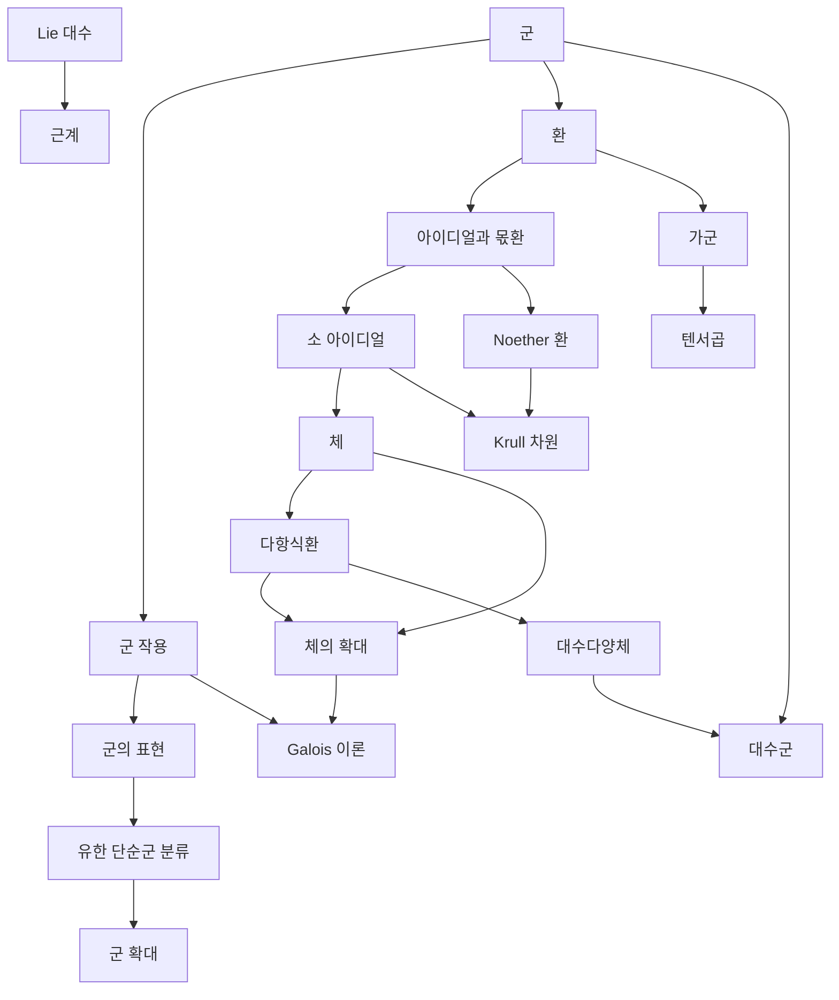

# 추상대수 개관

# 개요

추상대수(abstract algebra)는 연산의 규칙만 남기고 대상을 잊는다. 군은 대칭을, 환은 덧셈과 곱셈을, 체는 나눗셈까지를 공리화한다. 물음은 "이 공리만으로 무엇이 따라오는가" 와 "구체적 대상이 어느 공리계의 예인가" 다.

갈래는 군론, 환과 아이디얼, 가군과 호몰로지 대수, 가환환론, 체와 Galois 이론이다. 여기에 두 갈래를 잇는 코호몰로지와 K 이론, 다항식의 해집합을 다루는 대수다양체와 그 모듈라이, 연속적인 대칭을 다루는 Lie 이론과 표현론, 그리고 정점작용소대수가 더해진다. 정수론으로 넘어가는 대수, 곧 유체론과 Iwasawa 이론은 [정수론 개관](number-theory-overview.md)에 있다.

시작은 [군](groups.md)이다. [군 작용](group-actions.md)에서 [Sylow 정리](sylow-theorems.md)와 [Galois 이론](galois-theory.md)이 갈라지고, [환](rings.md)에서 [아이디얼](ideals-quotient-rings.md)을 거쳐 [체](fields.md)와 [가군](modules.md)이 나온다. 연속적인 대칭은 [Lie 대수](lie-algebras.md)에서 시작한다.

# 지도

# 갈래

처음 읽는 사람은 군론, 환과 아이디얼, 가군과 호몰로지 대수의 순서로 읽는다. 가환환론은 가군을 읽은 뒤에 온다. 체와 Galois 이론은 환과 아이디얼까지만 읽으면 들어갈 수 있다. 코호몰로지와 K 이론은 가군과 체를 둘 다 읽은 뒤다. 대수다양체는 환과 아이디얼 뒤에 오고, Lie 이론과 표현론은 그 대수군을 쓴다. 모듈라이와 불변량, 정점작용소대수는 마지막 둘이다.

## 군론

먼저 읽을 것: [함수](functions.md)(기초), [벡터 공간](vector-spaces.md), [선형 사상](linear-maps.md)(선형대수 개관). 시작 문서: [군](groups.md).

- [군](groups.md): 결합법칙, 항등원, 역원 세 공리와 부분군, 준동형, 몫군
- [가해군](solvable-groups.md): 가환인 몫을 쌓아 얻는 군, 유도열과 Feit–Thompson 판정
- [군 작용](group-actions.md): 군이 집합에 작용하는 방식과 궤도–안정자 정리
  - [켤레류](conjugacy-classes.md): 켤레 관계의 동치류와 류 방정식
  - [정규화군](normalizer.md): 부분집합을 켤레로 보존하는 부분군과 N/C 정리
  - [순종군](amenable-groups.md): 불변 평균을 갖는 군, Følner 조건과 역설적 분해의 부재
- [Sylow 정리](sylow-theorems.md): 소수 거듭제곱 차수 부분군의 존재와 개수
- [군의 표현](group-representations.md): 군을 가역행렬의 군으로 보내는 준동형과 기약분해
- [지표표](character-table.md): 기약지표를 켤레류별로 적은 정사각 배열과 두 직교관계
  - [Burnside 의 pᵃqᵇ 정리](burnside-pq-theorem.md): 지표값의 대수적 정수성과 열 직교관계로 위수 pᵃqᵇ 인 군이 가해군임을 증명
- [유한 단순군 분류](finite-simple-groups.md): 유한 단순군이 네 계열과 산재군 26 개로 다한다는 정리
- [군 확대](group-extensions.md): 주어진 몫과 핵으로 군을 복원하는 문제와 분해 조건
  - [Schur 곱셈자](schur-multipliers.md): 중심 확대를 분류하는 둘째 호몰로지군
- [군의 표시](group-presentations.md): 생성원과 관계자로 군을 적는 방법과 낱말 문제
  - [쌍곡군](hyperbolic-groups.md): Cayley 그래프의 측지삼각형이 일정한 폭 안에서 얇은 군
  - [Garside 정규형](garside-normal-form.md): 땋임군의 원소를 기본 땋임의 거듭제곱과 단순 땋임의 곱으로 유일하게 적는 표준형, 낱말 문제와 켤레 문제의 알고리즘

## 환과 아이디얼

먼저 읽을 갈래: 군론. 먼저 읽을 것: [합동 산술](modular-arithmetic.md)(정수론 개관). 시작 문서: [환](rings.md).

- [환](rings.md): 덧셈과 곱셈 두 연산을 함께 규정하는 공리계와 정역, 단원, 준동형
- [아이디얼과 몫환](ideals-quotient-rings.md): 곱셈으로 닫힌 부분군과 그것으로 나눈 환
- [소 아이디얼](prime-ideals.md): 몫이 정역인 아이디얼과 극대 아이디얼의 관계
- [환의 국소화](localization-rings.md): 곱셈 집합의 원소를 가역으로 만드는 분수환
- [체](fields.md): 0 이 아닌 원소가 모두 가역인 가환환과 표수
- [다항식환](polynomial-rings.md): 환 위의 다항식이 이루는 환과 나눗셈 정리
- [유일분해정역](unique-factorization-domains.md): 기약원 분해가 순서를 빼고 하나인 정역과 Gauss 보조정리
  - [유클리드 정역](euclidean-domains.md): 나머지가 줄어드는 나눗셈이 되는 정역과 Bézout 항등식
- [Noether 환](noetherian-rings.md): 아이디얼의 오름사슬 조건과 Hilbert 기저정리
- [Krull 차원](krull-dimension.md): 소 아이디얼 사슬의 길이로 잰 차원과 높이 정리

## 가군과 호몰로지 대수

먼저 읽을 갈래: 환과 아이디얼. 시작 문서: [가군](modules.md).

- [가군](modules.md): 환이 작용하는 아벨군과 자유가군, 생성계
  - [PID 위의 유한생성 가군](finitely-generated-modules.md): 순환가군의 직합 분해와 Smith 표준형
- [완전열](exact-sequences.md): 상과 핵이 맞물린 사슬, 짧은 완전열과 뱀 보조정리
- [사슬 복합체](chain-complexes.md): 합성이 0 인 가군의 열과 호몰로지
- [텐서곱](tensor-products.md): 쌍선형 사상을 선형 사상으로 바꾸는 보편성질
- [Nakayama 보조정리](nakayama-lemma.md): 국소환 위의 유한생성 가군을 잉여체로 내려 읽는 보조정리
- [사영가군](projective-modules.md): 들어 올리기 성질과 국소적 자유성, Quillen–Suslin 정리
- [단사가군](injective-modules.md): 부분가군에서의 확장 성질, Baer 판정과 단사 포락
- [유도 함자](derived-functors.md): 완전성의 실패를 재는 Tor 와 Ext 의 구성

## 가환환론

먼저 읽을 갈래: 가군과 호몰로지 대수. 시작 문서: [정칙 국소환](regular-local-rings.md).

- [정칙 국소환](regular-local-rings.md): 차원과 접공간 차원이 같은 국소환과 Serre 의 호몰로지 판정
- [이산부값환](discrete-valuation-rings.md): 차원 1 의 정칙 국소환과 원소의 표준형
- [Dedekind 정역](dedekind-domains.md): 아이디얼이 소 아이디얼의 곱으로 유일하게 분해되는 정역
  - [Iwasawa 대수](iwasawa-algebra.md): p 진 정수 계수 멱급수환과 유한생성 가군의 구조 정리
- [Cohen–Macaulay 환](cohen-macaulay-rings.md): 깊이와 차원이 같은 국소환과 박힌 성분의 부재
- [Gorenstein 환](gorenstein-rings.md): 유형이 1 인 환과 표준 가군의 자유성
- [완전교차환](complete-intersection-rings.md): 정칙 국소환을 정칙열로 나눈 몫과 Betti 수의 증가
- [Koszul 복합체](koszul-complex.md): 원소열로 만든 사슬 복합체와 정칙열 판정
- [국소 코호몰로지](local-cohomology.md): 아이디얼로 소멸되는 부분의 유도 함자와 소멸 차수
- [Hartshorne–Lichtenbaum 소멸 정리](hartshorne-lichtenbaum.md): 최고차 국소 코호몰로지의 소멸 판정과 산술 랭크의 하한
- [집합론적 완전교차](set-theoretic-complete-intersection.md): 여차원과 같은 개수의 방정식으로 잘리는 대수집합

## 체와 Galois 이론

먼저 읽을 갈래: 환과 아이디얼. 시작 문서: [체의 확대](field-extensions.md).

- [체의 확대](field-extensions.md): 확대를 벡터 공간으로 보는 차수와 대수적 원소의 최소다항식
  - [나눗셈 대수](division-algebras.md): 체의 비가환 일반화와 실수 위의 분류
  - [Witt 환](witt-ring.md): 이차형식을 쌍곡형식을 법으로 모은 환과 기본 아이디얼의 여과
  - [초월차수](transcendence-degree.md): 대수적으로 독립인 원소의 최대 개수, 교환 정리와 대수적으로 닫힌 체의 분류, 다양체의 차원
  - [Noether 정규화](noether-normalization.md): 유한생성 대수를 다항식환 위의 유한 확대로 만드는 정리, 약한 영점 정리
- [유한체](finite-fields.md): 원소 개수가 소수 거듭제곱인 체의 존재와 유일성, 곱셈군의 순환성
- [오류정정부호](error-correcting-codes.md): 유한체 위의 선형 부호와 최소 거리
  - [Mathieu 군](mathieu-groups.md): 길이 24 의 이진 부호가 갖는 자기동형군, 다중추이 산재 단순군 다섯
- [Galois 이론](galois-theory.md): 중간체와 Galois 군의 부분군이 짝지어지는 대응
  - [미분 Galois 이론](differential-galois-theory.md): 선형 미분방정식의 가해성을 선형 대수군으로 판정
  - [에탈 기본군](etale-fundamental-group.md): 유한 에탈 덮개를 분류하는 유한위상군
  - [실폐체](real-closed-fields.md): 양수가 제곱이고 홀수 차수 다항식이 근을 갖는 순서체, 대수학의 기본정리의 대수적 증명과 Tarski–Seidenberg 양화사 소거
- [Artin–Schreier 이론](artin-schreier-theory.md): 표수 p 에서 차수 p 순환확대의 생성원과 분류
- [Witt 벡터](witt-vectors.md): 고스트 성분과 덧셈 다항식, 표수 p 완전환의 표수 0 올림

## 코호몰로지와 K 이론

먼저 읽을 갈래: 가군과 호몰로지 대수, 체와 Galois 이론. 먼저 읽을 것: [코호몰로지](cohomology.md)(위상 개관). 시작 문서: [군 코호몰로지](group-cohomology.md).

- [군 코호몰로지](group-cohomology.md): 자명한 가군에서 유도한 함자와 저차 항이 분류하는 확대
  - [Tate 코호몰로지](tate-cohomology.md): 노름 사상으로 음의 차수까지 이은 코호몰로지와 Herbrand 몫
- [Hilbert 정리 90](hilbert-theorem-90.md): 순환 확대에서 노름이 1 인 원소가 켤레의 비로 쓰인다는 정리
- [Kummer 이론](kummer-theory.md): 1 의 거듭제곱근을 가진 체에서 지수가 같은 아벨 확대의 분류
- [Galois 코호몰로지](galois-cohomology.md): 절대 Galois 군의 연속 코사슬로 정의한 코호몰로지, Kummer 열과 형식의 분류, 국소 쌍대성
- [Milnor K 이론](milnor-k-theory.md): 곱셈군의 텐서곱을 a⊗(1−a) 로 나눈 군과 Galois 코호몰로지로 가는 노름 잉여 동형
- [대수적 K 이론](algebraic-k-theory.md): 사영가군의 동형류에서 나오는 고차 불변량
  - [Bloch 군](bloch-group.md): 다섯 항 관계로 나눈 군과 Borel 조절자

## 대수다양체

먼저 읽을 갈래: 환과 아이디얼. 시작 문서: [대수다양체](algebraic-varieties.md).

- [대수다양체](algebraic-varieties.md): 다항식의 해집합과 영점정리가 잇는 근기 아이디얼과의 대응
- [사영다양체](projective-varieties.md): 동차좌표로 넓힌 공간 위의 대수적 집합과 완비성
  - [아벨 다양체](abelian-varieties.md): 군 구조를 갖춘 완비 다양체와 강체성에서 따라 나오는 교환성
  - [교차 이론](intersection-theory.md): 부분다양체의 교차를 중복도로 세는 Chow 환, Bézout 정리와 코호몰로지의 컵곱
  - [토릭 다양체](toric-varieties.md): 격자의 뿔과 부채로 정해지는 다양체, 궤도와 뿔의 대응, 다면체의 격자점과 단면의 차원
- [대수군](algebraic-groups.md): 다항식 사상으로 곱이 주어진 다양체와 반단순군의 분류

## Lie 이론과 표현론

먼저 읽을 갈래: 군론, 대수다양체. 시작 문서: [Lie 대수](lie-algebras.md).

- [Lie 대수](lie-algebras.md): 교대 쌍선형 괄호와 Jacobi 항등식, 가해·반단순의 구분
  - [양자군](quantum-groups.md): 보편포락대수를 한 변수로 변형한 Hopf 대수와 Yang–Baxter 방정식
  - [Clifford 대수](clifford-algebras.md): 벡터의 제곱을 이차형식으로 놓은 결합대수와 직교군의 이중덮개
  - [Solovay–Kitaev 정리](solovay-kitaev.md): 조밀한 부분군의 생성원으로 유니터리 군의 원소를 다항 길이로 근사하는 절차
- [근계](root-systems.md): 반단순 Lie 대수의 가중치가 이루는 유한 벡터계와 Dynkin 도형의 분류
  - [아핀 Lie 대수](affine-lie-algebras.md): 일반화 Cartan 행렬의 아핀형에 대응하는 무한차원 Lie 대수
- [Coxeter 군](coxeter-groups.md): 반사로 생성된 군의 표시와 길이 함수, Bruhat 순서
- [Weyl 지표 공식](weyl-character-formula.md): 최고 가중치 표현의 지표를 교대합의 비로 적는 공식
  - [구면조화함수](spherical-harmonics.md): 구면 위 Laplace 작용소의 고유함수와 회전군의 기약분해
- [깃발다양체](flag-varieties.md): 부분공간 사슬의 공간 G/B, Schubert 세포 분해와 유한체 위의 점 개수, Borel 표시
- [Borel–Weil–Bott 정리](borel-weil-bott.md): 깃다양체 위 직선다발의 층 코호몰로지가 주는 기약표현
  - [Schubert 계산](schubert-calculus.md): 깃다양체의 Schubert 류가 이루는 교차 이론과 곱 규칙
- [Kazhdan–Lusztig 다항식](kazhdan-lusztig.md): Hecke 대수의 두 기저를 잇는 다항식과 중복도 공식
- [범주 O](category-o.md): 최고 가중치 가군이 이루는 범주와 블록 분해
- [Beilinson–Bernstein 국소화](beilinson-bernstein.md): 가군의 범주와 깃다양체 위 D 가군의 범주의 동치
- [Schur–Weyl 쌍대성](schur-weyl-duality.md): 텐서거듭제곱 위의 일반선형군 작용과 대칭군 작용이 서로의 중심화
- [세포대수](cellular-algebras.md): 세포 기저와 쌍선형형식으로 기약 가군을 분류하는 틀
- [Brauer 대수](brauer-algebras.md): 직교군과 심플렉틱군의 쌍대성을 담는 도형 대수
- [Temperley–Lieb 대수](temperley-lieb-algebras.md): 교차 없는 도형이 기저인 대수와 고리 제거 매개변수
  - [Jones–Wenzl 멱등원](jones-wenzl-idempotents.md): 생성원을 모두 소멸시키는 멱등원과 색칠된 매듭 불변량
  - [분할 대수](partition-algebras.md): 집합의 분할이 기저인 대수와 대칭군의 쌍대성

## 모듈라이와 불변량

먼저 읽을 갈래: 대수다양체, Lie 이론과 표현론. 시작 문서: [모듈라이 공간](moduli-space.md).

- [모듈라이 공간](moduli-space.md): 동형류를 점으로 갖는 공간과 섬세·조대의 구별
  - [Hilbert 스킴](hilbert-scheme.md): Hilbert 다항식이 정해진 닫힌 부분스킴의 모듈라이
  - [대수적 스택](algebraic-stacks.md): 대상과 동형사상을 함께 남긴 군준 범주, 몫 스택과 Deligne–Mumford 스택, Keel–Mori 조대 모듈라이 공간
- [기하 불변량 이론](geometric-invariant-theory.md): 환원적 군의 작용에 따른 몫과 Hilbert–Mumford 판정
  - [벡터다발의 모듈라이 공간](moduli-of-vector-bundles.md): 곡선 위의 안정 벡터다발의 모듈라이와 기울기 조건
- [Gromov–Witten 불변량](gromov-witten-invariants.md): 안정 사상의 모듈라이 위의 교차수와 가상 기본류
- [양자 코호몰로지](quantum-cohomology.md): 세 점 불변량으로 변형한 컵곱과 결합성이 주는 Witten–Dijkgraaf–Verlinde–Verlinde 방정식

## 정점작용소대수

먼저 읽을 갈래: Lie 이론과 표현론. 시작 문서: [Virasoro 대수](virasoro-algebra.md).

- [Virasoro 대수](virasoro-algebra.md): Witt 대수의 중심 확대와 중심 전하
- [정점작용소대수](vertex-operator-algebras.md): 상태에 장을 대응시키는 공리계와 등급 구조
- [Zhu 대수](zhu-algebra.md): 기약 가군을 유한차원 결합대수의 가군으로 옮기는 몫
- [Schellekens 목록](schellekens-list.md): 중심 전하 24 의 홀로모픽 정점작용소대수 71 개의 분류

# 연관 문서

## 선수지식

- [집합](sets.md)

## 더 알아보기

- [군](groups.md)
- [Lie 대수](lie-algebras.md)

#algebra #group_theory #ring_theory #field_theory #overview
