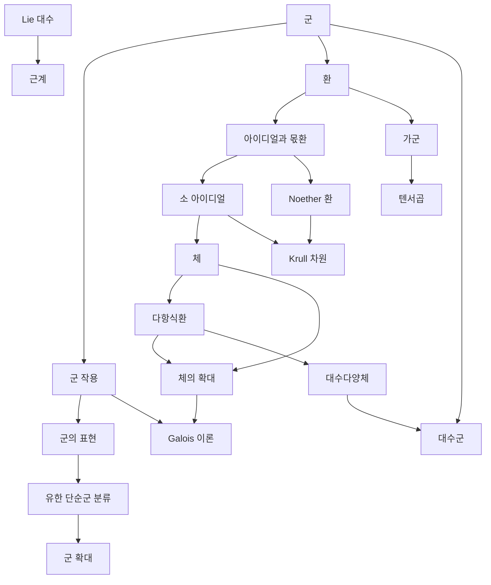

# 추상대수 개관

# 개요

추상대수(abstract algebra)는 대상이 무엇인지 잊고 연산이 따르는 규칙만으로 결과를 끌어내는 분야다. 정사각형을 돌리고 뒤집는 여덟 가지 움직임을 이어 하는 것과, $12$ 시간 시계에서 시각을 더하는 것은 대상은 다르지만 결합법칙, 항등원, 역원이라는 같은 규칙을 따른다. 규칙만으로 증명한 사실은 그 규칙을 따르는 모든 대상에 한 번에 성립하므로, 규칙의 목록을 정하고 그 목록에서 따라오는 것을 증명한다.

처음 읽는 사람은 [군](groups.md)에서 시작한다.

# 지도

# 갈래

처음 읽는 사람은 군론, 환과 아이디얼, 가군과 호몰로지 대수의 순서로 읽는다. 가환환론은 가군을 읽은 뒤에 온다.

체와 Galois 이론은 환과 아이디얼까지만 읽으면 들어갈 수 있다. 코호몰로지와 K 이론은 가군과 체를 둘 다 읽은 뒤다.

대수다양체는 환과 아이디얼 뒤에 오고, Lie 이론과 표현론은 그 대수군을 쓴다. 모듈라이와 불변량, 정점작용소대수는 마지막 둘이다. 정수론으로 넘어가는 대수, 곧 유체론과 Iwasawa 이론은 [정수론 개관](number-theory-overview.md)에 있다.

## 군론

먼저 읽을 것: [함수](functions.md)(기초), [벡터 공간](vector-spaces.md), [선형 사상](linear-maps.md)(선형대수 개관). 시작 문서: [군](groups.md).

- [군](groups.md): 결합법칙, 항등원, 역원 세 공리와 부분군, 준동형, 몫군
- [대칭군](symmetric-groups.md): 순열의 군, 서로소 순환 분해, 호환에 의한 생성과 부호, Cayley 정리
- [가해군](solvable-groups.md): 가환인 몫을 쌓아 얻는 군, 유도열과 Feit–Thompson 판정
- [군 작용](group-actions.md): 군이 집합에 작용하는 방식과 궤도–안정자 정리
  - [켤레류](conjugacy-classes.md): 켤레 관계의 동치류와 류 방정식
  - [정규화군](normalizer.md): 부분집합을 켤레로 보존하는 부분군과 N/C 정리
  - [군의 Cauchy 정리](cauchy-theorem-groups.md): 위수를 나누는 소수 p 마다 위수 p 인 원소가 있다는 정리, 곱이 항등원인 줄을 돌리는 McKay 의 증명
  - [순종군](amenable-groups.md): 불변 평균을 갖는 군, Følner 조건과 역설적 분해의 부재
  - [Haagerup 성질](haagerup-property.md): 무한원에서 0 으로 가는 양의 정부호 함수로 1 을 근사하는 군, 고유 아핀 등거리 작용과 성질 (T) 와의 배타
- [Sylow 정리](sylow-theorems.md): 소수 거듭제곱 차수 부분군의 존재와 개수
- [군의 표현](group-representations.md): 군을 가역행렬의 군으로 보내는 준동형과 기약분해
  - [Jordan 의 유한 선형군 정리](jordan-finite-linear-groups.md): GLₙ(C) 의 유한 부분군이 n 으로만 정해지는 지수 안에 교환 정규 부분군을 갖는다는 정리, 지수 2 인 이면체군과 지수 60 인 이진 정이십면체군, 유니타리 군의 교환자 증명, J(3) = 360 과 n ≥ 71 의 (n+1)!, 양의 표수의 실패와 Larsen–Pink 정리, Cremona 군의 Jordan 성질
- [지표표](character-table.md): 기약지표를 켤레류별로 적은 정사각 배열과 두 직교관계
  - [Burnside 의 pᵃqᵇ 정리](burnside-pq-theorem.md): 지표값의 대수적 정수성과 열 직교관계로 위수 pᵃqᵇ 인 군이 가해군임을 증명
- [유한 단순군 분류](finite-simple-groups.md): 유한 단순군이 네 계열과 산재군 26 개로 다한다는 정리
- [준무작위 군](quasirandom-groups.md): 자명하지 않은 기약 표현의 차원이 모두 D 이상인 유한군, 곱이 없는 집합이 n/D^(1/3) 보다 작다는 Gowers 정리, PSL₂(Fₚ) 와 Babai–Sós 물음, 곱 집합 ABC=G. 먼저 준무작위 그래프를 읽는다
- [군 확대](group-extensions.md): 주어진 몫과 핵으로 군을 복원하는 문제와 분해 조건
  - [Schur 곱셈자](schur-multipliers.md): 중심 확대를 분류하는 둘째 호몰로지군
- [군의 표시](group-presentations.md): 생성원과 관계자로 군을 적는 방법과 낱말 문제
  - [쌍곡군](hyperbolic-groups.md): Cayley 그래프의 측지삼각형이 일정한 폭 안에서 얇은 군
  - [Garside 정규형](garside-normal-form.md): 땋임군의 원소를 기본 땋임의 거듭제곱과 단순 땋임의 곱으로 유일하게 적는 표준형, 낱말 문제와 켤레 문제의 알고리즘

## 환과 아이디얼

먼저 읽을 갈래: 군론. 먼저 읽을 것: [합동 산술](modular-arithmetic.md)(정수론 개관). 시작 문서: [환](rings.md).

- [환](rings.md): 덧셈과 곱셈 두 연산을 함께 규정하는 공리계와 정역, 단원, 준동형
- [아이디얼과 몫환](ideals-quotient-rings.md): 곱셈으로 닫힌 부분군과 그것으로 나눈 환
- [소 아이디얼](prime-ideals.md): 몫이 정역인 아이디얼과 극대 아이디얼의 관계
- [환의 국소화](localization-rings.md): 곱셈 집합의 원소를 가역으로 만드는 분수환
- [체](fields.md): 0 이 아닌 원소가 모두 가역인 가환환과 표수
- [다항식환](polynomial-rings.md): 환 위의 다항식이 이루는 환과 나눗셈 정리
  - [판별식](discriminant.md): 근의 차의 제곱의 곱을 계수로 적은 값, 중근과 실근 개수의 판정, Galois 군이 교대군에 드는 조건
  - [종결식](resultant.md): Sylvester 행렬의 행렬식으로 두 다항식의 공통근을 판정하는 값, 근의 곱 공식과 변수 소거
  - [부분분수 분해](partial-fraction-decomposition.md): 분모의 기약인수 거듭제곱마다 분수 하나로 나누는 분해의 존재와 유일성, 단순근 계수 p(c)/q′(c), 유리함수의 적분
- [유일분해정역](unique-factorization-domains.md): 기약원 분해가 순서를 빼고 하나인 정역과 Gauss 보조정리
  - [유클리드 정역](euclidean-domains.md): 나머지가 줄어드는 나눗셈이 되는 정역과 Bézout 항등식
  - [유리근 정리](rational-root-theorem.md): 정수 계수 다항식의 유리수 근을 계수의 약수로 줄이는 정리, 삼차 이하 기약성과 정수적으로 닫힌 정역
- [원시다항식의 Gauss 보조정리](gauss-lemma-polynomials.md): 원시다항식의 곱이 원시라는 정리, 유리수 계수 인수분해를 정수 계수로 옮기기와 R[x] 의 유일분해
- [Eisenstein 판정법](eisenstein-criterion.md): 계수를 소수 하나로 나누어 정수 계수 다항식이 유리수 위에서 기약임을 보이는 조건과 원분다항식의 기약성
- [Noether 환](noetherian-rings.md): 아이디얼의 오름사슬 조건과 Hilbert 기저정리
  - [Gröbner 기저](groebner-bases.md): 나눗셈의 나머지가 하나로 정해지는 아이디얼의 생성원, S 다항식과 Buchberger 알고리즘, 사전식 순서의 소거 정리
    - [Gröbner 부채](groebner-fans.md): 가중치 공간을 축소 Gröbner 기저마다 뿔로 나눈 부채, 초기형식과 Gröbner 뿔, 축소 기저의 유한성, 주 아이디얼의 Newton 다면체 법선 부채, 벽을 지나며 기저를 바꾸는 Gröbner 걷기. 먼저 볼록 다면체를 읽는다
- [Krull 차원](krull-dimension.md): 소 아이디얼 사슬의 길이로 잰 차원과 높이 정리
  - [Hilbert 함수](hilbert-functions.md): 차수마다 남는 동차 다항식의 수, 유리 Hilbert 급수와 큰 차수의 Hilbert 다항식, 극의 차수로 읽는 차원과 분자의 값으로 읽는 차수

## 가군과 호몰로지 대수

먼저 읽을 갈래: 환과 아이디얼. 시작 문서: [가군](modules.md).

- [가군](modules.md): 환이 작용하는 아벨군과 자유가군, 생성계
  - [PID 위의 유한생성 가군](finitely-generated-modules.md): 순환가군의 직합 분해와 Smith 표준형
- [완전열](exact-sequences.md): 상과 핵이 맞물린 사슬, 짧은 완전열과 뱀 보조정리
- [사슬 복합체](chain-complexes.md): 합성이 0 인 가군의 열과 호몰로지
- [텐서곱](tensor-products.md): 쌍선형 사상을 선형 사상으로 바꾸는 보편성질
  - [평탄 가군](flat-modules.md): 텐서곱이 단사를 보존하는 가군, Tor 판정과 주 아이디얼 정역 위의 비틀림 없음, 유한표시이면 사영, Lazard 정리
- [Nakayama 보조정리](nakayama-lemma.md): 국소환 위의 유한생성 가군을 잉여체로 내려 읽는 보조정리
- [사영가군](projective-modules.md): 들어 올리기 성질과 국소적 자유성, Quillen–Suslin 정리
- [단사가군](injective-modules.md): 부분가군에서의 확장 성질, Baer 판정과 단사 포락
- [유도 함자](derived-functors.md): 완전성의 실패를 재는 Tor 와 Ext 의 구성

## 가환환론

먼저 읽을 갈래: 가군과 호몰로지 대수. 시작 문서: [정칙 국소환](regular-local-rings.md).

- [정칙 국소환](regular-local-rings.md): 차원과 접공간 차원이 같은 국소환과 Serre 의 호몰로지 판정
  - [Hilbert–Samuel 중복도](hilbert-samuel-multiplicity.md): 국소환을 극대 아이디얼의 거듭제곱으로 나눈 몫의 길이가 차원만큼의 차수로 느는 다항식의 최고차 계수, 초곡면에서 가장 낮은 항의 차수, Nagata 의 정칙성 판정과 Cohen–Macaulay 판정
- [이산부값환](discrete-valuation-rings.md): 차원 1 의 정칙 국소환과 원소의 표준형
- [Dedekind 정역](dedekind-domains.md): 아이디얼이 소 아이디얼의 곱으로 유일하게 분해되는 정역
  - [Iwasawa 대수](iwasawa-algebra.md): p 진 정수 계수 멱급수환과 유한생성 가군의 구조 정리
- [Cohen–Macaulay 환](cohen-macaulay-rings.md): 깊이와 차원이 같은 국소환과 박힌 성분의 부재
- [Gorenstein 환](gorenstein-rings.md): 유형이 1 인 환과 표준 가군의 자유성
- [완전교차환](complete-intersection-rings.md): 정칙 국소환을 정칙열로 나눈 몫과 Betti 수의 증가
- [Koszul 복합체](koszul-complex.md): 원소열로 만든 사슬 복합체와 정칙열 판정
- [Hilbert syzygy 정리](hilbert-syzygy-theorem.md): 다항식환 위 차수 붙은 가군의 길이 n 이하 자유 분해, 차수 붙은 Betti 수와 Hilbert 급수의 분자, Auslander–Buchsbaum 공식
  - [Castelnuovo–Mumford 정칙성](castelnuovo-mumford-regularity.md): Betti 수의 차수에서 단계를 뺀 값의 최댓값, Hilbert 함수가 다항식이 되는 차수, 점 집합의 상한과 국소 코호몰로지에 의한 기술
- [국소 코호몰로지](local-cohomology.md): 아이디얼로 소멸되는 부분의 유도 함자와 소멸 차수
- [Hartshorne–Lichtenbaum 소멸 정리](hartshorne-lichtenbaum.md): 최고차 국소 코호몰로지의 소멸 판정과 산술 랭크의 하한
- [Artin–Rees 보조정리](artin-rees-lemma.md): 부분가군 위에서 아이디얼 진 거름 둘이 몇 단계 차이로 같다는 보조정리, Rees 대수를 쓴 증명, Krull 교차정리와 매끄러운 함수 싹의 반례
- [집합론적 완전교차](set-theoretic-complete-intersection.md): 여차원과 같은 개수의 방정식으로 잘리는 대수집합

## 체와 Galois 이론

먼저 읽을 갈래: 환과 아이디얼. 시작 문서: [체의 확대](field-extensions.md).

- [체의 확대](field-extensions.md): 확대를 벡터 공간으로 보는 차수와 대수적 원소의 최소다항식
  - [나눗셈 대수](division-algebras.md): 체의 비가환 일반화와 실수 위의 분류
  - [Witt 환](witt-ring.md): 이차형식을 쌍곡형식을 법으로 모은 환과 기본 아이디얼의 여과
  - [초월차수](transcendence-degree.md): 대수적으로 독립인 원소의 최대 개수, 교환 정리와 대수적으로 닫힌 체의 분류, 다양체의 차원
  - [Noether 정규화](noether-normalization.md): 유한생성 대수를 다항식환 위의 유한 확대로 만드는 정리, 약한 영점 정리
- [분리 확대](separable-extensions.md): 최소다항식의 근이 겹치지 않는 확대, 도함수 판정과 완전체, 분리 차수와 순비분리 확대
- [정규 확대](normal-extensions.md): 기약다항식의 근을 모두 포함하는 확대, 분해체 판정과 정규 폐포, 정규성이 탑에서 전이되지 않는 예
- [원시원소 정리](primitive-element-theorem.md): 유한 분리 확대가 원소 하나로 생성된다는 정리, 중간체가 유한개라는 판정과 비분리 확대의 반례
- [유한체](finite-fields.md): 원소 개수가 소수 거듭제곱인 체의 존재와 유일성, 곱셈군의 순환성
  - [대수적 폐포](algebraic-closure.md): 모든 다항식의 근을 담는 가장 작은 대수적 확대, Zorn 보조정리에 의한 존재와 동형을 빼고의 유일성
- [오류정정부호](error-correcting-codes.md): 유한체 위의 선형 부호와 최소 거리
  - [Mathieu 군](mathieu-groups.md): 길이 24 의 이진 부호가 갖는 자기동형군, 다중추이 산재 단순군 다섯
- [Galois 이론](galois-theory.md): 중간체와 Galois 군의 부분군이 짝지어지는 대응
  - [미분 Galois 이론](differential-galois-theory.md): 선형 미분방정식의 가해성을 선형 대수군으로 판정
  - [에탈 기본군](etale-fundamental-group.md): 유한 에탈 덮개를 분류하는 유한위상군
  - [삼차방정식](cubic-equation.md): 이차항을 지우는 치환과 근을 두 수의 합으로 두는 치환으로 얻는 Cardano 공식, 세 근과 판별식, 실근이 셋일 때 복소수를 거쳐야 하는 기약 경우, 삼배각 공식 풀이
  - [사차방정식](quartic-equation.md): 양변을 완전제곱으로 만드는 Ferrari 의 방법, 분해 삼차방정식, 근을 두 쌍으로 나누는 세 방법과 S₄/V₄
  - [Abel–Ruffini 정리](abel-ruffini-theorem.md): 근호 확대와 Galois 군의 가해성의 동치, 5차 이상 일반 다항식에 근의 공식이 없다는 정리와 x⁵−6x+3
  - [실폐체](real-closed-fields.md): 양수가 제곱이고 홀수 차수 다항식이 근을 갖는 순서체, 대수학의 기본정리의 대수적 증명과 Tarski–Seidenberg 양화사 소거
- [Hilbert 기약성 정리](hilbert-irreducibility-theorem.md): 매개변수 다항식에 유리수를 대입해도 기약성과 Galois 군이 남는 값이 얇은 집합 밖에 있다는 정리
  - [Noether 문제](noether-problem.md): 변수를 맞바꾸는 군의 고정체가 순수 초월 확대인지, 긍정이면 유리수체 위에서 실현된다는 것과 위수 47 의 반례
- [작도 가능한 수](constructible-numbers.md): 자와 컴퍼스로 그리는 길이가 제곱근 탑의 수라는 판정, 세 고전 문제와 Gauss–Wantzel 정리
  - [종이접기 작도](origami-constructions.md): 접기 한 번으로 삼차방정식을 푸는 작도, 차수 2 와 3 의 확대 탑이라는 판정, 각의 삼등분과 Pierpont 소수의 정다각형
- [Artin 의 고정체 정리](artin-fixed-field-theorem.md): 자기동형의 유한군이 고정하는 체 위의 차수가 군의 위수라는 정리, Dedekind 의 지표 독립과 대칭 유리함수
  - [역 Galois 문제](inverse-galois-problem.md): 유한군을 유리수체 위의 Galois 군으로 실현하는 문제, 아벨군과 대칭군의 실현, Noether 문제와 가해군
- [Artin–Schreier 이론](artin-schreier-theory.md): 표수 p 에서 차수 p 순환확대의 생성원과 분류
- [Witt 벡터](witt-vectors.md): 고스트 성분과 덧셈 다항식, 표수 p 완전환의 표수 0 올림

## 코호몰로지와 K 이론

먼저 읽을 갈래: 가군과 호몰로지 대수, 체와 Galois 이론. 먼저 읽을 것: [코호몰로지](cohomology.md)(위상 개관). 시작 문서: [군 코호몰로지](group-cohomology.md).

- [군 코호몰로지](group-cohomology.md): 자명한 가군에서 유도한 함자와 저차 항이 분류하는 확대
  - [Tate 코호몰로지](tate-cohomology.md): 노름 사상으로 음의 차수까지 이은 코호몰로지와 Herbrand 몫
- [Hilbert 정리 90](hilbert-theorem-90.md): 순환 확대에서 노름이 1 인 원소가 켤레의 비로 쓰인다는 정리
- [Kummer 이론](kummer-theory.md): 1 의 거듭제곱근을 가진 체에서 지수가 같은 아벨 확대의 분류
- [Galois 코호몰로지](galois-cohomology.md): 절대 Galois 군의 연속 코사슬로 정의한 코호몰로지, Kummer 열과 형식의 분류, 국소 쌍대성
- [Milnor K 이론](milnor-k-theory.md): 곱셈군의 텐서곱을 a⊗(1−a) 로 나눈 군과 Galois 코호몰로지로 가는 노름 잉여 동형
- [Grothendieck 군](grothendieck-group.md): 가환 모노이드에 형식적인 차를 붙인 아벨군, 보편성질과 안정 동치
- [대수적 K 이론](algebraic-k-theory.md): 사영가군의 동형류에서 나오는 고차 불변량
  - [Bloch 군](bloch-group.md): 다섯 항 관계로 나눈 군과 Borel 조절자

## 대수다양체

먼저 읽을 갈래: 환과 아이디얼. 시작 문서: [대수다양체](algebraic-varieties.md).

- [대수다양체](algebraic-varieties.md): 다항식의 해집합과 영점정리가 잇는 근기 아이디얼과의 대응
- [Hilbert 영점 정리](hilbert-nullstellensatz.md): 해가 없는 방정식계가 1 을 만든다는 정리, 약한 꼴과 Rabinowitsch 기법으로 얻는 강한 꼴, 차수의 상한
  - [0 차원 아이디얼](zero-dimensional-ideals.md): 해가 유한 개인 방정식계의 아이디얼, 몫의 차원으로 세는 해의 개수, 곱셈 행렬의 고윳값으로 해를 읽는 Stickelberger 정리와 모양 보조정리
    - [FGLM 알고리즘](fglm-algorithm.md): 한 순서의 Gröbner 기저로 계산한 나머지들의 일차 관계를 작은 단항식부터 찾아 다른 순서의 기저를 만드는 변환, 해의 개수 D 에 대한 O(nD³) 비용
    - [Bernstein–Kushnirenko 정리](bernstein-kushnirenko.md): 0 이 아닌 좌표의 해의 개수를 Newton 다면체의 혼합부피로 세는 정리, Bézout 수와의 차이, 초기형식으로 쓴 등호 조건, 혼합 세분과 다면체 호모토피
      - [호모토피 연속법](homotopy-continuation.md): 근을 아는 쉬운 계에서 출발해 경로를 따라 모든 근을 구하는 수치 방법, 예측-교정법, 감마 기법, 다면체 호모토피의 경로 수
      - [희소 종결식](sparse-resultant.md): 지지집합이 정해진 n+1 개 다항식의 공통근 조건을 적은 다항식, 계수에 대한 차수가 혼합부피인 것, A-종결식과 Newton 다면체
  - [Positivstellensatz](positivstellensatz.md): 실수 부등식계에 해가 없는 것과 제곱합으로 −1 을 만드는 항등식의 동치, 실영점 정리, Motzkin 다항식, 콤팩트 집합 위의 Schmüdgen 과 Putinar 표현, 반정부호 계획법으로 찾는 제곱합. 먼저 실폐체를 읽는다
- [사영다양체](projective-varieties.md): 동차좌표로 넓힌 공간 위의 대수적 집합과 완비성
  - [Chow 정리](chow-theorem.md): 사영공간의 해석적 부분집합이 동차다항식의 영점이라는 정리, y = eˣ 가 대수곡선이 아닌 이유, 원뿔로 하는 증명, 정칙사상의 대수성, GAGA. 복소해석 개관의 정칙함수를 먼저 읽는다
  - [아벨 다양체](abelian-varieties.md): 군 구조를 갖춘 완비 다양체와 강체성에서 따라 나오는 교환성
    - [Kummer 곡면](kummer-surfaces.md): 아벨 곡면을 x 와 −x 로 묶은 몫, 2 등분점 16 개가 주는 보통 이중점, 종수 2 Jacobi 다양체의 2Θ 사상으로 얻는 사차곡면과 16₆ 배치, 부풀림이 주는 Euler 표수 24 의 K3 곡면과 Nikulin 정리. 복소해석 개관의 Jacobi 다양체를 먼저 읽는다
  - [토릭 다양체](toric-varieties.md): 격자의 뿔과 부채로 정해지는 다양체, 궤도와 뿔의 대응, 다면체의 격자점과 단면의 차원
    - [토릭 아이디얼](toric-ideals.md): 변수에 단항식을 대입하는 사상의 핵, 정수 영공간 벡터의 이항식 생성, 격자 기저 아이디얼의 포화, 이항식 Gröbner 기저와 Graver 기저, Markov 기저와 Conti–Traverso 정수 계획법. 먼저 Gröbner 기저를 읽는다
- [교차 이론](intersection-theory.md): 부분다양체의 교차를 중복도로 세는 Chow 환, Bézout 정리와 코호몰로지의 컵곱
- [Cayley–Bacharach 정리](cayley-bacharach-theorem.md): 두 삼차곡선의 아홉 교점 가운데 여덟을 지나는 삼차곡선이 아홉째도 지난다는 정리, 독립 조건과 Bézout 정리, Pascal 정리와 타원곡선의 결합법칙
- [부풀림](blow-ups.md): 곡면의 한 점을 방향들의 사영직선으로 바꾸는 구성, 고유 변환과 중복도, E² = −1 과 표준류 K + E, 곡선 특이점 풀기, Castelnuovo 수축 정리와 쌍유리 사상의 분해
- [딸림 공식](adjunction-formula.md): 곡면 위 곡선의 표준류를 곡면의 표준류와 곡선 자신으로 적는 식, 평면곡선의 종수 (d − 1)(d − 2)/2 와 잔류로 얻는 1 형식, 산술 종수, 초곡면의 표준다발, 유리곡선의 자기교차수. 복소해석 개관의 Riemann–Roch 정리를 먼저 읽는다
  - [Cremona 군](cremona-group.md): 사영평면의 쌍유리 자기사상이 이루는 군, 표준 이차 변환 (yz : xz : xy) 를 세 점의 부풀림과 세 직선의 수축으로 적는 법, Noether 방정식, Noether–Castelnuovo 정리, de Jonquières 변환
  - [Hodge 지표 정리](hodge-index-theorem.md): 사영곡면의 교차형식이 풍부한 류 하나만 양의 방향으로 갖는다는 정리, 부호수 (1, ρ − 1), 부등식 (D·H)² ≥ D²H², Castelnuovo–Severi 부등식과 유한체 위 곡선의 점 개수, 수축되는 곡선의 음정부호성
  - [Serre 쌍대성](serre-duality.md): 높은 차수 코호몰로지를 표준다발과의 짝의 낮은 차수 코호몰로지의 쌍대로 바꾸는 정리, Riemann 구에서 유수로 하는 짝, 곡선과 곡면의 h¹, Hodge 수의 대칭, 쌍대 층. 위상 개관의 층 코호몰로지를 먼저 읽는다
  - [풍부한 선다발의 수치 판정법](ampleness-criteria.md): 선다발이 매장을 주는지를 교차수로 가르는 정리들, 한 점에서 부풀린 사영평면의 aH − bE 와 원뿔곡선이 주는 삼차 곡면, nef 원뿔과 풍부 원뿔, Nakai–Moishezon, Kleiman, Seshadri 판정법과 Mumford 의 예, Serre 소멸. 복소해석 개관의 Kodaira 매장 정리를 먼저 읽는다
    - [Zariski 분해](zariski-decomposition.md): 곡면의 유효 인자를 nef 인 양의 부분과 교차행렬이 음정부호인 음의 부분으로 나누는 분해, H + 2E 의 단면이 모두 2mE 를 고정 성분으로 갖는 계산, 존재와 유일성, 단면의 동형, 부피 P², 단면환의 유한 생성
    - [Seshadri 상수](seshadri-constants.md): 점을 지나는 곡선과의 교차수를 중복도로 나눈 값의 하한, 부풀림의 nef 경계, 상한과 Ein–Lazarsfeld 정리, 일반적인 r 점의 Nagata 추측과 제곱수 경우, Hilbert 제14문제의 반례
- [삼차곡면](cubic-surfaces.md): 사영공간의 삼차 동차식이 정하는 곡면, 매끄러우면 직선이 27 개라는 Cayley–Salmon 정리, 여섯 점을 부풀린 사영평면 모형, Picard 격자와 E₆ 근계, 삼중접평면 45 개, Hasse 원리의 실패
  - [del Pezzo 곡면](del-pezzo-surfaces.md): 반표준다발이 풍부한 곡면, 일반 위치의 r 점을 부풀린 사영평면과 차수 9 − r, 차수별 모형, (−1) 곡선 27, 56, 240 과 근계 E₆, E₇, E₈, 차수 2 의 이중 덮개와 사차곡선의 이중접선 28 개
    - [Fano 다양체](fano-varieties.md): 반표준다발이 풍부한 매끄러운 사영 다양체, 차수 d 초곡면의 Fano 조건과 지수, 구조층 코호몰로지의 소멸과 단일 연결성, Mori 의 유리곡선과 유리 연결성, Kobayashi–Ochiai 정리, 차원 1, 2, 3 의 1, 10, 105 족과 유계성, Kähler–Einstein 계량의 존재. 복소해석 개관의 Kodaira 매장 정리를 먼저 읽는다
      - [삼차원 Fano 다양체](fano-threefolds.md): Picard 수 1 인 17 족의 Iskovskikh 분류와 지수·차수·종수, Mukai 의 등질공간 단면, Picard 수 2 이상 88 족의 Mori–Mukai 분류, 삼차와 사차 초곡면의 비유리성과 Lüroth 문제
- [선직곡면](ruled-surfaces.md): 곡선 위의 사영직선 다발, 계수 2 벡터다발의 사영화, 가장 음인 단면의 자기교차수 −e, 표준류와 K² = 8(1 − g), q = g 와 Kodaira 차원 −∞, Nagata 정리, 기본 변환. 미분기하 개관의 벡터다발을 먼저 읽는다
- [Hirzebruch 곡면](hirzebruch-surfaces.md): 사영직선 위의 사영직선 다발 Fₙ, 네 반직선의 부채, 자기교차수 −n 의 단면과 동형류의 구별, Picard 군과 K² = 8, 기본 변환, 극소 유리곡면, 짝홀에 따른 미분동형 유형
- [Noether–Lefschetz 정리](noether-lefschetz-theorem.md): P³ 의 차수 4 이상 매우 일반적인 곡면의 Picard 군이 평면 단면으로 생성된다는 정리, 직선을 갖는 곡면의 여차원 d − 3, Hodge 이론적 증명, Green–Voisin 의 여차원 하한, 차수 3 이하의 실패. 위상 개관의 Lefschetz 초평면 정리와 복소해석 개관의 Lefschetz (1,1) 정리를 먼저 읽는다
- [극소 모형 프로그램](minimal-model-program.md): 표준다발과 음으로 만나는 곡선을 수축해 극소 모형이나 Mori 올뭉치에 이르는 절차, 두 점을 부풀린 사영평면의 두 끝 모형, Kodaira 차원 0 이상에서의 유일성, Mori 원뿔 정리와 극선, 인자·올뭉치·작은 수축과 꽃잎 변환, Birkar–Cascini–Hacon–McKernan 정리. 복소해석 개관의 Kodaira 차원을 먼저 읽는다
  - [Flop](flops.md): 표준인자와 교차수가 0 인 곡선을 떼어 내고 다른 곡선으로 바꿔 끼우는 쌍유리 변환, 원뿔 xy = zw 의 두 작은 분해와 Atiyah flop, 법다발 O(−1)⊕O(−1), 인자와의 교차수 −1 과 1, 정사각형 뿔의 두 쪼개기, 극소 모형을 잇는 Kawamata 정리, Betti 수와 유도 범주의 보존
- [Desargues 정리](desargues-theorem.md): 한 점에서 원근인 두 삼각형의 대응하는 변의 교점이 한 직선 위에 있다는 정리, 공간 안의 평면과 나눗셈환 좌표화의 동치, Moulton 평면
- [Pascal 정리](pascal-theorem.md): 원뿔곡선에 내접한 육각형의 마주 보는 변의 교점이 한 직선 위에 있다는 정리, Braikenridge–Maclaurin 역과 Brianchon 쌍대
  - [Pappus 정리](pappus-theorem.md): 두 직선 위의 점 여섯 개로 만든 세 교점이 한 직선 위에 있다는 정리, 나눗셈환의 곱셈 교환법칙과의 동치, Desargues 정리를 함의하는 Hessenberg 정리
- [대수군](algebraic-groups.md): 다항식 사상으로 곱이 주어진 다양체와 반단순군의 분류

## Lie 이론과 표현론

먼저 읽을 갈래: 군론, 대수다양체. 시작 문서: [Lie 대수](lie-algebras.md).

- [Lie 대수](lie-algebras.md): 교대 쌍선형 괄호와 Jacobi 항등식, 가해·반단순의 구분
  - [Baker–Campbell–Hausdorff 공식](baker-campbell-hausdorff.md): 두 행렬 지수의 곱을 지수 하나로 쓸 때의 지수를 교환자의 급수로 적는 공식, 교환자가 중심에 있는 경우와 Heisenberg 군, 수렴 반지름, 분할 근사의 오차
    - [Zassenhaus 공식](zassenhaus-formula.md): 합의 지수를 두 지수와 거듭된 교환자의 지수의 곱으로 쪼개는 전개, C₂ 와 C₃, Heisenberg 대수에서 끝나는 곱, Lie–Trotter 곱 공식의 1/m 오차
  - [Clifford 대수](clifford-algebras.md): 벡터의 제곱을 이차형식으로 놓은 결합대수와 직교군의 이중덮개
  - [Solovay–Kitaev 정리](solovay-kitaev.md): 조밀한 부분군의 생성원으로 유니터리 군의 원소를 다항 길이로 근사하는 절차
- [보편포락대수](universal-enveloping-algebra.md): Lie 괄호를 교환자로 갖는 결합대수, Poincaré–Birkhoff–Witt 기저와 Casimir 원소
  - [양자군](quantum-groups.md): 보편포락대수를 한 변수로 변형한 Hopf 대수와 Yang–Baxter 방정식
- [근계](root-systems.md): 반단순 Lie 대수의 가중치가 이루는 유한 벡터계와 Dynkin 도형의 분류
  - [아핀 Lie 대수](affine-lie-algebras.md): 일반화 Cartan 행렬의 아핀형에 대응하는 무한차원 Lie 대수
- [최고무게 가군](highest-weight-modules.md): 최고무게 벡터 하나로 생성되는 가군, Verma 가군과 그 단순 몫, 유한차원이 되는 무게의 판정
- [Harish-Chandra 동형](harish-chandra-isomorphism.md): 보편포락대수의 중심과 Weyl 군 불변 다항식환의 동형, 중심 지표가 같을 조건
- [Weyl 완전가약성 정리](weyl-complete-reducibility.md): 반단순 Lie 대수의 유한차원 표현이 기약표현의 직합이라는 정리와 Casimir 작용소를 쓴 증명
- [Lie 대수 코호몰로지](lie-algebra-cohomology.md): Chevalley–Eilenberg 복합체, 확장의 분류와 반단순 Lie 대수의 Whitehead 보조정리
- [Levi 분해](levi-decomposition.md): 유한차원 Lie 대수를 근기와 반단순 부분대수의 반직곱으로 쪼개는 정리와 Malcev 의 켤레 정리
  - [Ado 정리](ado-theorem.md): 유한차원 Lie 대수가 충실한 유한차원 표현, 곧 행렬 Lie 대수로 실현된다는 정리
- [Coxeter 군](coxeter-groups.md): 반사로 생성된 군의 표시와 길이 함수, Bruhat 순서
  - [삼각군](triangle-groups.md): 내각이 π/p, π/q, π/r 인 삼각형의 반사와 회전, 1/p+1/q+1/r 과 1 의 비교로 갈리는 구면·평면·쌍곡평면, 유한 삼각군의 위수와 정다면체, (2,3,7) 과 Hurwitz 상계
- [Weyl 지표 공식](weyl-character-formula.md): 최고 가중치 표현의 지표를 교대합의 비로 적는 공식
  - [구면조화함수](spherical-harmonics.md): 구면 위 Laplace 작용소의 고유함수와 회전군의 기약분해
- [깃발다양체](flag-varieties.md): 부분공간 사슬의 공간 G/B, Schubert 세포 분해와 유한체 위의 점 개수, Borel 표시
- [Borel–Weil–Bott 정리](borel-weil-bott.md): 깃다양체 위 직선다발의 층 코호몰로지가 주는 기약표현
  - [Schubert 계산](schubert-calculus.md): 깃다양체의 Schubert 류가 이루는 교차 이론과 곱 규칙
- [Kazhdan–Lusztig 다항식](kazhdan-lusztig.md): Hecke 대수의 두 기저를 잇는 다항식과 중복도 공식
- [범주 O](category-o.md): 최고 가중치 가군이 이루는 범주와 블록 분해
  - [Jantzen 여과](jantzen-filtration.md): Verma 가군의 반변 형식이 퇴화하는 차수로 나눈 감소 여과, 합 공식과 단순성 판정
- [Beilinson–Bernstein 국소화](beilinson-bernstein.md): 가군의 범주와 깃다양체 위 D 가군의 범주의 동치
- [Schur–Weyl 쌍대성](schur-weyl-duality.md): 텐서거듭제곱 위의 일반선형군 작용과 대칭군 작용이 서로의 중심화
- [Specht 가군](specht-modules.md): Young 대각표의 열마다 번호의 차를 곱한 다항식이 펼치는 공간, 분할마다 하나인 대칭군의 기약표현과 분기 규칙
- [Murnaghan–Nakayama 규칙](murnaghan-nakayama-rule.md): 테두리 띠를 떼어 내며 높이의 부호를 더해 대칭군의 지표값을 구하는 규칙, 긴 순환에서의 값과 p 핵
  - [p 핵](p-cores.md): p 칸 테두리 띠를 다 떼고 남은 도형, 주판과 갈고리 길이로 본 성질, 대칭군의 p 블록을 정하는 Nakayama 추측
  - [Thoma 정리](thoma-theorem.md): 무한 대칭군의 극단 지표를 행 비율과 열 비율의 두 감소수열로 분류하는 정리, 곱셈성, Pólya 빈도 수열을 거친 증명, Young 격자의 조화함수와 정규화된 기약지표의 극한. 조합론 개관의 Pólya 빈도 수열과 Young 격자를 먼저 읽는다
- [Broué 추측](broue-conjecture.md): 결손군이 가환인 블록이 정규화군의 Brauer 대응 블록과 유도 동치라는 추측, 순환 결손군과 대칭군에서의 증명
- [세포대수](cellular-algebras.md): 세포 기저와 쌍선형형식으로 기약 가군을 분류하는 틀
- [Brauer 대수](brauer-algebras.md): 직교군과 심플렉틱군의 쌍대성을 담는 도형 대수
- [Temperley–Lieb 대수](temperley-lieb-algebras.md): 교차 없는 도형이 기저인 대수와 고리 제거 매개변수
  - [Jones–Wenzl 멱등원](jones-wenzl-idempotents.md): 생성원을 모두 소멸시키는 멱등원과 색칠된 매듭 불변량
  - [분할 대수](partition-algebras.md): 집합의 분할이 기저인 대수와 대칭군의 쌍대성

## 모듈라이와 불변량

먼저 읽을 갈래: 대수다양체, Lie 이론과 표현론. 시작 문서: [모듈라이 공간](moduli-space.md).

- [모듈라이 공간](moduli-space.md): 동형류를 점으로 갖는 공간과 섬세·조대의 구별
  - [Hilbert 스킴](hilbert-scheme.md): Hilbert 다항식이 정해진 닫힌 부분스킴의 모듈라이
  - [대수적 스택](algebraic-stacks.md): 대상과 동형사상을 함께 남긴 군준 범주, 몫 스택과 Deligne–Mumford 스택, Keel–Mori 조대 모듈라이 공간
- [기하 불변량 이론](geometric-invariant-theory.md): 환원적 군의 작용에 따른 몫과 Hilbert–Mumford 판정
  - [벡터다발의 모듈라이 공간](moduli-of-vector-bundles.md): 곡선 위의 안정 벡터다발의 모듈라이와 기울기 조건
    - [Hitchin 올뭉치](hitchin-fibration.md): Higgs 다발을 특성다항식으로 보내는 사상, 스펙트럼 곡선의 Jacobi 다양체인 올과 완전 적분계, 비가환 Hodge 대응
- [Gromov–Witten 불변량](gromov-witten-invariants.md): 안정 사상의 모듈라이 위의 교차수와 가상 기본류
- [양자 코호몰로지](quantum-cohomology.md): 세 점 불변량으로 변형한 컵곱과 결합성이 주는 Witten–Dijkgraaf–Verlinde–Verlinde 방정식

## 정점작용소대수

먼저 읽을 갈래: Lie 이론과 표현론. 시작 문서: [Virasoro 대수](virasoro-algebra.md).

- [Virasoro 대수](virasoro-algebra.md): Witt 대수의 중심 확대와 중심 전하
- [정점작용소대수](vertex-operator-algebras.md): 상태에 장을 대응시키는 공리계와 등급 구조
- [Zhu 대수](zhu-algebra.md): 기약 가군을 유한차원 결합대수의 가군으로 옮기는 몫
- [Schellekens 목록](schellekens-list.md): 중심 전하 24 의 홀로모픽 정점작용소대수 71 개의 분류

# 연관 문서

## 선수지식

- [집합](sets.md)

## 더 알아보기

- [군](groups.md)
- [Lie 대수](lie-algebras.md)

#algebra #group_theory #ring_theory #field_theory #overview
