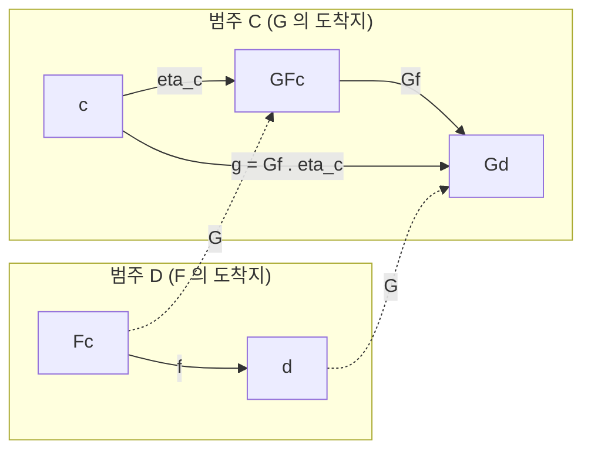

# 수반

# 개요

**수반(adjunction)** 은 두 [범주](category.md) 사이를 반대 방향으로 오가는 두 [함자](functors.md)에서, 한쪽으로 보낸 뒤의 사상과 다른 쪽으로 보낸 뒤의 사상이 일대일로 대응하는 관계다. 준동형은 생성원의 행선지만 정하면 정해지므로, 집합 $S$ 에서 [군](groups.md) $G$ 로 가는 함수와 $S$ 로 만든 자유군에서 $G$ 로 가는 준동형은 일대일로 대응한다. 수반은 이런 대응이 성립하는 함자 쌍을 정의해, 한쪽 범주의 사상 문제를 다른 쪽 범주의 사상 문제로 바꿔 푼다.

# 직관

집합 $S=\lbrace a,b\rbrace$ 의 글자와 그 역 $a^{-1}$, $b^{-1}$ 을 늘어놓은 낱말에서 $aa^{-1}$ 같은 이웃 쌍을 지운 것들은 이어 붙이기로 군을 이룬다. 이 군을 $S$ 로 만든 자유군(free group) $F(S)$ 라 한다. $F(S)$ 에서 정수의 덧셈군 $\mathbb Z$ 로 가는 준동형 $h$ 를 정하려면 $a$, $ab^{-1}a$, $b^3a^{-2}$ 처럼 끝없이 많은 낱말에 값을 주어야 한다.

준동형은 이어 붙이기를 덧셈으로 보내므로 $h(ab^{-1}a)=h(a)-h(b)+h(a)$ 다. $h(a)=2$, $h(b)=5$ 로 정하면 $h(ab^{-1}a)=2-5+2=-1$ 이고, 다른 낱말의 값도 같은 식으로 나온다. 두 값만 정하면 준동형 하나가 정해지고, 두 값을 다르게 정하면 다른 준동형이 나온다.

두 값 $a\mapsto 2$, $b\mapsto 5$ 는 $S$ 에서 정수의 집합으로 가는 함수다. 군 $H$ 에 그 원소의 집합 $U(H)$ 를 대응시키는 함자를 $U$ 라 쓰면, 함수 $S\to U(\mathbb Z)$ 와 준동형 $F(S)\to\mathbb Z$ 가 일대일로 대응한다. 준동형에서 함수로 가는 쪽은 준동형을 길이 1 인 낱말 $a$, $b$ 에 제한하는 것이다. 함수 $S\to T$ 는 낱말의 글자를 바꿔 써서 준동형 $F(S)\to F(T)$ 를 주므로 $F$ 도 함자다.

이 대응은 뒤에 준동형을 합성해도 어긋나지 않는다. 3 으로 나눈 나머지를 주는 준동형 $v:\mathbb Z\to\mathbb Z/3\mathbb Z$ 를 $h$ 뒤에 합성한 $v\circ h$ 는 함수 $a\mapsto 2$, $b\mapsto 2$ 에 대응하고, 이것은 $h$ 에 대응하던 함수 $a\mapsto 2$, $b\mapsto 5$ 뒤에 $v$ 를 합성한 것과 같다. 대응이 이렇게 양쪽의 합성과 맞물리는 함자 쌍에서 $F$ 를 $U$ 의 왼쪽 수반, $U$ 를 $F$ 의 오른쪽 수반이라 한다.

# 정의

## hom 집합 정의

범주 $\mathcal C$ , $\mathcal D$ 와 함자

$$
F : \mathcal{C} \to \mathcal{D}, \qquad G : \mathcal{D} \to \mathcal{C}
$$

가 주어졌다고 하자. $\mathrm{Hom}\_{\mathcal D}(Fc,d)$ 는 $Fc$ 에서 $d$ 로 가는 사상의 집합, 곧 hom 집합(hom-set)이다. $F$ 가 $G$ 의 **왼쪽 수반(left adjoint)** 이고 $G$ 가 $F$ 의 **오른쪽 수반(right adjoint)** 이라는 것은 전단사족

$$
\varphi_{c,d} : \mathrm{Hom}\_{\mathcal{D}}(Fc, d) \thickspace\xrightarrow{\thickspace\sim\thickspace}\thickspace \mathrm{Hom}\_{\mathcal{C}}(c, Gd)
$$

이 존재하고, 임의의 $u:c'\to c$ 와 $v:d\to d'$ 에 대해

$$
\varphi_{c',d'}(v \circ f \circ Fu) = Gv \circ \varphi_{c,d}(f) \circ u
$$

가 성립한다는 뜻이다. 이 등식을 $c$ 와 $d$ 에 대한 **자연성(naturality)** 이라 하고, 이 관계를 다음과 같이 적는다.

$$
F \dashv G
$$

직관 절의 자유군에서 $\mathcal C$ 는 집합의 범주, $\mathcal D$ 는 군의 범주, $G=U$ 이고, $\varphi_{S,\mathbb Z}$ 는 준동형 $h$ 를 함수 $a\mapsto h(a)$, $b\mapsto h(b)$ 로 보낸다. $u=\mathrm{id}\_S$ 이고 $v$ 가 3 으로 나눈 나머지를 주는 준동형이면 자연성의 양변은 둘 다 함수 $a\mapsto 2$, $b\mapsto 2$ 다.

## unit 과 counit

$F\dashv G$ 이면 두 [자연변환](natural-transformations.md)

$$
\eta : \mathrm{id}\_{\mathcal{C}} \Rightarrow GF, \qquad \varepsilon : FG \Rightarrow \mathrm{id}\_{\mathcal{D}}
$$

이 $\eta_c = \varphi_{c,Fc}(\mathrm{id}\_{Fc})$ 와 $\varepsilon_d = \varphi^{-1}\_{Gd,d}(\mathrm{id}\_{Gd})$ 로 정의된다. $\eta$ 를 수반의 **unit**, $\varepsilon$ 을 **counit** 이라 한다.

자유군 수반에서 $\eta_S:S\to U(F(S))$ 는 글자 $a$ 를 길이 1 인 낱말 $a$ 로 보낸다. $\varepsilon_{\mathbb Z}:F(U(\mathbb Z))\to\mathbb Z$ 는 정수를 글자로 쓴 낱말을 그 합으로 보낸다. 정수 $n$ 을 글자로 쓴 것을 $\lbrack n\rbrack$ 으로 적으면 낱말 $\lbrack 2\rbrack\lbrack 5\rbrack^{-1}\lbrack 2\rbrack$ 의 상은 $2-5+2=-1$ 이다.

그림의 아래쪽 경로가 전단사 $\varphi$ 다. $f : Fc \to d$ 를 $G$ 로 옮긴 뒤 unit 과 합성하면 $g : c \to Gd$ 가 된다.

# 성질

## hom 함자의 자연동형

$F\dashv G$ 는 두 함자

$$
\mathrm{Hom}\_{\mathcal{D}}(F-, -), \quad \mathrm{Hom}\_{\mathcal{C}}(-, G-) \thickspace : \thickspace \mathcal{C}^{\mathrm{op}} \times \mathcal{D} \to \mathbf{Set}
$$

사이의 자연동형과 같다. hom 집합 사이에 전단사가 존재하는 것만으로는 수반이 아니다. 유한집합은 크기만 같아도 전단사를 가지므로, 자연성이 있어야 자연변환으로서의 동형이 되고 unit 과 counit 이 정의된다.

## 삼각항등식

unit 과 counit 은 **삼각항등식(triangle identities)** 을 만족한다.

$$
(\varepsilon F) \circ (F \eta) = \mathrm{id}\_F, \qquad (G \varepsilon) \circ (\eta G) = \mathrm{id}\_G
$$

자유군 수반에서 $(U\varepsilon)\circ(\eta U)$ 는 정수 $n$ 을 길이 1 인 낱말 $\lbrack n\rbrack$ 으로 보낸 뒤 그 합 $n$ 으로 보내므로 항등이다. $g : c \to Gd$ 에서 $f$ 는 $f = \varepsilon_d \circ Fg$ 로 복원된다.

## 두 정의의 동치

함자 $F$ , $G$ 에 대해 다음은 동치다.

1. 삼각항등식을 만족하는 자연변환 쌍 $(\eta, \varepsilon)$ 이 존재한다.
2. $c$ 와 $d$ 에 대해 자연성을 만족하는 전단사 $\mathrm{Hom}(Fc, d) \cong \mathrm{Hom}(c, Gd)$ 가 존재한다.

*증명의 요지.* (1) → (2): $f : Fc \to d$ 에 $Gf \circ \eta_c$ 를 대응시키고, $g : c \to Gd$ 에 $\varepsilon_d \circ Fg$ 를 대응시킨다. 한쪽 합성을 계산하면

$$
\varepsilon_d \circ F(Gf \circ \eta_c) = \varepsilon_d \circ FGf \circ F\eta_c = f \circ \varepsilon_{Fc} \circ F\eta_c = f
$$

이고 여기서 두 번째 등호는 $\varepsilon$ 의 자연성이며 세 번째는 삼각항등식이다. 반대 방향도 대칭이다. 자연성은 $F$ 와 $G$ 가 함자이고 $\eta$ 와 $\varepsilon$ 이 자연변환이라는 데서 나온다.

(2) → (1): 정의 절에서처럼 항등사상의 상으로 $\eta$ 와 $\varepsilon$ 을 정의하면 전단사의 자연성으로부터 삼각항등식이 유도된다. ∎

## unit 의 보편성질

$\eta_c : c \to GFc$ 는 다음 의미에서 보편적이다. 임의의 $d$ 와 $g : c \to Gd$ 에 대해

$$
g = G\tilde{g} \circ \eta_c
$$

를 만족하는 $\tilde g:Fc\to d$ 가 유일하게 존재한다. 이것이 자유 구성의 보편성질(universal property)이다. 자유군에서 $\tilde g$ 는 함수 $g:S\to U(H)$ 로 정해지는 준동형 $F(S)\to H$ 다. 역으로 각 $c$ 마다 이런 보편 사상이 존재하면 $F$ 를 함자로 확장할 수 있고 $F\dashv G$ 가 된다. 수반의 존재는 대상마다의 보편성질을 모은 것과 같다.

## 유일성

오른쪽 수반은 존재하면 자연동형을 제외하고 유일하다. $G$ , $G'$ 가 모두 $F$ 의 오른쪽 수반이면

$$
\mathrm{Hom}\_{\mathcal{C}}(c, Gd) \cong \mathrm{Hom}\_{\mathcal{D}}(Fc, d) \cong \mathrm{Hom}\_{\mathcal{C}}(c, G'd)
$$

가 $c$ 에 대해 자연성을 만족하므로 [Yoneda lemma](yoneda-lemma.md)의 따름정리(Yoneda 매장의 충실충만성)로 $Gd \cong G'd$ 이고, 이 동형은 $d$ 에 대해 자연성을 만족한다. 왼쪽 수반도 같은 이유로 유일하다.

## Yoneda lemma 와의 관계

수반은 표현 가능성(representability)으로 다시 쓸 수 있다.

- $G:\mathcal D\to\mathcal C$ 의 왼쪽 수반이 존재할 필요충분조건은, 각 대상 $c$ 에 대해 함자 $\mathrm{Hom}\_{\mathcal C}(c,G-):\mathcal D\to\mathbf{Set}$ 가 [표현 가능 함자](representable-functors.md)인 것이다. 그때 표현 대상이 $Fc$ 다.
- Yoneda lemma 는 이 표현 대상이 유일하며 $c$ 에 대한 함자성이 자동으로 따라옴을 보장한다. 수반의 자연성 조건은 Yoneda 매장이 충실충만하다는 사실의 응용이다.

## 극한과 쌍대극한의 보존

오른쪽 수반은 모든 [극한](limits-colimits.md)을 보존하고, 왼쪽 수반은 모든 쌍대극한을 보존한다. 이 정리를 RAPL(right adjoints preserve limits)이라 부른다.

*증명의 요지.* $\mathcal D$ 안의 도형 $d_i$ 가 극한 $\lim d_i$ 를 가진다고 하자. 임의의 $c$ 에 대해

$$
\mathrm{Hom}\_{\mathcal{C}}(c, G(\lim_i d_i)) \cong \mathrm{Hom}\_{\mathcal{D}}(Fc, \lim_i d_i) \cong \lim_i \mathrm{Hom}\_{\mathcal{D}}(Fc, d_i) \cong \lim_i \mathrm{Hom}\_{\mathcal{C}}(c, G d_i)
$$

이다. 가운데 등호는 hom 함자가 두 번째 변수에서 극한을 보존한다는 사실이고, 나머지는 수반이다. 오른쪽 끝은 $\mathrm{Hom}(c, \lim G d_i)$ 와 같으므로 Yoneda lemma 로 $G(\lim d_i) \cong \lim G d_i$ 다. 쌍대극한 쪽은 반대 범주에서 같은 논증을 한다. ∎

대우를 쓰면 부정 판정이 된다. 어떤 구성이 쌍대극한(몫, 직합)을 깨뜨리면 그 구성은 왼쪽 수반이 아니고, 극한(곱, 핵)을 깨뜨리면 오른쪽 수반이 아니다. [가군](modules.md)에서 텐서곱은 직합을 보존하므로 왼쪽 수반 후보이고, 실제로 Hom 의 왼쪽 수반이다.

## 존재 정리

역방향 질문, 즉 극한을 보존하는 함자가 수반을 가지는지는 크기 조건을 하나 더 요구한다.

Freyd 수반 함자 정리(Freyd adjoint functor theorem). $\mathcal D$ 가 국소적으로 작고(locally small) 완비(complete)이며 $G:\mathcal D\to\mathcal C$ 가 모든 작은 극한을 보존하고 해집합 조건(solution set condition)을 만족하면 $G$ 는 왼쪽 수반을 가진다.[^1]

해집합 조건은 각 $c$ 마다 $c\to Gd$ 꼴 사상을 대표하는 작은 집합이 있다는 조건이다. 이 조건은 크기 문제 하나 때문에 수반이 없는 경우를 배제한다.

## 합성과 동치

- $F\dashv G$ 이고 $F'\dashv G'$ 이며 합성이 정의되면 $F'F\dashv GG'$ 다. 수반은 합성에 닫혀 있다.
- 범주의 동치는 unit 과 counit 이 모두 동형인 수반과 같다. 이때 $F$ 는 왼쪽 수반과 오른쪽 수반을 겸한다.
- counit 이 동형이면 $G$ 는 충실충만하고 $\mathcal D$ 는 $\mathcal C$ 의 반사 부분범주(reflective subcategory)다. 완비화, 군화(group completion), 층화(sheafification)가 이 꼴이다.

## Monad

$F\dashv G$ 에서 $T=GF:\mathcal C\to\mathcal C$ 를 만들면

$$
\eta : \mathrm{id} \Rightarrow T, \qquad \mu = G \varepsilon F : T^2 \Rightarrow T
$$

가 결합법칙과 단위법칙을 만족한다. 이 데이터 $(T, \eta, \mu)$ 가 [monad](monads.md) 다. 자유군 수반의 monad 는 집합에 형식적 낱말을 붙이는 연산이고, 자유가군 수반의 monad 는 형식적 선형결합을 취하는 연산이다.

역으로 모든 monad 는 적어도 두 가지 수반에서 나온다. Eilenberg–Moore 범주(대수의 범주)와 [Kleisli 범주](kleisli-eilenberg-moore.md)가 각각 그 분해의 끝과 시작을 준다. 프로그래밍 언어에서 쓰는 monad 는 후자 쪽이다.

## 부분순서에서의 수반

[부분순서](partial-orders.md) 집합을 사상이 최대 하나뿐인 범주로 보면 수반은 [Galois 연결](galois-connections.md)이 된다. 단조사상 $f$ , $g$ 에 대해

$$
f(x) \le y \iff x \le g(y)
$$

가 성립하는 상황이다. $f(x)$ 는 $x\le g(y)$ 를 만족하는 $y$ 가운데 가장 작은 것이고, $g(y)$ 는 $f(x)\le y$ 를 만족하는 $x$ 가운데 가장 큰 것이다. 일반 범주의 수반에서는 이 부등식 자리에 hom 집합 사이의 전단사가 온다.

# 활용

## 자유-망각 쌍

오른쪽이 모두 망각 함자인 수반이다.

| 왼쪽 수반 | 오른쪽 수반 | unit 이 주는 것 |
| --- | --- | --- |
| 자유군 | 바탕집합 | 생성원 포함 |
| 자유 가군 | 바탕집합 | 기저 포함 |
| 자유 [벡터 공간](vector-spaces.md) | 바탕집합 | 기저 포함 |
| [다항식환](polynomial-rings.md) | 바탕 [환](rings.md) | 부정원 지정 |
| 아벨군화 | 아벨군 포함 | 교환자 몫으로 가는 사상 |

세 번째 줄에서 집합을 벡터 공간으로 확장하는 방법이 유일하게 정해지므로, [선형사상](linear-maps.md)을 기저 위의 값만으로 정의할 수 있다.

## 곱-지수 수반

집합의 범주에서 고정된 $A$ 에 대해

$$
\mathrm{Hom}(X \times A, Y) \cong \mathrm{Hom}(X, Y^A)
$$

unit $\eta_X : X \to (X \times A)^A$ 는 $x$ 를 $a \mapsto (x, a)$ 로 보내는 사상이고, counit $\varepsilon_Y : Y^A \times A \to Y$ 는 평가 사상이다. 삼각항등식은 평가한 뒤 다시 묶으면 원래 함수가 된다는 등식이다.

## 확장과 제한

환 준동형 $f:R\to S$ 는 두 방향의 함자를 만든다.

- 제한(restriction) $f^\ast$ 는 $S$ 가군을 $R$ 가군으로 보낸다. 스칼라 곱을 $f$ 로 끌어온다.
- 확장(extension) $f_! = S \otimes_R -$ 는 $R$ 가군을 $S$ 가군으로 보낸다.

이때

$$
\mathrm{Hom}\_{S}(S \otimes_R M, N) \cong \mathrm{Hom}\_{R}(M, f^{\ast}N)
$$

이 성립하여 $S \otimes_R - \dashv f^\ast$ 다. 이 식의 일반형이 tensor-hom 수반(tensor-hom adjunction)

$$
\mathrm{Hom}\_{S}(M \otimes_R N, P) \cong \mathrm{Hom}\_{R}(M, \mathrm{Hom}\_{S}(N, P))
$$

이고, 자세한 구성은 [텐서곱](tensor-products.md) 문서에 있다. 이 수반에서 텐서곱이 쌍대극한을 보존하므로 우완전(right exact)이다. Hom 은 극한을 보존하므로 좌완전(left exact)이다. 환의 [국소화](localization-rings.md) 역시 같은 틀에서 왼쪽 수반으로 나타난다.

## 논리와 기하

- 술어논리에서 변수 치환 함자의 왼쪽 수반이 존재기호, 오른쪽 수반이 전칭기호다. 이 관점은 [1차 논리](first-order-logic.md)의 규칙을 범주적으로 재구성한다.
- 위상에서 부분공간 위상, 몫위상, 콤팩트화는 모두 수반 구성이다. [Stone–Čech 콤팩트화](stone-cech-compactification.md)는 콤팩트 Hausdorff 공간 포함 함자의 왼쪽 수반이다.
- [Galois 이론](galois-theory.md)의 대응은 부분체와 부분군 사이의 Galois 연결, 즉 부분순서 범주 사이 수반의 전형이다.[^2]
- 이산 위상과 비이산 위상을 주는 함자는 망각 함자의 각각 왼쪽 수반과 오른쪽 수반이다.

[^1]: nLab, Adjoint functor theorem, https://ncatlab.org/nlab/show/adjoint+functor+theorem
[^2]: nLab, Galois connection, https://ncatlab.org/nlab/show/Galois+connection

# 연관 문서

## 선수지식

- [자연변환](natural-transformations.md)
- [Yoneda lemma](yoneda-lemma.md)

## 더 알아보기

- [Monad](monads.md)
- [토포스](topos-theory.md)

#category_theory #algebra #logic
