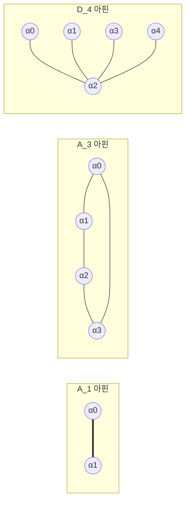

# 아핀 Lie 대수

# 개요

**아핀 Lie 대수(affine Lie algebra)** 는 유한차원 [Lie 대수](lie-algebras.md)의 원소에 변수 $t$ 의 양과 음의 거듭제곱을 계수로 붙여 만든 무한차원 Lie 대수다. 원 위의 점마다 대각합이 $0$ 인 $2\times2$ [행렬](matrices.md) 하나를 주는 함수를 모으면 무한차원의 대칭이 생기고, 2차원 양자장론의 대칭이 이 꼴로 나온다. 아핀 Lie 대수는 이런 대칭을 유한차원 Lie 대수의 근계와 Weyl 군을 옮긴 틀로 다루어 그 표현의 지표를 계산한다.

# 직관

$\mathfrak{sl}\_2$ 의 표현론은 Cartan 부분대수 하나와 근 $\pm\alpha$ 로 끝난다. 이제 $\mathfrak{sl}\_2$ 값 함수를 원 $S^1$ 위에서 생각한다. [Fourier 급수](fourier-series.md)로 펼치면 기저가 $x\otimes t^n$ 이고, 괄호는 다음으로 정해진다.

$$
\lbrack x\otimes t^m,y\otimes t^n\rbrack=\lbrack x,y\rbrack\otimes t^{m+n}
$$

이 대수의 표현을 찾으려 하면 막힌다. $\mathbb C\lbrack t,t^{-1}\rbrack$ 쪽으로 무한히 뻗은 방향에 최고무게 벡터를 세울 자리가 없다. $t$ 의 지수를 읽는 연산자가 대수 안에 없어서 어느 벡터가 위인지 정할 수 없다.

지수를 읽는 연산자를 넣는다. $d=t\thinspace\partial_t$ 를 더해 $\lbrack d,x\otimes t^n\rbrack=n\thinspace x\otimes t^n$ 으로 두면 $d$ 의 고윳값이 지수 $n$ 을 읽는다. 그러면 $n$ 이 가장 큰 벡터를 최고무게로 잡을 수 있다.

이 연산자만으로는 표현이 자명해진다. $x\otimes t^m$ 과 $y\otimes t^{-m}$ 의 괄호가 $\lbrack x,y\rbrack\otimes t^0$ 뿐이어서 올림과 내림을 반복해도 $\mathfrak g$ 안에서 맴돌고, 최고무게 벡터에 작용해 얻는 공간이 유한차원이 된다. 그래서 중심원소 $K$ 를 더해 괄호에 항을 하나 보탠다.

$$
\lbrack x\otimes t^m,y\otimes t^n\rbrack=\lbrack x,y\rbrack\otimes t^{m+n}+m\thinspace\delta_{m+n,0}\thinspace(x,y)\thinspace K
$$

이제 $x\otimes t^m$ 으로 올리고 $y\otimes t^{-m}$ 으로 내리면 $K$ 가 나오고, $K$ 가 스칼라 $k$ 로 작용하는 표현에서 올림과 내림이 $k$ 에 비례하는 값을 남긴다. $k\ne 0$ 이면 이 작용이 무한차원 최고무게 표현을 만든다.

# 정의

## 일반화 Cartan 행렬

정수행렬 $A=(a_{ij})\_{i,j=0}^{n}$ 이 다음을 만족하면 **일반화 Cartan 행렬(generalized Cartan matrix, GCM)** 이다.

- $a_{ii}=2$
- $i\ne j$ 이면 $a_{ij}\le 0$
- $a_{ij}=0$ 이면 $a_{ji}=0$

유한차원 반단순 Lie 대수의 Cartan 행렬은 여기에 양정부호 조건을 더한 것이다. 기약 GCM 은 $A$ 가 양정부호이면 **유한형(finite type)**, 반정부호이고 핵이 1 차원이면 **아핀형(affine type)**, 그 밖이면 **부정형(indefinite type)** 이다.

아핀형에서 핵을 펼치는 벡터 가운데 성분이 서로소인 양의 정수인 것을 $v=(a_0,\dots,a_n)$ 이라 할 때, 그 성분이 **표시(mark)** 이고 $\sum a_i$ 가 **Coxeter 수(Coxeter number)** 다.

$1\times1$ 행렬 $(2)$ 는 양정부호이므로 유한형이고, $\mathfrak{sl}\_2$ 의 Cartan 행렬이다. $2\times2$ 행렬

$$
A=\begin{pmatrix}2&-2\cr -2&2\end{pmatrix}
$$

는 고윳값이 $0$ 과 $4$ 이고 핵이 $(1,1)$ 로 펼쳐지므로 아핀형이다. 표시는 $a_0=a_1=1$ 이고 Coxeter 수는 $2$ 다. 이 행렬을 $A_1^{(1)}$ 로 적는다.

## Kac–Moody 대수

GCM $A$ 에 대해 **Kac–Moody 대수(Kac–Moody algebra)** $\mathfrak g(A)$ 는 생성원 $e_i,f_i,h_i$ 와 다음 관계로 정의되는 Lie 대수다.

$$
\lbrack h_i,h_j\rbrack=0,\qquad \lbrack h_i,e_j\rbrack=a_{ij}e_j,\qquad \lbrack h_i,f_j\rbrack=-a_{ij}f_j,\qquad \lbrack e_i,f_j\rbrack=\delta_{ij}h_i
$$

여기에 Serre 관계(Serre relations)를 더한다.

$$
(\mathrm{ad}\thinspace e_i)^{1-a_{ij}}e_j=0,\qquad (\mathrm{ad}\thinspace f_i)^{1-a_{ij}}f_j=0\quad(i\ne j)
$$

$A$ 가 아핀형이면 $\mathfrak g(A)$ 를 **아핀 Lie 대수** 라 한다.

$A=(2)$ 이면 생성원이 $e,f,h$ 셋이고 관계가 $\lbrack h,e\rbrack=2e$, $\lbrack h,f\rbrack=-2f$, $\lbrack e,f\rbrack=h$ 이므로 $\mathfrak g(A)=\mathfrak{sl}\_2$ 다. $A=A_1^{(1)}$ 이면 $a_{01}=-2$ 이므로 Serre 관계는 $(\mathrm{ad}\thinspace e_0)^3e_1=0$ 이다.

## 루프 실현

$\mathfrak g$ 를 단순 유한차원 Lie 대수, $(\cdot,\cdot)$ 을 Killing 형식이라 한다. 아핀 Lie 대수 $\hat{\mathfrak g}$ 는 벡터공간

$$
\hat{\mathfrak g}=\bigl(\mathfrak g\otimes\mathbb C\lbrack t,t^{-1}\rbrack\bigr)\oplus\mathbb CK\oplus\mathbb Cd
$$

에 다음 괄호를 준 것이다.

$$
\lbrack x\otimes t^m,\thinspace y\otimes t^n\rbrack=\lbrack x,y\rbrack\otimes t^{m+n}+m\thinspace\delta_{m+n,0}\thinspace(x,y)K
$$

$$
\lbrack d,\thinspace x\otimes t^n\rbrack=n\thinspace x\otimes t^n,\qquad \lbrack K,\thinspace\hat{\mathfrak g}\rbrack=0
$$

$K$ 가 중심이고, $\mathbb CK$ 로 나눈 몫이 루프대수(loop algebra) $\mathfrak g\otimes\mathbb C\lbrack t,t^{-1}\rbrack$ 에 $d$ 를 붙인 것이다. 표현에서 $K$ 가 스칼라 $k$ 로 작용하면 그 표현의 **레벨(level)** 이 $k$ 다.

$\mathfrak g=\mathfrak{sl}\_2$ 이면 $\lbrack e\otimes t,\thinspace f\otimes t^{-1}\rbrack=h\otimes 1+(e,f)K$ 이다. 레벨 $k$ 표현에서 마지막 항은 스칼라 $k(e,f)$ 로 작용한다. 직관 절에서 올림과 내림이 남기는 값이 이것이다.

## 아핀 근계

$\hat{\mathfrak h}=\mathfrak h\oplus\mathbb CK\oplus\mathbb Cd$ 를 Cartan 부분대수로 잡는다. $\delta\in\hat{\mathfrak h}^\ast$ 를 $\delta(d)=1$ , $\delta(\mathfrak h)=\delta(K)=0$ 으로 정한다. $\mathfrak g$ 의 [근계](root-systems.md)를 $\Phi$ 라 할 때 $\hat{\mathfrak g}$ 의 근계는 다음이다.

$$
\hat\Phi=\lbrace\alpha+n\delta:\alpha\in\Phi,\thinspace n\in\mathbb Z\rbrace\cup\lbrace n\delta:n\in\mathbb Z\setminus\lbrace 0\rbrace\rbrace
$$

$\hat{\mathfrak h}^\ast$ 위의 쌍선형형식은 $\mathfrak h^\ast$ 에서는 원래 형식이고 $(\delta,\delta)=0$ , $(\delta,\mathfrak h^\ast)=0$ 이다. 이 형식으로 근을 둘로 나눈다.

- **실근(real root)** $\alpha+n\delta$ ($\alpha\in\Phi$). 길이가 $(\alpha,\alpha)\gt 0$ 이다.
- **허근(imaginary root)** $n\delta$ ($n\ne 0$). 길이가 $0$ 이다.

단순근은 $\alpha_1,\dots,\alpha_n$ (원래 단순근)에 $\alpha_0=\delta-\theta$ 를 더한 $n+1$ 개다. $\theta$ 는 $\Phi$ 의 최고근이다. 이 $n+1$ 개의 단순근으로 그린 도표가 **확장 Dynkin 도표(extended Dynkin diagram)** 다.

$\mathfrak g=\mathfrak{sl}\_2$ 이면 $\Phi=\lbrace\pm\alpha\rbrace$ 이고 $\theta=\alpha$ 다. 실근은 $\pm\alpha+n\delta$, 허근은 $n\delta$ 이고, 단순근은 $\alpha_1=\alpha$ 와 $\alpha_0=\delta-\alpha$ 다.

유한형 도표에 꼭짓점 하나를 더한 모양이고, 더하는 자리를 최고근이 정한다. 비틀리지 않은 아핀 대수 $X_n^{(1)}$ 의 도표가 이것이다.

## 아핀 Weyl 군

실근 $\alpha+n\delta$ 마다 반사 $s_{\alpha+n\delta}$ 가 있고, 이들이 생성하는 군이 **아핀 Weyl 군(affine Weyl group)** $\hat W$ 다. $\mathfrak h^\ast$ 에 제한하면 반사 $s_{\alpha+n\delta}$ 는 초평면 $\lbrace\lambda:(\lambda,\alpha)=n\rbrace$ 에 대한 반사로 작용한다. 이 초평면들이 $\mathfrak h^\ast\_{\mathbb R}$ 를 나눈 조각 하나가 **기본 알코브(fundamental alcove)** 다.

$\mathfrak g=\mathfrak{sl}\_2$ 이면 $\mathfrak h^\ast\_{\mathbb R}$ 가 직선이고 초평면은 등간격으로 놓인 점들이다. $\hat W$ 는 이 점들에 대한 반사로 생성되고, 기본 알코브는 이웃한 두 점 사이의 구간이다.

## 적분가능 최고무게 표현

$\hat\Lambda\in\hat{\mathfrak h}^\ast$ 가 모든 $i$ 에 대해 $\hat\Lambda(h_i)\in\mathbb Z\_{\ge 0}$ 이면 **지배적 적분(dominant integral)** 이고, 그 최고무게 표현 $L(\hat\Lambda)$ 를 **적분가능(integrable)** 이라 한다. 레벨은 $k=\hat\Lambda(K)$ 다.

$\alpha_0=\delta-\theta$ 이므로 $\hat\Lambda(h_0)\ge 0$ 은 $\langle\lambda,\theta^\vee\rangle\le k$ 와 같다. $\lambda$ 는 $\hat\Lambda$ 를 $\mathfrak h$ 로 제한한 것이다. $\mathfrak g=\mathfrak{sl}\_2$ 이고 $m=\lambda(h)$ 이면 조건은 $0\le m\le k$ 이다. 레벨 $1$ 에서는 $m=0$ 과 $m=1$ 두 가지다.

# 성질

## 세 형의 분류

> **정리.** 기약 일반화 Cartan 행렬 $A$ 에 대해 다음 셋 가운데 정확히 하나가 성립한다[^1]. 성분이 모두 양수인 $v$ 가 존재해 $Av\gt 0$ 이면 유한형, $Av=0$ 이면 아핀형, $Av\lt 0$ 이면 부정형이다.

증명의 요지는 [Perron–Frobenius 정리](perron-frobenius.md)다. $A$ 의 비대각성분이 음이 아닌 꼴로 $2I-A$ 를 보면 비음행렬이고 기약이므로 성분이 모두 양수인 고유벡터 $v$ 가 최대 고윳값에 붙는다. 그 고윳값이 $2$ 보다 작으면 $Av\gt 0$ , 같으면 $Av=0$ , 크면 $Av\lt 0$ 이고, 세 경우가 각각 유한형, 아핀형, 부정형이다. 최대 고윳값이 유일하므로 세 경우가 배타적이다.

아핀형에서 핵이 1 차원이라는 것은 최대 고윳값의 고유공간이 1 차원이라는 Perron–Frobenius 의 결론이다. 그 유일한 핵벡터가 표시 $(a_0,\dots,a_n)$ 이고, $\delta=\sum_i a_i\alpha_i$ 가 성립한다.

$A$ 가 유한형이면 $\mathfrak g(A)$ 는 유한차원 반단순 Lie 대수다.

## 비틀린 아핀 대수

루프 실현은 비틀리지 않은(untwisted) 아핀 대수를 모두 준다. $\mathfrak g$ 의 Dynkin 도표 자기동형 $\sigma$ 로 루프의 주기조건을 비틀면 비틀린(twisted) 아핀 대수가 나오고, 둘을 합친 목록이 아핀형 GCM 의 분류와 일치한다[^1].

## 아핀 Weyl 군의 구조

$$
\hat W\cong W\ltimes t_{Q^\vee}
$$

$W$ 는 유한 Weyl 군이고 $t_{Q^\vee}$ 는 쌍대 근격자 $Q^\vee$ 만큼의 평행이동군이다. 기본 알코브는 $\hat W$ 의 기본영역이고, 유한 Weyl 군의 추(cone)와 달리 유계인 단체다.

## 레벨별 적분가능 표현의 개수

레벨 $k$ 를 고정하면 $\langle\lambda,\theta^\vee\rangle\le k$ 를 만족하는 지배적 $\lambda$ 가 유한개이므로, 레벨 $k$ 적분가능 표현은 유한개다. $\mathfrak{sl}\_2$ 에서는 $k+1$ 개다.

## 허근의 중복도

> **정리.** 아핀 Lie 대수에서 $\dim\hat{\mathfrak g}\_{n\delta}=\mathrm{rank}\thinspace\mathfrak g$ 이고 $\dim\hat{\mathfrak g}\_{\alpha+n\delta}=1$ 이다.

루프 실현에서 직접 읽힌다. $d$ 의 고윳값이 $n$ 인 부분은 $\mathfrak g\otimes t^n$ 이고, 그 안에서 $\mathfrak h$ 의 작용에 대한 무게 $\alpha$ 부분은 $\mathfrak g_\alpha\otimes t^n$ 이라 1 차원이며, 무게 $0$ 부분은 $\mathfrak h\otimes t^n$ 이라 차원이 $\mathrm{rank}\thinspace\mathfrak g$ 다.

실근의 Weyl 궤도는 하나뿐이지만 허근 $n\delta$ 는 $\hat W$ 가 고정한다. $\hat W$ 가 $\delta$ 를 고정하므로 길이 $0$ 인 방향이 군의 작용에 보존되고, 이것이 $\hat W$ 가 유한군이 아닌 이유다. 반사를 반복하면 $\delta$ 방향으로 평행이동이 쌓인다.

## Weyl–Kac 지표 공식

> **정리.** 적분가능 최고무게 표현 $L(\hat\Lambda)$ 의 지표는 다음이다[^2].

$$
\mathrm{ch}\thinspace L(\hat\Lambda)=\frac{\sum_{w\in\hat W}\varepsilon(w)\thinspace e^{w(\hat\Lambda+\hat\rho)-\hat\rho}}{\prod_{\alpha\in\hat\Phi^+}(1-e^{-\alpha})^{\mathrm{mult}\thinspace\alpha}}
$$

유한차원의 [Weyl 지표 공식](weyl-character-formula.md)과 같은 모양이고, 달라진 것은 합이 무한군 $\hat W$ 를 돌고 분모의 지수에 중복도가 붙는다는 점이다. 중복도가 실근에서 $1$ , 허근에서 $\mathrm{rank}\thinspace\mathfrak g$ 다.

$\hat\Lambda=0$ 에 넣으면 좌변이 $1$ 이고 분자와 분모가 같아진다. 이 등식이 **Macdonald 항등식**이다. $\hat{\mathfrak g}$ 가 $A_1^{(1)}$ 일 때 $\hat W$ 가 무한 2 면체군이고, 항등식이 Jacobi 의 삼중곱 공식이 된다.

$$
\prod_{n\ge 1}(1-q^n)=\sum_{k\in\mathbb Z}(-1)^k q^{k(3k-1)/2}
$$

Euler 의 오각수 정리도 같은 방식으로 나온다. 분모의 무한곱이 $q$ 급수가 되고 분자의 $\hat W$ 합이 격자 위의 부호 붙은 합이 되므로, 지표 공식이 $q$ 급수의 항등식으로 번역된다.

## 지표의 모듈러성

> **정리.** 고정된 레벨 $k$ 의 적분가능 표현들의 정규화된 지표는 $\mathrm{SL}\_2(\mathbb Z)$ 의 표현을 이룬다[^2].

$q=e^{2\pi i\tau}$ 로 두고 지표를 $\tau$ 의 함수로 보면, 레벨 $k$ 적분가능 표현이 유한개이므로 그 지표들이 유한차원 공간을 펼친다. $\tau\mapsto\tau+1$ 과 $\tau\mapsto-1/\tau$ 가 이 공간을 보존한다.

증명의 요지는 지표를 격자 위의 테타 함수의 비로 쓰는 것이다. 분자가 $Q^\vee$ 격자의 테타 함수이고 분모가 Dedekind 에타 함수의 거듭제곱이며, 둘의 모듈러 변환 규칙이 알려져 있다.

# 활용

- **Wess–Zumino–Witten 모형.** [Wess–Zumino–Witten 모형](wess-zumino-witten.md)의 대칭 대수가 레벨 $k$ 아핀 Lie 대수다. 그 문서의 1 차 장 목록이 레벨 $k$ 적분가능 표현의 목록이고, 융합 규칙이 그 목록 안에서 닫히지 않는 텐서곱을 자른 것이다. 모듈러 불변 분배함수의 구성에 위 지표의 모듈러성을 쓴다.

- **정점작용소대수.** [정점작용소대수](vertex-operator-algebras.md)의 아핀 구성은 레벨 $k$ 진공 표현 $L(k\Lambda_0)$ 에 정점작용소 구조를 주는 것이다. 레벨 1 의 $\mathrm{SU}(N)$ 에서 이 구성이 근격자의 격자 정점작용소대수와 일치한다.

- **Macdonald 항등식.** 위 지표 공식에 $\hat\Lambda=0$ 을 넣어 얻는 $q$ 급수 항등식이 Jacobi 삼중곱과 Euler 오각수 정리를 포함한다. 분할수의 생성함수 항등식 여럿이 같은 방식으로 나온다.

- **범주 O.** [범주 O](category-o.md) 의 구성이 Kac–Moody 대수에서 그대로 작동한다. Verma 가군, 블록 분해, Kazhdan–Lusztig 중복도가 아핀형에서도 정의되고, 아핀 [Kazhdan–Lusztig 다항식](kazhdan-lusztig.md)이 레벨 $k$ 표현의 지표를 계산한다.

- **기하학적 Langlands 강령.** 임계 레벨 $k=-h^\vee$ 는 Weyl–Kac 지표 공식의 분모가 뜻을 잃는 레벨이다. 이 레벨에서 $\hat{\mathfrak g}$ 의 중심이 커지고, 그 중심을 [기하학적 Langlands 강령](geometric-langlands.md) 대응의 쌍대 쪽 자료와 맞추는 것이 Feigin–Frenkel 동형이다.

[^1]: V. Kac, *Infinite Dimensional Lie Algebras*, 3rd ed., Cambridge University Press, 1990, 4 장.
[^2]: V. Kac, *Infinite Dimensional Lie Algebras*, 3rd ed., Cambridge University Press, 1990, 10 장과 13 장.

# 연관 문서

## 선수지식

- [근계](root-systems.md)

## 더 알아보기

- [Wess–Zumino–Witten 모형](wess-zumino-witten.md)

#algebra #group_theory #linear_algebra #combinatorics
