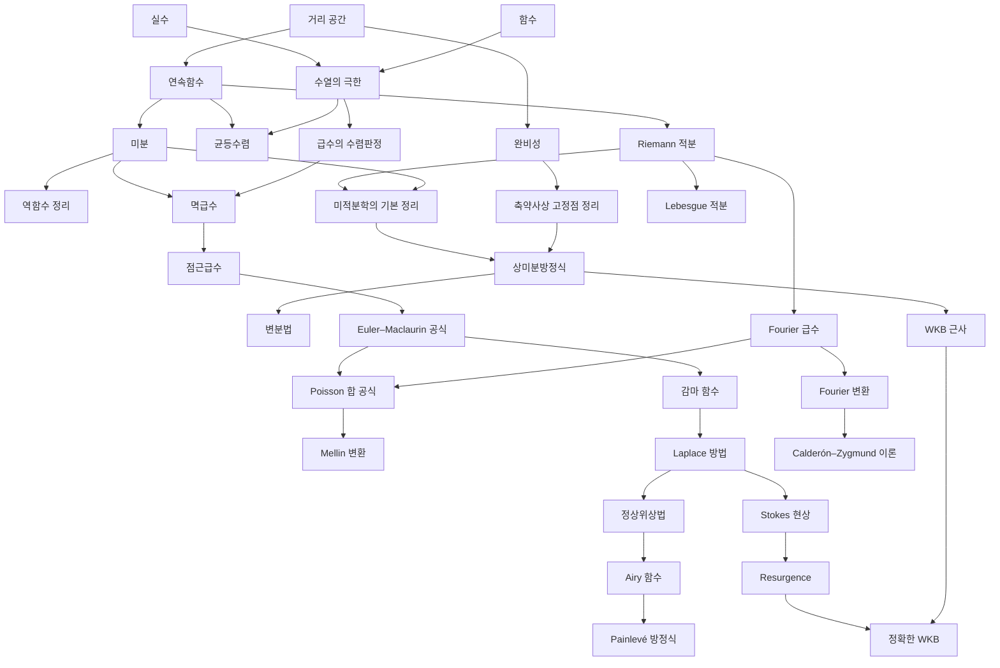

# 해석학 개관

# 개요

해석학(analysis)은 극한으로 정의되는 대상을 다루는 분야다. 원의 넓이는 원 안에 정다각형을 그리고 변의 수를 늘려 가며 구한 넓이가 다가가는 수로 정하는데, 그런 수가 언제 있는지, 있다면 다각형들의 성질을 물려받는지는 따로 따져야 한다. 수열이 한 수에 다가간다는 것을 오차의 크기로 정의하고, 그 정의로 극한의 존재와 성질의 보존을 증명한다.

처음 읽는 사람은 [실수](real-numbers.md)에서 시작한다.

# 지도

# 갈래

처음 읽는 사람은 극한과 연속, 함수공간의 근사정리, Lipschitz 조건, 미분과 적분의 순서로 읽는다. 그 네 갈래가 이 분야의 공통 기반이고, 나머지 일곱은 거기서 갈라진다.

측도와 복소평면으로의 확장을 먼저 읽으면 뒤의 여섯 갈래에서 적분과 해석적 연속을 전제할 수 있다. 변분법과 비선형 방정식은 미분방정식을 잇고, 멱급수와 점근해석은 Fourier 해석과 적분변환보다 앞에 온다.

보간과 특이적분, 퍼텐셜과 작용소는 Fourier 해석을 쓴다.

## 극한과 연속

먼저 읽을 것: [함수](functions.md)(기초 개관). 시작 문서: [실수](real-numbers.md).

- [실수](real-numbers.md): 상한 공리를 만족하는 순서체, Dedekind 절단 구성과 Archimedes 성질
  - [재배열 부등식](rearrangement-inequality.md): 같은 순서로 짝지은 곱의 합이 가장 크다는 부등식, 맞바꾸기 증명과 Chebyshev 합 부등식, Hardy–Littlewood 의 함수 판본
- [수열의 극한](limits.md): 수렴의 정의와 극한의 사칙연산
  - [산술-기하 평균 부등식](am-gm-inequality.md): 합을 개수로 나눈 값이 곱의 거듭제곱근 이상이라는 부등식, Cauchy 의 귀납 증명과 로그의 오목성, 조화·기하·산술·제곱 평균의 순서와 곱에 대한 Young 부등식
    - [Maclaurin 부등식](maclaurin-inequality.md): 기본 대칭다항식의 평균을 차수만큼 제곱근한 값이 차수에 따라 줄어든다는 부등식, Newton 부등식과 그 Rolle 증명
  - [Fekete 보조정리](fekete-lemma.md): 부분가법 수열을 n 으로 나눈 극한의 존재와 그 값이 하한이라는 것, 엔트로피와 증가율
- [연속함수](continuity.md): $\varepsilon\text{-}\delta$ 정의와 열린집합 정의의 동치
  - [중간값 정리](intermediate-value-theorem.md): 구간 위의 연속함수가 두 끝값 사이의 모든 값을 갖는다는 정리, 이분법 증명과 구성적 근사형
- [완비성](completeness.md): 극한값을 모르고도 수렴을 판정하는 조건
  - [Bolzano–Weierstrass 정리](bolzano-weierstrass.md): 유계 수열에서 수렴하는 부분수열을 뽑는 구간 반분 논증
- [최대·최소 정리](extreme-value-theorem.md): 닫힌 유계 구간의 연속함수가 최댓값과 최솟값을 갖는다는 정리, 가정이 빠질 때의 반례, 콤팩트 공간판과 최대점 후보
- [균등연속](uniform-continuity.md): $\delta$ 를 점에 의존하지 않게 고른 조건, Heine–Cantor 정리
- [균등수렴](uniform-convergence.md): 연속성과 적분을 극한과 바꿔 쓸 수 있게 하는 조건
- [기하급수](geometric-series.md): 공비가 일정한 급수의 부분합 공식, 공비의 절댓값이 1 보다 작을 때의 합과 Neumann 급수
- [급수의 수렴판정](series-convergence.md): 비교, 비율, 근, 적분, 교대급수 판정과 재배열
  - [조화급수](harmonic-series.md): 자연수 역수의 합, 책 쌓기와 묶음으로 보이는 발산, 로그 증가와 Euler–Mascheroni 상수, 정수가 아닌 조화수, 교대 조화급수와 소수 역수의 합
  - [Abel 합산 공식](abel-summation.md): 곱의 합을 부분합과 이웃한 항의 차로 바꿔 쓰는 등식, Dirichlet 판정법과 조화합의 점근식

## 함수공간의 근사정리

먼저 읽을 갈래: 극한과 연속. 먼저 읽을 것: [Banach 공간](banach-spaces.md)(함수해석 개관). 시작 문서: [Arzelà–Ascoli 정리](arzela-ascoli.md).

- [Arzelà–Ascoli 정리](arzela-ascoli.md): 함수족이 균등수렴하는 부분열을 가질 조건, 동등연속
  - [Baire 범주 정리](baire-category.md): 완비 공간이 성긴 집합 가산 개로 덮이지 않는다는 정리, 구성 없는 존재 증명
- [Stone–Weierstrass 정리](stone-weierstrass.md): 점을 분리하는 부분대수의 균등근사, Weierstrass 근사정리
- [Korovkin 정리](korovkin-theorem.md): 양작용소 열의 균등수렴을 세 검정함수에서 판정, Bernstein 다항식의 수렴
- [직교다항식](orthogonal-polynomials.md): 가중 내적의 직교 기저, 삼항 점화식과 영점의 실근 분리, 영점을 절점으로 쓰면 차수 $2n-1$ 까지 정확한 구적 공식
- [Chebyshev 다항식](chebyshev-polynomials.md): 구간에서 균등노름이 가장 작은 최고차 계수 $1$ 의 다항식, 등진동과 절점 보간

## Lipschitz 조건과 고정점

먼저 읽을 갈래: 극한과 연속. 시작 문서: [Lipschitz 사상](lipschitz-maps.md).

- [Lipschitz 사상](lipschitz-maps.md): 거리를 상수배 이내로 옮기는 조건, McShane 확장
- [축약사상 고정점 정리](banach-fixed-point.md): 완비성이 해의 존재와 유일성을 주는 첫 사례
- [Hölder 공간](holder-spaces.md): 거리의 $\alpha$ 제곱으로 차를 통제하는 함수의 Banach 공간, Morrey 부등식과 지수의 포함관계

## 미분과 적분

먼저 읽을 갈래: Lipschitz 조건과 고정점. 먼저 읽을 것: [선형사상](linear-maps.md), [스펙트럼 정리](spectral-theorem.md)(선형대수 개관). 시작 문서: [미분](derivative.md).

- [미분](derivative.md): 국소 선형근사
- [평균값 정리](mean-value-theorem.md): 두 끝점을 잇는 선분의 기울기가 어느 안쪽 점의 미분계수와 같다는 정리, Rolle 정리와 Cauchy 평균값 정리, 도함수 부호로 정하는 단조성, Darboux 정리
  - [L'Hôpital 법칙](lhopital-rule.md): 0/0 꼴과 ∞/∞ 꼴 극한을 도함수의 비의 극한으로 구하는 정리, 다른 꼴의 환원과 역이 성립하지 않는 예
  - [Taylor 정리](taylor-theorem.md): 근사 다항식의 오차를 다음 차수의 도함수로 적는 정리, Lagrange·적분·Peano 형 나머지항, Taylor 급수로 수렴하지 않는 매끄러운 함수
  - [다항식 보간](polynomial-interpolation.md): 주어진 점들의 값을 지나는 유일한 다항식, Lagrange 꼴과 Newton 꼴, 오차 공식과 Runge 현상
  - [역함수 정리](inverse-function-theorem.md): 전미분과 연쇄법칙, 역함수 정리와 음함수 정리
- [연쇄법칙](chain-rule.md): 합성함수의 미분이 각 미분의 곱이라는 규칙, Jacobi 행렬의 곱으로 쓴 여러 변수판, 역함수의 미분과 곱의 계산 순서
  - [자동미분](automatic-differentiation.md): 프로그램의 단계마다 연쇄법칙을 적용하는 전진 모드와 역전 모드, Baur–Strassen 의 기울기 비용과 검사점
- [기울기 벡터](gradient.md): 편미분을 모은 벡터, 방향도함수가 기울기 벡터와 방향의 내적이라는 공식, 가장 가파른 방향과 임계점, 등위집합에 수직인 성질, 방향도함수가 모두 있어도 미분 가능하지 않은 예
- [Schwarz 정리](schwarz-theorem.md): 이계 편미분이 연속이면 미분 순서를 바꿔도 값이 같다는 정리, 직사각형 네 꼭짓점의 차분과 평균값 정리를 쓴 증명, 연속성이 없는 반례
- [Hessian 행렬](hessian.md): 이계 편미분의 대칭행렬, 이차 Taylor 전개와 임계점의 이계 판정, 볼록성 판정
- [Laplace 연산자](laplace-operator.md): Hessian 의 대각합, 구면 평균과의 차를 재는 평균값 공식, 회전 불변성과 극좌표 표현, 고윳값 개수의 점근 공식
- [Riemann 적분](riemann-integral.md): 분할과 상하합, 적분 가능성의 판정
  - [Hermite–Hadamard 부등식](hermite-hadamard-inequality.md): 볼록함수의 구간 평균이 가운데 값과 끝점 평균 사이에 있다는 부등식, 로그 평균과 사다리꼴·중점 규칙의 오차 부호
  - [Newton–Cotes 공식](newton-cotes.md): 등간격 점의 보간 다항식을 적분한 수치적분, 사다리꼴 규칙과 Simpson 규칙의 오차, 높은 차수의 음의 가중치와 Romberg 적분
  - [Clenshaw–Curtis 구적](clenshaw-curtis-quadrature.md): Chebyshev 극값점의 보간 다항식을 적분한 수치적분, 양수 가중치와 연속함수에서의 수렴, 두 배로 늘려도 유지되는 노드
    - [Smolyak 희소격자 구적](smolyak-quadrature.md): 1 차원 구적의 차분을 텐서곱해 단계의 합이 작은 것만 더한 고차원 적분 공식, 점의 개수와 혼합 매끄러움에서의 오차
- [중적분](multiple-integral.md): 직사각형 조각의 Riemann 합으로 정의한 평면과 공간의 적분, Jordan 가측 영역, 연속함수의 Fubini 정리와 순서를 바꿀 수 없는 예
- [미적분학의 기본 정리](fundamental-calculus.md): 미분과 적분의 역관계
  - [치환적분](integration-by-substitution.md): 적분변수를 바꾸는 공식, 여러 변수에서 Jacobi 행렬식의 절댓값으로 주는 부피 배율, 극좌표와 Gauss 적분
  - [이상적분](improper-integral.md): 무한 구간과 끝점에서 유계가 아닌 함수의 적분을 극한으로 정한 것, 거듭제곱 함수와 비교 판정, 절대수렴과 조건수렴, 적분판정과 Cauchy 주값
  - [부분적분](integration-by-parts.md): 곱의 미분법을 적분한 공식, 경계항이 사라질 때의 약한 도함수, 발산 정리로 쓴 다변수판과 합의 부분적분, Fourier 계수의 감소
  - [Leibniz 적분 규칙](leibniz-integral-rule.md): 매개변수로 미분할 때 미분을 적분 안으로 넣는 조건, 움직이는 적분 구간, 연속성이 없는 반례와 Lebesgue 적분판
  - [곡선의 길이](arc-length.md): 꺾은선 길이의 상한, 속력의 적분 공식과 호길이 매개화, 길이가 무한인 연속 곡선
    - [타원적분](elliptic-integrals.md): 타원의 둘레에서 나오는 제곱근 적분, Legendre 의 세 표준형, 완전 적분의 급수와 도함수, Legendre 관계식
  - [선적분](line-integral.md): 곡선을 매개화해 벡터장과 속도의 내적을 적분한 값, 호길이에 대한 적분, 끝점의 퍼텐셜 차로 주는 기울기 정리, 경로 독립성과 보존장, 구멍 있는 영역의 반례
  - [면적분](surface-integral.md): 매개곡면의 넓이 요소와 외적, 함수와 벡터장의 면적분, 반구면의 넓이와 유량, 매개화 불변성, 그래프의 넓이 공식과 구면 띠의 넓이
  - [Green 정리](greens-theorem.md): 평면 영역의 이중적분을 경계의 선적분으로 바꾸는 정리, 넓이 공식과 신발끈 공식
    - [발산 정리](divergence-theorem.md): 닫힌 곡면을 지나는 유량이 안쪽의 발산을 적분한 값과 같다는 정리, 상자 계산과 조각 나누기, 점 원천의 Gauss 법칙, Green 항등식
    - [Kelvin–Stokes 정리](kelvin-stokes-theorem.md): 닫힌 곡선을 따른 순환이 걸친 곡면을 지나는 회전의 유량과 같다는 정리, 걸친 곡면에 무관함, 회전의 뜻, 회전이 0 인 벡터장과 퍼텐셜
- [상미분방정식](ordinary-differential-equations.md): Picard–Lindelöf 존재 정리와 선형 이론
  - [Peano 존재정리](peano-existence-theorem.md): 연속성만으로 얻는 해의 존재, 유일성의 실패와 Osgood 조건
  - [변수분리형 미분방정식](separable-differential-equations.md): 도함수가 시간의 식과 미지함수의 식의 곱인 방정식, 양변을 따로 적분하는 풀이와 그 근거, 평형해, 해가 여럿인 예와 유한 시간 폭발, 로지스틱 방정식
  - [완전미분방정식](exact-differential-equations.md): 왼쪽이 어떤 함수의 전미분인 방정식과 등위곡선 해, 판정 조건과 퍼텐셜 구하기, 적분인자와 일계 선형 방정식
  - [Wronski 행렬식](wronskian.md): 해와 도함수를 늘어놓은 행렬의 행렬식, 계수만으로 정해지는 Abel 항등식과 둘째 해 구하기, Liouville 공식, 상수 변화법
  - [행렬 지수](matrix-exponential.md): 거듭제곱급수로 정의한 행렬의 지수, 상수계수 선형 미분방정식의 해, 교환할 때만 성립하는 지수법칙, 행렬식이 대각합의 지수라는 것과 Jordan 블록 공식, 척도 조정과 제곱
    - [Duhamel 원리](duhamel-principle.md): 바깥 입력이 있는 선형 방정식의 해를 동차 해의 적분으로 쓰는 공식, 기본행렬과 상수 변화법, 파동방정식의 특성 삼각형, 로그 노름으로 본 해의 상한
    - [행렬 로그](matrix-logarithm.md): eˣ = B 인 행렬 X, 고윳값의 허수부를 (−π, π) 에 둔 주 로그, 가역성과 실수 로그의 Jordan 블록 조건, 역 척도 조정과 제곱
    - [Magnus 전개](magnus-expansion.md): 계수가 바뀌는 선형 방정식의 해를 행렬 지수 하나로 쓰고 지수를 적분과 교환자의 급수로 구하는 방법, Magnus 적분법, 수렴 조건과 Lie 군 구조의 보존
    - [Floquet 이론](floquet-theory.md): 주기 계수 선형 방정식의 한 주기 흐름인 모노드로미 행렬과 Floquet 승수, 주기 행렬과 지수의 곱으로 쓰는 Floquet 정리, Hill 방정식의 대각합 판정과 매개변수 공명
- [Euler 방법](euler-method.md): 걸음마다 그 점의 기울기를 따라 나아가는 어림, 국소 절단오차와 1 차 수렴, 시험 방정식의 안정 조건, 음함수 Euler 방법
- [Runge–Kutta 방법](runge-kutta-methods.md): 걸음 안의 여러 점에서 잰 기울기를 가중평균해 나아가는 수치해법, Butcher 표와 차수 조건, 단의 수와 차수의 한계, 안정성 함수와 A-안정성
  - [선형 다단계 방법](linear-multistep-methods.md): 지나온 값과 기울기의 일차결합으로 다음 값을 정하는 방법, Adams 방법과 후진 차분 공식, 근 조건과 Dahlquist 동치 정리, Dahlquist 의 두 장벽
    - [예측자–수정자 방법](predictor-corrector-methods.md): 양함수 공식으로 어림한 값을 음함수 공식의 우변에 넣어 고친다. PECE, Milne 장치의 오차 어림, 차수, 유계인 안정 영역, 걸음 크기 조절
      - [Nordsieck 표현](nordsieck-representation.md): 지나온 값 대신 걸음으로 척도를 맞춘 도함수를 저장하는 표현, Pascal 행렬의 예측과 ℓ 벡터의 보정, Adams–Moulton 공식과 후진 차분 공식과의 동치, 걸음과 차수 바꾸기
    - [일반 선형 방법](general-linear-methods.md): 단과 들어오는 값을 행렬 A, U, B, V 로 함께 적어 Runge–Kutta 방법과 다단계 방법을 묶는 틀, 안정성 행렬, 무모순성과 안정성, Butcher 수렴 정리
  - [적응 걸음 크기 조절](adaptive-step-size-control.md): 내장 쌍의 두 결과의 차로 한 걸음 오차를 어림해 걸음을 늘리고 줄이는 방법, 걸음 갱신 규칙과 국소 외삽, 허용치 비례성, 강성 문제에서 안정 한계에 묶이는 걸음, PI 조절
- [Grönwall 부등식](gronwall-inequality.md): 자기 적분으로 눌린 함수의 지수 상한, 해의 유일성과 연속의존성
  - [Bihari 부등식](bihari-inequality.md): 비선형 함수의 적분으로 눌린 함수의 상한, Osgood 유일성 판정
- [강성 방정식](stiff-equations.md): 빨리 줄어드는 성분 때문에 양함수 방법의 걸음이 안정성으로 묶이는 방정식, L-안정성과 사다리꼴 규칙의 진동, 단조 조건과 B-안정성, 대수적 안정성
  - [θ 방법](theta-method.md): 걸음 양끝의 기울기를 1−θ 와 θ 로 섞는 한 걸음 방법, θ = 1/2 에서만 차수 2, θ ≥ 1/2 의 A-안정성과 θ = 1 의 L-안정성
  - [지수 적분기](exponential-integrators.md): 선형 부분을 행렬 지수로 정확히 풀고 나머지만 다항식으로 근사하는 방법, φ 함수, 지수 Euler 방법과 ETDRK2, 강성 문제에서의 감쇠
  - [Rosenbrock 방법](rosenbrock-methods.md): Newton 반복을 한 번에서 멈춘 선형 음함수 방법, 단마다 같은 계수행렬 I − hγJ, L-안정 2 차 방법, 근사 Jacobi 행렬을 허용하는 W 방법
  - [후진 차분 공식](backward-differentiation-formulas.md): 지나온 값과 새 값을 지나는 보간 다항식의 새 점 기울기로 만든 음함수 다단계 공식. 차수 k 와 k≤6 의 영안정성, A(α)-안정의 각, 무한대에서의 감쇠, Newton 반복
    - [미분대수방정식](differential-algebraic-equations.md): 도함수가 없는 제약식이 섞인 연립 미분방정식, 미분 지표와 무모순 처음 값, Weierstrass–Kronecker 표준형, 진자의 지표 3 과 이탈, 후진 차분 공식의 수렴
- [Lyapunov 안정성](lyapunov-stability.md): 해를 구하지 않고 평형점 근처에 머무는지 판정하는 Lyapunov 함수와 선형화
  - [수축 해석](contraction-analysis.md): Jacobi 행렬의 로그 노름이 음수인 영역에서 해들이 지수적으로 모이는 것, 일반화된 Jacobi 행렬, 평형점의 유일성과 주기 입력에의 동조, 직렬과 되먹임 결합
  - [Lotka–Volterra 방정식](lotka-volterra-equations.md): 서로 잡아먹거나 경쟁하는 종의 개체 수 방정식, 보존량으로 보이는 포식자와 피식자의 주기해, 시간 평균과 자기 억제 항의 점근 안정성
- [Hartman–Grobman 정리](hartman-grobman.md): 쌍곡 평형점 근처의 흐름이 선형화와 위상 공액이라는 정리, 안정 다양체 정리
  - [중심 다양체 정리](center-manifold-theorem.md): 실수부가 0 인 고윳값의 방향에 접하는 불변 다양체, 축소 원리
- [Sternberg 정리](sternberg-theorem.md): 고윳값에 공명이 없을 때 쌍곡 평형점 근처의 흐름을 선형화하는 매끄러운 좌표 변환, 호몰로지 방정식
- [Poincaré–Dulac 정규형](poincare-dulac-normal-form.md): 좌표 변환으로 공명 단항식만 남긴 꼴, Poincaré 영역의 해석적 판본, Hopf 정규형과 Takens 정규형
- [Hopf 분기](hopf-bifurcation.md): 켤레 고윳값 한 쌍이 허수축을 가로지를 때 평형점에서 주기해가 갈라져 나오는 현상, 초임계와 아임계
- [Poincaré–Bendixson 정리](poincare-bendixson.md): 평면에서 유계인 해가 다가가는 곳, 극한 순환의 존재와 Bendixson 판정법
  - [Lorenz 방정식](lorenz-system.md): 유계 영역에 갇히고 평형점이 모두 불안정한데도 주기해로 가지 않는 3 차원 계, 이상 끌개
- [Liénard 정리](lienard-theorem.md): 감쇠와 복원력의 부호 조건에서 극한 순환이 하나뿐이고 안정하다는 정리, van der Pol 방정식
- [Hilbert 의 16 번째 문제](hilbert-sixteenth-problem.md): 다항식 벡터장의 극한 순환 개수의 상한, 개별 유한성 정리와 Hilbert 수의 하한
- [약한 Hilbert 16 번째 문제](weak-hilbert-sixteenth-problem.md): Hamilton 벡터장의 섭동에서 극한 순환을 세는 Abel 적분의 영점 수, Poincaré–Pontryagin 정리와 Varchenko–Khovanskii 정리
- [Bogdanov–Takens 분기](bogdanov-takens-bifurcation.md): 고윳값 0 이 두 번인 평형점에서 안장점 마디점, Hopf, 호모클리닉 곡선이 만나는 여차원 2 분기, Abel 적분으로 본 극한 순환의 유일성
- [Sturm–Liouville 이론](sturm-liouville.md): 2 계 고윳값 문제의 직교성과 완전성, Sturm 진동정리

## 측도와 복소평면으로의 확장

먼저 읽을 갈래: 미분과 적분. 시작 문서: [Lebesgue 적분](lebesgue-integral.md).

- [Lebesgue 적분](lebesgue-integral.md): 적분을 측도로 다시 세운다
  - [Rademacher 정리](rademacher-theorem.md): Lipschitz 사상이 거의 모든 점에서 미분가능하다는 정리
  - [Poincaré 회전수](poincare-rotation-number.md): 원 위상동형사상의 평균 회전량, 유리 회전수와 주기 궤도, Denjoy 정리와 Diophantine 회전수의 매끄러운 공액
- [정칙함수](holomorphic-functions.md): 복소미분이 해석성을 강제한다
  - [비표준 해석학](nonstandard-analysis.md): 무한소를 원소로 갖는 순서체에서 극한을 계산으로 바꾼다

## 변분법과 기하 부등식

먼저 읽을 갈래: 측도와 복소평면으로의 확장. 시작 문서: [변분법](calculus-of-variations.md).

- [변분법](calculus-of-variations.md): 범함수의 정류 조건과 Euler–Lagrange 방정식
  - [최단강하선 문제](brachistochrone.md): 낙하 시간 범함수와 Beltrami 항등식, 사이클로이드 해와 등시성
  - [현수선](catenary.md): 길이를 고정한 위치 에너지 최소화, 쌍곡코사인 해와 수평 장력의 뜻
  - [Noether 정리](noether-theorem.md): 작용의 연속 대칭마다 나오는 보존량, 평행이동과 회전과 시간 대칭의 세 전하
- [변분법의 직접법](direct-method.md): 최소화열과 약수렴으로 얻는 최소점의 존재, 강제성과 약하반연속성
  - [Dirichlet 원리](dirichlet-principle.md): 경계값이 정해진 함수 가운데 에너지 최소점이 조화함수라는 원리, Weierstrass 의 반례
- [Brunn–Minkowski 부등식](brunn-minkowski.md): Minkowski 합의 부피 하한, 상자 분해 증명과 [Prékopa–Leindler 부등식](prekopa-leindler-inequality.md)
  - [Prékopa–Leindler 부등식](prekopa-leindler-inequality.md): 중점의 함숫값이 기하평균 이상인 세 함수의 적분 부등식, 수준집합으로 쓴 1 차원 증명, 로그오목 주변분포의 Prékopa 정리, Maurey 의 Gauss 집중
  - [Brascamp–Lieb 부등식](brascamp-lieb-inequality.md): 선형 사영 뒤에 놓은 함수들의 곱의 적분을 적분의 거듭제곱의 곱으로 누르는 부등식, Loomis–Whitney 와 Hölder 를 포함하는 것, 부분공간 차원으로 하는 유한성 판정과 Gauss 함수로 상수를 구하는 Lieb 정리
  - [등주부등식](isoperimetric-inequality.md): 길이를 고정한 넓이의 최대, 정류 곡선이 원인 것과 Hurwitz 의 Fourier 증명
    - [Lévy 등주부등식](levy-isoperimetric-inequality.md): 구면 위에서 넓이가 같은 집합 가운데 모자의 확대가 가장 작다는 정리, 두 점 대칭화, 모자 넓이의 상한 e^(-nε²/2) 과 측도 집중
    - [Faber–Krahn 부등식](faber-krahn.md): 부피가 같은 영역 가운데 Dirichlet 첫 고윳값이 가장 작은 것은 공이다, 대칭 감소 재배열과 Pólya–Szegő 부등식, Krahn–Szegő 정리
      - [Szegő–Weinberger 부등식](szego-weinberger.md): 부피가 같은 영역 가운데 Neumann 첫 양의 고윳값이 가장 큰 것은 공이다, Brouwer 고정점으로 중심을 맞춘 Weinberger 의 시험함수와 구면의 Hersch 부등식
  - [너비가 일정한 곡선](curves-of-constant-width.md): 모든 방향의 폭이 같은 볼록 곡선, Reuleaux 삼각형과 둘레 πw 의 Barbier 정리, 넓이의 Blaschke–Lebesgue 하한
  - [Crofton 공식](crofton-formula.md): 곡선과 만나는 직선을 교차 횟수만큼 센 측도가 길이의 두 배라는 공식, 직선의 불변 측도, Cauchy 공식과 Poincaré 공식
- [혼합부피](mixed-volumes.md): Minkowski 합의 부피를 계수별로 분해한 양, Steiner 공식과 Minkowski 1차 부등식
  - [Alexandrov–Fenchel 부등식](alexandrov-fenchel-inequality.md): 혼합부피의 두 자리에 대한 역 Cauchy–Schwarz 꼴 부등식, 혼합부피 수열의 로그 오목성, 상자의 영구식과 Newton 부등식, 선형 확장 개수의 로그 오목성
- [내재부피](intrinsic-volumes.md): 주변 차원에 의존하지 않는 기하량의 족, Hadwiger 정리와 Kubota 투영 공식
  - [주운동학 공식](principal-kinematic-formula.md): 고정한 볼록집합과 무작위로 놓은 볼록집합이 만나는 강체운동의 측도를 넓이와 둘레로 주는 Blaschke 공식, 기하 확률과 공간의 공식
  - [Bonnesen 부등식](bonnesen-inequality.md): 등주 결손이 내접·외접 반지름 차의 제곱의 π² 배 이상이라는 부등식, 원판과 볼록집합의 운동학적 증명
- [McMullen 분해](mcmullen-decomposition.md): 평행이동 불변 평가의 공간을 동차차수로 가른 직합, Alesker 조밀성 정리

## 비선형 방정식과 파동

먼저 읽을 갈래: 변분법과 기하 부등식. 시작 문서: [점성해](viscosity-solutions.md).

- [점성해](viscosity-solutions.md): 시험함수와의 접촉으로 정의하는 약한 해, 비교 원리와 Hopf-Lax 공식
- [Hamilton–Jacobi–Bellman 방정식](hamilton-jacobi-bellman.md): 연속 시간 최적 제어의 가치함수가 만족하는 방정식, 동적 계획 원리와 검증 정리, 확률 제어
  - [Pontryagin 최대 원리](pontryagin-maximum-principle.md): 최적 제어의 필요조건, 공상태 방정식과 Hamilton 함수의 최대화, 뱅뱅 제어
- [엔트로피 해](entropy-solutions.md): 보존법칙의 불연속 해를 가려내는 볼록 부등식, Rankine-Hugoniot 조건과 충격파·희박파의 구별
- [Riemann 문제](riemann-problem.md): 두 상수 상태를 잇는 자기유사 해, 파 곡선과 Lax 의 존재 정리
- [솔리톤](solitons.md): 분산과 비선형의 상쇄로 모양이 유지되는 고립파, Hirota 쌍선형 꼴과 충돌의 탄성
- [sine-Gordon 방정식](sine-gordon-equation.md): 위상 전하로 분류되는 kink 와 breather, Bäcklund 변환과 상수 음곡률 곡면의 대응

## 멱급수와 점근해석

먼저 읽을 갈래: 측도와 복소평면으로의 확장. 시작 문서: [멱급수](power-series.md).

- [멱급수](power-series.md): 수렴반경과 해석성
  - [Tauber 정리](tauberian-theorems.md): 평균의 수렴에 항의 조건을 더해 급수의 수렴과 점근을 얻는 정리, Tauber 와 Hardy–Littlewood 의 정리와 Karamata 의 다항식 근사 증명
  - [지수함수](exponential-function.md): 도함수가 자신과 같은 급수, 덧셈 법칙과 자연로그, 다항식보다 빠른 증가, e 의 무리수성
    - [쌍곡함수](hyperbolic-functions.md): 지수함수를 짝과 홀로 가른 두 함수, 삼각 항등식과 부호만 다른 항등식
    - [Euler–Mascheroni 상수](euler-mascheroni-constant.md): 조화수와 로그의 차이의 극한, 감마 함수의 도함수와 zeta 함수의 상수항
  - [삼각함수](trigonometric-functions.md): 급수로 정의한 사인과 코사인, 덧셈정리와 원주율, 단위원의 매개화와 Leibniz 급수
    - [극좌표](polar-coordinates.md): 거리와 각으로 쓰는 평면 좌표, 극곡선, 부채꼴 조각으로 구하는 넓이와 길이, 넓이 요소 r dr dθ, 복소수의 극형식
      - [구면좌표](spherical-coordinates.md): 거리와 극각, 방위각으로 쓰는 공간 좌표, 부피 요소 ρ² sin φ 와 공의 부피, 구면의 넓이 요소, 반지름에만 의존하는 함수의 적분, Laplace 연산자의 구면좌표 표현과 원기둥좌표
    - [조화 진동자](harmonic-oscillator.md): 거리에 비례하는 힘을 받는 물체의 방정식 mx″ + kx = 0, 각진동수와 진폭, 에너지 보존, 특성방정식으로 가르는 감쇠의 세 경우, 강제 진동과 공명
      - [Kepler 법칙](kepler-laws.md): 역제곱 가속도의 운동방정식을 극좌표로 풀어 얻는 타원 궤도, 면적 속도 일정, 주기의 제곱과 긴반지름의 세제곱의 비례, 이체 문제의 환원
        - [Kepler 방정식](kepler-equation.md): 시각에서 궤도 위의 위치를 정하는 방정식 M = E − e sin E, 해의 유일성, 고정점 반복과 Newton 반복, Bessel 함수 급수
        - [Bertrand 정리](bertrand-orbit-theorem.md): 묶인 궤도가 모두 닫히는 중심력은 역제곱 힘과 거리에 비례하는 힘뿐이라는 정리, 원 궤도 근처 흔들림의 각진동수와 근점 사이각, 근일점 이동
        - [Laplace–Runge–Lenz 벡터](laplace-runge-lenz-vector.md): 역제곱 힘에서 보존되는 근일점 방향의 벡터, 내적 하나로 얻는 궤도 방정식, 에너지와 이심률의 관계, 닫힌 궤도
          - [Kepler 문제의 SO(4) 대칭](kepler-problem-so4-symmetry.md): 각운동량과 척도를 맞춘 Laplace–Runge–Lenz 벡터의 Poisson 괄호가 이루는 so(4), 두 3 차원 회전으로의 분해, 궤도 공간 S² × S², Moser 정칙화와 수소 원자의 n² 축퇴
        - [Lagrange 점](lagrange-points.md): 원 제한 삼체 문제에서 회전 좌표계의 평형점 다섯, L₁ 의 거리 ∛(μ/3), Jacobi 적분, L₄ 와 L₅ 의 Routh 안정 조건
          - [Hill 영역](hill-regions.md): Jacobi 상수로 갈 수 있는 위치 2Ω ≥ C 와 영속도 곡선, 지구–달의 임계값 C₁ ≈ 3.1883 에서 L₁ 의 목이 열리는 단계, C₁ > C₂ > C₃ > C₄ = 3 − μ + μ², Hill 안정성과 Hill 반지름, Conley 의 목을 지나는 궤도
- [점근급수](asymptotic-series.md): 수렴을 요구하지 않는 전개와 나머지항 조건, 최적 절단, Watson 보조정리
- [Euler–Maclaurin 공식](euler-maclaurin.md): 합과 적분의 차이를 도함수 값의 급수로 전개
  - [Richardson 외삽](richardson-extrapolation.md): 오차 전개의 첫 항을 두 간격의 근삿값의 선형결합으로 지우는 방법, Romberg 적분표
- [감마 함수](gamma-function.md): 계승의 해석적 연속
- [Wallis 곱](wallis-product.md): 사인 거듭제곱 적분의 점화식과 비교로 얻는 π/2 의 무한곱, 중심 이항계수의 범위
- [Stirling 공식](stirling-formula.md): 큰 n 에서 계승을 √(2πn)(n/e)ⁿ 으로 근사하는 식, 합과 적분의 비교와 Wallis 적분, 오차 1/(12n), 중심 이항계수의 점근
- [Laplace 방법](laplace-method.md): 지수적으로 집중된 적분의 주항
- [정상위상법](stationary-phase.md): 진동적분의 위상이 멈추는 자리
  - [Bessel 함수](bessel-functions.md): 원통 대칭 경계값 문제의 반지름 방향 해, 영점이 정하는 고유진동수와 가중 직교성
- [Stokes 현상](stokes-phenomenon.md): 점근전개의 계수가 불연속으로 바뀌는 선
- [Borel–Padé 재합산](borel-pade.md): Borel 변환의 해석적 연장을 Padé 근사로 대신하는 절차, 가짜 극점과 등각사상 재합산
- [Resurgence 이론](resurgence.md): 섭동급수와 비섭동 효과의 연결
- [Airy 함수](airy-functions.md): 회전점 근방의 표준형
- [WKB 근사](wkb-approximation.md)(Wentzel–Kramers–Brillouin): 작은 매개변수를 가진 방정식의 지수적 해
- [정확한 WKB](exact-wkb.md): WKB 급수를 Borel 재합산으로 엄밀화
- [Painlevé 방정식](painleve-equations.md): 가동 특이점이 극뿐인 비선형 방정식

## Fourier 해석과 적분변환

먼저 읽을 갈래: 멱급수와 점근해석. 먼저 읽을 것: [Hilbert 공간](hilbert-spaces.md)(함수해석 개관), [Phragmén–Lindelöf 원리](phragmen-lindelof.md)(복소해석 개관). 시작 문서: [Fourier 급수](fourier-series.md).

- [Fourier 급수](fourier-series.md): 직교계 전개와 $L^2$ 수렴
  - [Fejér 핵](fejer-kernel.md): 부분합의 Cesàro 평균이 쓰는 음이 아닌 핵, Fejér 정리와 Gibbs 현상의 부재
  - [Lobachevsky 함수](lobachevsky-function.md): Fourier 급수가 쌍곡 부피를 계산한다
- [Wirtinger 부등식](wirtinger-inequality.md): 평균이 $0$ 인 주기함수를 도함수의 $L^2$ 노름으로 누르는 부등식, 최적 상수와 등호 조건
  - [Poincaré 부등식](poincare-inequality.md): 경계에서 $0$ 이거나 평균이 $0$ 인 함수를 기울기의 $L^p$ 노름으로 누르는 부등식, 최적 상수가 첫 고윳값의 역수라는 것, 볼록 영역과 Gauss 측도의 판본
- [Fourier 변환](fourier-transform.md): 실직선 위의 적분변환과 반전 공식, Plancherel 정리
  - [불확정성 원리](uncertainty-principle.md): 함수와 변환의 분산의 곱에 대한 하한
  - [이산 Fourier 변환](fourier.md): 유한 순환군 위의 Fourier 해석
  - [합성곱](convolution.md): 평행이동의 가중평균, Young 부등식과 합성곱 정리, 평활화와 근사 항등원
  - [파동방정식](wave-equation.md): 두 방향으로 이동하는 해와 d'Alembert 공식, 유한 전파 속도와 에너지 보존, Huygens 원리
  - [열방정식](heat-equation.md): 열핵과의 합성곱으로 쓴 해, 평활화와 최대값 원리, 고유함수 전개, 역방향 불량설정
  - [분수 Laplace 연산자](fractional-laplacian.md): Fourier 곱 |ξ| 의 2s 제곱과 거리 가중 특이 적분으로 정의한 비국소 연산, 대칭 안정 과정의 생성원과 조화 확장
- [Poisson 합 공식](poisson-summation.md): 격자 합과 쌍대격자 합의 등식
- [Mellin 변환](mellin-transform.md): 곱셈적 구조 위의 적분변환
- [Laplace 변환](laplace-transform.md): 미분을 s 의 곱셈으로 바꿔 초기값 문제를 대수방정식으로 푸는 변환, 합성곱 정리와 Bromwich 반전 공식
- [완전 단조 함수](completely-monotone-functions.md): 모든 도함수의 부호가 번갈아 나오는 함수, 지수적 감소의 혼합이라는 Bernstein 정리
  - [Schoenberg 정리](schoenberg-theorem.md): 거리의 함수로 정한 핵이 모든 차원에서 양의 준정부호인 것과 완전 단조인 것의 동치, 거리 공간의 Hilbert 매장
- [표본화 정리](sampling-theorem.md): 대역제한 함수를 균일한 표본으로 복원하는 공식과 Nyquist 조건
  - [Paley–Wiener 정리](paley-wiener-theorem.md): 지지 집합이 유한 구간인 함수의 Fourier 변환을 지수형 전해석함수로 특징짓는 정리, 대역제한 함수와 지지 집합의 크기

## 보간과 특이적분

먼저 읽을 갈래: Fourier 해석과 적분변환. 시작 문서: [Marcinkiewicz 보간 정리](marcinkiewicz-interpolation.md).

- [Riesz–Thorin 정리](riesz-thorin.md): 두 끝 지수의 노름에서 그 사이 지수의 노름, 복소 보간
- [Minkowski 적분 부등식](minkowski-integral-inequality.md): 단면들을 적분한 함수의 Lᵖ 노름이 단면 노름의 적분 이하라는 부등식, 혼합 노름의 교환
  - [Hardy 부등식](hardy-inequality.md): 누적 평균의 Lᵖ 노름이 원래 노름의 p/(p-1) 배 이하라는 부등식, 수열 꼴과 Carleman 의 부등식
    - [Carleman 부등식](carleman-inequality.md): 앞부분 기하평균들의 합이 원래 합의 e 배 이하라는 부등식, 가중 산술-기하 평균 증명, 상수 e 의 최선성과 Hardy 부등식의 극한
- [Hilbert 부등식](hilbert-inequality.md): 성분이 1/(m+n) 인 행렬의 ℓ² 노름이 π 라는 부등식, 무게를 준 Schur 판정법과 적분 꼴
- [Young 의 합성곱 부등식](young-convolution-inequality.md): 지수 등식 1+1/r=1/p+1/q 아래 합성곱의 Lʳ 노름을 두 함수 노름의 곱으로 누르는 부등식, 세 인수 Hölder 증명과 Gauss 함수가 주는 최적 상수
- [Marcinkiewicz 보간 정리](marcinkiewicz-interpolation.md): 약한 유형 추정 둘에서 그 사이 지수의 강한 추정
- [Hardy–Littlewood 극대함수](hardy-littlewood-maximal-function.md): 공 평균의 상한, 약한 추정과 Lebesgue 미분 정리
  - [Kakeya 극대함수](kakeya-maximal-function.md): 방향마다 폭 δ 인 관 위의 평균의 최댓값, Kakeya 추측을 함의하는 극대 부등식과 평면의 Córdoba 정리, 제한 추측과의 관계
    - [Bochner–Riesz 평균](bochner-riesz-means.md): 공 밖의 주파수를 (1−|ξ|²)^δ 로 깎아 되돌리는 평균, 임계 지수 (n−1)/2, 공 곱셈자에 대한 Fefferman 정리, Bochner–Riesz 추측과 제한 추측
  - [Hardy–Littlewood–Sobolev 부등식](hardy-littlewood-sobolev-inequality.md): Riesz 퍼텐셜이 Lᵖ 에서 Lᵠ 로 유계라는 부등식, 핵을 가까운 조각과 먼 조각으로 가르는 Hedberg 증명과 Sobolev 매장
- [Fourier 제한 추측](fourier-restriction-conjecture.md): Fourier 변환을 구면 위로 제한한 값이 Lᵖ 노름으로 조절되는 범위, 구면 측도의 Fourier 변환이 줄어드는 속도와 평평한 원판의 비교, Stein–Tomas 정리와 Knapp 예, 평면의 경우와 Kakeya, Bochner–Riesz 추측과의 관계
- [Calderón–Zygmund 이론](calderon-zygmund-theory.md): 특이적분 작용소의 $L^p$ 유계성과 분해
- [극대 특이적분](maximal-singular-integral.md): 절단 적분의 상한, Cotlar 부등식과 주값의 각점 존재
- [Littlewood–Paley 이론](littlewood-paley.md): 주파수의 이진 분해, 제곱함수와 $L^p$ 노름의 동등성
- [유계 평균 진동 공간](bounded-mean-oscillation.md): 구간마다 평균에서 벗어난 크기의 평균이 유계인 함수, log|x| 의 2/e, John–Nirenberg 부등식, 특이적분의 끝점 유계성, H¹ 과의 쌍대성과 Carleson 측도 판정

## 퍼텐셜과 작용소

먼저 읽을 갈래: 보간과 특이적분. 시작 문서: [Green 함수](greens-function.md).

- [Green 함수](greens-function.md): $-\Delta E=\delta_0$ 의 해, 표현 공식과 Poisson 핵
- [퍼텐셜 이론](potential-theory.md): 열조화함수의 상한으로 만든 Dirichlet 해, 용량과 균형 측도, Wiener 기준
  - [로그 용량](logarithmic-capacity.md): 평면 집합 위 확률측도의 로그 에너지 최솟값, 초월 지름과 Chebyshev 상수의 일치, 균형 측도와 대수적 정수의 분포
    - [Bernstein–Walsh 정리](bernstein-walsh-theorem.md): 다항식 최선 근사 오차의 지수적 감소율과 Green 함수 등위선 안쪽까지의 정칙 연장의 동치, Bernstein 타원과 Chebyshev 계수의 상한
  - [De Giorgi–Nash–Moser 정리](de-giorgi-nash-moser.md): 유계 측정가능 계수의 약한 해가 Hölder 연속이다, Caccioppoli 부등식과 진동 감소
- [최대값 원리](maximum-principle.md): $Lu\le 0$ 인 함수가 최대값을 경계에서 갖는다, Hopf 보조정리와 선험 상한
- [장애물 문제](obstacle-problem.md): 장애물 위에 머무는 에너지 최소점, 변분 부등식과 상보성 조건, 접촉 집합과 자유 경계
  - [Signorini 문제](signorini-problem.md): 경계 위의 장애물, Signorini 경계 조건의 상보성, 얇은 장애물 문제의 최적 정칙성
- [Alexandrov–Bakelman–Pucci 추정](alexandrov-bakelman-pucci.md): 해의 최댓값을 위 접촉 집합 위 오른쪽 항의 $L^n$ 노름으로 묶는 부등식, 기울기 상의 공과 측정가능 계수
  - [Monge–Ampère 방정식](monge-ampere-equation.md): 볼록함수의 Hessian 행렬식을 정하는 방정식, 기울기 상의 부피로 정의한 Alexandrov 해, 비교 원리와 Dirichlet 문제
- [Krylov–Safonov Harnack 부등식](krylov-safonov-harnack.md): 측정가능 계수 비발산형 방정식의 음 아닌 해의 Harnack 부등식, 측도 추정과 약한 Harnack 부등식, Hölder 연속성
  - [Evans–Krylov 정리](evans-krylov-theorem.md): 오목한 완전 비선형 타원형 방정식의 해가 $C^{2,\alpha}$ 에 속한다, 2계 도함수의 한쪽 부등식과 Bellman 방정식
- [유계 작용소](bounded-operators.md): 작용소 노름, 스펙트럼과 분해 스펙트럼
  - [비유계 작용소](unbounded-operators.md): 조밀한 정의역, 자기수반성, 한 모수 유니터리 군
- [Fredholm 작용소](fredholm-operators.md): 핵과 여핵이 유한차원인 작용소의 정수 불변량
- [Fredholm 행렬식](fredholm-determinant.md): 핵 작용소의 행렬식과 적분방정식
- [Peter–Weyl 정리](peter-weyl.md): 콤팩트군 위 $L^2$ 의 기약표현 분해

# 연관 문서

## 선수지식

- [집합](sets.md)

## 더 알아보기

- [실수](real-numbers.md)
- [수열의 극한](limits.md)
- [완비성](completeness.md)
- [연속함수](continuity.md)
- [이산 Fourier 변환](fourier.md)

#analysis #complex_analysis #overview
