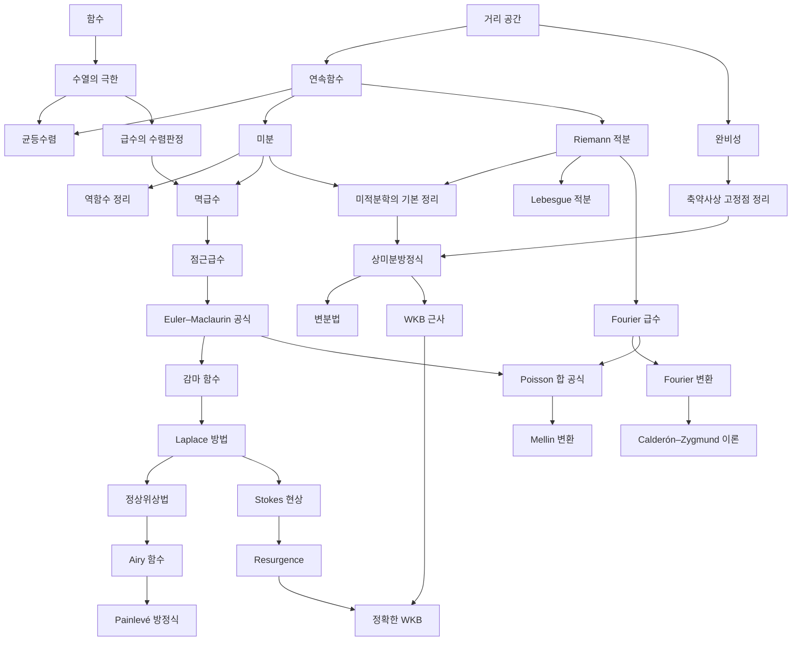

# 해석학 개관

# 개요

해석학(analysis)은 극한으로 정의되는 대상을 다루는 분야다. 원의 넓이는 원 안에 정다각형을 그리고 변의 수를 늘려 가며 구한 넓이가 다가가는 수로 정하는데, 그런 수가 언제 있는지, 있다면 다각형들의 성질을 물려받는지는 따로 따져야 한다. 수열이 한 수에 다가간다는 것을 오차의 크기로 정의하고, 그 정의로 극한의 존재와 성질의 보존을 증명한다.

처음 읽는 사람은 [수열의 극한](limits.md)에서 시작한다.

# 지도

# 갈래

처음 읽는 사람은 극한과 연속, 함수공간의 근사정리, Lipschitz 조건, 미분과 적분의 순서로 읽는다. 그 네 갈래가 이 분야의 공통 기반이고, 나머지 일곱은 거기서 갈라진다. 측도와 복소평면으로의 확장을 먼저 읽으면 뒤의 여섯 갈래에서 적분과 해석적 연속을 전제할 수 있다. 변분법과 비선형 방정식은 미분방정식을 잇고, 멱급수와 점근해석은 Fourier 해석과 적분변환보다 앞에 온다. 보간과 특이적분, 퍼텐셜과 작용소는 Fourier 해석을 쓴다.

## 극한과 연속

먼저 읽을 것: [함수](functions.md)(기초 개관). 시작 문서: [수열의 극한](limits.md).

- [수열의 극한](limits.md): 수렴의 정의와 극한의 사칙연산
  - [Fekete 보조정리](fekete-lemma.md): 부분가법 수열을 n 으로 나눈 극한의 존재와 그 값이 하한이라는 것, 엔트로피와 증가율
- [연속함수](continuity.md): $\varepsilon\text{-}\delta$ 정의와 열린집합 정의의 동치
  - [중간값 정리](intermediate-value-theorem.md): 구간 위의 연속함수가 두 끝값 사이의 모든 값을 갖는다는 정리, 이분법 증명과 구성적 근사형
- [완비성](completeness.md): 극한값을 모르고도 수렴을 판정하는 조건
  - [Bolzano–Weierstrass 정리](bolzano-weierstrass.md): 유계 수열에서 수렴하는 부분수열을 뽑는 구간 반분 논증
- [균등연속](uniform-continuity.md): $\delta$ 를 점에 의존하지 않게 고른 조건, Heine–Cantor 정리
- [균등수렴](uniform-convergence.md): 연속성과 적분을 극한과 바꿔 쓸 수 있게 하는 조건
- [급수의 수렴판정](series-convergence.md): 비교, 비율, 근, 적분, 교대급수 판정과 재배열
  - [Abel 합산 공식](abel-summation.md): 곱의 합을 부분합과 이웃한 항의 차로 바꿔 쓰는 등식, Dirichlet 판정법과 조화합의 점근식

## 함수공간의 근사정리

먼저 읽을 갈래: 극한과 연속. 먼저 읽을 것: [Banach 공간](banach-spaces.md)(함수해석 개관). 시작 문서: [Arzelà–Ascoli 정리](arzela-ascoli.md).

- [Arzelà–Ascoli 정리](arzela-ascoli.md): 함수족이 균등수렴하는 부분열을 가질 조건, 동등연속
  - [Baire 범주 정리](baire-category.md): 완비 공간이 성긴 집합 가산 개로 덮이지 않는다는 정리, 구성 없는 존재 증명
- [Stone–Weierstrass 정리](stone-weierstrass.md): 점을 분리하는 부분대수의 균등근사, Weierstrass 근사정리
- [Korovkin 정리](korovkin-theorem.md): 양작용소 열의 균등수렴을 세 검정함수에서 판정, Bernstein 다항식의 수렴
- [직교다항식](orthogonal-polynomials.md): 가중 내적의 직교 기저, 삼항 점화식과 영점의 실근 분리, 영점을 절점으로 쓰면 차수 $2n-1$ 까지 정확한 구적 공식
- [Chebyshev 다항식](chebyshev-polynomials.md): 구간에서 균등노름이 가장 작은 최고차 계수 $1$ 의 다항식, 등진동과 절점 보간

## Lipschitz 조건과 고정점

먼저 읽을 갈래: 극한과 연속. 시작 문서: [Lipschitz 사상](lipschitz-maps.md).

- [Lipschitz 사상](lipschitz-maps.md): 거리를 상수배 이내로 옮기는 조건, McShane 확장
- [축약사상 고정점 정리](banach-fixed-point.md): 완비성이 해의 존재와 유일성을 주는 첫 사례
- [Hölder 공간](holder-spaces.md): 거리의 $\alpha$ 제곱으로 차를 통제하는 함수의 Banach 공간, Morrey 부등식과 지수의 포함관계

## 미분과 적분

먼저 읽을 갈래: Lipschitz 조건과 고정점. 먼저 읽을 것: [선형사상](linear-maps.md), [스펙트럼 정리](spectral-theorem.md)(선형대수 개관). 시작 문서: [미분](derivative.md).

- [미분](derivative.md): 국소 선형근사
  - [다항식 보간](polynomial-interpolation.md): 주어진 점들의 값을 지나는 유일한 다항식, Lagrange 꼴과 Newton 꼴, 오차 공식과 Runge 현상
  - [역함수 정리](inverse-function-theorem.md): 전미분과 연쇄법칙, 역함수 정리와 음함수 정리
- [Hessian 행렬](hessian.md): 이계 편미분의 대칭행렬, 이차 Taylor 전개와 임계점의 이계 판정, 볼록성 판정
- [Laplace 연산자](laplace-operator.md): Hessian 의 대각합, 구면 평균과의 차를 재는 평균값 공식, 회전 불변성과 극좌표 표현, 고윳값의 Weyl 법칙
- [Riemann 적분](riemann-integral.md): 분할과 상하합, 적분 가능성의 판정
  - [Newton–Cotes 공식](newton-cotes.md): 등간격 점의 보간 다항식을 적분한 수치적분, 사다리꼴 규칙과 Simpson 규칙의 오차, 높은 차수의 음의 가중치와 Romberg 적분
  - [Clenshaw–Curtis 구적](clenshaw-curtis-quadrature.md): Chebyshev 극값점의 보간 다항식을 적분한 수치적분, 양수 가중치와 연속함수에서의 수렴, 두 배로 늘려도 유지되는 노드
    - [Smolyak 희소격자 구적](smolyak-quadrature.md): 1 차원 구적의 차분을 텐서곱해 단계의 합이 작은 것만 더한 고차원 적분 공식, 점의 개수와 혼합 매끄러움에서의 오차
- [미적분학의 기본 정리](fundamental-calculus.md): 미분과 적분의 역관계
  - [Green 정리](greens-theorem.md): 평면 영역의 이중적분을 경계의 선적분으로 바꾸는 정리, 넓이 공식과 신발끈 공식
- [상미분방정식](ordinary-differential-equations.md): Picard–Lindelöf 존재 정리와 선형 이론
  - [Peano 존재정리](peano-existence-theorem.md): 연속성만으로 얻는 해의 존재, 유일성의 실패와 Osgood 조건
- [Grönwall 부등식](gronwall-inequality.md): 자기 적분으로 눌린 함수의 지수 상한, 해의 유일성과 연속의존성
  - [Bihari 부등식](bihari-inequality.md): 비선형 함수의 적분으로 눌린 함수의 상한, Osgood 유일성 판정
- [Lyapunov 안정성](lyapunov-stability.md): 해를 구하지 않고 평형점 근처에 머무는지 판정하는 Lyapunov 함수와 선형화
- [Hartman–Grobman 정리](hartman-grobman.md): 쌍곡 평형점 근처의 흐름이 선형화와 위상 공액이라는 정리, 안정 다양체 정리
  - [중심 다양체 정리](center-manifold-theorem.md): 실수부가 0 인 고윳값의 방향에 접하는 불변 다양체, 축소 원리
- [Sternberg 정리](sternberg-theorem.md): 고윳값에 공명이 없을 때 쌍곡 평형점 근처의 흐름을 선형화하는 매끄러운 좌표 변환, 호몰로지 방정식
- [Poincaré–Dulac 정규형](poincare-dulac-normal-form.md): 좌표 변환으로 공명 단항식만 남긴 꼴, Poincaré 영역의 해석적 판본, Hopf 정규형과 Takens 정규형
- [Hopf 분기](hopf-bifurcation.md): 켤레 고윳값 한 쌍이 허수축을 가로지를 때 평형점에서 주기해가 갈라져 나오는 현상, 초임계와 아임계
- [Poincaré–Bendixson 정리](poincare-bendixson.md): 평면에서 유계인 해가 다가가는 곳, 극한 순환의 존재와 Bendixson 판정법
  - [Lorenz 방정식](lorenz-system.md): 유계 영역에 갇히고 평형점이 모두 불안정한데도 주기해로 가지 않는 3 차원 계, 이상 끌개
- [Liénard 정리](lienard-theorem.md): 감쇠와 복원력의 부호 조건에서 극한 순환이 하나뿐이고 안정하다는 정리, van der Pol 방정식
- [Hilbert 의 16 번째 문제](hilbert-sixteenth-problem.md): 다항식 벡터장의 극한 순환 개수의 상한, 개별 유한성 정리와 Hilbert 수의 하한
- [약한 Hilbert 16 번째 문제](weak-hilbert-sixteenth-problem.md): Hamilton 벡터장의 섭동에서 극한 순환을 세는 Abel 적분의 영점 수, Poincaré–Pontryagin 정리와 Varchenko–Khovanskii 정리
- [Bogdanov–Takens 분기](bogdanov-takens-bifurcation.md): 고윳값 0 이 두 번인 평형점에서 안장점 마디점, Hopf, 호모클리닉 곡선이 만나는 여차원 2 분기, Abel 적분으로 본 극한 순환의 유일성
- [Sturm–Liouville 이론](sturm-liouville.md): 2 계 고윳값 문제의 직교성과 완전성, Sturm 진동정리

## 측도와 복소평면으로의 확장

먼저 읽을 갈래: 미분과 적분. 시작 문서: [Lebesgue 적분](lebesgue-integral.md).

- [Lebesgue 적분](lebesgue-integral.md): 적분을 측도로 다시 세운다
  - [Rademacher 정리](rademacher-theorem.md): Lipschitz 사상이 거의 모든 점에서 미분가능하다는 정리
  - [Poincaré 회전수](poincare-rotation-number.md): 원 위상동형사상의 평균 회전량, 유리 회전수와 주기 궤도, Denjoy 정리와 Diophantine 회전수의 매끄러운 공액
- [정칙함수](holomorphic-functions.md): 복소미분이 해석성을 강제한다
  - [비표준 해석학](nonstandard-analysis.md): 무한소를 원소로 갖는 순서체에서 극한을 계산으로 바꾼다

## 변분법과 기하 부등식

먼저 읽을 갈래: 측도와 복소평면으로의 확장. 시작 문서: [변분법](calculus-of-variations.md).

- [변분법](calculus-of-variations.md): 범함수의 정류 조건과 Euler–Lagrange 방정식
  - [최단강하선 문제](brachistochrone.md): 낙하 시간 범함수와 Beltrami 항등식, 사이클로이드 해와 등시성
  - [현수선](catenary.md): 길이를 고정한 위치 에너지 최소화, 쌍곡코사인 해와 수평 장력의 뜻
  - [Noether 정리](noether-theorem.md): 작용의 연속 대칭마다 나오는 보존량, 평행이동과 회전과 시간 대칭의 세 전하
- [변분법의 직접법](direct-method.md): 최소화열과 약수렴으로 얻는 최소점의 존재, 강제성과 약하반연속성
  - [Dirichlet 원리](dirichlet-principle.md): 경계값이 정해진 함수 가운데 에너지 최소점이 조화함수라는 원리, Weierstrass 의 반례
- [Brunn–Minkowski 부등식](brunn-minkowski.md): Minkowski 합의 부피 하한, 상자 분해 증명과 Prékopa–Leindler 부등식
  - [등주부등식](isoperimetric-inequality.md): 길이를 고정한 넓이의 최대, 정류 곡선이 원인 것과 Hurwitz 의 Fourier 증명
    - [Faber–Krahn 부등식](faber-krahn.md): 부피가 같은 영역 가운데 Dirichlet 첫 고윳값이 가장 작은 것은 공이다, 대칭 감소 재배열과 Pólya–Szegő 부등식, Krahn–Szegő 정리
      - [Szegő–Weinberger 부등식](szego-weinberger.md): 부피가 같은 영역 가운데 Neumann 첫 양의 고윳값이 가장 큰 것은 공이다, Brouwer 고정점으로 중심을 맞춘 Weinberger 의 시험함수와 구면의 Hersch 부등식
- [혼합부피](mixed-volumes.md): Minkowski 합의 부피를 계수별로 분해한 양, Steiner 공식과 Alexandrov–Fenchel 부등식
- [내재부피](intrinsic-volumes.md): 주변 차원에 의존하지 않는 기하량의 족, Hadwiger 정리와 Kubota 투영 공식
- [McMullen 분해](mcmullen-decomposition.md): 평행이동 불변 평가의 공간을 동차차수로 가른 직합, Alesker 조밀성 정리

## 비선형 방정식과 파동

먼저 읽을 갈래: 변분법과 기하 부등식. 시작 문서: [점성해](viscosity-solutions.md).

- [점성해](viscosity-solutions.md): 시험함수와의 접촉으로 정의하는 약한 해, 비교 원리와 Hopf-Lax 공식
- [엔트로피 해](entropy-solutions.md): 보존법칙의 불연속 해를 가려내는 볼록 부등식, Rankine-Hugoniot 조건과 충격파·희박파의 구별
- [Riemann 문제](riemann-problem.md): 두 상수 상태를 잇는 자기유사 해, 파 곡선과 Lax 의 존재 정리
- [솔리톤](solitons.md): 분산과 비선형의 상쇄로 모양이 유지되는 고립파, Hirota 쌍선형 꼴과 충돌의 탄성
- [sine-Gordon 방정식](sine-gordon-equation.md): 위상 전하로 분류되는 kink 와 breather, Bäcklund 변환과 상수 음곡률 곡면의 대응

## 멱급수와 점근해석

먼저 읽을 갈래: 측도와 복소평면으로의 확장. 시작 문서: [멱급수](power-series.md).

- [멱급수](power-series.md): 수렴반경과 해석성
  - [Tauber 정리](tauberian-theorems.md): 평균의 수렴에 항의 조건을 더해 급수의 수렴과 점근을 얻는 정리, Tauber 와 Hardy–Littlewood 의 정리와 Karamata 의 다항식 근사 증명
  - [지수함수](exponential-function.md): 도함수가 자신과 같은 급수, 덧셈 법칙과 자연로그, 다항식보다 빠른 증가, e 의 무리수성
    - [쌍곡함수](hyperbolic-functions.md): 지수함수를 짝과 홀로 가른 두 함수, 삼각 항등식과 부호만 다른 항등식
- [점근급수](asymptotic-series.md): 수렴을 요구하지 않는 전개와 나머지항 조건, 최적 절단, Watson 보조정리
- [Euler–Maclaurin 공식](euler-maclaurin.md): 합과 적분의 차이를 도함수 값의 급수로 전개
  - [Richardson 외삽](richardson-extrapolation.md): 오차 전개의 첫 항을 두 간격의 근삿값의 선형결합으로 지우는 방법, Romberg 적분표
- [감마 함수](gamma-function.md): 계승의 해석적 연속
- [Laplace 방법](laplace-method.md): 지수적으로 집중된 적분의 주항
- [정상위상법](stationary-phase.md): 진동적분의 위상이 멈추는 자리
  - [Bessel 함수](bessel-functions.md): 원통 대칭 경계값 문제의 반지름 방향 해, 영점이 정하는 고유진동수와 가중 직교성
- [Stokes 현상](stokes-phenomenon.md): 점근전개의 계수가 불연속으로 바뀌는 선
- [Borel–Padé 재합산](borel-pade.md): Borel 변환의 해석적 연장을 Padé 근사로 대신하는 절차, 가짜 극점과 등각사상 재합산
- [Resurgence 이론](resurgence.md): 섭동급수와 비섭동 효과의 연결
- [Airy 함수](airy-functions.md): 회전점 근방의 표준형
- [WKB 근사](wkb-approximation.md)(Wentzel–Kramers–Brillouin): 작은 매개변수를 가진 방정식의 지수적 해
- [정확한 WKB](exact-wkb.md): WKB 급수를 Borel 재합산으로 엄밀화
- [Painlevé 방정식](painleve-equations.md): 가동 특이점이 극뿐인 비선형 방정식

## Fourier 해석과 적분변환

먼저 읽을 갈래: 멱급수와 점근해석. 먼저 읽을 것: [Hilbert 공간](hilbert-spaces.md)(함수해석 개관). 시작 문서: [Fourier 급수](fourier-series.md).

- [Fourier 급수](fourier-series.md): 직교계 전개와 $L^2$ 수렴
  - [Fejér 핵](fejer-kernel.md): 부분합의 Cesàro 평균이 쓰는 음이 아닌 핵, Fejér 정리와 Gibbs 현상의 부재
  - [Wirtinger 부등식](wirtinger-inequality.md): 평균이 $0$ 인 주기함수를 도함수의 $L^2$ 노름으로 누르는 부등식, 최적 상수와 등호 조건
  - [Lobachevsky 함수](lobachevsky-function.md): Fourier 급수가 쌍곡 부피를 계산한다
- [Fourier 변환](fourier-transform.md): 실직선 위의 적분변환과 반전 공식, Plancherel 정리
  - [불확정성 원리](uncertainty-principle.md): 함수와 변환의 분산의 곱에 대한 하한
  - [이산 Fourier 변환](fourier.md): 유한 순환군 위의 Fourier 해석
  - [합성곱](convolution.md): 평행이동의 가중평균, Young 부등식과 합성곱 정리, 평활화와 근사 항등원
  - [파동방정식](wave-equation.md): 두 방향으로 이동하는 해와 d'Alembert 공식, 유한 전파 속도와 에너지 보존, Huygens 원리
  - [열방정식](heat-equation.md): 열핵과의 합성곱으로 쓴 해, 평활화와 최대값 원리, 고유함수 전개, 역방향 불량설정
- [Poisson 합 공식](poisson-summation.md): 격자 합과 쌍대격자 합의 등식
- [Mellin 변환](mellin-transform.md): 곱셈적 구조 위의 적분변환
- [Laplace 변환](laplace-transform.md): 미분을 s 의 곱셈으로 바꿔 초기값 문제를 대수방정식으로 푸는 변환, 합성곱 정리와 Bromwich 반전 공식
- [표본화 정리](sampling-theorem.md): 대역제한 함수를 균일한 표본으로 복원하는 공식과 Nyquist 조건

## 보간과 특이적분

먼저 읽을 갈래: Fourier 해석과 적분변환. 시작 문서: [Marcinkiewicz 보간 정리](marcinkiewicz-interpolation.md).

- [Riesz–Thorin 정리](riesz-thorin.md): 두 끝 지수의 노름에서 그 사이 지수의 노름, 복소 보간
- [Marcinkiewicz 보간 정리](marcinkiewicz-interpolation.md): 약한 유형 추정 둘에서 그 사이 지수의 강한 추정
- [Hardy–Littlewood 극대함수](hardy-littlewood-maximal-function.md): 공 평균의 상한, 약한 추정과 Lebesgue 미분 정리
- [Calderón–Zygmund 이론](calderon-zygmund-theory.md): 특이적분 작용소의 $L^p$ 유계성과 분해
- [극대 특이적분](maximal-singular-integral.md): 절단 적분의 상한, Cotlar 부등식과 주값의 각점 존재
- [Littlewood–Paley 이론](littlewood-paley.md): 주파수의 이진 분해, 제곱함수와 $L^p$ 노름의 동등성

## 퍼텐셜과 작용소

먼저 읽을 갈래: 보간과 특이적분. 시작 문서: [Green 함수](greens-function.md).

- [Green 함수](greens-function.md): $-\Delta E=\delta_0$ 의 해, 표현 공식과 Poisson 핵
- [퍼텐셜 이론](potential-theory.md): 세분함수의 상한으로 만든 Dirichlet 해, 용량과 균형 측도, Wiener 기준
  - [최대값 원리](maximum-principle.md): $Lu\le 0$ 인 함수가 최대값을 경계에서 갖는다, Hopf 보조정리와 선험 상한
  - [로그 용량](logarithmic-capacity.md): 평면 집합 위 확률측도의 로그 에너지 최솟값, 초월 지름과 Chebyshev 상수의 일치, 균형 측도와 대수적 정수의 분포
    - [Bernstein–Walsh 정리](bernstein-walsh-theorem.md): 다항식 최선 근사 오차의 지수적 감소율과 Green 함수 등위선 안쪽까지의 정칙 연장의 동치, Bernstein 타원과 Chebyshev 계수의 상한
  - [De Giorgi–Nash–Moser 정리](de-giorgi-nash-moser.md): 유계 측정가능 계수의 약한 해가 Hölder 연속이다, Caccioppoli 부등식과 진동 감소
- [유계 작용소](bounded-operators.md): 작용소 노름, 스펙트럼과 분해 스펙트럼
  - [비유계 작용소](unbounded-operators.md): 조밀한 정의역, 자기수반성, 한 모수 유니터리 군
- [Fredholm 작용소](fredholm-operators.md): 핵과 여핵이 유한차원인 작용소의 정수 불변량
- [Fredholm 행렬식](fredholm-determinant.md): 핵 작용소의 행렬식과 적분방정식
- [Peter–Weyl 정리](peter-weyl.md): 콤팩트군 위 $L^2$ 의 기약표현 분해

# 연관 문서

## 선수지식

- [집합](sets.md)

## 더 알아보기

- [수열의 극한](limits.md)
- [완비성](completeness.md)
- [연속함수](continuity.md)
- [이산 Fourier 변환](fourier.md)

#analysis #complex_analysis #overview
