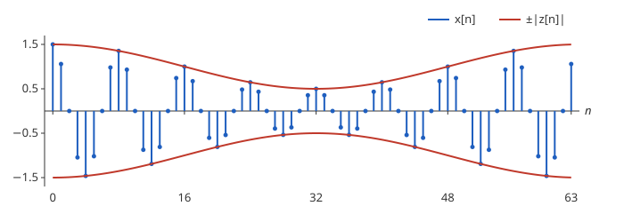

# 해석 신호

# 개요

**해석 신호(analytic signal)** 는 실수 신호에서 음의 주파수 성분을 지우고 양의 주파수 성분을 두 배로 한 복소수 신호다. 라디오의 진폭 변조(amplitude modulation, AM) 방송은 빠르게 진동하는 파형의 진폭을 소리에 맞춰 천천히 바꾸어 보내고, 받는 쪽은 그 진폭의 변화를 다시 꺼내야 한다. 실수 파형의 절댓값은 진동할 때마다 $0$ 으로 떨어지지만, 해석 신호의 절댓값은 진동 없이 진폭만 따라간다.

# 직관

수열 $x\lbrack n\rbrack=e\lbrack n\rbrack\cos(\pi n/4)$ $(0\le n\le 63)$ 에서 $e\lbrack n\rbrack=1+\frac12\cos(2\pi n/64)$ 는 천천히 바뀌는 진폭이다. $x$ 만 받아서 $e$ 를 꺼내려 한다. $\lvert x\lbrack n\rbrack\rvert$ 는 $n=2,6,10,\dots$ 에서 $\cos(\pi n/4)=0$ 이므로 $0$ 이 되고, 진폭이 아니라 진동을 따라 오르내린다.

$\cos\theta=\frac12(e^{i\theta}+e^{-i\theta})$ 이고, 복소수 $e^{i\theta}$ 는 절댓값이 늘 $1$ 이다. 진폭이 $1$ 로 일정하면 $\cos(\pi n/4)$ 를 $e^{i\pi n/4}$ 로 바꾼 수열의 절댓값이 진폭이다. 진폭이 바뀌어도 같은 일을 하려면 $x$ 를 주파수별로 나누어 $e^{-i\theta}$ 쪽을 버리고 $e^{i\theta}$ 쪽을 두 배로 한다.

곱을 합으로 바꾸면 $x\lbrack n\rbrack=\cos(2\pi\cdot 8n/64)+\frac14\cos(2\pi\cdot 7n/64)+\frac14\cos(2\pi\cdot 9n/64)$ 이다. 세 코사인을 각각 $e^{i(\cdot)}$ 로 바꾸면 $z\lbrack n\rbrack=e^{i\pi n/4}\bigl(1+\frac14e^{-2\pi in/64}+\frac14e^{2\pi in/64}\bigr)=e^{i\pi n/4}e\lbrack n\rbrack$ 이다. $e\lbrack n\rbrack\gt 0$ 이므로 $\lvert z\lbrack n\rbrack\rvert=e\lbrack n\rbrack$ 이고 실수부는 $x\lbrack n\rbrack$ 이다.

아래 그림의 막대는 $x\lbrack n\rbrack$, 빨간 곡선은 $\pm\lvert z\lbrack n\rbrack\rvert$ 다. 막대 끝이 빨간 곡선에 닿는 자리가 $\cos(\pi n/4)=\pm 1$ 인 $n$ 이다.

# 정의

## 연속 신호

실수값 함수 $x\in L^2(\mathbb R)$ 의 [Fourier 변환](fourier-transform.md)을 $\hat x$ 라 한다. 다음 식으로 정해지는 복소수값 함수 $z$ 를 $x$ 의 **해석 신호** 라 한다.

$$
\hat z(\xi)=\begin{cases}2\hat x(\xi)&\xi\gt 0\cr 0&\xi\lt 0\end{cases}
$$

$z=x+iy$ 로 쓸 때 $y$ 를 $x$ 의 **Hilbert 변환(Hilbert transform)** 이라 한다. Hilbert 변환은 Fourier 변환에 $-i\thinspace\mathrm{sgn}\thinspace\xi$ 를 곱하는 작용소이고, $\cos t$ 를 $\sin t$ 로 보낸다.

## 이산 신호

$N$ 이 짝수이고 $x\lbrack 0\rbrack,\dots,x\lbrack N-1\rbrack$ 이 실수이며 [이산 Fourier 변환](fourier.md)이 $X\lbrack k\rbrack$ 라 한다. 다음 $Z\lbrack k\rbrack$ 의 이산 Fourier 역변환 $z\lbrack n\rbrack$ 을 $x$ 의 이산 해석 신호라 한다[^1].

$$
Z\lbrack k\rbrack=\begin{cases}X\lbrack k\rbrack&k=0,\thinspace N/2\cr 2X\lbrack k\rbrack&1\le k\le N/2-1\cr 0&N/2+1\le k\le N-1\end{cases}
$$

$k$ 가 $N/2$ 보다 큰 번호는 음의 주파수 $2\pi(k-N)/N$ 에 해당한다. 직관 절에서 $X\lbrack k\rbrack$ 는 $k=7,8,9$ 와 $k=55,56,57$ 에서만 $0$ 이 아니고, $Z$ 는 앞의 셋을 두 배로 하고 뒤의 셋을 지운 것이다.

## 포락선과 순간 주파수

$z\lbrack n\rbrack=A\lbrack n\rbrack e^{i\phi\lbrack n\rbrack}$ $(A\lbrack n\rbrack\ge 0)$ 로 쓸 때 $A$ 를 **포락선(envelope)**, $\phi$ 를 **순간 위상(instantaneous phase)** 이라 한다. 이웃한 두 위상의 차이 $\arg(z\lbrack n\rbrack\overline{z\lbrack n-1\rbrack})$ 를 **순간 주파수(instantaneous frequency)** 라 한다. 직관 절에서 포락선은 $e\lbrack n\rbrack$ 이고 순간 주파수는 모든 $n$ 에서 $\pi/4$ 다.

# 성질

## 실수부의 보존

이산 해석 신호의 실수부는 $x$ 다. $x$ 가 실수이면 $X\lbrack N-k\rbrack=\overline{X\lbrack k\rbrack}$ 이므로, 번호 $k$ 와 $N-k$ 의 두 성분 $X\lbrack k\rbrack e^{2\pi ikn/N}$ 과 $X\lbrack N-k\rbrack e^{2\pi i(N-k)n/N}$ 은 서로 켤레이고 합이 $2\thinspace\mathrm{Re}(X\lbrack k\rbrack e^{2\pi ikn/N})$ 이다. $Z$ 는 그 합 대신 $2X\lbrack k\rbrack e^{2\pi ikn/N}$ 하나를 두므로 실수부가 같다. 연속 신호에서도 $\hat x(-\xi)=\overline{\hat x(\xi)}$ 에서 같은 계산으로 $\mathrm{Re}\thinspace z=x$ 가 나온다.

## 코사인과 사인

$x\lbrack n\rbrack=\cos(2\pi k\_0n/N)$, $1\le k\_0\le N/2-1$ 이면 $z\lbrack n\rbrack=e^{2\pi ik\_0n/N}$ 이고, 이산 Hilbert 변환은 $\sin(2\pi k\_0n/N)$ 이다. 포락선은 $1$ 이고 순간 주파수는 $2\pi k\_0/N$ 이다.

## 곱의 해석 신호

$x\lbrack n\rbrack=e\lbrack n\rbrack\cos(2\pi k\_0n/N)$ 이고 $e$ 가 실수이며 이산 Fourier 변환이 $\lvert k\rvert\lt k\_0$ 인 번호에만 있으면(번호 $k$ 와 $N-k$ 를 같은 주파수로 본다), 그리고 $k\_0$ 에 그 폭을 더해도 $N/2$ 보다 작으면 $z\lbrack n\rbrack=e\lbrack n\rbrack e^{2\pi ik\_0n/N}$ 이다. 직관 절이 $k\_0=8$ 이고 $e$ 의 번호가 $\pm 1$ 인 경우다. 증명의 요지. $e$ 의 각 성분 $e^{2\pi ijn/N}$ $(\lvert j\rvert\lt k\_0)$ 에 $\cos$ 를 곱하면 번호 $k\_0+j$ 와 $-k\_0+j$ 의 두 성분이 되고, 앞의 것은 양, 뒤의 것은 음의 주파수다. 음의 쪽을 지우고 양의 쪽을 두 배로 하면 $e^{2\pi ijn/N}e^{2\pi ik\_0n/N}$ 이 남는다. 연속 신호에서 같은 진술을 Bedrosian 정리(Bedrosian theorem)라 한다.

$e$ 의 주파수가 $k\_0$ 에 닿으면 이 등식이 깨진다. $\lvert z\rvert$ 는 그때도 정의되지만 $\lvert e\rvert$ 와 같지 않다.

# 활용

- AM 복조. 받은 파형의 해석 신호를 계산해 절댓값을 취하면 진폭에 실린 소리가 나온다. 곱의 해석 신호 절의 조건이 소리의 주파수가 반송 주파수보다 낮아야 한다는 조건이다.
- 단측파대 변조(single-sideband modulation). 소리 $m$ 의 해석 신호에 $e^{i\omega\_ct}$ 를 곱한 것의 실수부 $m(t)\cos\omega\_ct-y(t)\sin\omega\_ct$ 를 보내면, 반송 주파수 $\omega\_c$ 의 위쪽 성분만 남아 차지하는 주파수 폭이 절반이 된다. $y$ 는 $m$ 의 Hilbert 변환이다.
- 순간 주파수의 추정. 주파수가 시간에 따라 바뀌는 신호에서 이웃한 해석 신호 값의 위상 차이로 시각마다의 주파수를 읽는다. [단시간 Fourier 변환](short-time-fourier-transform.md)이 조각마다 주파수 표를 주는 것과 달리 표본마다 수 하나를 준다.
- [Calderón–Zygmund 이론](calderon-zygmund-theory.md). Hilbert 변환은 핵이 $1/(\pi t)$ 인 특이적분 작용소이고, 그 이론의 첫 예다.

[^1]: S. L. Marple, "Computing the discrete-time analytic signal via FFT", *IEEE Transactions on Signal Processing* 47(9) (1999), 2600–2603.

# 연관 문서

## 선수지식

- [이산 Fourier 변환](fourier.md)

## 더 알아보기

아직 연결한 문서가 없다.

#signal_processing #analysis
