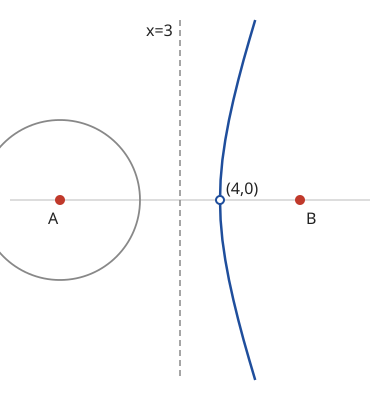

# Apollonius 도형

# 개요

**Apollonius 도형(Apollonius diagram)** 은 평면에 원들이 놓였을 때, 각 점을 원의 둘레까지의 거리가 가장 짧은 원에 배정해 평면을 나눈 그림이다. 종이에 잉크 방울 두 개가 같은 빠르기로 번지는데 한 방울이 먼저 떨어져 이미 반지름 $2$ 만큼 번져 있으면, 두 얼룩이 만나는 선은 두 방울의 한가운데가 아니다. 점에서 같은 거리인 곳을 잇는 [Voronoi 도형](voronoi-diagrams.md)의 수직이등분선으로는 이 선을 그릴 수 없다.

Apollonius 도형은 점마다 반지름을 주고 중심까지의 거리에서 반지름을 뺀 값으로 구역을 나눈다. 두 구역의 경계는 쌍곡선의 한 가지이고, 경계들이 만나는 점은 세 원에 동시에 접하는 원의 중심이다.

# 직관

방울 $A$ 는 $(0,0)$ 에 떨어져 반지름 $2$ 까지 번진 상태이고, 그때 방울 $B$ 가 $(6,0)$ 에 떨어진다. 두 얼룩은 같은 빠르기로 번진다. 점 $x$ 에 $A$ 의 잉크가 닿기까지 남은 시간은 $\lvert x-A\rvert-2$, $B$ 의 잉크가 닿는 시간은 $\lvert x-B\rvert$ 에 비례한다.

두 시간이 같은 점에서 두 얼룩이 만난다. $x$ 축 위에서는 $x-2=6-x$ 이므로 $(4,0)$ 이고, 두 점의 한가운데 $(3,0)$ 보다 $B$ 쪽으로 $1$ 만큼 옮겨 간다. 축 밖에서는 $\lvert x-A\rvert-\lvert x-B\rvert=2$ 인 점들, 곧 $A$ 와 $B$ 를 초점으로 하는 쌍곡선의 $B$ 쪽 가지다.

그림에서 쌍곡선은 위아래로 갈수록 $B$ 쪽으로 휜다. 점 $(6,8)$ 은 $A$ 까지 $10$, $B$ 까지 $8$ 떨어져 있어 $10-2=8$ 이므로 쌍곡선 위에 있다.

# 정의

## 가중 거리

중심 $p$ 와 반지름 $w\ge 0$ 의 짝을 **가중 사이트(weighted site)** 라 한다. 점 $x$ 의 가중 사이트 $(p,w)$ 까지의 **가법 가중 거리(additively weighted distance)** 는 다음이다.

$$
d(x,p)=\lvert x-p\rvert-w
$$

$x$ 가 원 밖에 있으면 $d(x,p)$ 는 원의 둘레까지의 거리다. 직관 절에서 원점의 $A$ 까지의 가중 거리는 $-2$, $B$ 까지는 $6$ 이다.

## Apollonius 영역

가중 사이트 $(p\_1,w\_1),\dots,(p\_n,w\_n)$ 에서 $p\_i$ 의 **Apollonius 영역(Apollonius cell)** 은 다음이다.

$$
A_i=\lbrace x\in\mathbb R^2:\ d(x,p_i)\le d(x,p_j)\quad\forall j\rbrace
$$

Apollonius 영역들로 평면을 나눈 것을 **Apollonius 도형(Apollonius diagram)** 또는 **가법 가중 Voronoi 도형(additively weighted Voronoi diagram)** 이라 한다. 반지름이 모두 같으면 Voronoi 도형이다.

# 성질

## 쌍곡선 경계

$w\_i\gt w\_j$ 이고 두 원이 서로 포함하지 않으면, $A\_i$ 와 $A\_j$ 의 경계는 다음 식을 만족하는 점들이다.

$$
\lvert x-p_i\rvert-\lvert x-p_j\rvert=w_i-w_j
$$

이것은 $p\_i$, $p\_j$ 를 초점으로 하는 쌍곡선 가운데 반지름이 작은 $p\_j$ 쪽 가지다. $w\_i=w\_j$ 이면 수직이등분선이다. 직관 절에서 초점이 $(0,0)$, $(6,0)$ 이고 $w\_i-w\_j=2$ 이므로 경계는 $(x-3)^2-y^2/8=1$ 의 오른쪽 가지다.

## 빈 영역

원 $j$ 가 원 $i$ 안에 들어 있으면, 곧 $\lvert p\_i-p\_j\rvert\le w\_i-w\_j$ 이면 삼각부등식으로 모든 $x$ 에서 다음이 성립한다.

$$
\lvert x-p_j\rvert-w_j\ge\lvert x-p_i\rvert-\lvert p_i-p_j\rvert-w_j\ge\lvert x-p_i\rvert-w_i
$$

그러므로 $A\_j$ 의 내부는 비어 있다. 영역이 비어 있지 않으면 $A\_i$ 는 $p\_i$ 를 포함하고, $A\_i$ 의 어느 점에서 $p\_i$ 로 가는 선분이 $A\_i$ 안에 있다. 영역은 볼록이 아닐 수 있지만 연결되어 있다.

## 꼭짓점과 Apollonius 문제

세 영역이 만나는 점 $v$ 에서는 세 원까지의 가중 거리가 같은 값 $r$ 이다. 그러므로 $v$ 를 중심으로 반지름 $r$ 인 원은 세 원에 모두 바깥에서 접한다. 주어진 세 원에 접하는 원을 찾는 고대의 [Apollonius 문제](apollonius-problem.md)의 답 하나이고, 도형의 이름이 여기서 왔다.

## 원뿔로 올리기와 계산

가중 사이트 $(p,w)$ 를 원뿔 $z=\lvert x-p\rvert-w$ 로 올리면, 모든 원뿔의 기울기가 같다. 원뿔들의 아래쪽 포락면을 평면에 내린 것이 Apollonius 도형이다. Voronoi 도형은 꼭짓점의 높이가 모두 $0$ 인 같은 원뿔들에서 나온다.

Apollonius 도형의 꼭짓점과 변은 $O(n)$ 개다(Sharir).[^1] Voronoi 도형 문서의 Fortune 쓸기는 해변선의 포물선을 쌍곡선 호로 바꾸면 Apollonius 도형을 $O(n\log n)$ 시간에 계산한다.[^2]

# 활용

- 결정의 성장. 결정 핵이 서로 다른 시각에 생겨 같은 빠르기로 자라면, 다 자란 결정립의 경계가 Apollonius 도형이다. 일찍 생긴 핵일수록 반지름이 큰 사이트에 해당하고, 이 모형을 Johnson–Mehl 모형(Johnson–Mehl model)이라 한다.[^3]
- 원 모양 장애물 사이의 길. 원판 장애물들 사이에서 로봇이 장애물과 가장 멀리 떨어져 움직이는 길은 Apollonius 도형의 변을 따라간다.
- 가장 가까운 원 찾기. 원 $n$ 개의 Apollonius 도형에 [점 위치 찾기](point-location.md) 구조를 더하면, 질의점에서 둘레가 가장 가까운 원을 $O(\log n)$ 시간에 찾는다.

[^1]: M. Sharir, "Intersection and closest-pair problems for a set of planar discs", *SIAM Journal on Computing* **14** (1985), 448–468.
[^2]: S. Fortune, "A sweepline algorithm for Voronoi diagrams", *Algorithmica* **2** (1987), 153–174.
[^3]: W. A. Johnson, R. F. Mehl, "Reaction kinetics in processes of nucleation and growth", *Transactions of the American Institute of Mining and Metallurgical Engineers* **135** (1939), 416–458.

# 연관 문서

## 선수지식

- [Voronoi 도형](voronoi-diagrams.md)

## 더 알아보기

아직 연결한 문서가 없다.

#algorithms #computation #data_structures
