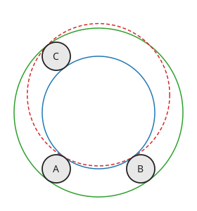

# Apollonius 문제

# 개요

**Apollonius 문제(problem of Apollonius)** 는 평면에 주어진 원 세 개에 모두 접하는 원을 찾는 문제다. 탁자 위에 동전 세 개가 떨어져 놓여 있을 때, 세 동전에 모두 닿는 고리를 놓는 방법은 고리가 각 동전을 바깥에서 건드리는지 안에 감싸는지에 따라 여러 가지다. 세 원의 반지름을 같은 만큼 바꿔 한 원을 점으로 줄이고, 그 점을 중심으로 [원 반전](circle-inversion.md)을 하면 문제가 두 원의 공통접선을 긋는 문제가 되어 답이 많아야 여덟 개로 정해진다.

# 직관

반지름 $1$ 인 원 $A$, $B$, $C$ 가 중심 $(0,0)$, $(6,0)$, $(0,8)$ 에 있다. 세 원에 모두 바깥에서 접하는 원의 중심은 세 중심에서 거리가 같으므로, 세 중심을 지나는 원의 중심 $(3,4)$ 다. 세 중심까지의 거리는 $5$ 이므로 반지름은 $5-1=4$ 다. 세 원을 모두 안에 감싸고 접하는 원은 같은 중심에 반지름 $5+1=6$ 이다.

$A$ 와 $B$ 에는 바깥에서 접하고 $C$ 는 안에 감싸는 원은 중심에서 $A$, $B$, $C$ 의 중심까지의 거리가 $\rho+1$, $\rho+1$, $\rho-1$ 이다. 앞의 두 조건으로 중심이 직선 $x=3$ 위에 있고, 셋째 조건을 풀면 중심 $X$ 와 반지름 $\rho$ 가 다음과 같다.

$$
X=\left(3,\thinspace 4+\frac{2\sqrt{10}}{5}\right),\qquad\rho=\frac{8\sqrt{10}}{5}\approx 5.06
$$

그림의 파란 원, 초록 원, 빨간 점선 원이 세 회색 원에 모두 접한다. 접하는 방식을 원마다 바깥과 안 가운데 하나로 고르면 $2^3=8$ 가지이고, 이 예에서는 여덟 가지마다 답이 하나씩 있다.

# 정의

## 부호 있는 반지름

중심이 $P\_i$, 반지름이 $r\_i$ 인 원 $C\_i$ 에 중심 $X$, 반지름 $\rho$ 인 원이 접한다. 바깥에서 접하면 $\vert X-P\_i\vert=\rho+r\_i$ 이고, $C\_i$ 를 안에 감싸고 접하면 $\vert X-P\_i\vert=\rho-r\_i$ 다. 바깥이면 $s\_i=1$, 안이면 $s\_i=-1$ 로 두어 두 경우를 $\vert X-P\_i\vert=\rho+s\_ir\_i$ 로 쓴다. $s\_ir\_i$ 를 $C\_i$ 의 **부호 있는 반지름(signed radius)** 이라 한다.

## Apollonius 문제

원 세 개 $C\_1,C\_2,C\_3$ 과 부호 $s\_1,s\_2,s\_3$ 이 주어졌을 때 다음을 만족하는 $X$ 와 $\rho\gt 0$ 을 찾는 문제를 Apollonius 문제라 한다.

$$
\vert X-P_i\vert=\rho+s_ir_i\qquad(i=1,2,3)
$$

직관 절의 세 원은 $(s\_1,s\_2,s\_3)=(1,1,1)$ 에서 $\rho=4$, $(-1,-1,-1)$ 에서 $\rho=6$, $(1,1,-1)$ 에서 $\rho=8\sqrt{10}/5$ 다.

# 성질

## 반지름을 함께 바꾸기

세 원의 부호 있는 반지름에 같은 수 $\delta$ 를 더하고 $\rho$ 에서 $\delta$ 를 빼도 등식 $\vert X-P\_i\vert=\rho+s\_ir\_i$ 는 그대로이고, 해의 중심 $X$ 도 그대로다. $\delta=-s\_3r\_3$ 으로 잡으면 $C\_3$ 이 점 $P\_3$ 이 되고, 문제는 $P\_3$ 을 지나면서 두 원에 접하는 원을 찾는 것이 된다.

직관 절의 $(1,1,1)$ 에서 $\delta=-1$ 이면 세 원이 모두 점이 되어 세 점을 지나는 원 하나가 남고, 그 반지름 $5$ 에서 $1$ 을 빼면 $\rho=4$ 다.

## 반전으로 하는 풀이

$P\_3$ 을 중심으로 반전하면 $P\_3$ 을 지나는 원은 $P\_3$ 을 지나지 않는 직선이 되고, $C\_1$, $C\_2$ 는 원이 된다. 접하는 관계는 반전으로 보존되므로, 문제는 두 원에 접하는 직선을 긋는 것이 된다. 두 원의 공통접선은 많아야 네 개이고, 그 직선들을 다시 반전하면 해가 나온다.

## 해의 개수

$s\_3$ 을 정하면 위의 풀이에서 공통접선 네 개가 $(s\_1,s\_2)$ 네 가지에 하나씩 대응한다. $s\_3$ 의 두 가지를 합쳐 해는 많아야 여덟 개다. 세 원이 서로 떨어져 있고 어느 원도 다른 원을 감싸지 않으면, 직선을 반지름이 무한한 원으로 보아 해로 셀 때 여덟 개가 모두 있다. 한 원이 다른 원을 감싸면 공통접선이 줄어 해도 줄고, 세 원이 같은 점에서 접하면 해가 무한히 많다.

## 연립방정식으로 하는 풀이

세 등식을 제곱해 첫째 식을 둘째와 셋째 식에서 빼면 $X$ 와 $\rho$ 에 대한 일차식 두 개가 남는다. 이것으로 $X$ 를 $\rho$ 의 일차식으로 적어 첫째 식에 넣으면 $\rho$ 의 이차방정식이 나온다. 부호 $s\_i$ 의 여덟 가지마다 이차방정식 하나를 풀어 양의 근을 고른다.

직관 절의 $(1,-1,1)$ 에서는 중심이 $(3+\rho/3,4)$ 이고 $\rho^2=27$ 이므로 $\rho=3\sqrt3$ 이다. $(-1,1,1)$ 에서는 $\rho\approx 4.31$, $(1,-1,-1)$ 에서는 $\rho\approx 6.73$ 이다.

# 활용

- [Descartes 원 정리](descartes-circle-theorem.md). 세 원이 서로 접하면 Apollonius 문제의 해 가운데 세 원과 함께 서로 접하는 원 네 개를 이루는 두 원의 곡률이 Descartes 원 정리의 두 근이다.
- [Apollonius 도형](apollonius-diagrams.md)의 꼭짓점. 가중 거리가 같은 세 영역이 만나는 점은 세 원에 모두 바깥에서 접하는 해의 중심이다.
- 쌍곡선 항법. 세 원에 접하는 원의 중심은 두 원의 중심까지의 거리의 차가 일정한 점, 곧 두 중심을 초점으로 하는 쌍곡선 위에 있다. 세 송신소에서 온 신호의 도착 시간 차로 위치를 정하는 방법이 이 계산과 같다.

# 연관 문서

## 선수지식

- [원 반전](circle-inversion.md)

## 더 알아보기

아직 연결한 문서가 없다.

#complex_analysis #algebra
