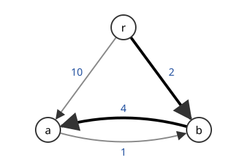

# 유향 신장트리

# 개요

**유향 신장트리(arborescence)** 는 유향 그래프에서 뿌리 $r$ 을 정했을 때, $r$ 에서 모든 정점으로 가는 유향 경로가 하나씩만 있도록 고른 호의 집합이다. 한 송신점에서 모든 수신점으로 일방향 연결을 놓되 연결마다 비용이 다를 때, 가장 싸게 모두에게 닿는 연결이 비용이 가장 작은 유향 신장트리다. 방향이 없을 때 쓰는 [최소 신장트리](minimum-spanning-tree.md)의 탐욕법은 여기서 실패하고, 정점마다 들어오는 가장 싼 호를 고른 뒤 생긴 순환을 한 정점으로 줄이는 절차로 찾는다.

# 직관

뿌리 $r$ 과 정점 $a,b$ 가 있고 일방통행 길 넷의 비용이 $a\to b$ 는 $1$, $r\to b$ 는 $2$, $b\to a$ 는 $4$, $r\to a$ 는 $10$ 이다(아래 그림). $r$ 에서 $a$ 와 $b$ 에 모두 갈 수 있게 길을 가장 싸게 고르려 한다. 각 정점에는 들어오는 길이 하나만 있으면 된다.



최소 신장트리처럼 싼 길부터 넣고, 들어오는 길이 이미 있는 정점이나 순환을 만드는 길은 건너뛴다. $a\to b$ 를 넣으면 $b$ 에 들어오는 길이 생겨 $r\to b$ 를 건너뛰고, $b\to a$ 는 순환을 만들어 건너뛰고, $r\to a$ 를 넣는다. 비용은 $11$ 이다. 그런데 $r\to b$ 와 $b\to a$ 를 고르면 비용이 $6$ 이다. 맨 처음 넣은 싼 길 $a\to b$ 가 $b$ 의 하나뿐인 자리를 차지해서 탐욕법이 막혔다.

그래서 길을 정점마다 고른다. 정점마다 들어오는 가장 싼 길을 고르면 $a$ 는 $b\to a$ 를, $b$ 는 $a\to b$ 를 고르고, 둘이 순환을 이루어 $r$ 에서 닿지 않는다. 순환 $\lbrace a,b\rbrace$ 를 한 정점으로 보고, 밖에서 들어오는 길의 비용에서 그 길이 대신할 순환 안의 길의 비용을 뺀다. $r\to a$ 는 $10-4=6$, $r\to b$ 는 $2-1=1$ 이다. 더 싼 $r\to b$ 를 고르고 순환에서 $b$ 로 들어오던 $a\to b$ 를 빼면 $r\to b$, $b\to a$ 가 남고 비용은 $6$ 이다. 이 절차를 Chu–Liu/Edmonds 알고리즘이라 한다. 그림의 굵은 호가 이 결과다.

# 정의

$D=(V,A)$ 는 유한 유향 그래프이고 $r\in V$ 다. 호의 집합 $T\subseteq A$ 가 다음 둘을 만족하면 $r$ 을 뿌리로 하는 유향 신장트리다.

- $r$ 로 들어오는 $T$ 의 호는 없고, $r$ 이 아닌 정점마다 들어오는 $T$ 의 호가 정확히 하나다.
- 방향을 무시하면 $T$ 에 순환이 없다.

이때 $\lvert T\rvert=\lvert V\rvert-1$ 이고 $r$ 에서 모든 정점으로 가는 $T$ 안의 유향 경로가 하나씩 있다. 둘째 조건만 지키고 들어오는 호를 하나 이하로 둔 것을 가지(branching)라 한다. 호의 비용 $c:A\to\mathbb R$ 가 주어지면 $c(T)=\sum_{e\in T}c(e)$ 가 가장 작은 유향 신장트리를 최소 비용 유향 신장트리라 한다.

$S\subseteq V$ 에 대해 $S$ 밖에서 $S$ 로 들어오는 호의 수를 $\rho(S)$ 로 쓴다.

# 성질

## Chu–Liu/Edmonds 알고리즘

Y. J. Chu 와 T. H. Liu, J. Edmonds 가 따로 냈다[^1][^2].

```javascript
// arcs: {from, to, cost} 의 배열, 정점은 0..n-1, root 는 뿌리
function minArborescence(n, arcs, root) {
  const best = new Array(n).fill(null);
  for (const e of arcs)
    if (e.to !== root && e.from !== e.to && (!best[e.to] || e.cost < best[e.to].cost))
      best[e.to] = e;
  const cycle = findCycle(n, best, root); // best 가 이루는 순환, 없으면 null
  if (!cycle) return best.filter(Boolean);
  const comp = contract(n, cycle);        // 순환을 정점 하나로 줄인 번호
  const reduced = arcs
    .filter((e) => comp[e.from] !== comp[e.to])
    .map((e) => ({ ...e, from: comp[e.from], to: comp[e.to], orig: e,
                   cost: cycle.has(e.to) ? e.cost - best[e.to].cost : e.cost }));
  const inner = minArborescence(n - cycle.size + 1, reduced, comp[root]);
  return expand(inner, cycle, best);      // 순환으로 들어오는 호의 끝점에서 순환의 호 하나를 뺀다
}
```

정당성의 요지. 정점 $v$ 로 들어오는 모든 호의 비용에서 같은 수를 빼면 모든 유향 신장트리의 비용이 그 수만큼 줄어 최적해가 바뀌지 않는다. 그래서 정점마다 가장 싼 들어오는 호의 비용을 빼서 그 호들의 비용을 $0$ 으로 만들어도 된다. 이 호들이 순환을 이루지 않으면 비용 $0$ 의 유향 신장트리이므로 최적이다. 순환 $C$ 를 이루면, $C$ 로 들어오는 호를 정확히 하나 쓰고 나머지는 $C$ 의 호인 최적해가 있으므로 $C$ 를 줄여도 된다.

축약은 많아야 $\lvert V\rvert$ 번이고 한 번에 $O(\lvert A\rvert)$ 이므로 $O(\lvert V\rvert\lvert A\rvert)$ 시간이다. R. E. Tarjan 은 $O(\lvert A\rvert\log\lvert V\rvert)$ 로 줄였다.

## Edmonds 가지 정리

$D$ 에 $r$ 을 뿌리로 하는, 호를 공유하지 않는 유향 신장트리가 $k$ 개 있는 것은 $r$ 을 포함하지 않는 공집합 아닌 모든 $S\subseteq V$ 에서 $\rho(S)\ge k$ 인 것과 동치다[^3]. 이것이 J. Edmonds 의 가지 정리(branching theorem)다.

필요성은 유향 신장트리 하나가 $S$ 로 들어오는 호를 적어도 하나 쓰는 데서 나온다. $k=1$ 이면 $r$ 에서 모든 정점에 닿는다는 조건이다. 충분성은 유향 신장트리를 하나씩 키우면서, 남은 그래프가 $k-1$ 에 대한 조건을 계속 만족하도록 호를 고르는 귀납으로 증명된다. L. Lovász 가 이 형태의 짧은 증명을 주었다.

## Matroid 로 본 유향 신장트리

$A$ 위의 두 [matroid](matroids.md) 를 둔다. $M_1$ 은 방향을 무시한 그래프 matroid 이고, $M_2$ 는 호를 끝점으로 묶어 $r$ 이 아닌 정점마다 하나 이하, $r$ 로는 하나도 고르지 않는 분할 matroid 다. 유향 신장트리는 크기가 $\lvert V\rvert-1$ 인 공통 독립집합이다. 공통 독립집합이 matroid 를 이루지 않으므로 탐욕법이 실패하고, 가장 큰 공통 독립집합은 [Matroid 교집합 정리](matroid-intersection.md)로 다룬다.

# 활용

- [Euler 회로](eulerian-circuits.md)의 개수. de Bruijn, van Aardenne-Ehrenfest, Smith, Tutte 의 BEST 정리(BEST theorem)는 유향 Euler 회로의 수를 한 정점으로 모이는 유향 신장트리의 수로 쓰고, 그 수는 행렬-트리 정리(matrix-tree theorem)의 유향 판본으로 계산된다.
- 방송망. 한 송신점에서 모든 수신점으로 일방향 연결을 가장 싸게 놓는 문제가 최소 비용 유향 신장트리다. 가지 정리는 호 $k-1$ 개가 끊겨도 모든 수신점에 닿는 망의 조건을 준다.
- 의존 구문 분석. 문장의 낱말을 정점으로, 낱말 사이의 지배 관계 점수를 호의 비용으로 두면 비투영 의존 구조의 최적 해석이 최소 비용 유향 신장트리다.

[^1]: Y. J. Chu, T. H. Liu, "On the shortest arborescence of a directed graph", Scientia Sinica 14 (1965), 1396–1400.
[^2]: J. Edmonds, "Optimum branchings", Journal of Research of the National Bureau of Standards 71B (1967), 233–240.
[^3]: J. Edmonds, "Edge-disjoint branchings", in R. Rustin (ed.), Combinatorial Algorithms, Algorithmics Press (1973), 91–96.

# 연관 문서

## 선수지식

- [최소 신장트리](minimum-spanning-tree.md)
- [Matroid 교집합 정리](matroid-intersection.md)

## 더 알아보기

아직 연결한 문서가 없다.

#graph_theory #algorithms #optimization
