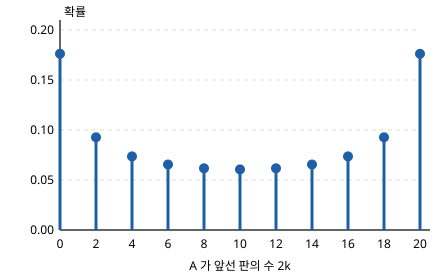

# 아크사인 법칙

# 개요

**아크사인 법칙(arcsine law)** 은 공정한 동전 던지기 게임에서 한 사람이 앞서 있는 시간의 비율이 반반 근처보다 $0$ 이나 $1$ 근처에 몰린다는 정리다. 두 사람이 동전을 $20$ 번 던져 앞면이면 A 가, 뒷면이면 B 가 $1$ 점을 얻는다고 하자. 게임 내내 어느 한쪽이 줄곧 앞설 확률은 약 $0.35$ 이고, 정확히 $10$ 판 동안 A 가 앞설 확률은 약 $0.06$ 이다. 아크사인 법칙은 걷기가 마지막으로 $0$ 을 지난 시각의 분포를 구해 이 비율의 분포를 정확히 계산한다.

# 직관

A 의 점수에서 B 의 점수를 뺀 값을 $S_k$ 라 하면, $S_k$ 는 매 판 $1$ 씩 오르거나 내리는 [무작위 걷기](random-walks.md)다. 판 $k$ 에서 $S_{k-1}$ 과 $S_k$ 의 합이 양수이면 그 판 동안 A 가 앞섰다고 센다. 두 사람의 실력이 같으므로 A 가 앞선 판의 수는 $10$ 근처에 몰릴 것처럼 보인다.

실제 분포는 반대다. 앞선 판의 수는 언제나 짝수 $2k$ 이고, 그 확률을 $k=0,\dots,10$ 에 대해 그리면 다음과 같다. 양 끝 $0$ 과 $20$ 의 막대가 가장 높고 가운데 $10$ 의 막대가 가장 낮다.

이 모양은 걷기가 $0$ 을 마지막으로 지난 시각을 보면 설명된다. 마지막으로 $0$ 을 지난 뒤에는 걷기가 다시 $0$ 에 오지 않으므로 남은 판 내내 한쪽이 앞선다. 걷기가 $0$ 으로 돌아오는 일은 드물어서, 마지막 영점은 게임 초반이나 후반에 오는 경우가 많다.

# 정의

## 단순 대칭 무작위 걷기

$X_1,X_2,\dots$ 가 독립이고 각각 $1/2$ 의 확률로 $+1$ 과 $-1$ 이라 하자. $S_0=0$ 과 $S_k=X_1+\dots+X_k$ 로 정한 수열을 **단순 대칭 무작위 걷기(simple symmetric random walk)** 라 한다. $2m$ 걸음 뒤 $0$ 에 있을 확률을 다음으로 쓴다.

$$
u_{2m}=\Pr\lbrack S_{2m}=0\rbrack=\binom{2m}{m}2^{-2m}
$$

$u_0=1$, $u_2=1/2$, $u_4=3/8$, $u_6=5/16$ 이다.

## 마지막 영점과 양의 시간

길이 $2n$ 의 걷기에서 $S_k=0$ 인 가장 큰 $k\le 2n$ 을 **마지막 영점(last zero)** $L_{2n}$ 이라 한다. $S_{k-1}+S_k\gt 0$ 인 $k\le 2n$ 의 개수를 **양의 시간(time spent positive)** $T_{2n}$ 이라 한다. 직관 절의 게임에서 $T_{20}$ 이 A 가 앞선 판의 수다.

$n=2$ 이면 걸음 넷의 경로 $16$ 개가 같은 확률로 나온다. 줄곧 위에 있는 경로는 ++++, +++−, ++−+, ++−−, +−++, +−+− 의 여섯 개이므로 $T_4=4$ 일 확률이 $6/16=3/8$ 이다.

## 아크사인 분포

구간 $(0,1)$ 위의 확률분포 가운데 누적분포함수와 밀도가 다음인 것을 **아크사인 분포(arcsine distribution)** 라 한다.

$$
F(x)=\frac2\pi\arcsin\sqrt x,\qquad f(x)=\frac{1}{\pi\sqrt{x(1-x)}}
$$

$x=1/4$ 이면 $\arcsin(1/2)=\pi/6$ 이므로 $F(1/4)=1/3$ 이다. 밀도는 양 끝에서 무한대로 커지고 $x=1/2$ 에서 가장 작다. 이 분포는 두 모수가 모두 $1/2$ 인 [베타분포](beta-distribution.md)다.

# 성질

## 돌아오지 않을 확률

정리. 다음이 성립한다.

$$
\Pr\lbrack S_1\ne 0,\dots,S_{2n}\ne 0\rbrack=u_{2n}
$$

증명의 요지. 대칭성으로 줄곧 양수일 확률의 두 배를 구하면 된다. $S_1=1$ 에서 출발해 $S_{2n}=2r$ 에 닿으며 $0$ 을 지나지 않는 경로의 수는 [투표 정리](ballot-theorem.md)의 반사 원리(reflection principle)로 다음과 같다. 여기서 $N_m(x)$ 는 $m$ 걸음에 $0$ 에서 $x$ 로 가는 경로의 수다.

$$
N_{2n-1}(2r-1)-N_{2n-1}(2r+1)
$$

이 차를 $r\ge 1$ 에 대해 더하면 앞뒤 항이 지워져 $N_{2n-1}(1)=\binom{2n-1}{n}$ 이 남는다. 이 수는 $\frac12\binom{2n}{n}$ 이므로 줄곧 양수일 확률이 $u_{2n}/2$ 이다. $\square$

## 마지막 영점의 분포

정리. $k=0,1,\dots,n$ 에 대해 다음이 성립한다.

$$
\Pr\lbrack L_{2n}=2k\rbrack=u_{2k}\thinspace u_{2n-2k}
$$

증명의 요지. $L_{2n}=2k$ 는 $S_{2k}=0$ 이고 그 뒤 $2n-2k$ 걸음 동안 $0$ 에 오지 않는 사건이다. 두 부분은 서로 다른 걸음으로 정해지므로 독립이고, 앞의 확률은 $u_{2k}$, 뒤의 확률은 위 정리로 $u_{2n-2k}$ 다. $\square$

$n=2$ 이면 $L_4=0,2,4$ 의 확률이 $3/8$, $1/4$, $3/8$ 이다. 경로 $16$ 개 가운데 여섯, 넷, 여섯 개에 해당한다.

## Chung–Feller 정리

정리(Chung–Feller theorem). 양의 시간도 마지막 영점과 같은 분포를 따른다.

$$
\Pr\lbrack T_{2n}=2k\rbrack=u_{2k}\thinspace u_{2n-2k}
$$

증명의 요지. $n$ 에 대한 귀납법을 쓴다. 처음 $0$ 으로 돌아오는 시각 $2r$ 로 경로를 나누면, 첫 구간은 통째로 위나 아래에 있고 나머지는 길이 $2n-2r$ 의 걷기다. 첫 귀환 시각의 분포와 귀납 가정을 넣어 더하면 우변이 나온다.[^1] 직관 절의 그림이 $n=10$ 인 경우이고, $u_{20}\approx 0.176$ 과 $u_{10}^2\approx 0.061$ 이 양 끝과 가운데의 막대다.

## 극한 분포

[Stirling 공식](stirling-formula.md)으로 $u_{2k}$ 는 $1/\sqrt{\pi k}$ 에 가깝다. 그래서 $k=nx$ 근처에서 $u_{2k}u_{2n-2k}$ 는 $\frac1n f(x)$ 에 가깝고, 이 값을 $k\le nx$ 에 대해 더하면 $f$ 의 적분이 된다. $0\lt x\lt 1$ 에 대해 다음이 성립한다.

$$
\lim_{n\to\infty}\Pr\Big\lbrack\frac{L_{2n}}{2n}\le x\Big\rbrack=\lim_{n\to\infty}\Pr\Big\lbrack\frac{T_{2n}}{2n}\le x\Big\rbrack=\frac2\pi\arcsin\sqrt x
$$

$x=1/4$ 을 넣으면, 긴 게임에서 A 가 전체의 $1/4$ 이하 동안만 앞설 확률이 $1/3$ 에 가깝다.

## Brown 운동의 세 아크사인 법칙

정리(Lévy). [Brown 운동](brownian-motion.md) $(B_t)\_{0\le t\le 1}$ 에서 다음 세 확률변수는 모두 아크사인 분포를 따른다.[^2]

- 마지막 영점 $g=\sup\lbrace t\le 1:B_t=0\rbrace$.
- 양의 시간 $A=\int_0^1\mathbf 1\lbrace B_t\gt 0\rbrace\thinspace dt$.
- 최댓값을 갖는 시각 $\theta$.

$g$ 에 대한 증명의 요지. $g\le x$ 는 구간 $(x,1)$ 에서 $B$ 가 $0$ 에 닿지 않는 사건이다. $B_x=a$ 라 하면 Brown 운동의 반사 원리로 그 조건부 확률은 $\Pr\lbrack\vert B_{1-x}\vert\lt\vert a\vert\rbrack$ 이다. 그래서 독립 표준정규변수 $Z_1,Z_2$ 로 다음이 나온다.

$$
\Pr\lbrack g\le x\rbrack=\Pr\big\lbrack\sqrt{1-x}\thinspace\vert Z_2\vert\lt\sqrt x\thinspace\vert Z_1\vert\big\rbrack
$$

점 $(Z_1,Z_2)$ 의 편각은 균등분포를 따르므로, 우변은 편각의 탄젠트 절댓값이 $\tan\alpha$ 보다 작을 확률이다. 여기서 $\sin\alpha=\sqrt x$ 이므로 그 확률은 $2\alpha/\pi$ 다. $\square$

$\theta$ 는 같은 계산으로 나온다. $\theta\le x$ 는 $\lbrack 0,x\rbrack$ 의 최댓값이 $\lbrack x,1\rbrack$ 의 최댓값 이상인 사건이고, 두 최댓값에서 $B_x$ 를 뺀 값은 독립이며 각각 $\sqrt x\thinspace\vert Z_1\vert$ 와 $\sqrt{1-x}\thinspace\vert Z_2\vert$ 와 분포가 같다. $A$ 는 Chung–Feller 정리의 극한에서 나온다. [Donsker 불변원리](donsker-invariance-principle.md)로 걷기의 양의 시간이 Brown 운동의 양의 시간으로 분포수렴하므로 두 극한이 같다.

## Sparre Andersen 정리

정리(Sparre Andersen theorem). $X_i$ 가 독립이고 같은 분포를 따르며 그 분포가 $0$ 에 대해 대칭이고 연속이라 하자. 부분합 $S_1,\dots,S_n$ 가운데 양수인 것의 개수 $N_n$ 은 걸음의 분포와 무관하게 다음을 만족한다.[^3]

$$
\Pr\lbrack N_n=k\rbrack=\binom{2k}{k}\binom{2n-2k}{n-k}2^{-2n}
$$

우변은 $u_{2k}u_{2n-2k}$ 와 같다. [정규분포](normal-distribution.md) 걸음이든 [Cauchy 분포](cauchy-distribution.md) 걸음이든 $N_n/n$ 의 극한이 아크사인 분포다.

# 활용

- 공정한 게임의 앞섬. 동전 던지기를 $20$ 번 하면 한쪽이 줄곧 앞서는 경우가 35% 쯤이다. 오래 앞서는 일은 공정한 게임에서도 흔하므로, 앞선 기간의 길이만으로는 한쪽이 유리한지 가를 수 없다.
- 누적 성과의 비교. 두 전략의 누적 수익 차가 공정한 걷기를 따르면, 한 전략이 대부분의 기간에 앞서는 것이 전형적인 결과다. 앞선 기간의 비율은 아크사인 분포와 견주어 판단한다.
- [Chebyshev 다항식](chebyshev-polynomials.md)의 영점. $T_n$ 의 영점은 $\cos\frac{(2j-1)\pi}{2n}$ 이고, 균등한 각의 코사인 분포는 밀도가 $1/(\pi\sqrt{1-y^2})$ 다. $y=2x-1$ 로 옮기면 아크사인 밀도이므로, 영점들의 분포가 $n\to\infty$ 에서 아크사인 분포로 간다.
- 베타분포의 특수한 경우. [이항분포](binomial-distribution.md)의 성공 확률 $p$ 에 대한 Jeffreys 사전분포(Jeffreys prior)가 아크사인 분포다.

[^1]: W. Feller, *An Introduction to Probability Theory and Its Applications*, Vol. I, 3rd ed., Wiley (1968), Ch. III. 마지막 영점의 분포, Chung–Feller 정리, 극한의 아크사인 법칙. 원 논문은 K. L. Chung, W. Feller, "On fluctuations in coin-tossing", *Proceedings of the National Academy of Sciences* **35** (1949), 605–608.
[^2]: P. Lévy, "Sur certains processus stochastiques homogènes", *Compositio Mathematica* **7** (1940), 283–339. 증명의 현대적 서술은 P. Mörters, Y. Peres, *Brownian Motion*, Cambridge University Press (2010), 5 장.
[^3]: E. Sparre Andersen, "On the fluctuations of sums of random variables", *Mathematica Scandinavica* **1** (1953), 263–285.

# 연관 문서

## 선수지식

- [투표 정리](ballot-theorem.md)
- [Brown 운동](brownian-motion.md)

## 더 알아보기

- [Sparre Andersen 정리](sparre-andersen-theorem.md)
- [일반화된 아크사인 법칙](generalized-arcsine-law.md)

#probability #combinatorics #analysis
