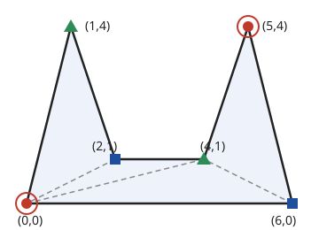

# 미술관 정리

# 개요

**미술관 정리(art gallery theorem)** 는 벽이 $n$ 개인 다각형 모양의 미술관을 지키는 데 경비원이 $\lfloor n/3\rfloor$ 명이면 충분하고, 그만큼 필요한 미술관이 있다는 정리다. 경비원은 한 자리에 서서 벽에 가리지 않는 곳을 모두 본다. 볼록한 방은 한 명이면 되지만, 벽이 안으로 꺾여 들어간 미술관에서는 한 사람에게 보이지 않는 구석이 생긴다.

이 정리는 미술관을 [다각형 삼각분할](polygon-triangulation.md)로 삼각형들로 나누고 꼭짓점을 세 색으로 칠해, 한 색의 꼭짓점에 경비원을 두면 된다는 것으로 답한다.

# 직관

꼭짓점이 $(0,0)$, $(6,0)$, $(5,4)$, $(4,1)$, $(2,1)$, $(1,4)$ 인 빗 모양의 미술관을 본다. 아래쪽 띠에서 위로 뾰족한 이빨 둘이 솟아 있다. 오른쪽 이빨의 끝 $(5,4)$ 를 보려면 이빨의 두 벽을 아래로 늘인 쐐기 안에 서야 하고, 그 쐐기는 바닥에서 $x\ge 11/3$ 인 부분이다. 왼쪽 이빨의 끝 $(1,4)$ 를 보는 쐐기는 바닥에서 $x\le 7/3$ 이다.

두 쐐기는 겹치지 않으므로 경비원 한 명으로는 두 이빨 끝을 함께 볼 수 없다. 벽이 $6$ 개이고 경비원 $2=6/3$ 명이 필요하다. 이빨을 $k$ 개로 늘리면 벽 $3k$ 개에 경비원 $k$ 명이 필요하다.

그림의 점선은 미술관을 삼각형 넷으로 자른 대각선이다. 꼭짓점은 원, 사각형, 삼각형의 세 모양으로 칠했고, 모든 삼각형의 세 꼭짓점이 서로 다른 모양이다. 원 모양 두 꼭짓점 $(0,0)$ 과 $(5,4)$ 에 경비원을 두면 미술관 전체가 보인다.

# 정의

## 보이는 점

단순 다각형 $P$ 의 두 점 $x,y$ 를 잇는 선분이 $P$ 안에 있으면 $x$ 가 $y$ 를 **본다(sees)** 고 한다. 점들의 집합 $G\subseteq P$ 의 어느 점이 $P$ 의 모든 점을 보면 $G$ 가 $P$ 를 **지킨다(guards)** 고 하고, $G$ 의 점을 **경비원(guard)** 이라 한다.

직관 절에서 $(0,0)$ 은 왼쪽 이빨 끝 $(1,4)$ 를 보지만 오른쪽 이빨 끝 $(5,4)$ 는 보지 못한다. $\lbrace(0,0),(5,4)\rbrace$ 는 미술관을 지킨다.

## 미술관 함수

꼭짓점이 $n$ 개인 단순 다각형들 가운데 가장 많은 경비원이 필요한 것의 경비원 수를 $g(n)$ 이라 한다. 다각형마다 필요한 최소 경비원 수를 구하고, 그 최댓값을 $n$ 마다 취한 것이다.

# 성질

## 미술관 정리

정리(Chvátal). $n\ge 3$ 이면 $g(n)=\lfloor n/3\rfloor$ 다.[^1]

직관 절의 빗에서 이빨 끝을 보는 쐐기들이 서로 겹치지 않으므로 $g(n)\ge\lfloor n/3\rfloor$ 이다. 아래는 $g(n)\le\lfloor n/3\rfloor$ 의 증명이다.

## Fisk 의 세 색 증명

S. Fisk 는 다음과 같이 증명했다.[^2] 다각형을 삼각분할하면 변과 대각선으로 이은 [그래프](graphs.md)의 꼭짓점을 세 색으로 칠해, 모든 삼각형의 세 꼭짓점이 서로 다른 색이 되게 할 수 있다.

증명의 요지. 삼각형이 하나이면 세 꼭짓점에 세 색을 쓴다. 삼각형이 둘 이상이면 다각형 삼각분할 문서의 두 귀 정리로 귀가 있다. 귀를 떼어 낸 다각형을 귀납법으로 칠하면, 귀의 두 밑 꼭짓점은 이미 서로 다른 색이고 귀의 꼭짓점에 남은 셋째 색을 준다. 이것은 [그래프 색칠](graph-coloring.md)에서 이 그래프의 채색수가 $3$ 이라는 것이다.

세 색 가운데 가장 적게 쓰인 색의 꼭짓점은 $\lfloor n/3\rfloor$ 개 이하다. 모든 삼각형에 그 색의 꼭짓점이 하나 있고 삼각형은 볼록이므로, 그 꼭짓점에 선 경비원이 삼각형 전체를 본다. 직관 절에서는 세 색이 두 번씩 쓰여 어느 색을 골라도 경비원 $2$ 명이다.

## 변형

- 직교 다각형. 모든 변이 수평이나 수직인 다각형은 경비원 $\lfloor n/4\rfloor$ 명으로 충분하고, 이 수가 필요한 경우가 있다(Kahn, Klawe, Kleitman).[^3]
- 구멍이 있는 다각형. 바깥 경계와 구멍들의 꼭짓점이 모두 $n$ 개이고 구멍이 $h$ 개이면 경비원 $\lfloor(n+h)/3\rfloor$ 명으로 충분하다.[^4]
- 최소 경비원 계산. 주어진 다각형을 지키는 최소 경비원 수를 구하는 문제는 NP-난해(NP-hard, NP 는 nondeterministic polynomial time)다(Lee, Lin).[^5] 경비원이 아무 점에나 설 수 있으면 실수 존재 이론(existential theory of the reals)의 문제들과 같은 난도다.[^6]

# 활용

- 감시 장치 배치. 건물의 평면도에 카메라를 둘 자리를 정할 때, 삼각분할과 세 색 칠하기가 꼭짓점 $n/3$ 개 이하의 배치를 준다.
- 로봇과 센서의 탐색. 방 안의 모든 곳을 보아야 하는 이동 로봇의 경로 계획에서, 경비원 자리를 먼저 정하고 그 점들을 도는 경로를 찾는다.

[^1]: V. Chvátal, "A combinatorial theorem in plane geometry", *Journal of Combinatorial Theory, Series B* **18** (1975), 39–41.
[^2]: S. Fisk, "A short proof of Chvátal's watchman theorem", *Journal of Combinatorial Theory, Series B* **24** (1978), 374.
[^3]: J. Kahn, M. Klawe, D. Kleitman, "Traditional galleries require fewer watchmen", *SIAM Journal on Algebraic and Discrete Methods* **4** (1983), 194–206.
[^4]: F. Hoffmann, M. Kaufmann, K. Kriegel, "The art gallery theorem for polygons with holes", *Proceedings of the 32nd IEEE Symposium on Foundations of Computer Science* (1991), 39–48.
[^5]: D. T. Lee, A. K. Lin, "Computational complexity of art gallery problems", *IEEE Transactions on Information Theory* **32** (1986), 276–282.
[^6]: M. Abrahamsen, A. Adamaszek, T. Miltzow, "The art gallery problem is ∃ℝ-complete", *Proceedings of the 50th ACM Symposium on Theory of Computing* (2018), 65–73.

# 연관 문서

## 선수지식

- [다각형 삼각분할](polygon-triangulation.md)
- [그래프 색칠](graph-coloring.md)

## 더 알아보기

아직 연결한 문서가 없다.

#algorithms #computation #combinatorics #graph_theory
