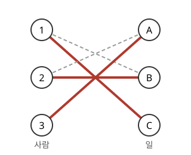

# 할당 문제

# 개요

**할당 문제(assignment problem)** 는 사람 $n$ 명에게 일 $n$ 개를 하나씩 맡길 때, 사람과 일의 짝마다 정해진 비용의 합이 가장 작은 짝짓기를 찾는 문제다. 세 사람이 세 가지 일을 나눠 맡는데 사람마다 일마다 걸리는 시간이 다르면, 누구에게 무엇을 맡겨야 걸리는 시간의 합이 가장 짧은지가 이 꼴이다. 비용 표의 행과 열에서 같은 수를 빼도 어느 짝짓기가 가장 싼지는 바뀌지 않으므로, 빼기를 되풀이해 $0$ 만으로 짝을 다 지을 수 있는 표를 만들면 답이 나온다.

# 직관

사람 $1,2,3$ 이 일 $A,B,C$ 를 하는 데 걸리는 시간이 다음 표다. 행이 사람이고 열이 일이다.

$$
C=\begin{pmatrix}1&2&3\cr 2&4&6\cr 3&6&9\end{pmatrix}
$$

사람 $1$ 부터 차례로 남은 일 가운데 가장 빠른 것을 맡기면 $1\to A$, $2\to B$, $3\to C$ 이고 합은 $1+4+9=14$ 다. 사람 $3$ 이 가장 느린 일을 떠안았다. 짝짓기는 $3!=6$ 가지뿐이라 다 세면 $1\to C$, $2\to B$, $3\to A$ 의 $3+4+3=10$ 이 가장 작지만, $n$ 이 커지면 $n!$ 가지를 셀 수 없다.

어느 짝짓기든 각 행에서 하나, 각 열에서 하나를 고른다. 그래서 한 행의 모든 수에서 같은 수를 빼면 모든 짝짓기의 합이 똑같이 그만큼 줄고, 어느 짝짓기가 가장 싼지는 바뀌지 않는다. 행마다 가장 작은 수 $1,2,3$ 을 빼고, 이어서 열마다 가장 작은 수 $0,1,2$ 를 빼면 다음 표가 된다.

$$
\begin{pmatrix}0&0&0\cr 0&1&2\cr 0&2&4\end{pmatrix}
$$

표의 수는 모두 $0$ 이상이고 지금까지 행에서 뺀 합 $6$ 과 열에서 뺀 합 $3$ 을 더하면 $9$ 이므로, 어느 짝짓기든 $9$ 이상이 든다. $0$ 인 칸만으로 짝을 다 지을 수 있으면 그 짝짓기가 $9$ 로 가장 싸다. 그런데 사람 $2$ 와 $3$ 의 $0$ 이 둘 다 일 $A$ 에 있어 두 사람을 동시에 $0$ 인 칸에 둘 수 없다.

$0$ 인 칸은 행 $1$ 과 열 $A$ 두 줄로 다 덮인다. 덮이지 않은 칸 가운데 가장 작은 수가 $1$ 이므로, 덮이지 않은 행 $2,3$ 에서 $1$ 을 빼고 덮인 열 $A$ 에 $1$ 을 더한다. 덮이지 않은 칸은 $1$ 줄고, 행 $1$ 과 열 $A$ 가 겹치는 칸은 $1$ 늘고, 나머지는 그대로다.

$$
\begin{pmatrix}1&0&0\cr 0&0&1\cr 0&1&3\end{pmatrix}
$$

뺀 합은 $9-1+2=10$ 이 되었다. 아래 그림은 이 표에서 $0$ 인 칸을 사람과 일 사이의 선으로 그린 것이다. 굵은 선 $1\to C$, $2\to B$, $3\to A$ 가 $0$ 인 칸만으로 지은 짝짓기이고, 원래 표에서 합이 $10$ 이므로 가장 싸다.

# 정의

## 할당 문제

$n\times n$ 실수 행렬 $C=(c\_{ij})$ 가 주어질 때, 다음 값을 가장 작게 하는 순열 $\sigma$ 를 찾는 문제를 **할당 문제** 라 한다.

$$
\sum_{i=1}^{n}c_{i\sigma(i)}
$$

사람 $i$ 와 일 $j$ 를 정점으로 하고 모든 쌍을 간선으로 이은 완전 이분 그래프에서, 순열은 완전 [매칭](matchings.md)이고 위 값은 매칭의 비용이다. 직관 절의 답은 $\sigma(1)=C$, $\sigma(2)=B$, $\sigma(3)=A$ 이고 비용은 $10$ 이다.

## 선형계획 완화와 쌍대

변수 $x\_{ij}$ 가 $0$ 이상이고 행의 합과 열의 합이 모두 $1$ 인 조건에서 $\sum c\_{ij}x\_{ij}$ 를 최소화하는 문제를 할당 문제의 **선형계획 완화(linear programming relaxation)** 라 한다. 그 쌍대 문제는 다음과 같다.

$$
\max\ \sum_{i}u_i+\sum_{j}v_j\quad\text{s.t.}\quad u_i+v_j\le c_{ij}\quad(\forall i,j)
$$

쌍대 허용해 $(u,v)$ 에서 $\bar c\_{ij}=c\_{ij}-u\_i-v\_j\ge 0$ 을 **축소 비용(reduced cost)** 이라 하고, $\bar c\_{ij}=0$ 인 간선만 모은 부분그래프를 **등식 부분그래프(equality subgraph)** 라 한다.

직관 절에서 행과 열에서 뺀 수가 $u,v$ 이고 남은 표가 축소 비용이다. 마지막 표는 $u=(1,3,4)$, $v\_A=-1$, $v\_B=1$, $v\_C=2$ 에서 나오고, 그 등식 부분그래프가 그림의 다섯 선이다.

# 성질

## 약쌍대성과 최적성

정리. 쌍대 허용해 $(u,v)$ 와 순열 $\sigma$ 에 대해 $\sum\_i c\_{i\sigma(i)}\ge\sum\_i u\_i+\sum\_j v\_j$ 이고, 등식 부분그래프에 완전 매칭 $\sigma$ 가 있으면 등호가 성립해 $\sigma$ 가 최적이다.

증명의 요지. 다음 식에서 마지막 합이 $0$ 이상이다.

$$
\sum_{i}c_{i\sigma(i)}=\sum_{i}u_i+\sum_{j}v_j+\sum_{i}\bar c_{i\sigma(i)}
$$

등식 부분그래프 안의 매칭이면 마지막 합이 $0$ 이다. ∎

선형계획 완화의 허용해는 이중 확률 행렬이고, [Birkhoff–von Neumann 정리](birkhoff-von-neumann-theorem.md)로 그 꼭짓점은 순열 행렬이다. 그래서 완화의 최적값이 할당 문제의 최적값과 같다.

## 헝가리안 방법

**헝가리안 방법(Hungarian method)** 은 다음 절차다[^1].

1. $u\_i=\min\_j c\_{ij}$, $v\_j=\min\_i(c\_{ij}-u\_i)$ 로 시작한다.
2. 등식 부분그래프의 최대 매칭을 구한다. 크기가 $n$ 이면 멈춘다.
3. 아니면 등식 부분그래프의 간선을 모두 덮는 최소 정점 덮개, 곧 $0$ 인 칸을 모두 덮는 가장 적은 행과 열을 구한다. König 정리(Kőnig's theorem)로 그 줄 수는 최대 매칭의 크기와 같다.
4. 덮이지 않은 칸의 축소 비용 가운데 최솟값 $\delta$ 를 구해 덮이지 않은 행의 $u\_i$ 에 $\delta$ 를 더하고 덮인 열의 $v\_j$ 에서 $\delta$ 를 뺀다. 2 로 돌아간다.

직관 절의 계산이 이 절차다. 1 단계 뒤의 덮개는 행 $1$ 과 열 $A$ 이고, $\delta=1$ 로 4 단계를 한 번 하면 2 단계에서 크기 $3$ 의 매칭이 나온다.

## 4 단계의 정당성

정리. 4 단계 뒤에도 모든 축소 비용이 $0$ 이상이고, 덮개의 줄 수가 $k\lt n$ 이면 쌍대 목적값이 $(n-k)\delta\gt 0$ 만큼 늘어난다.

증명의 요지. 덮이지 않은 칸은 $\delta$ 줄어 $0$ 이상이고, 행과 열이 둘 다 덮인 칸은 $\delta$ 늘고, 하나만 덮인 칸은 그대로다. 덮인 행이 $r$ 개, 덮인 열이 $k-r$ 개이면 $u$ 의 합은 $(n-r)\delta$ 늘고 $v$ 의 합은 $(k-r)\delta$ 줄어 $(n-k)\delta$ 가 남는다. ∎

비용이 정수이면 $\delta\ge 1$ 이므로 쌍대 목적값이 최적값에 닿을 때까지 유한 번에 끝난다. 직관 절에서 $k=2$, $\delta=1$ 이고 목적값은 $9$ 에서 $10$ 으로 늘었다.

## 최소 비용 흐름과의 관계

사람마다 공급량 $1$, 일마다 공급량 $-1$ 을 두고 간선 $i\to j$ 의 비용을 $c\_{ij}$ 로 두면 할당 문제는 [최소 비용 흐름](min-cost-flow.md) 문제다. 쌍대 변수 $u,v$ 가 그 문서의 퍼텐셜이고, 등식 부분그래프에서 증가 경로를 찾는 일은 축소 비용으로 잰 최단경로를 찾는 일이다.

이 대응으로 연속 최단 경로법을 쓰면 $n$ 번 흘리고, 퍼텐셜로 Dijkstra 알고리즘(Dijkstra's algorithm)을 쓰면 전체가 $O(n^3)$ 시간이다[^2].

# 활용

- 이산 [최적 수송](optimal-transport.md). 점 $n$ 개에서 점 $n$ 개로 같은 질량을 옮기는 최적 수송은 할당 문제이고, 쌍대 변수 $u,v$ 가 그 문서의 Kantorovich 쌍대 변수다.
- [원시-쌍대 방법](primal-dual-method.md). 헝가리안 방법은 쌍대 허용해를 유지하며 상보 여유 조건을 만족하는 원시해를 찾는 원시-쌍대 방법이다. 제약행렬이 완전 단일모듈이어서 근사가 아니라 최적해가 나온다.
- [네트워크 단체법](network-simplex-method.md). 할당 문제를 최소 비용 흐름으로 적으면 기저가 신장 트리이고, 모든 기저 해가 정수이므로 정수 조건 없이 순열을 얻는다.
- 추적과 자료 연관. 앞 시각의 물체 $n$ 개와 지금 시각의 관측 $n$ 개를 거리의 합이 가장 작게 짝짓는 문제가 할당 문제다.
- 병목 할당과 이차 할당. 비용의 합 대신 최댓값을 줄이는 [병목 할당 문제](bottleneck-assignment-problem.md)는 이분 탐색과 매칭으로 풀린다. 두 쌍의 짝마다 비용이 붙는 이차 할당 문제(quadratic assignment problem)는 [NP-완전성](np-completeness.md) 문서의 NP-난해(NP-hard, nondeterministic polynomial time hard) 문제다[^3].

[^1]: H. W. Kuhn, "The Hungarian method for the assignment problem", *Naval Research Logistics Quarterly* **2** (1955), 83–97.
[^2]: J. Edmonds, R. M. Karp, "Theoretical Improvements in Algorithmic Efficiency for Network Flow Problems", *Journal of the ACM* **19** (1972), https://doi.org/10.1145/321694.321699
[^3]: Sartaj Sahni, Teofilo Gonzalez, "P-complete approximation problems", *Journal of the ACM* **23** (1976), 555–565.

# 연관 문서

## 선수지식

- [매칭](matchings.md)
- [최소 비용 흐름](min-cost-flow.md)

## 더 알아보기

- [병목 할당 문제](bottleneck-assignment-problem.md)

#graph_theory #optimization #combinatorics
