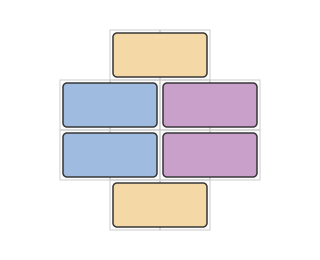

# Aztec 다이아몬드

# 개요

**Aztec 다이아몬드(Aztec diamond)** 는 칸 수가 $2,4,\dots,2n,2n,\dots,4,2$ 인 행을 가운데를 맞춰 쌓은 계단 모양의 영역이다. 이 영역을 $1\times 2$ 도미노로 빈틈없이 채우는 방법을 세면 $n=1$ 에서 $2$, $n=2$ 에서 $8$, $n=3$ 에서 $64$ 로, 지수가 $1,3,6$ 인 $2$ 의 거듭제곱이다.

도미노 덮기의 수를 행렬식으로 세는 방법을 이 영역에 쓰면 개수가 $2^{n(n+1)/2}$ 로 정확히 나온다. 큰 $n$ 에서 무작위로 고른 덮기는 네 귀퉁이에서 한 방향의 도미노로 굳고 내접원 안에서만 섞인다.

# 직관

$n=1$ 이면 영역은 $2\times 2$ 정사각형이고, 도미노 두 개를 가로로 놓거나 세로로 놓는 $2$ 가지가 있다. $n=2$ 이면 영역은 칸이 $2,4,4,2$ 인 네 행이다. 아래 그림은 도미노 여섯 개를 모두 가로로 놓은 덮기이고, 이 영역의 덮기는 모두 $8$ 가지다.

차수가 하나 오를 때 개수가 $2\to 8\to 64$ 로 $2^2$ 배, $2^3$ 배 늘어난다. 이웃한 세 차수의 개수 사이에는 $8\cdot 1=2\cdot 2^2$, $64\cdot 2=2\cdot 8^2$ 이 성립한다. 차수 $0$ 의 빈 영역을 $1$ 가지로 세면, 이 관계 하나로 다음 개수가 차례로 정해진다.

# 정의

## Aztec 다이아몬드

평면에서 꼭짓점이 정수점인 단위 정사각형 가운데 $\vert x\vert+\vert y\vert\le n+1$ 인 영역 안에 놓인 것을 모두 모은 것을 차수 $n$ 인 Aztec 다이아몬드 $\mathrm{AD}\_n$ 이라 한다. $\mathrm{AD}\_n$ 은 정사각형 $2n(n+1)$ 개로 되어 있고, $n=2$ 이면 $12$ 개다.

## 도미노 덮기

이웃한 두 정사각형을 합친 $1\times 2$ 또는 $2\times 1$ 직사각형이 도미노이고, 영역을 겹치지 않는 도미노로 빈틈없이 채운 것을 **도미노 덮기(domino tiling)** 라 한다. 정사각형을 꼭짓점, 이웃 관계를 간선으로 둔 그래프에서 도미노 덮기는 완전 매칭과 같다. $\mathrm{AD}\_n$ 의 도미노 덮기의 수를 $T(n)$ 으로 쓴다.

# 성질

## Aztec 다이아몬드 정리

**정리(Elkies–Kuperberg–Larsen–Propp).** 다음이 성립한다[^1].

$$
T(n)=2^{n(n+1)/2}
$$

$n=1,2,3$ 이면 $2$, $8$, $64$ 다. 논문은 이 정리의 증명을 네 가지 제시했고, 그 가운데 하나가 [교대 부호 행렬](alternating-sign-matrices.md)과의 대응이다.

## 응축 점화식

$\mathrm{AD}\_n$ 의 네 귀퉁이 칸을 지우는 방법을 조합한 그래프 응축(graphical condensation)으로 다음 점화식이 나온다[^2].

$$
T(n)T(n-2)=2\thinspace T(n-1)^2
$$

$T(0)=1$, $T(1)=2$ 에서 시작하면 직관 절의 $8$ 과 $64$ 가 나온다. $2^{n(n+1)/2}$ 를 넣으면 양변의 지수가 모두 $n^2-n+1$ 이므로, 귀납법으로 정리가 증명된다. 이 점화식은 [행렬식](determinants.md)의 Dodgson 응축과 같은 꼴이다.

## 교대 부호 행렬과의 관계

크기 $n+1$ 인 교대 부호 행렬마다 $-1$ 성분의 수를 $N(A)$ 라 하면 다음이 성립한다[^1].

$$
T(n)=\sum\_{A}2^{N(A)}
$$

$n=2$ 이면 $3\times 3$ 교대 부호 행렬 가운데 순열 행렬 $6$ 개가 $1$ 씩, 가운데가 $-1$ 인 행렬이 $2$ 를 내어 $8$ 이다.

## 행렬식으로 세기

$\mathrm{AD}\_n$ 은 평면 이분 그래프이므로 [Kasteleyn 정리](kasteleyn-theorem.md)에 따라 간선에 부호나 복소 가중치를 준 인접 행렬의 행렬식 절댓값이 $T(n)$ 이다. 그 역행렬의 성분이 특정한 도미노가 놓일 확률을 준다.

## 북극권 정리

**정리(Jockusch–Propp–Shor).** $\mathrm{AD}\_n$ 의 도미노 덮기를 고르게 무작위로 고르고 $n$ 으로 축소하면, $n\to\infty$ 일 때 확률 $1$ 에 가깝게 내접원 바깥의 네 귀퉁이 영역에서는 도미노가 한 방향으로 벽돌처럼 쌓이고, 원 안에서만 여러 방향이 섞인다[^3].

이 경계원을 북극권(arctic circle)이라 한다. 귀퉁이 영역에서 도미노의 방향은 귀퉁이마다 정해져 있다.

# 활용

- 결정점과정. 원 안의 도미노 위치는 [결정점과정](determinantal-point-process.md)이고, 북극권 근처의 요동은 Airy 과정으로 수렴한다.
- 도미노 뒤섞기. 차수 $n-1$ 의 무작위 덮기에서 차수 $n$ 의 무작위 덮기를 만드는 도미노 뒤섞기(domino shuffling) 알고리즘이 고른 표본을 만든다. 큰 $n$ 의 그림은 이 알고리즘으로 그린다.
- 다른 영역과의 비교. 정사각형 영역의 도미노 덮기 수는 Kasteleyn 의 곱 공식으로 나오고 $2$ 의 거듭제곱이 아니다. 같은 칸 수의 영역이라도 경계 모양이 덮기의 수와 극한 모양을 바꾼다.

[^1]: N. Elkies, G. Kuperberg, M. Larsen, J. Propp, "Alternating-sign matrices and domino tilings", Journal of Algebraic Combinatorics 1 (1992), 111–132 and 219–234.
[^2]: E. H. Kuo, "Applications of graphical condensation for enumerating matchings and tilings", Theoretical Computer Science 319 (2004), 29–57.
[^3]: W. Jockusch, J. Propp, P. Shor, "Random domino tilings and the arctic circle theorem", arXiv:math/9801068, 1998.

# 연관 문서

## 선수지식

- [Kasteleyn 정리](kasteleyn-theorem.md)
- [교대 부호 행렬](alternating-sign-matrices.md)

## 더 알아보기

아직 연결한 문서가 없다.

#combinatorics #probability #graph_theory
