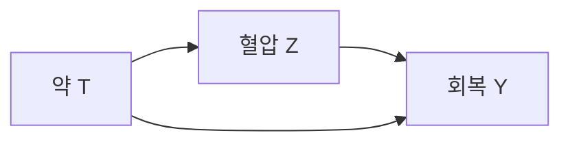
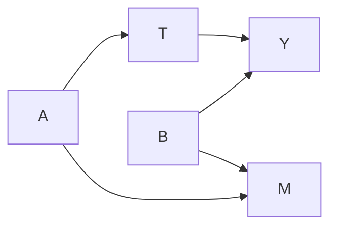

# 뒷문 기준

# 개요

**뒷문 기준(back-door criterion)** 은 관찰 자료로 치료가 결과에 주는 효과를 구할 때, 어느 변수로 자료를 나누어 다시 평균 내야 하는지를 변수 사이의 인과 관계 그림에서 읽는 조건이다. [Simpson 역설](simpson-paradox.md)의 신장결석 자료에서는 결석 크기로 나누어야 치료 A 가 낫다는 결론이 나오고, 같은 숫자 표라도 나누는 변수가 치료 뒤의 혈압이면 나누지 않아야 맞다. 두 경우는 숫자가 아니라 화살표의 방향으로 갈린다. 이 기준은 치료와 결과를 잇는 경로 가운데 치료로 들어오는 화살표로 시작하는 것을 모두 막는 변수 집합을 고르게 하고, 그 집합으로 나누어 평균 낸 값이 효과임을 보장한다.

# 직관

신장결석 자료에서 결석 크기 $Z$ 는 의사가 어느 치료 $T$ 를 고를지에 영향을 주고, 치료의 성공 $Y$ 에도 영향을 준다. 치료도 성공에 영향을 준다. 이 관계를 화살표로 그리면 다음과 같다.

$T$ 와 $Y$ 를 잇는 길은 둘이다. $T\to Y$ 는 치료의 효과다. $T\leftarrow Z\to Y$ 는 큰 결석이 A 를 받게 하고 큰 결석이 성공률을 낮추는 길이며, 치료와 상관없이 A 와 낮은 성공을 함께 나타나게 한다.

합친 성공률 $0.780$ 과 $0.826$ 에는 두 길이 섞여 있다. $Z$ 의 값을 하나로 고정하면 둘째 길로는 차이가 생기지 않으므로, 결석 크기마다 비교한 뒤 전체 환자의 결석 구성으로 평균 낸 $0.833$ 과 $0.779$ 가 치료의 효과다.

혈압 예에서는 화살표가 다르다. 약 $T$ 가 혈압 $Z$ 를 낮추고 낮은 혈압이 회복 $Y$ 를 돕는다.

여기서 $T\to Z\to Y$ 는 $T$ 에서 나가는 길이고 약의 효과의 일부다. $Z$ 를 고정하면 이 효과를 지우게 되므로 나누지 않는다. 두 그림의 차이는 $Z$ 를 지나는 길이 $T$ 로 들어오는 화살표로 시작하는지, $T$ 에서 나가는 화살표로 시작하는지다. 들어오는 화살표로 시작하는 길을 뒷문 경로라 부른다.

# 정의

## 인과 그래프와 개입

변수 $V$ 위의 비순환 유향 그래프 $G$ 에서 각 변수 $X$ 가 부모 $\mathrm{pa}(X)$ 와 다른 변수와 독립인 잡음으로 정해진다고 하자. 그러면 결합분포는 [확률 그래프 모형](graphical-models.md)의 유향 인수분해 $P(v)=\prod_XP(x\mid\mathrm{pa}(x))$ 를 따른다. 이런 $G$ 를 **인과 그래프(causal graph)** 라 한다.

$T$ 를 값 $t$ 로 정하는 **개입(intervention)** $\mathrm{do}(T=t)$ 은 $T$ 를 정하는 식을 상수 $t$ 로 바꾸는 것이다. 개입 아래의 분포는 $T$ 의 인수만 지운 곱이다.

$$
P(v\mid\mathrm{do}(T=t))=\prod_{X\ne T}P(x\mid\mathrm{pa}(x))\Big\vert_{T=t}
$$

이것을 **절단 인수분해(truncated factorization)** 라 한다. 신장결석 그래프에서 $P(y\mid\mathrm{do}(t))=\sum_zP(z)P(y\mid t,z)$ 이고, 직관 절의 $0.833$ 이 $t=\mathrm A$ 인 값이다. 조건부확률 $P(y\mid t)=\sum_zP(z\mid t)P(y\mid t,z)$ 는 $P(z)$ 대신 $P(z\mid t)$ 를 쓰므로 $0.780$ 이다.

## 경로의 막힘

경로의 양 끝이 아닌 정점 $W$ 는 양옆 화살표의 방향에 따라 세 꼴이다. 연쇄 $\to W\to$, 분기 $\leftarrow W\to$, 충돌 $\to W\leftarrow$ 다. 충돌 꼴의 $W$ 를 **충돌자(collider)** 라 한다.

변수 집합 $Z$ 가 경로를 **막는다(block)** 는 것은 경로의 양 끝이 아닌 어떤 정점 $W$ 가 다음 가운데 하나를 만족한다는 뜻이다.

1. $W$ 가 연쇄나 분기이고 $W\in Z$ 다.
2. $W$ 가 충돌자이고 $W$ 와 $W$ 의 후손이 모두 $Z$ 에 없다.

신장결석 그래프의 경로 $T\leftarrow Z\to Y$ 는 $\lbrace Z\rbrace$ 가 막는다. 두 변수 집합 사이의 모든 경로를 $Z$ 가 막으면 두 집합이 $Z$ 로 **d 분리(d-separation)** 된다고 하고, 이때 두 집합은 $Z$ 가 주어지면 조건부 독립이다.

## 뒷문 기준

$T$ 와 $Y$ 를 잇는 경로 가운데 $T$ 로 들어오는 화살표로 시작하는 것을 **뒷문 경로(back-door path)** 라 한다. 변수 집합 $Z$ 가 다음 두 조건을 만족하면 $(T,Y)$ 에 대해 **뒷문 기준** 을 만족한다고 한다[^1].

1. $Z$ 의 어떤 원소도 $T$ 의 후손이 아니다.
2. $Z$ 가 $T$ 와 $Y$ 사이의 모든 뒷문 경로를 막는다.

신장결석 그래프에서 $\lbrace Z\rbrace$ 는 기준을 만족한다. 혈압 그래프에서 $\lbrace Z\rbrace$ 는 $Z$ 가 $T$ 의 후손이어서 조건 1 을 어기고, 빈 집합은 뒷문 경로가 없으므로 기준을 만족한다.

# 성질

## 뒷문 조정 공식

$Z$ 가 $(T,Y)$ 에 대해 뒷문 기준을 만족하면 다음이 성립한다[^1].

$$
P(y\mid\mathrm{do}(T=t))=\sum_zP(y\mid t,z)\thinspace P(z)
$$

이것이 Simpson 역설 문서의 표준화한 성공률이고, **뒷문 조정 공식(back-door adjustment formula)** 이라 한다. 우변은 관찰 분포만으로 계산되므로 개입 없이 효과를 구한다.

증명의 요지. 조건 1 에서 $Z$ 는 $T$ 의 후손이 아니므로 $T$ 를 바꾸어도 $Z$ 의 분포가 그대로이고, $P(z\mid\mathrm{do}(t))=P(z)$ 다. 조건 2 에서 $Z$ 를 고정하면 $T$ 와 $Y$ 를 잇는 경로 가운데 $T$ 에서 나가는 경로만 열려 있으므로 $P(y\mid\mathrm{do}(t),z)=P(y\mid t,z)$ 다. 두 식을 $z$ 에 대해 더하면 공식이 나온다.

## 충돌자로 나누면 생기는 치우침

$T$ 와 $Y$ 의 공통 원인이 없고, 서로 독립인 $A$ 와 $B$ 가 각각 $T$ 와 $Y$ 에 영향을 주며, 둘이 함께 $M$ 에 영향을 준다고 하자.

뒷문 경로 $T\leftarrow A\to M\leftarrow B\to Y$ 는 충돌자 $M$ 에서 빈 집합으로 이미 막혀 있으므로 빈 집합이 기준을 만족하고, 조정하지 않은 $P(y\mid t)$ 가 효과다. $\lbrace M\rbrace$ 은 이 경로를 열어 기준을 어긴다. $M$ 이 치료 앞에 측정된 변수라도 나누면 치우침이 생긴다. 이 꼴을 M 편향(M-bias)이라 한다.

## 역확률 가중

뒷문 조정 공식은 다음과 같이도 쓰인다.

$$
P(y\mid\mathrm{do}(T=t))=\sum_z\frac{P(y,t,z)}{P(t\mid z)}
$$

각 관측을 그 관측이 받은 치료의 확률 $P(t\mid z)$ 의 역수로 가중해 평균 내는 것이다. 이것을 역확률 가중(inverse probability weighting)이라 한다. $T$ 가 두 값일 때 $e(z)=P(T=1\mid z)$ 를 **성향 점수(propensity score)** 라 하고, $Z$ 가 뒷문 기준을 만족하면 $Z$ 대신 $e(Z)$ 하나로 나누어 조정해도 같은 값이 나온다[^2].

## 앞문 기준

뒷문 경로를 막을 변수가 관측되지 않을 때도 효과를 구할 수 있는 경우가 있다. $T$ 에서 $Y$ 로 가는 모든 경로가 관측된 변수 $M$ 을 지나고, $T$ 와 $M$ 사이에 뒷문 경로가 없고, $M$ 과 $Y$ 사이의 뒷문 경로를 $T$ 가 모두 막으면 다음이 성립한다. 이것을 **앞문 기준(front-door criterion)** 이라 한다[^1].

$$
P(y\mid\mathrm{do}(T=t))=\sum_mP(m\mid t)\sum_{t'}P(y\mid m,t')\thinspace P(t')
$$

## do 계산법

뒷문 공식과 앞문 공식은 [do 계산법](do-calculus.md)의 세 규칙으로 유도된다. 세 규칙은 관찰 분포와 개입 분포 사이에서 조건과 개입을 지우거나 바꾸는 조건을 d 분리로 준다. 어떤 개입 분포가 관찰 분포로 정해질 때는 언제나 세 규칙으로 그 식이 유도된다[^3].

# 활용

- 관찰 연구의 공변량 선택. 의료 기록이나 행정 자료로 치료 효과를 추정할 때, 측정한 변수 가운데 치료 앞에 정해지고 뒷문 경로를 모두 막는 집합을 골라 조정한다. 치료 뒤에 생긴 변수와 충돌자는 넣지 않는다.
- [Simpson 역설](simpson-paradox.md)의 판정. 집단별 비교와 합친 비교 가운데 어느 것이 효과인지는 나누는 변수가 뒷문 기준을 만족하는지로 정한다.
- 회귀 조정. [선형회귀](linear-regression.md)에 치료와 함께 넣는 설명변수가 뒷문 기준을 만족하고 모형이 맞으면 치료의 계수가 평균 효과다.
- 추천과 광고의 오프라인 평가. 기록된 사용자 특성으로 정해진 노출 확률을 역확률 가중에 넣어, 다른 노출 정책을 썼을 때의 반응을 기록만으로 추정한다.

[^1]: J. Pearl, *Causality: Models, Reasoning, and Inference*, 2판, Cambridge University Press (2009), 3.3 절.
[^2]: P. R. Rosenbaum, D. B. Rubin, "The central role of the propensity score in observational studies for causal effects", Biometrika 70 (1983).
[^3]: I. Shpitser, J. Pearl, "Identification of joint interventional distributions in recursive semi-Markovian causal models", Proceedings of AAAI (2006); Y. Huang, M. Valtorta, "Pearl's calculus of intervention is complete", Proceedings of UAI (2006).

# 연관 문서

## 선수지식

- [Simpson 역설](simpson-paradox.md)
- [확률 그래프 모형](graphical-models.md)

## 더 알아보기

- [do 계산법](do-calculus.md)
- [도구변수](instrumental-variables.md)

#statistics #probability #machine_learning
