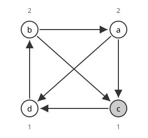

# Banks 집합

# 개요

**Banks 집합(Banks set)** 은 후보를 두 명씩 다수결에 붙인 결과에서, 서로 한 줄로 줄 세워지는 후보들을 더 늘릴 수 없을 때까지 모았을 때 그 줄의 맨 앞에 올 수 있는 후보의 집합이다. 의회가 안건 네 개를 두 개씩 차례로 표결해 이긴 쪽을 다음 표결에 올리는데, 의원들이 결과를 내다보고 표를 던진다고 하자. 표결 순서를 어떻게 정하든 최종 통과 안건은 이 집합 안에 있고, 이 집합의 안건은 모두 어떤 표결 순서에서 통과된다.

# 직관

[토너먼트 해](tournament-solutions.md) 문서의 네 후보 $a,b,c,d$ 를 다시 쓴다. 대결 결과는 $b\to a$, $a\to c$, $c\to d$, $d\to b$, $a\to d$, $b\to c$ 이고 화살표는 이긴 쪽에서 진 쪽으로 간다.



세 후보 $a,b,c$ 는 $b\to a\to c$ 이고 $b\to c$ 라서 $b,a,c$ 로 한 줄에 세워진다. 앞 후보가 뒤의 후보를 모두 이긴다. $d$ 를 더하면 $d\to b$ 이고 $a\to d$ 라서 한 줄이 깨지므로 이 줄은 더 늘어나지 않고, 맨 앞은 $b$ 다.

같은 방법으로 $a,c,d$ 는 $a,c,d$ 로 줄 세워지고 맨 앞이 $a$ 다. $d,b$ 는 $d\to b$ 로 줄 세워지는데, $a$ 를 더하면 $b\to a\to d\to b$ 가 돌고 $c$ 를 더하면 $b\to c\to d\to b$ 가 돌아 더 늘어나지 않는다. 맨 앞은 $d$ 다. $c$ 가 맨 앞인 줄은 늘리면 $a$ 가 $c$ 앞에 들어오므로, Banks 집합은 $\lbrace a,b,d\rbrace$ 다.

# 정의

[토너먼트](tournaments.md) $T$ 의 정점 집합 $S$ 가 추이적 부분토너먼트를 유도하면 $S$ 를 **추이적 집합(transitive set)** 이라 한다. 추이적 집합의 정점은 앞 정점이 뒤 정점을 모두 이기는 한 줄로 정해지고, 맨 앞 정점을 $S$ 의 **최대원(maximum)** 이라 한다. 직관 절의 $\lbrace a,b,c\rbrace$ 는 추이적 집합이고 최대원이 $b$ 다.

포함 관계로 극대인 추이적 집합, 곧 어느 정점을 더해도 추이적이지 않게 되는 추이적 집합의 최대원을 모두 모은 것을 **Banks 집합** $\mathrm{BA}(T)$ 라 한다[^1]. 직관 절에서 극대인 추이적 집합은 $\lbrace a,b,c\rbrace$, $\lbrace a,c,d\rbrace$, $\lbrace b,d\rbrace$ 이고 $\mathrm{BA}(T)=\lbrace a,b,d\rbrace$ 다.

Condorcet 승자 $x$ 가 있으면 $x$ 는 모든 정점을 이기므로 극대인 추이적 집합마다 맨 앞에 들어가고, Banks 집합은 $\lbrace x\rbrace$ 다. 그래서 Banks 집합은 토너먼트 해다.

# 성질

## 덮이지 않은 집합과의 포함

Banks 집합은 토너먼트 해 문서의 덮이지 않은 집합 $\mathrm{UC}(T)$ 에 포함된다. $x$ 가 극대인 추이적 집합 $S$ 의 최대원이고 $y$ 가 $x$ 를 덮는다고 하자. $y\to x$ 이므로 $y\notin S$ 다. $x$ 는 $S$ 의 나머지를 모두 이기고 $y$ 는 $x$ 가 이긴 정점을 모두 이기므로 $y$ 가 $S$ 전체를 이긴다. 그러면 $S\cup\lbrace y\rbrace$ 가 추이적이어서 $S$ 의 극대성에 어긋난다.

## Banks 승자 하나를 찾는 절차

추이적 집합 $S$ 를 비운 채 시작해, $S$ 의 모든 정점을 이기는 정점이 있는 동안 그 정점을 $S$ 의 맨 앞에 더한다. 그런 정점이 없어지면 $S$ 의 최대원이 Banks 집합에 든다[^2].

$S$ 를 극대가 될 때까지 늘려도 최대원은 바뀌지 않는다. 더하는 정점이 $S$ 의 맨 앞에 들어가려면 $S$ 전체를 이겨야 하는데 그런 정점이 없기 때문이다.

```javascript
// beats(u, v) 가 u→v 이면 true 인 토너먼트에서 Banks 집합의 원소 하나를 찾는다
function banksWinner(vertices, beats) {
  const chain = [];
  let grew = true;
  while (grew) {
    grew = false;
    for (const x of vertices) {
      if (!chain.includes(x) && chain.every((s) => beats(x, s))) {
        chain.unshift(x);
        grew = true;
        break;
      }
    }
  }
  return chain[0];
}
```

직관 절에서 정점을 $c,d,b,a$ 순으로 살피면 먼저 $c$ 가 들어가고, $c$ 를 이기는 정점 가운데 먼저 살피는 $b$ 가 맨 앞에 들어간다. $b$ 와 $c$ 를 모두 이기는 정점이 없으므로 $b$ 가 나온다.

## 원소 판정의 어려움

주어진 정점이 Banks 집합에 드는지 판정하는 문제는 NP-완전(nondeterministic polynomial time complete, NP-complete)이다[^3]. 원소 하나는 위 절차로 다항 시간에 찾지만, 정해진 정점이 원소인지는 그렇게 판정되지 않는다.

# 활용

- 의제 조작과 전략적 투표. 안건을 두 개씩 차례로 표결해 이긴 쪽을 다음 표결에 올리고 의원들이 결과를 내다보고 표를 던질 때, 표결 순서에 따라 나올 수 있는 최종 결과의 집합이 정확히 Banks 집합이다[^1]. 토너먼트 해 문서가 말한 덮이지 않은 집합의 포함보다 좁은 결과다.
- 선거 규칙의 비교. Copeland 집합, 덮이지 않은 집합, 꼭대기 순환과 함께 후보를 얼마나 좁히는지, 계산이 얼마나 어려운지로 비교하는 토너먼트 해다.

[^1]: J. S. Banks, "Sophisticated voting outcomes and agenda control", *Social Choice and Welfare* 1 (1985), 295–306.
[^2]: O. Hudry, "A note on 'Banks winners in tournaments are difficult to recognize' by G. J. Woeginger", *Social Choice and Welfare* 23 (2004), 113–114.
[^3]: G. J. Woeginger, "Banks winners in tournaments are difficult to recognize", *Social Choice and Welfare* 20 (2003), 523–528.

# 연관 문서

## 선수지식

- [토너먼트 해](tournament-solutions.md)

## 더 알아보기

아직 연결한 문서가 없다.

#graph_theory #order_theory #complexity
