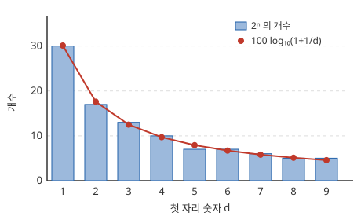

# Benford 법칙

# 개요

**Benford 법칙(Benford's law)** 은 여러 자릿수에 걸쳐 퍼진 수들에서 첫 자리 숫자가 $d$ 인 비율이 $\log_{10}(1+1/d)$ 이라는 법칙이다. $2, 4, 8, 16, 32, \dots$ 처럼 $2$ 를 거듭 곱한 수를 $2^{100}$ 까지 적고 첫 자리를 세면 $1$ 이 $30$ 번, $9$ 가 $5$ 번 나온다. 첫 자리는 상용로그의 소수 부분으로 정해지므로, 그 소수 부분이 $\lbrack 0,1)$ 에 고르게 퍼지면 첫 자리의 비율이 이 법칙대로 나온다.

# 직관

$2^n$ 의 첫 자리를 $n=1$ 부터 적으면 $2,4,8,1,3,6,1,2,5,1$ 이다. 열 개 가운데 $1$ 이 세 번이고 $7$ 과 $9$ 는 없다. $2^{100}$ 까지 세면 $1$ 부터 $9$ 까지 $30,17,13,10,7,7,6,5,5$ 번이다.

아래 그림의 막대가 이 개수이고, 점은 $100\log_{10}(1+1/d)$ 이다.

첫 자리가 $1$ 인 수는 $1\le x\lt 2$ 나 $10\le x\lt 20$ 처럼 어느 $k$ 에서 $10^k\le x\lt 2\cdot 10^k$ 인 수다. 상용로그를 취하면 $k\le\log_{10}x\lt k+\log_{10}2$ 이므로, $\log_{10}x$ 의 소수 부분이 $\lbrack 0,\log_{10}2)$ 에 있는 수다. 같은 계산으로 첫 자리가 $d$ 인 것은 소수 부분이 $\lbrack\log_{10}d,\log_{10}(d+1))$ 에 있는 것이다. 이 구간의 길이는 $d=1$ 에서 $0.301$, $d=9$ 에서 $0.046$ 이다.

$\log_{10}2^n=n\log_{10}2$ 이고 $\log_{10}2$ 는 [무리수](irrational-numbers.md)다. [등분포](equidistribution.md)에서 $\lbrace n\alpha\rbrace$ 는 무리수 $\alpha$ 에 대해 $\lbrack 0,1)$ 의 각 구간에 길이만큼의 빈도로 들어간다. 따라서 $2^n$ 의 첫 자리가 $d$ 인 빈도는 구간의 길이 $\log_{10}(d+1)-\log_{10}d=\log_{10}(1+1/d)$ 로 간다.

# 정의

## 유효숫자

양수 $x$ 를 $x=s\cdot 10^k$, $1\le s\lt 10$, $k\in\mathbb Z$ 로 쓸 때 $s$ 를 $x$ 의 **유효숫자(significand)** 라 하고 $S(x)$ 로 적는다. 다음이 성립한다.

$$
S(x)=10^{\lbrace\log_{10}x\rbrace}
$$

$\lbrace y\rbrace$ 는 $y$ 의 소수 부분이다. $x$ 의 첫 자리 숫자는 $D_1(x)=\lfloor S(x)\rfloor$ 이다. $S(2^{10})=S(1024)=1.024$ 이고 $D_1(1024)=1$ 이다.

## Benford 확률변수와 Benford 수열

양의 확률변수 $X$ 가 모든 $1\le t\lt 10$ 에서

$$
\Pr\lbrack S(X)\le t\rbrack=\log_{10}t
$$

를 만족하면 $X$ 가 **Benford 분포(Benford distribution)** 를 따른다고 한다. 이것은 $\lbrace\log_{10}X\rbrace$ 가 $\lbrack 0,1)$ 의 [균등분포](uniform-distribution.md)를 따르는 것과 같다.

양수의 수열 $(x_n)$ 이 모든 $1\le t\lt 10$ 에서

$$
\lim_{N\to\infty}\frac1N\thinspace\char35{}\lbrace n\le N:\thinspace S(x_n)\le t\rbrace=\log_{10}t
$$

를 만족하면 $(x_n)$ 을 **Benford 수열(Benford sequence)** 이라 한다. 이것은 $(\log_{10}x_n)$ 이 법 $1$ 에서 등분포인 것과 같다. 직관 절의 $(2^n)$ 은 Benford 수열이다.

## 첫 자리 법칙

$t=d$ 와 $t=d+1$ 의 차를 취하면 첫 자리의 분포가 나온다.

$$
\Pr\lbrack D_1(X)=d\rbrack=\log_{10}\left(1+\frac1d\right),\qquad d=1,\dots,9
$$

이 값은 $d=1,\dots,9$ 에서 차례로 $0.301$, $0.176$, $0.125$, $0.097$, $0.079$, $0.067$, $0.058$, $0.051$, $0.046$ 이다.

# 성질

## 앞의 여러 자리

Benford 분포에서 앞의 $m$ 자리가 정수 $j$ ($10^{m-1}\le j\lt 10^m$) 를 이룰 확률은 $S(X)$ 가 $\lbrack j/10^{m-1},(j+1)/10^{m-1})$ 에 있을 확률이므로 다음과 같다.

$$
\Pr\lbrack D_1\cdots D_m=j\rbrack=\log_{10}\left(1+\frac1j\right)
$$

첫 두 자리가 $31$ 일 확률은 $\log_{10}(32/31)\approx 0.0138$ 이다. 둘째 자리만의 분포는 첫 자리 $k$ 에 대해 더해서 얻는다.

$$
\Pr\lbrack D_2=d\rbrack=\sum_{k=1}^{9}\log_{10}\left(1+\frac{1}{10k+d}\right)
$$

$d=0$ 에서 $0.1197$, $d=9$ 에서 $0.0850$ 이다. 뒤 자리로 갈수록 분포는 $0,\dots,9$ 위의 균등분포에 빠르게 다가간다.

## 거듭제곱 수열

$a\gt 0$ 일 때 $(a^n)$ 이 Benford 수열인 것은 $\log_{10}a$ 가 무리수인 것과 동치다. $\log_{10}a=p/q$ 가 유리수이면 $\lbrace n\log_{10}a\rbrace$ 는 많아야 $q$ 개의 값만 되풀이하므로 등분포가 아니다. 무리수이면 등분포의 Weyl 판정법에서 직관 절의 계산이 그대로 된다.

[Fibonacci 수](fibonacci-numbers.md) $F_n$ 은 $F_n=(\varphi^n-(-\varphi)^{-n})/\sqrt5$ 이므로 $\log_{10}F_n=n\log_{10}\varphi-\log_{10}\sqrt5+o(1)$ 이다. $\log_{10}\varphi$ 가 무리수이므로 $(F_n)$ 도 Benford 수열이다.

## 자연수열

수열 $1,2,3,\dots$ 은 Benford 수열이 아니고, 첫 자리가 $1$ 인 비율이 수렴하지도 않는다. $N=1999$ 까지에는 첫 자리가 $1$ 인 수가 $1$, $10$ 부터 $19$, $100$ 부터 $199$, $1000$ 부터 $1999$ 까지의 $1111$ 개라 비율이 $0.556$ 이고, $N=9999$ 까지에는 같은 $1111$ 개라 비율이 $1/9$ 이다. $N$ 이 커지면 이 비율의 상극한은 $5/9$, 하극한은 $1/9$ 이다.

각 $n$ 에 무게 $1/n$ 을 주는 로그 밀도(logarithmic density)로 세면 첫 자리가 $1$ 인 비율이 $\log_{10}2$ 로 수렴한다.

$$
\lim_{N\to\infty}\frac{1}{\ln N}\sum_{n\le N,\thinspace D_1(n)=1}\frac1n=\log_{10}2
$$

$\lbrack 10^k,2\cdot 10^k)$ 의 정수에서 $1/n$ 을 더하면 $\ln 2$ 에 가깝고, $\lbrack 10^k,10^{k+1})$ 에서 더하면 $\ln 10$ 에 가까워 그 비가 $\log_{10}2$ 다.

## 척도 불변성

단위를 바꾸어 모든 값에 같은 양수 $c$ 를 곱해도 유효숫자의 분포가 그대로인 성질을 **척도 불변성(scale invariance)** 이라 한다. $\log_{10}(cX)=\log_{10}c+\log_{10}X$ 이고 $\lbrack 0,1)$ 의 균등분포는 법 $1$ 에서 평행이동해도 균등분포이므로, Benford 분포는 척도 불변이다.

역도 성립한다. 유효숫자 위의 확률분포가 모든 $c\gt 0$ 의 곱셈에 대해 불변이면 그것은 Benford 분포다.[^1] $\lbrace\log_{10}S\rbrace$ 의 분포가 $\lbrack 0,1)$ 위 모든 평행이동에 대해 불변이고, 그런 확률분포는 균등분포뿐이다. [Fourier 계수](fourier-series.md) $\hat\mu(k)$ 가 모든 $t$ 에서 $\hat\mu(k)=e^{2\pi ikt}\hat\mu(k)$ 를 만족하므로 $k\ne 0$ 이면 $\hat\mu(k)=0$ 이다.

## 독립 곱의 극한

$Y_1,Y_2,\dots$ 가 독립이고 같은 분포를 따르는 양의 확률변수라 하자. $\log_{10}Y_1$ 이 어떤 $c$ 와 정수 $k\ne 0$ 에 대해 $c+\frac1k\mathbb Z$ 에 확률 $1$ 로 놓이지 않으면, 곱 $X_n=Y_1\cdots Y_n$ 의 유효숫자 분포는 $n\to\infty$ 에서 Benford 분포로 수렴한다.

증명의 요지는 [특성함수](characteristic-functions.md)다. $\varphi(k)=\mathbb E\lbrack e^{2\pi ik\log_{10}Y_1}\rbrack$ 로 두면 $\lbrace\log_{10}X_n\rbrace$ 의 $k$ 번째 Fourier 계수는 $\varphi(k)^n$ 이다. 가정에서 $k\ne 0$ 이면 $\lvert\varphi(k)\rvert\lt 1$ 이므로 이 계수가 $0$ 으로 가고, $\lbrack 0,1)$ 위 분포는 Fourier 계수로 정해지므로 극한이 균등분포다.

## 로그정규분포

$\log_{10}X$ 가 분산 $\sigma^2$ 인 [정규분포](normal-distribution.md)를 따르면, 곧 $X$ 가 [로그정규분포](lognormal-distribution.md)를 따르면 $k$ 번째 Fourier 계수의 절댓값이 다음과 같다.

$$
\left\lvert\mathbb E\lbrack e^{2\pi ik\log_{10}X}\rbrack\right\rvert=e^{-2\pi^2k^2\sigma^2}
$$

$\sigma=1$, 곧 값이 십진 한 자릿수 정도 퍼지면 $k=1$ 에서 이 값이 $2.7\times 10^{-9}$ 이다. 그래서 여러 자릿수에 걸쳐 퍼진 로그정규분포의 첫 자리는 Benford 법칙과 거의 같은 비율로 나오고, 퍼짐이 작으면 어긋난다.

## 역사

S. Newcomb 이 1881 년에 로그표의 앞쪽 쪽이 뒤쪽보다 더 닳는다는 관찰에서 이 법칙을 적었다.[^2] F. Benford 는 1938 년에 강의 넓이, 인구, 물리 상수 등 20 가지 표의 수 20229 개로 같은 비율을 확인했다.[^3]

# 활용

- 회계 감사. 거래 대금과 세금 신고서의 금액은 여러 자릿수에 걸쳐 퍼지므로 첫 두 자리의 빈도가 위의 $\log_{10}(1+1/j)$ 에 가깝다. 지어낸 금액은 이 분포에서 벗어나는 경향이 있어, 빈도를 [Pearson 카이제곱 검정](pearson-chi-squared-test.md)으로 Benford 분포와 견주어 조사할 장부를 고른다.[^4] 금액에 상한이 있거나 한 자릿수에 몰린 자료에서는 Benford 분포를 기대할 근거가 없다.
- 부동소수점 수치 계산. 여러 수를 곱하고 나누는 계산의 중간값은 독립 곱의 극한 정리에 의해 유효숫자가 Benford 분포에 가깝다. R. Hamming 은 이 분포로 부동소수점 반올림 오차의 평균 크기를 계산했다.[^5]
- 시험 자료의 생성. Benford 확률변수는 $U$ 가 $\lbrack 0,1)$ 의 균등분포일 때 $10^{U}$ 로 만든다. 첫 자리 검사를 하는 프로그램의 시험 입력이 이것이다.

[^1]: R. S. Pinkham, "On the distribution of first significant digits", Annals of Mathematical Statistics 32 (1961). 척도 불변성의 엄밀한 꼴과 밑 불변성으로의 확장은 T. P. Hill, "Base-invariance implies Benford's law", Proceedings of the American Mathematical Society 123 (1995).
[^2]: S. Newcomb, "Note on the frequency of use of the different digits in natural numbers", American Journal of Mathematics 4 (1881).
[^3]: F. Benford, "The law of anomalous numbers", Proceedings of the American Philosophical Society 78 (1938).
[^4]: M. J. Nigrini, *Benford's Law: Applications for Forensic Accounting, Auditing, and Fraud Detection*, Wiley, 2012.
[^5]: R. W. Hamming, "On the distribution of numbers", Bell System Technical Journal 49 (1970).

# 연관 문서

## 선수지식

- [등분포](equidistribution.md)
- [균등분포](uniform-distribution.md)

## 더 알아보기

아직 연결한 문서가 없다.

#probability #number_theory #statistics
