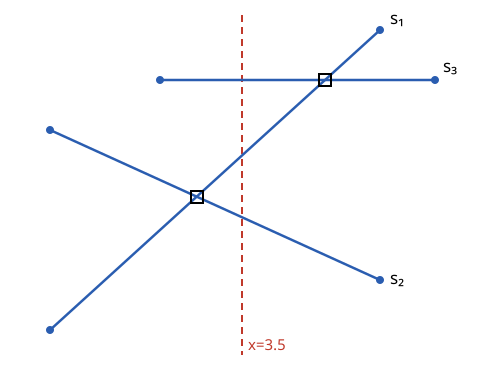

# Bentley–Ottmann 알고리즘

# 개요

**Bentley–Ottmann 알고리즘(Bentley–Ottmann algorithm)** 은 평면의 선분 $n$ 개가 서로 만나는 점을 모두 찾는 방법이다. 도로 지도와 하천 지도를 겹쳐 다리가 놓일 자리를 찾으려면 도로 선분과 하천 선분이 만나는 점을 모두 구해야 한다. 모든 쌍을 확인하면 $n(n-1)/2$ 번의 계산이 들지만, 교점은 대개 그보다 훨씬 적다. 이 알고리즘은 세로선을 왼쪽에서 오른쪽으로 쓸면서 세로선 위에서 이웃한 선분끼리만 확인해, 교점이 $k$ 개일 때 $O((n+k)\log n)$ 시간에 모두 찾는다.

# 직관

선분 셋이 있다. $s\_1$ 은 $(0,0)$ 에서 $(6,6)$ 까지, $s\_2$ 는 $(0,4)$ 에서 $(6,1)$ 까지, $s\_3$ 은 $(2,5)$ 에서 $(7,5)$ 까지다. 아래 그림의 네모가 교점 $(8/3,8/3)$ 과 $(5,5)$ 이고, 빨간 점선은 $x=3.5$ 의 세로선이다.

세로선을 $x=0$ 에서 오른쪽으로 옮기며 세로선과 만나는 선분을 아래에서 위로 적는다. $x=0$ 에서는 $s\_1,s\_2$ 다. 두 선분이 세로선 위에서 이웃하므로 둘이 만나는지 확인하고, 교점 $(8/3,8/3)$ 을 앞으로 처리할 일로 적어 둔다. $x=2$ 에서 $s\_3$ 이 맨 위에 들어오면 새 이웃 $s\_2,s\_3$ 을 확인하는데 만나지 않는다.

$x=8/3$ 에서 $s\_1$ 과 $s\_2$ 가 엇갈려 순서가 $s\_2,s\_1,s\_3$ 이 된다. 그림의 $x=3.5$ 가 이 순서다. 이제 $s\_1$ 과 $s\_3$ 이 이웃이 되어 확인하고 교점 $(5,5)$ 를 적는다. $x=5$ 에서 둘이 엇갈리고, 그 뒤로는 선분이 끝나기만 한다.

확인한 쌍은 셋이고, 처음부터 $s\_1,s\_3$ 을 확인하지 않아도 두 교점을 모두 찾았다.

# 정의

## 쓸기선과 상태

선분들의 끝점과 교점의 $x$ 좌표가 모두 다르다고 둔다. 세로선 $x=t$ 를 **쓸기선(sweep line)** 이라 하고, 쓸기선과 만나는 선분들을 만나는 점의 $y$ 좌표 순으로 놓은 목록을 **상태(status)** 라 한다. 상태가 바뀌는 $x$ 좌표, 곧 선분의 왼쪽 끝점, 오른쪽 끝점, 교점을 **사건(event)** 이라 한다.

직관 절에서 $t=3.5$ 의 상태는 $s\_2,s\_1,s\_3$ 이고, 사건은 $x=0,2,8/3,5,6,7$ 이다.

## 알고리즘

Bentley 와 Ottmann 이 1979 년에 제안한 절차는 다음과 같다[^1]. 사건 큐는 사건을 $x$ 순으로 꺼내는 우선순위 큐이고 처음에 모든 끝점을 담는다. 상태는 [균형 이진 탐색 트리](balanced-binary-search-trees.md)에 둔다. 두 선분이 만나는지는 [볼록 껍질 알고리즘](convex-hull-algorithms.md) 문서의 방향 판정을 네 번 써서 확인한다.

- 왼쪽 끝점. 선분을 상태에 넣고, 새 선분과 위아래 이웃이 오른쪽에서 만나면 그 교점을 사건 큐에 넣는다.
- 오른쪽 끝점. 선분을 상태에서 빼고, 새로 이웃이 된 위아래 두 선분이 오른쪽에서 만나면 그 교점을 넣는다.
- 교점. 교점을 보고하고 두 선분의 순서를 바꾼다. 바뀐 두 선분 각각과 새 이웃이 오른쪽에서 만나면 그 교점을 넣는다.

같은 교점을 두 번 넣지 않도록 사건 큐는 이미 있는 교점을 다시 넣지 않는다.

# 성질

## 정당성

정리. Bentley–Ottmann 알고리즘은 모든 교점을 보고한다[^1].

증명의 요지. 교점 $p$ 에서 만나는 두 선분 $s,s'$ 에 대해, $p$ 바로 앞의 사건을 처리한 뒤에는 $s$ 와 $s'$ 사이에 다른 선분이 없다. 그 사이에 선분이 있었다면 그 선분이 $p$ 전에 끝나거나 $s$ 나 $s'$ 과 만나야 하는데, 어느 쪽이든 $p$ 와 그 사건 사이에 다른 사건이 생긴다. 그래서 $s$ 와 $s'$ 은 어느 사건에서 이웃이 되었고, 그때 $p$ 가 사건 큐에 들어간다.

## 시간과 공간

사건은 끝점 $2n$ 개와 교점 $k$ 개다. 사건마다 사건 큐와 상태 트리의 연산이 상수 번이고 각각 $O(\log n)$ 이므로, 전체 시간은 $O((n+k)\log n)$ 이다. 사건 큐에서 지금 이웃이 아닌 쌍의 교점을 지우면 큐의 크기가 $O(n)$ 으로 유지된다.

교점이 많아 $k$ 가 $n^2$ 에 가까우면 모든 쌍을 확인하는 $O(n^2)$ 보다 느리다. Chazelle 과 Edelsbrunner 는 $O(n\log n+k)$ 시간의 결정적 알고리즘을 만들었고, 출력 $k$ 와 원소 유일성 하한 $\Omega(n\log n)$ 때문에 이 시간이 최적이다[^2].

## 교점 존재 판정

교점이 하나라도 있는지만 물으면, 같은 쓸기에서 첫 교점을 찾는 순간 멈추면 된다. 그 전까지 사건은 끝점뿐이므로 $O(n\log n)$ 시간이다. Shamos 와 Hoey 가 1976 년에 이 판정을 먼저 제안했다[^3]. 다각형의 변 $n$ 개에 쓰면 다각형이 자기 자신과 엇갈리지 않는 단순 다각형인지 $O(n\log n)$ 에 판정된다.

# 활용

- 지도 겹치기. 지리 정보 시스템에서 두 지도의 선분 교점을 모두 구해 겹친 지도의 영역을 만든다.
- 회로 설계 검사. 집적 회로 배선의 선분이 허용되지 않는 자리에서 만나는지 확인한다.
- 다각형 연산. 두 다각형의 합집합, 교집합, 차집합을 계산하는 첫 단계로 두 경계의 교점을 구한다.
- 쓸기 방법. 상태를 정렬된 구조에 두고 사건에서만 갱신하는 방법은 [가장 가까운 점 쌍](closest-pair-of-points.md), 직사각형 합집합의 넓이 같은 다른 평면 문제에도 쓰인다.

[^1]: J. L. Bentley, T. A. Ottmann, "Algorithms for reporting and counting geometric intersections", IEEE Transactions on Computers C-28 (1979), 643–647.
[^2]: B. Chazelle, H. Edelsbrunner, "An optimal algorithm for intersecting line segments in the plane", Journal of the ACM 39 (1992), 1–54.
[^3]: M. I. Shamos, D. Hoey, "Geometric intersection problems", IEEE Symposium on Foundations of Computer Science (FOCS) 1976, 208–215.

# 연관 문서

## 선수지식

- [볼록 껍질 알고리즘](convex-hull-algorithms.md)
- [균형 이진 탐색 트리](balanced-binary-search-trees.md)

## 더 알아보기

아직 연결한 문서가 없다.

#algorithms #computation #data_structures
