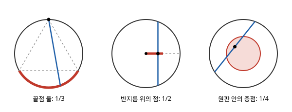

# Bertrand 역설

# 개요

**Bertrand 역설(Bertrand paradox)** 은 "원의 현을 무작위로 고른다" 는 같은 말이 고르는 방법에 따라 서로 다른 확률을 준다는 예다. 반지름 $1$ 인 원에 현을 하나 그을 때, 그 현이 원에 내접하는 정삼각형의 한 변 $\sqrt3$ 보다 길 확률을 묻는다. 현을 정하는 두 수를 어느 [균등분포](uniform-distribution.md)에서 뽑는지 명시하면 확률이 하나로 정해지고, 흔히 쓰는 세 가지 선택이 $1/3$, $1/2$, $1/4$ 를 준다.

# 직관

현을 고르는 방법 세 가지를 차례로 본다. 아래 그림에서 빨간 부분에 들어가면 현이 $\sqrt3$ 보다 길고, 파란 선분이 그런 현 하나다.

첫째 방법은 원 위의 두 점을 각각 고르게 뽑아 잇는 것이다. 한 끝점을 위쪽에 고정하면 그 점을 꼭짓점으로 하는 내접 정삼각형이 원을 세 원호로 나눈다. 다른 끝점이 맞은편 원호에 떨어질 때만 현이 변보다 길고, 그 원호는 원 둘레의 $1/3$ 이다.

둘째 방법은 반지름 하나를 고르고 그 위의 점을 고르게 뽑아, 그 점에서 반지름에 수직인 현을 긋는 것이다. 정삼각형의 변은 중심에서 거리 $1/2$ 에 있으므로, 점이 중심에서 $1/2$ 안쪽이면 현이 더 길다. 확률은 $1/2$ 이다.

셋째 방법은 원판 안의 점을 고르게 뽑아 그 점을 중점으로 하는 현을 긋는 것이다. 현이 더 길 조건은 둘째 방법과 같이 중점이 중심에서 $1/2$ 안쪽인 것이고, 그 원판의 넓이는 전체의 $1/4$ 이다.

# 정의

반지름 $1$ 인 원의 현은 중심에서 현까지의 거리 $p\in\lbrack 0,1)$ 와 현에 수직인 방향의 각 $\varphi\in\lbrack 0,2\pi)$ 로 정해진다. 현의 길이는 다음과 같다.

$$
\ell=2\sqrt{1-p^2}
$$

"무작위 현" 은 $(p,\varphi)$ 위의 확률분포를 하나 정해야 뜻이 생긴다. $\ell\gt\sqrt3$ 은 $p\lt 1/2$ 과 같으므로, 묻는 확률은 $\Pr\lbrack p\lt 1/2\rbrack$ 이고 그 값은 $p$ 의 분포에 달렸다. 같은 말로 기술된 실험이 서로 다른 확률분포로 형식화되어 서로 다른 답을 주는 이 상황을 J. Bertrand 가 1889 년에 제시했고, **Bertrand 역설** 이라 한다.[^1]

직관 절의 세 방법에서 $p$ 의 누적분포함수는 다음과 같다.

| 방법 | p 의 분포 | Pr[p < 1/2] |
| --- | --- | --- |
| 끝점 둘 | $\Pr\lbrack p\le t\rbrack=1-\frac2\pi\arccos t$ | $1/3$ |
| 반지름 위의 점 | $\Pr\lbrack p\le t\rbrack=t$ | $1/2$ |
| 원판 안의 중점 | $\Pr\lbrack p\le t\rbrack=t^2$ | $1/4$ |

첫째 줄은 두 끝점이 중심에서 이루는 각 $\theta$ 가 $\lbrack 0,\pi\rbrack$ 에서 고르게 분포하고 $p=\cos(\theta/2)$ 인 데서 나온다.

# 성질

## 현의 평균 길이

세 방법에서 현 길이의 기댓값은 각각 다음과 같다.

$$
\frac4\pi\approx 1.273,\qquad \frac\pi2\approx 1.571,\qquad \frac43\approx 1.333
$$

첫째는 $\ell=2\sin(\theta/2)$ 를 $\theta\in\lbrack 0,\pi\rbrack$ 에서 평균 낸 값이고, 둘째는 반원의 넓이 $\int_0^1 2\sqrt{1-p^2}\thinspace dp=\pi/2$ 다. 셋째는 $p$ 의 밀도 $2p$ 를 곱해 적분한 값이다.

## 변환에 대한 불변성

E. T. Jaynes 는 문제가 원의 크기와 위치를 정하지 않았으므로, 답이 원을 평행이동하거나 확대해도 바뀌지 않아야 한다고 요구했다. 평면의 직선 전체 위의 측도 가운데 회전과 평행이동에 대해 불변인 것은 상수배를 빼면 $dp\thinspace d\varphi$ 하나뿐이다. 이 측도를 원과 만나는 직선으로 제한하면 $p$ 가 $\lbrack 0,1)$ 에서 고르게 분포하므로 둘째 방법이 나오고, 확률은 $1/2$ 이다.[^2]

첫째 방법은 평행이동에 대해 불변이 아니다. 원보다 조금 큰 원을 겹쳐 놓으면, 큰 원의 현 가운데 작은 원과 만나는 것들의 분포가 작은 원에서 첫째 방법으로 고른 분포와 다르다.

## 실험과의 대응

긴 지푸라기를 바닥의 원 위로 아무렇게나 던지면, 지푸라기의 직선은 위치와 방향이 고르게 분포한다. 이 실험은 [Buffon 의 바늘 문제](buffons-needle.md)와 같은 직선의 분포를 쓰므로 둘째 방법과 일치한다. Jaynes 는 이 실험으로 $1/2$ 에 가까운 빈도를 얻었다고 보고했다.[^2]

# 활용

- 확률 모형의 명시. 표본공간과 그 위의 분포를 정하지 않은 "무작위" 는 확률을 정하지 않는다. [유한 확률 공간](probability.md)의 같은 가능성 가정을 연속 표본공간으로 옮길 때, 어느 변수가 고르게 분포하는지를 함께 정해야 한다.
- 무정보 사전분포. [Bayes 추론](bayesian-inference.md)에서 모르는 모수에 고른 사전분포를 줄 때, 모수를 다른 변수로 바꾸면 고른 분포가 고른 분포로 가지 않는다. 변수 변환에 대해 불변인 사전분포를 고르는 방법이 Jeffreys 사전분포(Jeffreys prior)이고, Jaynes 의 해법과 같은 원리를 쓴다.
- 적분기하. 직선 위의 불변 측도 $dp\thinspace d\varphi$ 는 Crofton 공식(Crofton formula)과 [내재부피](intrinsic-volumes.md)가 쓰는 측도이고, 볼록집합과 만나는 직선의 측도가 그 집합의 둘레다.

[^1]: J. Bertrand, *Calcul des probabilités*, Gauthier-Villars (1889), 4–5 쪽.
[^2]: E. T. Jaynes, "The well-posed problem", *Foundations of Physics* **3** (1973), 477–492.

# 연관 문서

## 선수지식

- [균등분포](uniform-distribution.md)

## 더 알아보기

아직 연결한 문서가 없다.

#probability #analysis #statistics
