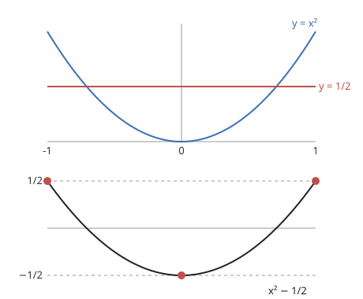

# 최량 균등 근사

# 개요

**최량 균등 근사(best uniform approximation)** 는 주어진 연속함수와의 차이의 최댓값이 가장 작은 다항식을 고르는 근사다. 구간 $\lbrack -1,1\rbrack$ 에서 $y=x^2$ 를 직선 하나로 대신하려면, 어디서든 벗어나는 정도가 가장 작은 직선을 골라야 한다. 그 직선은 $y=1/2$ 이고, 차이가 $x=-1,0,1$ 에서 $+1/2,-1/2,+1/2$ 로 번갈아 가장 크다. 최량 균등 근사는 차이가 다항식의 차수보다 두 개 많은 점에서 부호를 번갈아 최댓값에 닿는지로 판정하고, 그 판정을 반복 계산으로 바꾸면 근사 다항식이 구해진다.

# 직관

상수 $c$ 로 $x^2$ 를 대신하면 차이 $x^2-c$ 의 절댓값은 $x=0$ 에서 $\vert c\vert$, $x=\pm 1$ 에서 $\vert 1-c\vert$ 이고 이 둘 가운데 큰 것이 최댓값이다. 둘이 같아지는 $c=1/2$ 에서 최댓값이 가장 작은 $1/2$ 이 된다.

기울기 $b\ne 0$ 을 더해 $c+bx$ 로 바꾸면 $x=1$ 과 $x=-1$ 의 차이가 $1-c-b$ 와 $1-c+b$ 이므로 한쪽이 $1-c+\vert b\vert$ 로 커진다. 그래서 직선 가운데서도 $y=1/2$ 이 가장 좋다.

아래 그림의 위쪽은 $y=x^2$ 와 직선 $y=1/2$ 이고, 아래쪽은 차이 $x^2-1/2$ 이다. 차이는 세 점 $x=-1,0,1$ 에서 크기 $1/2$ 에 닿고 부호가 $+,-,+$ 로 바뀐다.

이 세 점이 다른 직선 $q$ 가 더 나을 수 없는 이유다. $q$ 의 차이가 모든 곳에서 $1/2$ 보다 작으면, 세 점에서 $q-1/2=(x^2-1/2)-(x^2-q)$ 의 부호가 $+,-,+$ 다. 그러면 일차식 $q-1/2$ 의 근이 둘이 되어 모순이다.

# 정의

## 균등 노름과 최량 근사

구간 $\lbrack a,b\rbrack$ 위의 연속함수 $g$ 에 대해 $\Vert g\Vert\_\infty=\max_{a\le x\le b}\vert g(x)\vert$ 를 **균등 노름(uniform norm)** 이라 한다. 차수가 $n$ 이하인 실계수 다항식 전체를 $\mathcal P_n$ 으로 쓰고, 연속함수 $f$ 에 대해 다음을 정의한다.

$$
E_n(f)=\min_{p\in\mathcal P_n}\Vert f-p\Vert\_\infty
$$

최솟값을 주는 $p$ 를 $f$ 의 차수 $n$ **최량 균등 근사** 라 한다. 직관 절에서 $f(x)=x^2$, $n=1$ 이고 최량 균등 근사는 $p=1/2$, $E_1(f)=1/2$ 이다.

## 교대점

$p\in\mathcal P_n$ 의 오차 $e=f-p$ 에 대해, 점 $a\le x_0\lt x_1\lt\cdots\lt x_{n+1}\le b$ 와 부호 $\sigma\in\lbrace 1,-1\rbrace$ 이 있어 모든 $j$ 에서 $e(x_j)=\sigma(-1)^j\Vert e\Vert\_\infty$ 이면 $x_0,\dots,x_{n+1}$ 을 $n+2$ 개의 **교대점(alternation points)** 이라 한다. 직관 절의 $-1,0,1$ 이 $n=1$ 의 교대점 세 개다.

# 성질

## 존재

$\mathcal P_n$ 은 유한차원이므로 $\Vert f-p\Vert\_\infty\le\Vert f\Vert\_\infty$ 인 $p$ 들은 유계 닫힌 집합을 이룬다. 그 위에서 연속함수 $p\mapsto\Vert f-p\Vert\_\infty$ 가 최솟값을 가지므로 최량 균등 근사가 존재한다.

## Chebyshev 교대 정리

**Chebyshev 교대 정리(Chebyshev equioscillation theorem)** 는 $p\in\mathcal P_n$ 이 $f$ 의 최량 균등 근사인 것과 $f-p$ 가 $n+2$ 개의 교대점을 갖는 것이 동치라는 정리다.

증명의 요지. 교대점이 있을 때 더 나은 $q$ 가 있으면, 직관 절처럼 $q-p$ 가 $n+2$ 개의 교대점에서 부호를 번갈아 바꾸므로 근이 $n+1$ 개 이상이 되어 $q-p=0$ 이고, $q$ 가 더 낫다는 가정에 모순이다. 거꾸로 교대점이 $n+1$ 개 이하이면, 오차가 최댓값에 닿는 부분들을 부호가 바뀌는 자리에서 많아야 $n$ 개의 점으로 가를 수 있다. 그 점들을 근으로 갖는 다항식에 작은 수를 곱해 $p$ 에 더하면 최댓값이 줄어든다.

## 유일성

$p,q$ 가 둘 다 최량이면 $(p+q)/2$ 도 최량이다. 그 교대점 $x_j$ 에서 $\vert f-p\vert$ 와 $\vert f-q\vert$ 가 모두 $E_n(f)$ 이하이고 평균이 $E_n(f)$ 이므로 $p(x_j)=q(x_j)$ 이다. $p-q\in\mathcal P_n$ 이 $n+2$ 개의 근을 가지므로 $p=q$ 다.

## de la Vallée Poussin 하한

$p\in\mathcal P_n$ 의 오차가 $n+2$ 개의 점 $x_0\lt\cdots\lt x_{n+1}$ 에서 부호를 번갈아 바꾸면 다음이 성립한다. 이것을 **de la Vallée Poussin 하한(de la Vallée Poussin bound)** 이라 한다.

$$
\min_j\vert f(x_j)-p(x_j)\vert\le E_n(f)\le\Vert f-p\Vert\_\infty
$$

왼쪽 부등식의 증명은 교대 정리의 첫 방향과 같다. 두 변이 가까우면 $p$ 가 최량에 가깝다는 것을 계산 중에 확인할 수 있다.

## 거듭제곱의 최량 근사

$\lbrack -1,1\rbrack$ 에서 $x^{n+1}$ 의 차수 $n$ 최량 균등 근사의 오차는 $2^{-n}T_{n+1}$ 이다. 여기서 $T_{n+1}$ 은 [Chebyshev 다항식](chebyshev-polynomials.md)이다. $T_{n+1}$ 은 $n+2$ 개의 점 $\cos(j\pi/(n+1))$ 에서 $\pm 1$ 을 번갈아 가지므로 교대 정리에 따라 최량이고, $E_n(x^{n+1})=2^{-n}$ 이다. 직관 절의 $x^2-1/2$ 는 $T_2(x)/2=(2x^2-1)/2$ 와 같다.

## Remez 알고리즘

**Remez 알고리즘(Remez algorithm)** 은 교대 정리를 반복 계산으로 바꾼 절차다.

1. 기준점 $x_0\lt\cdots\lt x_{n+1}$ 을 고른다. Chebyshev 다항식의 극점이 흔한 첫 선택이다.
2. 미지수 $p$ 의 계수 $n+1$ 개와 수 $h$ 에 대한 일차연립방정식 $p(x_j)+(-1)^jh=f(x_j)$ 를 푼다.
3. 오차 $f-p$ 가 국소 최대·최소인 점들로 기준점을 바꾼다. 부호가 번갈아 바뀌는 $n+2$ 개를 남긴다.
4. de la Vallée Poussin 하한의 두 변 $\vert h\vert$ 와 $\Vert f-p\Vert\_\infty$ 가 충분히 가까워질 때까지 2 단계로 돌아간다.

# 활용

- [Parks–McClellan 알고리즘](parks-mcclellan-algorithm.md). 선형 위상 [FIR 필터](fir-filters.md)(finite impulse response)의 주파수 응답을 $\cos k\omega$ 들의 일차결합으로 쓰고, 가중 오차의 최댓값을 최소로 하는 계수를 Remez 알고리즘으로 구한다. 그 문서의 교대 정리가 이 문서의 교대 정리의 가중 판본이다.
- 함수 계산 루틴. $\sin$, $\exp$ 같은 함수를 짧은 구간에서 다항식으로 계산할 때 Remez 알고리즘으로 계수를 정할 수 있다. 오차의 최댓값이 정해진 정밀도 아래라는 것이 교대점의 오차로 확인된다.
- Chebyshev 절점 보간. Chebyshev 다항식의 영점에서 보간한 다항식의 오차는 $E_n(f)$ 의 상수배에 $\log n$ 배를 곱한 값 이하이므로, Remez 알고리즘의 첫 근사로 쓰인다.

# 연관 문서

## 선수지식

- [Chebyshev 다항식](chebyshev-polynomials.md)

## 더 알아보기

- [Jackson 근사 정리](jackson-approximation-theorem.md)
- [Parks–McClellan 알고리즘](parks-mcclellan-algorithm.md)

#analysis #algorithms #optimization
