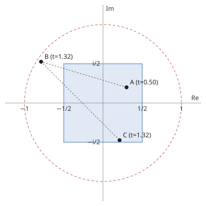

# Bianchi 군

# 개요

**Bianchi 군(Bianchi group)** 은 허수이차체의 정수를 성분으로 하고 행렬식이 $1$ 인 $2\times 2$ 행렬들이 쌍곡 3 공간에 작용하는 군이다. [모듈러 군](modular-group.md)은 상반평면의 점을 $\tau\mapsto\tau+1$ 과 $\tau\mapsto -1/\tau$ 로 옮겨 띠 하나 안으로 모았다. 성분을 Gauss 정수 $a+bi$ 로 넓히면 평행이동이 $w\mapsto w+1$ 과 $w\mapsto w+i$ 두 방향으로 늘고, 점이 사는 곳도 평면 위의 반공간이 된다. Bianchi 군은 이 공간의 점을 정사각형 기둥 하나 안으로 모으고, 그 기둥 조각의 부피를 [Dedekind zeta 함수](dedekind-zeta.md)의 값으로 준다.

# 직관

상반공간의 점을 $(w,t)$ 로 쓴다. $w$ 는 복소수이고 $t\gt 0$ 은 높이다. 평행이동 $w\mapsto w+1$ 과 $w\mapsto w+i$ 는 높이를 바꾸지 않고 $w$ 만 옮기므로, 이 둘만으로는 $w$ 를 정사각형 $\vert\mathrm{Re}\thinspace w\vert\le 1/2$, $\vert\mathrm{Im}\thinspace w\vert\le 1/2$ 안에 넣을 수 있을 뿐이다.

높이는 반전 $w\mapsto -1/w$ 를 상반공간으로 넓힌 사상이 바꾼다. 이 사상은 다음과 같이 점을 옮긴다.

$$
(w,t)\mapsto\left(\frac{-\bar w}{\vert w\vert^2+t^2},\ \frac{t}{\vert w\vert^2+t^2}\right)
$$

$\vert w\vert^2+t^2\lt 1$ 이면, 곧 점이 원점 중심 단위 반구 아래에 있으면 높이가 커진다.

점 $A=(0.3+0.2i,\thinspace 0.5)$ 에서 시작한다. $\vert w\vert^2+t^2=0.13+0.25=0.38$ 이므로 반구 아래이고, 반전하면 $B=(-0.789+0.526i,\thinspace 1.316)$ 이 된다. $w$ 에 $1-i$ 를 더하면 $C=(0.211-0.474i,\thinspace 1.316)$ 이다. $C$ 는 정사각형 안에 있고 $\vert w\vert^2+t^2\gt 1$ 이므로 반구 위에 있다.

아래 그림은 복소평면 위에서 내려다본 정사각형과 단위원, 세 점 $A,B,C$ 의 $w$ 성분이다. 괄호 안은 높이 $t$ 다. 반전으로 높이가 $0.5$ 에서 $1.32$ 로 커지고, 평행이동으로 정사각형 안에 들어온다.

반전과 평행이동을 되풀이하면 어느 점이든 정사각형 기둥 안이면서 단위 반구 위에 있는 점으로 옮겨진다. 기둥의 바닥이 반구면이고 위로는 끝없이 열린 이 조각이 Gauss 정수의 Bianchi 군에서 모듈러 군의 띠에 해당한다.

# 정의

## Bianchi 군

양의 제곱인수 없는 정수 $d$ 에 대해 $K=\mathbb Q(\sqrt{-d})$ 를 허수이차체라 하고 그 정수환을 $\mathcal O_d$ 로 쓴다. [대수적 수체](algebraic-number-fields.md)의 정수환이다. $d=1$ 이면 $\mathcal O_1=\mathbb Z\lbrack i\rbrack$ 이고, $d=3$ 이면 $\omega=(1+\sqrt{-3})/2$ 에 대해 $\mathcal O_3=\mathbb Z\lbrack\omega\rbrack$ 이다.

성분이 $\mathcal O_d$ 에 속하고 행렬식이 $1$ 인 $2\times 2$ 행렬의 군을 $\mathrm{SL}\_2(\mathcal O_d)$ 라 하고, $\pm I$ 로 나눈 몫 $\mathrm{PSL}\_2(\mathcal O_d)$ 를 Bianchi 군이라 한다. 이 군은 $\mathrm{PSL}\_2(\mathbb C)$ 의 부분군이므로 [쌍곡 3 다양체](hyperbolic-3-manifolds.md)의 상반공간 $\mathbb H^3$ 에 등거리사상으로 작용한다. 직관 절의 세 사상은 다음 행렬이 준다.

$$
T=\begin{pmatrix}1&1\cr 0&1\end{pmatrix},\qquad U=\begin{pmatrix}1&i\cr 0&1\end{pmatrix},\qquad S=\begin{pmatrix}0&-1\cr 1&0\end{pmatrix}
$$

$d=1$ 인 $\mathrm{PSL}\_2(\mathbb Z\lbrack i\rbrack)$ 를 **Picard 군(Picard group)** 이라 한다. 대수기하에서 직선다발의 동형류가 이루는 Picard 군과는 이름만 같은 다른 대상이다.

## 기본 다면체

$\Gamma\le\mathrm{PSL}\_2(\mathbb C)$ 에 대해 $\mathbb H^3$ 의 닫힌 집합 $F$ 가 다음을 만족하면 **기본 다면체(fundamental polyhedron)** 라 한다. $F$ 의 $\Gamma$ 상들이 $\mathbb H^3$ 을 덮고, 서로 다른 두 상은 경계에서만 만난다. Picard 군의 기본 다면체는 다음 집합이다.

$$
F=\left\lbrace (w,t)\ :\ \vert\mathrm{Re}\thinspace w\vert\le\tfrac12,\ 0\le\mathrm{Im}\thinspace w\le\tfrac12,\ \vert w\vert^2+t^2\ge 1\right\rbrace
$$

직관 절의 정사각형 기둥에서 $\mathrm{Im}\thinspace w\ge 0$ 인 절반이다. 대각행렬 $\mathrm{diag}(i,-i)$ 가 $w\mapsto -w$ 로 작용해 나머지 절반을 이 절반으로 옮긴다.

# 성질

## 이산성

$\mathcal O_d$ 는 복소평면의 [격자](lattices.md)이므로, 성분이 $\mathcal O_d$ 에 속하는 행렬은 $\mathrm{PSL}\_2(\mathbb C)$ 안에서 서로 일정 거리 이상 떨어져 있다. 따라서 Bianchi 군은 $\mathrm{PSL}\_2(\mathbb C)$ 의 이산 부분군이다.

$S$ 는 $S^2=-I$ 이므로 $\mathrm{PSL}\_2$ 에서 위수 $2$ 인 원소이고 점 $(0,1)$ 을 고정한다. Bianchi 군은 비틀림 원소를 가지므로 몫 $\mathbb H^3/\mathrm{PSL}\_2(\mathcal O_d)$ 는 다양체가 아니다. 유한 지표의 비틀림 없는 부분군 $\Gamma$ 를 잡으면 $\mathbb H^3/\Gamma$ 가 유한 부피 완비 쌍곡 3 다양체다.

## cusp 와 류수

몫 $\mathbb H^3/\mathrm{PSL}\_2(\mathcal O_d)$ 의 cusp 개수는 $K$ 의 류수 $h_K$ 와 같다. 경계 $\widehat{\mathbb C}$ 의 점 가운데 포물형 원소가 고정하는 점은 $K\cup\lbrace\infty\rbrace$ 이고, $a/c\in K$ 를 아이디얼 $(a,c)$ 의 류로 보내는 사상이 $\mathrm{PSL}\_2(\mathcal O_d)$ 궤도와 아이디얼 류 사이의 전단사를 준다. Picard 군은 $h_K=1$ 이므로 cusp 가 하나이고, 기본 다면체에서 위로 열린 끝이 그 cusp 다.

## Humbert 부피 공식

$K$ 의 판별식을 $D_K$ 라 하면 다음이 성립한다.

$$
\mathrm{Vol}\left(\mathbb H^3/\mathrm{PSL}\_2(\mathcal O_d)\right)=\frac{\vert D_K\vert^{3/2}}{4\pi^2}\thinspace\zeta_K(2)
$$

이것이 **Humbert 부피 공식(Humbert volume formula)** 이고, $\zeta_K$ 는 $K$ 의 Dedekind zeta 함수다. Picard 군에서는 $D_K=-4$ 이고 $\zeta_K(2)=\zeta(2)L(2,\chi_{-4})$ 이므로 부피가 Catalan 상수 $G=0.9159\ldots$ 의 $1/3$, 곧 $0.3053\ldots$ 이다. $d=3$ 에서는 부피가 $0.1691\ldots$ 이다.

## Poincaré 다면체 정리

**Poincaré 다면체 정리(Poincaré polyhedron theorem)** 는 [Poincaré 다각형 정리](poincare-polygon-theorem.md)의 3 차원 판이다. $\mathbb H^3$ 의 볼록 다면체 $P$ 와 그 면을 둘씩 짝짓는 등거리사상들이 주어지고, 모서리 순환마다 이면각의 합이 $2\pi/m$ 꼴이며 cusp 에서 완비성 조건이 성립한다고 하자. 그러면 짝짓기 사상들이 생성하는 군은 이산이고 $P$ 는 그 군의 기본 다면체다. 그 군의 정의관계는 짝짓기 관계와 모서리 순환마다의 관계 $(\text{순환곱})^m=1$ 이다.

$L=\mathrm{diag}(i,-i)$ 로 둔다. Picard 군의 기본 다면체 $F$ 에서 옆면 $\mathrm{Re}\thinspace w=\pm\tfrac12$ 는 $T$ 가 서로 짝짓고, 옆면 $\mathrm{Im}\thinspace w=0$ 은 $L$ 이, 옆면 $\mathrm{Im}\thinspace w=\tfrac12$ 는 $UL$ 이, 바닥의 반구면은 $S$ 가 각각 자기 자신과 짝짓는다. 이 정리를 $F$ 에 적용하면 Picard 군의 생성원과 정의관계가 나온다.

# 활용

- 쌍곡 3 다양체의 8 자매듭 여집합. 8 자매듭 여집합의 기본군은 $\mathrm{PSL}\_2(\mathcal O_3)$ 의 지표 $12$ 인 부분군이고, 부피 $2.0298\ldots$ 은 $d=3$ 의 Humbert 부피 $0.1691\ldots$ 의 $12$ 배다. Whitehead 고리(Whitehead link)의 여집합은 Picard 군의 지표 $12$ 인 부분군에서 오고 부피가 $12\times 0.3053\ldots=3.6638\ldots$ 이다.
- 산술 쌍곡 다양체. 사원수 대수에서 오는 산술군 가운데 경계가 있는 것, 곧 cusp 를 갖는 것은 어느 Bianchi 군과 공약(commensurable)이다. 곧 두 군의 교집합이 양쪽에서 유한 지표다.
- [모듈러 기호](modular-symbols.md). Bianchi 군의 코호몰로지가 허수이차체 위의 Bianchi 모듈러 형식을 담고, 모듈러 기호의 계산이 같은 틀로 옮겨 간다.

# 연관 문서

## 선수지식

- [모듈러 군](modular-group.md)
- [쌍곡 3 다양체](hyperbolic-3-manifolds.md)
- [대수적 수체](algebraic-number-fields.md)

## 더 알아보기

아직 연결한 문서가 없다.

#differential_geometry #number_theory #group_theory
