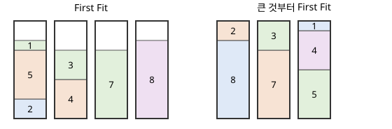

# 상자 채우기 문제

# 개요

**상자 채우기 문제(bin packing problem)** 는 크기가 정해진 물건들을 용량이 같은 상자들에 나눠 담을 때 상자를 가장 적게 쓰는 문제다. 무게가 $2,5,4,7,1,3,8$ kg 인 짐을 $10$ kg 까지 싣는 트럭들에 나눠 실을 때 트럭이 몇 대 필요한지가 이 꼴이다. 짐을 큰 것부터 차례로 들어가는 첫 트럭에 싣는 규칙이 이 예에서 최솟값을 내고, 일반적으로도 최솟값의 약 $11/9$ 배 안에 든다.

# 직관

짐은 $2,5,4,7,1,3,8$ 의 순서로 오고 트럭 한 대에 $10$ kg 까지 싣는다. 무게를 모두 더하면 $30$ 이므로 트럭은 적어도 $3$ 대 필요하다.

짐이 오는 대로 지금 싣는 트럭에 넣고, 안 들어가면 그 트럭을 보내고 새 트럭을 부른다. $2,5$ 를 실은 트럭에 $4$ 가 안 들어가 새 트럭을 부르고, 같은 식으로 $\lbrack 2,5\rbrack$, $\lbrack 4\rbrack$, $\lbrack 7,1\rbrack$, $\lbrack 3\rbrack$, $\lbrack 8\rbrack$ 의 $5$ 대가 된다. 보낸 트럭에 자리가 남아 있어도 다시 쓰지 않았다.

트럭을 보내지 않고 세워 두었다가, 짐마다 앞 트럭부터 살펴 들어가는 첫 트럭에 싣는다. 그러면 $1$ 은 첫 트럭에, $3$ 은 둘째 트럭에 들어가 아래 그림의 왼쪽처럼 $4$ 대가 된다. 늦게 온 큰 짐 $7$ 과 $8$ 이 들어갈 자리가 앞서 온 작은 짐들로 이미 나뉘어 있었다.

그래서 짐을 무거운 것부터 $8,7,5,4,3,2,1$ 로 늘어놓고 같은 규칙으로 싣는다. 그림의 오른쪽처럼 $\lbrack 8,2\rbrack$, $\lbrack 7,3\rbrack$, $\lbrack 5,4,1\rbrack$ 의 $3$ 대가 되고, 이것은 처음의 하한 $3$ 과 같으므로 최솟값이다.

# 정의

## 상자 채우기 문제

용량 $C\gt 0$ 과 크기 $s\_1,\dots,s\_n\in(0,C\rbrack$ 가 주어질 때, $\lbrace 1,\dots,n\rbrace$ 을 각 부분의 크기 합이 $C$ 이하인 부분들로 나누는 것을 **채우기(packing)** 라 하고, 부분 하나를 **상자(bin)** 라 한다. **상자 채우기 문제** 는 상자 수가 가장 적은 채우기를 찾는 문제이고, 그 수를 $\mathrm{OPT}(I)$ 로 쓴다. 직관 절의 입력 $I$ 는 $C=10$ 이고 $\mathrm{OPT}(I)=3$ 이다.

## Next Fit, First Fit, First Fit Decreasing

물건을 주어진 순서로 하나씩 넣는 다음 세 규칙이 기본이다.

- **Next Fit**. 마지막으로 연 상자에 들어가면 넣고, 아니면 새 상자를 열어 넣는다. 직관 절에서 $5$ 상자를 쓴다.
- **First Fit**. 연 상자들을 연 순서로 보고 들어가는 첫 상자에 넣고, 없으면 새 상자를 연다. 직관 절에서 $4$ 상자를 쓴다.
- **First Fit Decreasing**. 물건을 크기가 줄어드는 순서로 정렬한 뒤 First Fit 을 쓴다. 직관 절에서 $3$ 상자를 쓴다.

세 규칙이 입력 $I$ 에 쓰는 상자 수를 각각 $\mathrm{NF}(I)$, $\mathrm{FF}(I)$, $\mathrm{FFD}(I)$ 로 쓴다.

# 성질

## 크기 합의 하한

상자마다 크기 합이 $C$ 이하이므로 $\mathrm{OPT}(I)\ge\lceil\sum\_is\_i/C\rceil$ 다. 직관 절에서 이 하한은 $\lceil 30/10\rceil=3$ 이다.

## Next Fit 의 두 배 보장

$\mathrm{NF}(I)\le 2\thinspace\mathrm{OPT}(I)$ 다. Next Fit 이 연 상자를 $B\_1,\dots,B\_k$ 라 하면, $B\_{j+1}$ 의 첫 물건은 $B\_j$ 에 들어가지 않았으므로 이웃한 두 상자의 크기 합은 $C$ 를 넘는다. 이웃한 쌍 $k-1$ 개에 대해 더하면 다음이 나온다.

$$
2\sum_i s_i\gt (k-1)C
$$

따라서 $k\lt 2\sum\_is\_i/C+1\le 2\thinspace\mathrm{OPT}(I)+1$ 이다.

## First Fit 과 First Fit Decreasing 의 보장

D. S. Johnson 이 1973 년에 두 규칙의 비율을 처음 분석했고[^1], 가산 상수까지 정확한 판본은 다음이다.

$$
\mathrm{FF}(I)\le\left\lfloor\tfrac{17}{10}\mathrm{OPT}(I)\right\rfloor,\qquad
\mathrm{FFD}(I)\le\tfrac{11}{9}\mathrm{OPT}(I)+\tfrac{6}{9}
$$

첫째는 G. Dósa 와 J. Sgall 이[^2], 둘째는 G. Dósa 가[^3] 증명했고 두 부등식 모두 등호가 되는 입력이 있다. First Fit 에서 크기 합이 $C/2$ 이하인 상자는 많아야 하나다. 그런 상자가 둘이면 나중 상자의 물건이 앞 상자에 들어가므로 First Fit 은 그것을 앞 상자에 넣었다.

## 계산 복잡도

$\mathrm{OPT}(I)\le 2$ 인지 판정하는 것은 크기들을 합이 같은 두 무리로 나누는 [분할 문제](partition-problem.md)이고, 이것은 목표값이 전체 합의 절반인 [부분합 문제](subset-sum.md)이므로 NP(nondeterministic polynomial time)-완전이다. 그래서 $\mathrm{P}\ne\mathrm{NP}$ 이면 모든 입력에서 $3/2$ 배보다 작은 비율을 보장하는 다항 시간 알고리즘은 없다. 그런 알고리즘은 $\mathrm{OPT}(I)=2$ 인 입력에서 $2$ 를 내므로 분할 문제를 다항 시간에 푼다.

## 점근적 근사

$3/2$ 의 한계는 $\mathrm{OPT}$ 가 작은 입력에서만 생긴다. W. Fernandez de la Vega 와 G. S. Lueker 는 모든 $\varepsilon\gt 0$ 에 대해 $(1+\varepsilon)\mathrm{OPT}(I)+1$ 상자 이하를 쓰는 다항 시간 알고리즘을 주었다[^4]. 크기가 $\varepsilon C$ 이상인 물건만 남기고 크기를 몇 종류로 올려 맞추면 한 상자에 담을 수 있는 조합의 종류가 유한해져 [선형계획법](linear-programming.md)으로 풀리고, 작은 물건은 마지막에 First Fit 으로 채운다.

상자 하나에 담는 물건 조합마다 변수를 두는 선형계획을 배치 선형계획(configuration linear program)이라 한다. N. Karmarkar 와 R. M. Karp 는 이것으로 $\mathrm{OPT}(I)+O(\log^2\mathrm{OPT}(I))$ 를[^5], R. Hoberg 와 T. Rothvoss 는 $\mathrm{OPT}(I)+O(\log\mathrm{OPT}(I))$ 를 보장하는 알고리즘을 주었다[^6].

# 활용

- 재단 문제(cutting stock problem). 길이가 같은 원자재에서 주문받은 길이의 조각들을 잘라 낼 때 원자재 수를 줄이는 문제다. 같은 길이의 주문이 많으면 P. C. Gilmore 와 R. E. Gomory 의 배치 선형계획과 열 생성으로 푼다[^7].
- 서버와 메모리 배치. 가상 기계를 용량이 같은 서버에 나눠 올리거나 메모리 조각을 같은 크기의 페이지에 나눠 담을 때 First Fit 류 규칙을 쓴다.
- [동일 병렬 기계 일정 문제](identical-machine-scheduling.md). 일을 같은 기계 여러 대에 나눠 모든 일이 시각 $T$ 까지 끝나게 할 때 기계 수의 최솟값은 용량 $T$ 인 상자 채우기의 값이다.

[^1]: D. S. Johnson, "Near-optimal bin packing algorithms", PhD thesis, MIT (1973).
[^2]: G. Dósa, J. Sgall, "First Fit bin packing: A tight analysis", STACS 2013, LIPIcs 20 (2013), 538–549.
[^3]: G. Dósa, "The tight bound of First Fit Decreasing bin-packing algorithm is FFD(I) ≤ 11/9 OPT(I) + 6/9", ESCAPE 2007, Lecture Notes in Computer Science 4614 (2007), 1–11.
[^4]: W. Fernandez de la Vega, G. S. Lueker, "Bin packing can be solved within 1+ε in linear time", Combinatorica 1 (1981), 349–355.
[^5]: N. Karmarkar, R. M. Karp, "An efficient approximation scheme for the one-dimensional bin-packing problem", FOCS 1982, 312–320.
[^6]: R. Hoberg, T. Rothvoss, "A logarithmic additive integrality gap for bin packing", SODA 2017, 2616–2625.
[^7]: P. C. Gilmore, R. E. Gomory, "A linear programming approach to the cutting-stock problem", Operations Research 9 (1961), 849–859.

# 연관 문서

## 선수지식

- [근사 알고리즘](approximation-algorithms.md)
- [부분합 문제](subset-sum.md)

## 더 알아보기

- [동일 병렬 기계 일정 문제](identical-machine-scheduling.md)
- [차량 경로 문제](vehicle-routing-problem.md)

#algorithms #complexity #optimization #combinatorics
