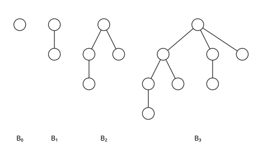

# 이항 힙

# 개요

**이항 힙(binomial heap)** 은 크기가 $2$ 의 거듭제곱인 힙 트리 몇 개로 우선순위 큐를 나타내어, 두 우선순위 큐를 하나로 합치는 연산을 빠르게 하는 자료구조다. 프린터 두 대의 대기열을 한 대로 합칠 때, [이진 힙](binary-heaps.md) 두 개를 합치려면 배열 두 개를 이어 붙인 뒤 힙을 다시 만들어야 해서 작업 수에 비례하는 시간이 든다. 이항 힙은 합치기를 두 이진수의 덧셈처럼 자리마다 트리를 맞붙이는 것으로 해서, 작업 수의 로그에 비례하는 걸음에 끝낸다.

# 직관

작업 $13$ 개짜리 대기열과 $6$ 개짜리 대기열을 합친다. $13=8+4+1$, $6=4+2$ 이므로 첫 대기열을 크기 $8,4,1$ 인 힙 셋으로, 둘째를 크기 $4,2$ 인 힙 둘로 나누어 둔다. 크기가 같은 힙 둘은 뿌리를 비교해 큰 쪽 뿌리를 작은 쪽 뿌리의 자식으로 붙이면 크기가 두 배인 힙 하나가 된다.

크기 $1$ 과 $2$ 는 한쪽에만 있어 그대로 둔다. 크기 $4$ 는 양쪽에 있으므로 붙여 크기 $8$ 하나를 만들고, 이것이 첫 대기열의 크기 $8$ 과 다시 만나 크기 $16$ 이 된다. 결과는 크기 $16,2,1$ 인 힙 셋이고 $16+2+1=19$ 다. 이 과정은 이진수의 덧셈 $1101\_2+0110\_2=10011\_2$ 에서 자리올림을 하는 것과 같다.

크기가 $2^k$ 인 힙을 이렇게 붙여서만 만들면 모양이 하나로 정해진다. 아래 그림이 크기 $1,2,4,8$ 인 모양이다. 크기 $8$ 인 트리는 크기 $4$ 인 트리 둘을 뿌리끼리 이은 것이고, 뿌리의 자식들은 크기 $4,2,1$ 인 트리의 뿌리다.



# 정의

## 이항 트리

**이항 트리(binomial tree)** $B_k$ 는 다음으로 귀납적으로 정의되는 뿌리 있는 트리다. $B_0$ 은 마디 하나다. $B_k$ 는 $B_{k-1}$ 두 개 가운데 한쪽 뿌리를 다른 쪽 뿌리의 가장 왼쪽 자식으로 붙인 것이다. $k$ 를 $B_k$ 의 **차수(order)** 라 한다.

예. 직관 절의 그림에서 $B_3$ 의 뿌리는 자식이 셋이고, 그 자식들은 왼쪽부터 $B_2$, $B_1$, $B_0$ 의 뿌리다.

## 이항 힙

**이항 힙** 은 이항 트리들의 모임이며, 각 트리의 모든 마디에서 부모의 키가 자식의 키 이하라는 힙 조건을 만족하고, 같은 차수의 트리가 둘 이상 없는 것이다. 트리들의 뿌리는 차수 순서로 연결 목록에 둔다. Vuillemin 이 1978 년에 제안했다[^1].

예. 원소가 $13$ 개인 이항 힙은 $13=1101\_2$ 이므로 $B_3$, $B_2$, $B_0$ 세 트리로 되어 있다.

## 연산

- **합치기(meld)** 는 두 이항 힙의 뿌리 목록을 차수 순으로 훑으며, 같은 차수의 트리 둘을 만나면 키가 큰 뿌리를 작은 뿌리의 자식으로 붙여 한 차수 높은 트리로 만든다.
- **삽입** 은 새 원소 하나로 된 $B_0$ 과 합친다.
- **최솟값 삭제** 는 뿌리들 가운데 키가 가장 작은 것을 떼고, 그 뿌리의 자식들이 이루는 트리 $B_{k-1},\dots,B_0$ 을 새 이항 힙으로 보아 나머지와 합친다.
- **키 감소** 는 키를 줄인 마디를 부모와 자리를 바꾸며 올린다.

```typescript
interface BinomialNode {
  key: number;
  order: number;
  child: BinomialNode | null;   // 가장 왼쪽 자식
  sibling: BinomialNode | null; // 오른쪽 형제, 또는 뿌리 목록의 다음 트리
}

// 차수가 같은 두 트리를 붙여 차수가 하나 큰 트리를 만든다.
function link(a: BinomialNode, b: BinomialNode): BinomialNode {
  if (b.key < a.key) [a, b] = [b, a];
  b.sibling = a.child;
  a.child = b;
  a.order += 1;
  return a;
}
```

예. 직관 절의 합치기에서 `link` 는 두 번 불린다. 크기 $4$ 인 두 트리를 붙여 $B_3$ 을 만들고, 그것과 첫 대기열의 $B_3$ 을 붙여 $B_4$ 를 만든다.

# 성질

## 이항 트리의 모양

$B_k$ 는 마디가 $2^k$ 개이고 높이가 $k$ 이며, 뿌리의 자식이 $k$ 개로 모든 마디 가운데 가장 많다. 깊이 $d$ 에 있는 마디는 다음 개수만큼 있다.

$$
\binom{k}{d}
$$

*증명의 요지.* $B_k$ 의 깊이 $d$ 마디는 아래쪽 $B_{k-1}$ 의 깊이 $d$ 마디와 위로 붙은 $B_{k-1}$ 의 깊이 $d-1$ 마디로 나뉜다. 그러므로 개수는 $\binom{k-1}{d}+\binom{k-1}{d-1}=\binom kd$ 다. 이 개수가 이항계수라서 이름이 붙었다.

## 연산의 비용

원소 $n$ 개인 이항 힙은 $n$ 의 이진 표현에서 $1$ 인 자리마다 트리가 하나씩 있으므로 트리가 $\lfloor\log\_2 n\rfloor+1$ 개 이하다. 합치기는 뿌리 목록을 한 번 훑으며 자리마다 `link` 를 많아야 한 번 하므로 $O(\log n)$ 이다. 최솟값 삭제는 뿌리를 훑는 데와 자식 $k\le\log\_2 n$ 개를 합치는 데 $O(\log n)$ 이고, 키 감소는 높이가 $\log\_2 n$ 이하라 $O(\log n)$ 이다.

## 삽입의 분할상환 비용

삽입을 $m$ 번 연달아 하면 전체 비용은 $O(m)$ 이고, 삽입 한 번의 [분할상환](amortized-analysis.md) 비용은 $O(1)$ 이다.

*증명의 요지.* 삽입 한 번은 이진 카운터에 $1$ 을 더하는 것과 같고, `link` 횟수는 자리올림 횟수다. 퍼텐셜을 트리의 수로 두면 `link` 한 번이 트리를 하나 줄이므로, 삽입 한 번이 퍼텐셜을 많아야 $1$ 늘리고 자리올림의 비용은 퍼텐셜 감소로 상쇄된다.

# 활용

- 합칠 수 있는 우선순위 큐. 여러 대기열을 합치는 일이 잦은 일정 관리와 이산 사건 모의실험에서 쓴다.
- [Fibonacci 힙](fibonacci-heaps.md)의 바탕. Fibonacci 힙은 이항 힙에서 합치기와 삽입 때 `link` 를 미루고, 키 감소 때 마디를 잘라 뿌리 목록으로 옮겨 키 감소를 분할상환 $O(1)$ 에 한다.
- 정렬. $n$ 개를 삽입한 뒤 최솟값 삭제를 $n$ 번 하면 $O(n\log n)$ 에 정렬한다.

[^1]: J. Vuillemin, "A data structure for manipulating priority queues", Communications of the ACM 21 (1978), 309–315.

# 연관 문서

## 선수지식

- [이진 힙](binary-heaps.md)
- [분할상환 분석](amortized-analysis.md)

## 더 알아보기

아직 연결한 문서가 없다.

#data_structures #algorithms #combinatorics
