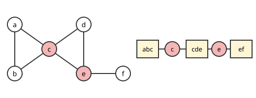

# 블록-절단점 나무

# 개요

**블록-절단점 나무(block-cut tree)** 는 연결 그래프를 정점 하나를 지워서는 끊어지지 않는 조각들로 자르고, 조각과 자른 정점을 번갈아 이은 나무다. 통신망에서 어느 중계소 하나가 고장 나면 망이 둘로 갈리는지, 갈린다면 어느 부분끼리 떨어지는지 알고 싶을 때 이 나무를 본다. 나무에 나타나는 자른 정점이 곧 고장 나면 망을 가르는 중계소이고, 깊이 우선 탐색 한 번으로 이 나무를 구한다.

# 직관

삼각형 $a,b,c$ 와 삼각형 $c,d,e$ 가 정점 $c$ 를 공유하고, $e$ 에 간선 $ef$ 가 붙은 그래프를 본다. $c$ 를 지우면 $\lbrace a,b\rbrace$ 와 $\lbrace d,e,f\rbrace$ 로 갈리고, $e$ 를 지우면 $f$ 가 떨어진다. 다른 정점은 지워도 그래프가 이어져 있다.

$c$ 와 $e$ 에서 그래프를 자르면 첫 삼각형, 둘째 삼각형, 간선 $ef$ 의 세 조각이 남는다. 조각마다 어느 정점 하나를 지워도 조각 안이 이어져 있다. 조각과 자른 정점을 번갈아 늘어놓으면 첫 삼각형, $c$, 둘째 삼각형, $e$, 간선 $ef$ 가 한 줄로 이어진다. 조각 둘이 자른 정점 두 곳에서 만나면 둘을 합친 것도 정점 하나를 지워 끊기지 않으므로 한 조각이어야 한다. 그래서 이 줄에는 순환이 생기지 않는다.



그림의 왼쪽에서 빨간 정점이 자른 정점 $c,e$ 이고, 오른쪽의 사각형이 조각, 원이 자른 정점이다.

# 정의

**절단점(cut vertex)** 은 지우면 연결 성분이 늘어나는 정점이고, **블록(block)** 은 절단점이 없는 연결 부분그래프 가운데 극대인 것이다. 블록은 [귀 분해](ear-decomposition.md)가 있는 $2$ 연결 부분그래프이거나 다리 하나이고, 두 블록은 많아야 절단점 하나를 공유한다.

연결 그래프 $G$ 의 절단점의 집합을 $X$, 블록의 집합을 $\mathcal B$ 라 한다. **블록-절단점 나무** $T(G)$ 는 정점 집합이 $\mathcal B\cup X$ 이고, $x\in X$ 와 $B\in\mathcal B$ 를 $x\in B$ 일 때 잇는 이분 그래프다.

간선 $e,f$ 가 같거나 둘을 모두 지나는 순환이 있을 때 $e\sim f$ 로 두면 이것은 동치 관계이고, 그 동치류가 이루는 부분그래프가 고립점이 아닌 블록이다.

# 성질

## 블록의 구조

- 두 블록은 많아야 정점 하나를 공유하고, 공유하는 정점은 절단점이다.
- 정점이 $3$ 개 이상인 블록은 $2$ 연결이고, 정점이 $2$ 개인 블록은 다리 하나다.
- 정점 $v$ 가 절단점인 것은 $v$ 가 블록 두 개 이상에 속하는 것과 동치다.

## 나무임

정리. 연결 그래프 $G$ 의 $T(G)$ 는 나무이고, 잎은 모두 블록이다.

증명의 요지. $G$ 가 연결이므로 $T(G)$ 도 연결이다. $T(G)$ 에 순환 $B_1,x_1,B_2,x_2,\dots,B_k,x_k,B_1$ 이 있으면 블록들의 합집합에서 어느 정점 하나를 지워도 나머지가 순환을 따라 이어지므로, 합집합이 절단점 없는 연결 부분그래프가 되어 블록의 극대성에 어긋난다. 절단점은 블록 두 개 이상에 속하므로 차수가 $2$ 이상이고, 잎이 될 수 없다.

잎 블록은 절단점을 하나만 포함하므로, 절단점이 있는 그래프에는 절단점을 하나만 포함하는 블록이 두 개 이상 있다. 그래프 성질을 블록에 대한 귀납법으로 증명할 때 잎 블록을 떼는 단계로 쓴다.

## 선형 시간 알고리즘

J. Hopcroft 와 R. E. Tarjan 은 깊이 우선 탐색 한 번으로 블록과 절단점을 모두 찾았다[^1].

깊이 우선 탐색 나무에서 정점 $v$ 의 방문 순서를 $\mathrm{pre}(v)$, $v$ 의 후손과 뒤 간선 하나로 닿는 정점들의 방문 순서의 최솟값을 $\mathrm{low}(v)$ 라 한다. 뿌리가 아닌 $v$ 가 절단점인 것은 $\mathrm{low}(c)\ge\mathrm{pre}(v)$ 인 자식 $c$ 가 있는 것과 동치이고, 뿌리는 자식이 둘 이상일 때 절단점이다. 탐색하면서 간선을 스택에 쌓고 이 조건이 성립할 때 $vc$ 까지 꺼내면 꺼낸 간선이 블록 하나다[^1].

```javascript
// 깊이 우선 탐색으로 블록을 찾는다. 꺼낸 간선 묶음 하나가 블록 하나다.
function blocks(graph) {
  const pre = new Map(), low = new Map(), stack = [], out = [];
  let time = 0;
  function dfs(v, parent) {
    pre.set(v, time); low.set(v, time); time++;
    for (const u of graph.neighbors(v)) {
      if (u === parent) continue;
      if (!pre.has(u)) {
        stack.push([v, u]);
        dfs(u, v);
        low.set(v, Math.min(low.get(v), low.get(u)));
        if (low.get(u) >= pre.get(v)) {
          const block = [];
          let e;
          do { e = stack.pop(); block.push(e); } while (e[0] !== v || e[1] !== u);
          out.push(block);
        }
      } else if (pre.get(u) < pre.get(v)) {
        stack.push([v, u]);
        low.set(v, Math.min(low.get(v), pre.get(u)));
      }
    }
  }
  for (const v of graph.vertices()) if (!pre.has(v)) dfs(v, null);
  return out;
}
```

# 활용

- 망의 취약점. 통신망에서 고장 나면 망이 갈리는 지점이 절단점이고, 블록-절단점 나무가 갈리는 모양을 나타낸다.
- 블록에 대한 귀납법. 평면성, 채색수, [Hamilton 순환](hamiltonian-cycles.md)의 존재처럼 블록마다 따로 판정되는 성질을 블록으로 나누어 다룬다. 그래프의 채색수는 블록의 채색수의 최댓값이다.
- [Gallai–Edmonds 분해](gallai-edmonds-decomposition.md)의 인수 임계 성분과 Lovász 의 홀수 귀 분해는 블록 단위로 적용된다. 인수 임계 그래프의 블록은 모두 인수 임계다.

[^1]: J. Hopcroft, R. E. Tarjan, "Algorithm 447: efficient algorithms for graph manipulation", Communications of the ACM 16 (1973), 372–378.

# 연관 문서

## 선수지식

- [귀 분해](ear-decomposition.md)

## 더 알아보기

아직 연결한 문서가 없다.

#graph_theory #algorithms #combinatorics
