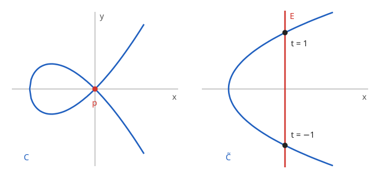

# 부풀림

# 개요

**부풀림(blow-up)** 은 곡면의 한 점을 그 점을 지나는 방향들의 모임으로 바꾸는 구성이다. 평면곡선 $y^2=x^2+x^3$ 은 원점에서 기울기 $1$ 인 가지와 기울기 $-1$ 인 가지가 교차해, 원점이 곡선 위의 매끄럽지 않은 점이 된다.

원점을 방향들의 모임인 사영직선으로 바꾸면 두 가지는 기울기가 달라서 그 사영직선의 서로 다른 두 점을 지나고, 곡선은 매끄러워진다. 부풀림은 이렇게 곡선의 교점과 특이점을 떼어 놓고, 그때 교차수와 표준류가 어떻게 바뀌는지를 계산하게 해 준다.

# 직관

곡선 $C$ 를 $y^2=x^2+x^3$ 으로 둔다. 원점 근처에서 $x^3$ 은 $x^2$ 보다 훨씬 작으므로 $C$ 는 두 직선 $y=x$, $y=-x$ 처럼 생겼다. 원점 밖의 점은 원점과 이어 기울기 $t=y/x$ 를 정할 수 있지만 원점 자신은 기울기가 정해지지 않는다.

평면의 점 $(x,y)$ 에 기울기 $t$ 를 함께 적은 쌍 $(x,t)$ 를 좌표로 삼고 $y=tx$ 로 되돌린다. $C$ 의 식에 넣으면 다음이 나온다.

$$
t^2x^2=x^2+x^3,\qquad x^2\thinspace(t^2-1-x)=0
$$

$x=0$ 은 원점 위에 놓인 모든 기울기 $t$ 의 직선이고, 이것이 원점을 바꾼 사영직선 $E$ 다. 남은 인수 $x=t^2-1$ 은 포물선이고 매끄럽다. 이 포물선은 $E$ 와 $t=1$, $t=-1$ 의 두 점에서 만나는데, 이 둘은 $C$ 의 두 가지의 기울기다.

왼쪽 그림은 원점 $p$ 에서 두 가지가 교차하는 $C$ 이고, 오른쪽 그림은 $(x,t)$ 좌표에서 $E$ 와 포물선이다. 원점에서 겹쳤던 두 가지는 $E$ 위의 $t=\pm 1$ 인 두 점으로 갈라진다.

# 정의

## 평면의 한 점

아핀 평면의 원점의 **부풀림** 은 다음 곡면이다.

$$
\mathrm{Bl}\_0\mathbb A^2=\lbrace\thinspace((x,y),(u:v))\in\mathbb A^2\times\mathbb P^1:\ xv=yu\thinspace\rbrace
$$

첫째 성분으로 보내는 사상을 $\pi$ 라 한다. $(x,y)\ne(0,0)$ 이면 $(u:v)=(x:y)$ 로 하나뿐이므로 $\pi$ 는 원점 밖에서 동형이다. 원점 위에는 $(u:v)$ 가 무엇이든 되므로 $\pi^{-1}(0)$ 은 사영직선이고, 이것을 **예외 곡선(exceptional curve)** $E$ 라 한다.

$u\ne 0$ 인 조각에서 $t=v/u$ 로 두면 $y=tx$ 이고 $(x,t)$ 가 좌표다. 직관 절의 계산이 이 조각에서 한 것이다. $v\ne 0$ 인 조각에서는 $s=u/v$, $x=sy$ 이고, 두 조각이 곡면 전체를 덮는다.

매끄러운 곡면 $X$ 의 점 $p$ 에서는 $p$ 근처의 국소 좌표 $(x,y)$ 로 같은 구성을 하고 $p$ 밖에서는 $X$ 를 그대로 붙인다. 이 곡면을 $\mathrm{Bl}\_pX$ 또는 $\widetilde X$ 로 적는다. 결과는 국소 좌표를 고르는 방법과 무관하다[^1].

## 고유 변환과 중복도

$C\subset X$ 가 $p$ 를 지나는 곡선일 때, $\pi^{-1}(C\setminus\lbrace p\rbrace)$ 의 폐포(closure)를 $C$ 의 **고유 변환(strict transform)** $\widetilde C$ 라 하고, $C$ 의 식을 $\pi$ 로 당긴 인자 $\pi^\ast C$ 를 **전체 변환(total transform)** 이라 한다.

$p$ 에서 $C$ 의 국소 식의 가장 낮은 차수의 항이 $m$ 차이면 $m$ 을 $p$ 에서 $C$ 의 **중복도(multiplicity)** 라 한다. 그러면 다음이 성립한다.

$$
\pi^\ast C=\widetilde C+mE
$$

직관 절의 $C$ 는 가장 낮은 차수의 항이 $y^2-x^2$ 이므로 $m=2$ 이고, 계산에서 나온 인수 $x^2$ 이 $2E$ 다.

# 성질

## 교차수

$\widetilde X$ 의 [교차 이론](intersection-theory.md)은 $X$ 의 것과 다음 관계로 이어진다[^1]. $D$, $D'$ 는 $X$ 의 인자다.

$$
\pi^\ast D\cdot\pi^\ast D'=D\cdot D',\qquad \pi^\ast D\cdot E=0,\qquad E^2=-1
$$

$E^2=-1$ 의 증명의 요지. $p$ 를 지나는 매끄러운 곡선 $L$ 은 중복도가 $1$ 이므로 $\pi^\ast L=\widetilde L+E$ 다. $L$ 을 $p$ 를 지나지 않는 곡선으로 옮길 수 있으므로 $\pi^\ast L\cdot E=0$ 이고, $\widetilde L$ 은 $E$ 와 $L$ 의 방향인 한 점에서 횡단으로 만나므로 $\widetilde L\cdot E=1$ 이다. 따라서 $0=1+E^2$ 다.

이 관계에서 $\widetilde C=\pi^\ast C-mE$ 이므로 $\widetilde C^2=C^2-m^2$ 이고 $\widetilde C\cdot E=m$ 이다. 직관 절의 포물선은 $E$ 와 두 점에서 횡단으로 만나 $\widetilde C\cdot E=2$ 다.

## Picard 군과 표준류

$\widetilde X$ 의 [Picard 군](picard-group.md)은 $\pi^\ast\mathrm{Pic}(X)\oplus\mathbb ZE$ 이다[^1]. 표준류는 다음과 같다.

$$
K\_{\widetilde X}=\pi^\ast K_X+E
$$

증명의 요지. $(x,t)$ 조각에서 $y=tx$ 이므로 $dy=t\thinspace dx+x\thinspace dt$ 이고 $dx\wedge dy=x\thinspace dx\wedge dt$ 다. $p$ 근처에서 $0$ 이 아닌 $2$ 형식을 당기면 $E$ 를 따라 한 번 $0$ 이 된다.

교차수 관계를 넣으면 $K\_{\widetilde X}^2=K_X^2-1$ 이다. 위상적으로는 점 하나가 $2$ 차원 구면인 $E$ 로 바뀌므로 Euler 표수가 $1$ 늘고 둘째 Betti 수가 $1$ 는다.

## 곡선의 종수

곡면 위 곡선 $C$ 의 산술 종수 $p_a$ 는 $2p_a-2=C^2+K\cdot C$ 로 정해진다. 두 관계를 넣으면 다음이 나온다.

$$
p_a(\widetilde C)=p_a(C)-\frac{m(m-1)}{2}
$$

직관 절의 $C$ 를 사영평면의 삼차곡선으로 보면 $p_a(C)=1$ 이고 $m=2$ 이므로 $p_a(\widetilde C)=0$ 이다. 고유 변환인 포물선은 사영직선과 동형이고, 마디가 있는 삼차곡선은 유리곡선이다.

## 특이점 풀기

평면곡선 $y^2=x^3$ 은 원점에서 중복도 $2$ 의 뾰족점을 갖는다. $(x,t)$ 조각에서 $x^2(t^2-x)=0$ 이므로 고유 변환은 매끄러운 곡선 $x=t^2$ 이고, $E$ 와 $t=0$ 에서 접해 $\widetilde C\cdot E=2$ 다.

정리. 매끄러운 곡면 위의 곡선은 점을 유한 번 부풀리면 고유 변환이 매끄러워지고, 더 부풀리면 고유 변환과 예외 곡선들의 합이 매끄러운 곡선들이 횡단으로만 만나는 곡선이 된다[^1].

증명의 요지는 위 종수 공식이다. $m\ge 2$ 인 점을 부풀릴 때마다 $p_a$ 가 줄고, $p_a$ 는 고유 변환의 정규화의 종수보다 작아질 수 없다.

## Castelnuovo 수축 정리

정리(Castelnuovo 수축 정리, Castelnuovo's contractibility theorem). 매끄러운 사영곡면 $S$ 위의 곡선 $E$ 가 사영직선과 동형이고 $E^2=-1$ 이면, 매끄러운 사영곡면 $S\_0$ 과 점 $p\in S\_0$ 이 있어 $S\cong\mathrm{Bl}\_pS\_0$ 이고 $E$ 가 예외 곡선이 된다[^2].

이런 곡선을 **(−1) 곡선((−1)-curve)** 이라 하고, $S\to S\_0$ 을 $E$ 의 **수축(blow-down)** 이라 한다. (−1) 곡선이 없는 곡면을 **극소 곡면(minimal surface)** 이라 한다. $K^2$ 는 수축할 때마다 $1$ 늘고 둘째 Betti 수는 $1$ 줄어들므로, 유한 번 수축하면 극소 곡면에 닿는다.

## 쌍유리 사상의 분해

정리. 매끄러운 사영곡면 사이의 쌍유리 사상(birational map)은 점의 부풀림과 (−1) 곡선의 수축을 유한 번 합성한 것이다. 쌍유리 사상이 모든 점에서 정의되면 부풀림만의 합성이다[^2].

사영평면에서 $(x:y:z)\mapsto(x:y)$ 는 $(0:0:1)$ 에서 정의되지 않는다. 이 점을 부풀리면 $E$ 위의 점이 $(0:0:1)$ 을 지나는 직선의 방향을 기억하므로 사상이 곡면 전체에서 정의되고, 그 곡면은 [Hirzebruch 곡면](hirzebruch-surfaces.md) $\mathbb F\_1$ 이다.

## 미분위상

복소곡면 $X$ 에 대해 $\mathrm{Bl}\_pX$ 는 방향을 지킨 채 $X$ 와 방향을 뒤집은 사영평면의 연결합과 미분동형이다[^2]. $E^2=-1$ 은 방향을 뒤집은 사영평면의 [교차형식](intersection-form.md) $(-1)$ 이다.

# 활용

- 유리곡면의 모형. [삼차곡면](cubic-surfaces.md)은 사영평면을 여섯 점에서 부풀린 곡면이고, 27 개 직선이 예외 곡선 여섯, 두 점을 지나는 직선의 고유 변환 열다섯, 다섯 점을 지나는 원뿔곡선의 고유 변환 여섯이다. [del Pezzo 곡면](del-pezzo-surfaces.md)은 일반 위치의 $r\le 8$ 점을 부풀린 곡면이다.
- 곡선 모임의 밑점. 평면 삼차곡선 두 개가 정하는 곡선 모임은 공통 교점 아홉에서 정의되지 않는 사상을 주고, 그 아홉 점을 부풀리면 [타원 곡면](elliptic-surfaces.md)이 된다.
- 특이 곡면의 해소. [Kummer 곡면](kummer-surfaces.md)의 이중점 열여섯을 부풀리면 [K3 곡면](k3-surfaces.md)이 된다. 이때는 곡면의 특이점을 부풀리므로 예외 곡선의 자기교차수가 $-2$ 다.
- 불변량 계산. [Noether 공식](noether-formula.md)의 양변이 부풀림에서 함께 변하지 않는다는 것을 $K^2$ 가 $1$ 줄고 Euler 표수가 $1$ 느는 것으로 확인한다.
- 곡면의 분류. [Kodaira 차원](kodaira-dimension.md)과 [Castelnuovo 유리성 판정법](castelnuovo-rationality-criterion.md)은 부풀림에 불변인 수로 곡면을 가르고, 각 쌍유리 동치류에서 극소 곡면을 대표로 고른다.
- 4 차원 위상. [Kirby 계산법](kirby-calculus.md)의 부풀리기 이동은 방향을 뒤집은 사영평면과의 연결합이고, 복소곡면의 부풀림이 이것의 복소 판본이다.

[^1]: R. Hartshorne, *Algebraic Geometry*, Graduate Texts in Mathematics 52, Springer, 1977, Chapter V, Section 3.

[^2]: A. Beauville, *Complex Algebraic Surfaces*, 2nd ed., London Mathematical Society Student Texts 34, Cambridge University Press, 1996, Chapter II.

# 연관 문서

## 선수지식

- [교차 이론](intersection-theory.md)

## 더 알아보기

- [Hirzebruch 곡면](hirzebruch-surfaces.md)
- [삼차곡면](cubic-surfaces.md)

#algebra #complex_analysis #topology
