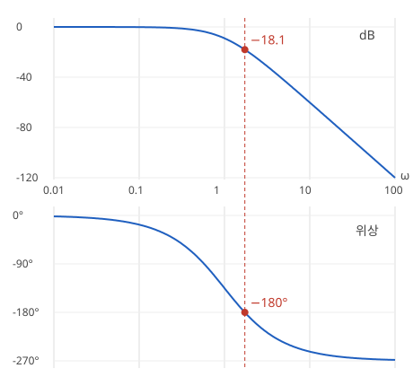

# Bode 선도

# 개요

**Bode 선도(Bode plot)** 는 전달 함수의 주파수 응답을 크기의 데시벨 값과 위상 두 그래프로, 가로축을 주파수의 로그로 두고 그린 것이다. 되먹임 고리의 장치가 $0.01$ 부터 $100$ 까지의 넓은 주파수에서 어떻게 반응하는지 보려면, 크기가 $1$ 에서 $10^{-6}$ 까지 바뀌므로 보통의 눈금으로는 한 그림에 담기지 않는다.

Bode 선도는 크기와 주파수를 모두 로그로 그려, 인수의 곱으로 쓴 전달 함수를 각 인수의 그래프의 합으로 그리고 대부분을 직선으로 근사한다.

# 직관

[Nyquist 판정법](nyquist-criterion.md) 문서의 $G(s)=1/(s+1)^3$ 에서 크기의 데시벨 값과 위상은 다음과 같다.

$$
20\log\_{10}\vert G(i\omega)\vert=-30\log\_{10}(1+\omega^2),\qquad\arg G(i\omega)=-3\arctan\omega
$$

$\omega\ll 1$ 이면 크기는 $0$ dB 이다. $\omega\gg 1$ 이면 크기가 $-60\log\_{10}\omega$ 에 가까워, 주파수가 $10$ 배가 될 때마다 $60$ dB 씩 준다. 로그 눈금에서는 기울기 $-60$ 의 직선이다.

아래 그림의 위쪽이 크기, 아래쪽이 위상이고 가로축은 $\omega$ 의 로그 눈금이다. 빨간 점선은 위상이 $-180^\circ$ 가 되는 $\omega=\sqrt3$ 이고, 거기서 크기는 $-30\log\_{10}4\approx-18.1$ dB 이다.

$-18.1$ dB 는 $20\log\_{10}8$ 이다. 이득을 $8$ 배까지 키워도 위상이 $-180^\circ$ 인 곳의 크기가 $0$ dB 에 닿지 않으므로, Nyquist 판정법의 경계 $k=8$ 이 이 그림에서 바로 읽힌다.

# 정의

전달 함수 $G(s)$ 와 $\omega\gt 0$ 에 대해 다음 두 그래프를 가로축 $\log\_{10}\omega$ 위에 그린 것을 **Bode 선도** 라 한다[^1].

- 크기 선도. 세로축은 $20\log\_{10}\vert G(i\omega)\vert$ 이고 단위를 데시벨(decibel, dB)이라 한다.
- 위상 선도. 세로축은 $\arg G(i\omega)$ 이고, $\omega$ 에 대해 연속이 되도록 $2\pi$ 의 배수를 골라 잇는다.

주파수가 $10$ 배가 되는 간격을 디케이드(decade)라 한다. 직관 절의 크기 곡선은 높은 주파수에서 디케이드마다 $-60$ dB 다.

# 성질

## 곱이 합이 되는 성질

$G=G\_1G\_2$ 이면 $\log\vert G\vert=\log\vert G\_1\vert+\log\vert G\_2\vert$ 이고 $\arg G=\arg G\_1+\arg G\_2$ 다. 그래서 전달 함수를 일차와 이차 인수로 쪼개 각 인수의 선도를 더하면 전체 선도가 된다. 직관 절의 선도는 $1/(s+1)$ 의 선도를 세 번 더한 것이다.

## 꺾인 직선 근사

인수 $1/(1+s/a)$ 의 크기는 $\omega\ll a$ 에서 $0$ dB, $\omega\gg a$ 에서 디케이드마다 $-20$ dB 인 직선에 가깝다. 두 직선은 $\omega=a$ 에서 만나고, 이 점을 꺾임 주파수(corner frequency)라 한다. 꺾임 주파수에서 실제 크기는 $-10\log\_{10}2\approx-3.01$ dB 이고 위상은 $-45^\circ$ 다.

영점 인수 $1+s/a$ 는 부호가 반대다. 극 하나마다 높은 주파수의 기울기가 $-20$ dB, 영점 하나마다 $+20$ dB 바뀐다.

## 이득 여유와 위상 여유

위상이 $-180^\circ$ 인 주파수에서 크기가 $-g$ dB 이면 이득 여유는 $g$ dB 다. 크기가 $0$ dB 인 주파수에서 위상에 $180^\circ$ 를 더한 값이 위상 여유다. 열린 고리가 안정하고 선도가 단순한 모양이면 두 여유가 모두 양수인 것이 닫힌 고리의 안정성이다. 직관 절은 이득 여유가 $18.1$ dB 다.

## Bode 이득–위상 관계

$G$ 가 오른쪽 반평면에 극과 영점이 없고 $G(0)\gt 0$ 이면 위상이 크기로 정해진다. $u=\log(\omega/\omega\_0)$ 로 두면 다음이 성립한다[^1].

$$
\arg G(i\omega\_0)=\frac1\pi\int\_{-\infty}^{\infty}\frac{d\log\vert G\vert}{du}\thinspace\log\coth\frac{\vert u\vert}{2}\thinspace du
$$

$\log\coth(\vert u\vert/2)$ 의 적분이 $\pi^2/2$ 이므로, 크기 기울기가 넓은 범위에서 디케이드마다 $-20n$ dB 이면 위상은 $-90n^\circ$ 에 가깝다. 직관 절의 높은 주파수에서 $n=3$, 위상 $-270^\circ$ 다.

오른쪽 반평면에 영점이 있으면 이 관계가 깨진다. $(1-s)/(1+s)$ 는 모든 $\omega$ 에서 크기가 $0$ dB 이지만 위상은 $-2\arctan\omega$ 로 $-180^\circ$ 까지 내려간다.

# 활용

- 고리 다듬기(loop shaping). 원하는 크기 선도의 모양을 정하고 이득 여유와 위상 여유를 확인하며 보상기의 극과 영점을 고른다. 이득–위상 관계 때문에 $0$ dB 근처의 기울기를 디케이드마다 $-40$ dB 보다 가파르게 하면 위상 여유가 사라진다.
- 필터 설계. [Butterworth 필터](butterworth-filter.md)는 통과 대역에서 크기 선도가 평평하고 꺾임 주파수 뒤에서 디케이드마다 $-20n$ dB 로 떨어지는 필터다.
- 계 식별. 장치에 여러 주파수의 사인파를 넣어 출력의 크기와 위상을 재면 Bode 선도가 실험으로 얻어지고, 직선 근사의 꺾임과 기울기로 극과 영점의 위치를 읽는다.

[^1]: H. W. Bode, *Network Analysis and Feedback Amplifier Design*, Van Nostrand, 1945.

# 연관 문서

## 선수지식

- [Nyquist 판정법](nyquist-criterion.md)

## 더 알아보기

아직 연결한 문서가 없다.

#complex_analysis #signal_processing #optimization
