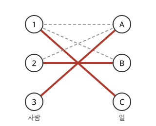

# 병목 할당 문제

# 개요

**병목 할당 문제(bottleneck assignment problem)** 는 사람 $n$ 명에게 일 $n$ 개를 하나씩 맡길 때, 맡긴 짝들의 비용 가운데 가장 큰 값을 가장 작게 하는 짝짓기를 찾는 문제다. 세 사람이 세 가지 일을 동시에 시작하고 모두 끝나야 다음 단계로 넘어갈 수 있으면, 걸리는 시간의 합이 아니라 가장 늦게 끝나는 사람의 시간이 중요하다. 병목 할당 문제는 기준 시간 $t$ 를 정해 $t$ 안에 끝나는 짝만으로 모두를 짝지을 수 있는지 묻고, 그것이 가능한 가장 작은 $t$ 를 찾는다.

# 직관

[할당 문제](assignment-problem.md) 문서의 표를 다시 쓴다. 사람 $1,2,3$ 이 일 $A,B,C$ 를 하는 데 걸리는 시간이 다음과 같다.

$$
C=\begin{pmatrix}1&2&3\cr 2&4&6\cr 3&6&9\end{pmatrix}
$$

세 사람이 동시에 시작하면 모두 끝나는 시각은 맡은 일의 시간 가운데 가장 큰 값이다. 짝짓기 $1\to A$, $2\to B$, $3\to C$ 는 $9$ 에 끝나고, 합이 가장 작은 짝짓기 $1\to C$, $2\to B$, $3\to A$ 는 $\max(3,4,3)=4$ 에 끝난다.

$4$ 보다 빨리 끝낼 수 있는지 보려고 $3$ 이하인 칸만 남긴다. 사람 $2$ 와 $3$ 은 둘 다 일 $A$ 만 $3$ 안에 할 수 있어 두 사람을 동시에 짝지을 수 없다. 기준을 $4$ 로 올리면 $2\to B$ 가 더해지고, 아래 그림처럼 $4$ 이하인 칸만으로 세 사람을 모두 짝지을 수 있다.

그래서 가장 이른 종료 시각은 $4$ 다. 기준을 정하고 그 안의 칸으로 짝을 다 지을 수 있는지 보는 일을 기준을 바꿔 가며 되풀이한 것이다.

# 정의

## 병목 할당 문제

$n\times n$ 실수 행렬 $C=(c\_{ij})$ 가 주어질 때, 다음 값을 가장 작게 하는 순열 $\sigma$ 를 찾는 문제를 **병목 할당 문제** 라 한다.

$$
\max_{1\le i\le n}c_{i\sigma(i)}
$$

직관 절의 답은 $\sigma(1)=C$, $\sigma(2)=B$, $\sigma(3)=A$ 이고 값은 $4$ 다.

## 문턱 그래프

실수 $t$ 에 대해 사람과 일을 정점으로 두고 $c\_{ij}\le t$ 인 쌍 $(i,j)$ 만 간선으로 이은 이분 그래프를 **문턱 그래프(threshold graph)** $G\_t$ 라 한다. 직관 절의 그림이 $G\_4$ 이고, $G\_3$ 은 거기서 $2\to B$ 를 뺀 그래프다.

# 성질

## 문턱과 완전 매칭

정리. 병목 할당 문제의 최솟값은 $G\_t$ 에 완전 [매칭](matchings.md)이 있는 가장 작은 $t$ 와 같고, 그 $t$ 는 $C$ 의 성분 가운데 하나다.

증명의 요지. 순열 $\sigma$ 의 값이 $t$ 이하인 것은 $\sigma$ 의 짝이 모두 $G\_t$ 의 간선인 것, 곧 $\sigma$ 가 $G\_t$ 의 완전 매칭인 것과 동치다. $t$ 가 커지면 $G\_t$ 의 간선은 늘기만 하고, $t$ 가 두 성분 사이를 움직이는 동안에는 $G\_t$ 가 바뀌지 않는다. ∎

## 최소최대 등식

정리. 병목 할당 문제의 최솟값은 $r+s\gt n$ 인 행 $r$ 개와 열 $s$ 개를 골라 만든 부분행렬의 최솟값 가운데 가장 큰 것과 같다.

증명의 요지. $G\_t$ 에 완전 매칭이 없으면 König 정리(Kőnig's theorem)로 간선을 모두 덮는 행과 열이 합쳐 $n-1$ 개 이하다. 덮이지 않은 행 $r$ 개와 열 $s$ 개는 $r+s\ge n+1$ 이고 그 부분행렬의 성분은 모두 $t$ 보다 크다. 거꾸로 $r+s\gt n$ 인 부분행렬에서는 어느 순열도 그 부분행렬의 칸을 하나 이상 지나므로 값이 부분행렬의 최솟값 이상이다. ∎

직관 절에서 행 $2,3$ 과 열 $B,C$ 의 부분행렬은 $r+s=4\gt 3$ 이고 최솟값이 $4$ 이므로, 어느 짝짓기도 $4$ 보다 일찍 끝나지 않는다.

## 계산

성분 $n^2$ 개를 정렬하고 기준 $t$ 를 성분 위에서 이분 탐색하며 $G\_t$ 의 최대 매칭을 구하면 된다. Hopcroft–Karp 알고리즘(Hopcroft–Karp algorithm)으로 매칭을 구하면 $O(n^{2.5}\log n)$ 시간이다[^1].

# 활용

- 병렬 작업의 종료 시각. 작업을 기계에 하나씩 동시에 맡길 때 마지막 작업이 끝나는 시각을 최소화하는 배정이 병목 할당 문제다.
- 수송의 병목. 공급점에서 수요점으로 동시에 출발한 운송 가운데 가장 늦게 도착하는 것을 앞당기는 문제가 같은 문턱 그래프와 매칭으로 풀린다.
- 사전식 병목 할당(lexicographic bottleneck assignment). 가장 큰 비용을 최소로 한 뒤 그 안에서 둘째로 큰 비용을 최소로 하는 일을 되풀이하는 문제다. 비용을 크기 순위에 따라 빠르게 커지는 가중치로 바꾸면 [할당 문제](assignment-problem.md) 하나로 풀린다.

[^1]: Rainer Burkard, Mauro Dell'Amico, Silvano Martello, *Assignment Problems*, SIAM, 2009.

# 연관 문서

## 선수지식

- [할당 문제](assignment-problem.md)

## 더 알아보기

아직 연결한 문서가 없다.

#graph_theory #optimization #combinatorics
