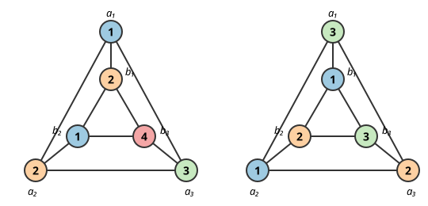

# Brooks 정리

# 개요

**Brooks 정리(Brooks' theorem)** 는 어느 정점에도 이웃이 $\Delta$ 개보다 많지 않은 연결 그래프를, 완전 그래프와 홀수 고리를 빼면 색 $\Delta$ 개로 칠할 수 있다는 정리다. 삼각형 두 개의 꼭짓점을 차례로 이은 삼각기둥 그래프는 정점마다 이웃이 셋이다. 정점을 아무 순서로 하나씩 칠하며 이웃이 쓰지 않은 가장 작은 색을 주면 순서에 따라 색이 넷 든다. Brooks 정리는 마지막에 칠할 정점의 두 이웃이 같은 색을 받게 순서를 정하면 색 셋으로 끝난다는 것을 보인다.

# 직관

[그래프 색칠](graph-coloring.md)에서 정점을 정한 순서대로 하나씩 칠하고, 각 정점에 이미 칠한 이웃이 쓰지 않은 가장 작은 색을 준다. 정점마다 이웃이 $\Delta$ 개 이하이면 차례가 온 정점의 이웃이 막는 색은 $\Delta$ 개 이하이므로, 색 $\Delta+1$ 개면 언제나 칠할 색이 남는다.

아래 그림은 바깥 삼각형 $a_1a_2a_3$ 과 안쪽 삼각형 $b_1b_2b_3$ 의 같은 번호끼리 이은 삼각기둥이고, 동그라미 안의 수가 색이다. 정점마다 이웃이 셋이므로 $\Delta=3$ 이다.

왼쪽은 순서 $a_1,b_2,a_2,b_1,a_3,b_3$ 으로 칠한 것이다. 마지막 $b_3$ 의 이웃 $b_1,b_2,a_3$ 이 색 $2,1,3$ 을 이미 모두 써서 색 $4$ 가 든다. 색이 모자란 것은 이웃이 모두 먼저 칠해진 정점에서만 생긴다. 이웃 가운데 하나라도 나중에 칠하는 정점은 막히는 색이 $\Delta-1$ 개 이하라서 색 $\Delta$ 개 안에 칠할 색이 남는다.

그래서 정점 $v$ 하나를 맨 뒤에 두고, 나머지는 $v$ 에서 먼 것부터 칠한다. 그러면 $v$ 가 아닌 정점마다 $v$ 쪽으로 한 걸음 가까운 이웃이 나중에 칠해지므로 색 $\Delta$ 개로 충분하다. 남은 것은 $v$ 이고, $v$ 의 이웃 둘이 같은 색이면 $v$ 의 이웃이 막는 색이 $\Delta-1$ 개 이하가 된다.

오른쪽은 $v=a_1$ 로 두고, $a_1$ 의 이웃 가운데 서로 이웃하지 않은 $a_2$ 와 $b_1$ 에 먼저 색 $1$ 을 준 것이다. 나머지 $b_2,b_3,a_3$ 를 $a_1$ 에서 먼 순서로 칠하면 색 $2,3,2$ 를 받고, $a_1$ 의 이웃은 색 $1,2,1$ 이라 $a_1$ 이 색 $3$ 을 받는다. 색 셋으로 끝난다.

# 정의

## 최대 차수와 탐욕 색칠

정점 $v$ 의 이웃의 수를 차수 $d(v)$ 라 하고, 그래프 $G$ 의 차수의 최댓값을 **최대 차수(maximum degree)** $\Delta(G)$ 라 한다. 정점을 순서 $v_1,\dots,v_n$ 으로 놓고 $v_i$ 에 $v_1,\dots,v_{i-1}$ 가운데 이웃이 쓰지 않은 가장 작은 색을 주는 것을 그 순서의 **탐욕 색칠(greedy coloring)** 이라 한다. 직관 절의 왼쪽 그림은 순서 $a_1,b_2,a_2,b_1,a_3,b_3$ 의 탐욕 색칠이다.

## 정리의 진술

연결 그래프 $G$ 가 완전 그래프도 홀수 고리도 아니면

$$
\chi(G)\le\Delta(G)
$$

이다[^1]. 여기서 $\chi(G)$ 는 채색수다. 삼각기둥은 $\Delta=3$ 이고 완전 그래프 $K_4$ 가 아니므로 $\chi\le 3$ 이며, 삼각형이 있으므로 $\chi=3$ 이다.

예외 둘은 실제로 색이 하나 더 든다. 완전 그래프 $K_{\Delta+1}$ 은 모든 정점이 서로 이웃해 색 $\Delta+1$ 개가 들고, 홀수 고리는 $\Delta=2$ 인데 색 $3$ 개가 든다.

# 성질

## 증명

Lovász 의 증명을 따른다[^2]. $\Delta\le 2$ 이면 $G$ 는 경로나 고리이고, 경로와 짝수 고리는 두 색으로 칠해진다. 이제 $\Delta\ge 3$ 이라 한다.

$G$ 가 $\Delta$ 정칙이 아니면 차수가 $\Delta$ 보다 작은 정점을 $v$ 로 두고, 나머지를 $v$ 에서 먼 순서로 탐욕 색칠한 뒤 $v$ 를 칠한다. 직관 절의 논법대로 모든 정점에 색이 남는다.

$G$ 에 절단점 $x$ 가 있으면, $G-x$ 의 각 성분에 $x$ 를 더한 조각마다 $x$ 의 차수가 $\Delta$ 보다 작으므로 앞 문단대로 색 $\Delta$ 개로 칠해진다. 조각마다 색 이름을 바꿔 $x$ 의 색을 맞추면 $G$ 의 색칠이 된다.

남은 경우는 $G$ 가 $\Delta$ 정칙이고 절단점이 없으며 완전 그래프가 아닌 경우다. 이때 정점 $v$ 와 그 이웃 $u,w$ 가 있어서 $u$ 와 $w$ 는 서로 이웃하지 않고 $G-u-w$ 는 연결된다. $u,w$ 에 색 $1$ 을 주고 $G-u-w$ 의 정점을 $v$ 에서 먼 순서로 칠하면, 마지막 $v$ 의 이웃이 막는 색은 $\Delta-1$ 개 이하다.

## 세 정점의 존재

앞 절의 $v,u,w$ 는 다음과 같이 찾는다. $G$ 가 완전 그래프가 아니고 연결이므로 거리가 $2$ 인 두 정점 $u,w$ 와 그 공통 이웃 $v$ 가 있다.

$G$ 에서 어느 두 정점을 지워도 연결이 남으면 $G-u-w$ 도 연결이다. 두 정점을 지워 끊기는 경우에는 $G-v$ 에 절단점이 생기는 정점 $v$ 를 고른다. $G-v$ 의 끝 블록 두 개에서 절단점이 아닌 $v$ 의 이웃 $u,w$ 를 하나씩 고르면, $u,w$ 는 서로 이웃하지 않는다. $v$ 의 차수가 $3$ 이상이므로 $v$ 는 $u,w$ 말고 다른 이웃을 통해 나머지와 이어지고, $G-u-w$ 는 연결이다.

## 임계 그래프와 Gallai 정리

$\chi(G)=k$ 이고 간선 하나만 지워도 채색수가 줄어드는 그래프를 [임계 그래프](critical-graphs.md)라 한다. $k$ 임계 그래프의 최소 차수는 $k-1$ 이다. Gallai 정리(Gallai's theorem)는 차수가 정확히 $k-1$ 인 정점들이 유도하는 부분그래프의 블록이 모두 완전 그래프나 홀수 고리라는 진술이고, 그래프 전체가 $(k-1)$ 정칙이면 이것이 Brooks 정리다.

## 목록 색칠

정점마다 쓸 수 있는 색의 목록이 따로 주어지는 [목록 색칠](list-coloring.md)에서도 같은 진술이 성립한다. 연결 그래프가 완전 그래프도 홀수 고리도 아니면 모든 정점에 길이 $\Delta$ 인 목록을 주었을 때 목록 안에서 색칠이 있다[^3].

# 활용

- 3 정칙 그래프. 정점마다 이웃이 셋인 연결 그래프는 $K_4$ 가 아니면 세 색으로 칠해진다. [Petersen 그래프](petersen-graph.md)의 채색수 $3$ 이 그 예다.
- 채색수의 판정. $\chi(G)=\Delta(G)+1$ 인 연결 그래프는 완전 그래프와 홀수 고리뿐이므로, 이 등호는 선형 시간에 판정된다. 반면 $\chi(G)\le 3$ 의 판정은 [NP-완전](np-completeness.md)(NP: nondeterministic polynomial time)이다.
- [그래프 퇴화도](graph-degeneracy.md). 퇴화도 $d$ 로 얻는 탐욕 색칠의 상한 $d+1$ 은 $\Delta+1$ 이하이고, $\Delta$ 정칙 그래프에서는 $d=\Delta$ 라서 두 상한이 같다. Brooks 정리는 이 경우에 색을 하나 더 줄인다.

[^1]: R. L. Brooks, "On colouring the nodes of a network", *Proceedings of the Cambridge Philosophical Society* 37 (1941), 194–197.
[^2]: L. Lovász, "Three short proofs in graph theory", *Journal of Combinatorial Theory, Series B* 19 (1975), 269–271.
[^3]: P. Erdős, A. L. Rubin, H. Taylor, "Choosability in graphs", *Congressus Numerantium* 26 (1979), 125–157.

# 연관 문서

## 선수지식

- [그래프 색칠](graph-coloring.md)

## 더 알아보기

아직 연결한 문서가 없다.

#graph_theory #combinatorics #algorithms
