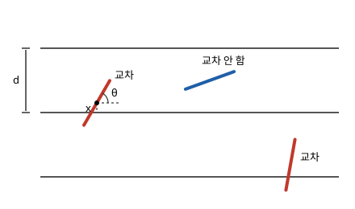

# Buffon 의 바늘 문제

# 개요

**Buffon 의 바늘 문제(Buffon's needle problem)** 는 평행선이 일정한 간격으로 그어진 바닥에 바늘을 아무렇게나 던질 때 바늘이 선과 만날 확률을 묻는 문제다. 폭이 $5\thinspace\mathrm{cm}$ 인 마루판 바닥에 길이 $5\thinspace\mathrm{cm}$ 인 이쑤시개를 쏟으면, 이쑤시개 가운데 일부는 판 사이의 이음매에 걸치고 나머지는 판 하나 안에 놓인다. 바늘의 중심 위치와 기울기를 두 [균등분포](uniform-distribution.md) 확률변수로 두고 넓이의 비를 계산하면, 걸칠 확률이 $2/\pi\approx 0.637$ 로 나온다.

# 직관

선 사이 간격을 $d$, 바늘 길이를 $\ell\le d$ 라 한다. 바늘이 어느 선과 만나는지는 두 수로 정해진다. 하나는 바늘의 중심에서 가장 가까운 선까지의 거리 $x$ 이고, 다른 하나는 바늘과 선이 이루는 각 $\theta$ 다.

그림의 왼쪽 바늘에서 중심의 높이와 바늘 끝의 높이 차는 $(\ell/2)\sin\theta$ 다. 이 값이 $x$ 이상이면 바늘 끝이 선을 넘으므로 바늘이 선과 만난다. 가운데 바늘은 거의 눕혀져 있어 높이 차가 작고, 선까지의 거리 $x$ 가 그보다 커서 만나지 않는다.

바늘을 아무렇게나 던진다는 것은 $x$ 가 $0$ 과 $d/2$ 사이에서, $\theta$ 가 $0$ 과 $\pi/2$ 사이에서 고르게 나온다는 뜻이다. 그러면 만날 확률은 직사각형 $\lbrack 0,\pi/2\rbrack\times\lbrack 0,d/2\rbrack$ 안에서 곡선 $x=(\ell/2)\sin\theta$ 아래 부분이 차지하는 넓이의 비다.

# 정의

간격이 $d$ 인 평행선 위에 길이 $\ell$ 인 선분을 던진다. 선분 중심에서 가장 가까운 선까지의 거리 $X$ 와 선분이 선과 이루는 각 $\Theta$ 가 독립이고 다음 분포를 따른다고 한다.

$$
X\sim U(0,d/2),\qquad \Theta\sim U(0,\pi/2)
$$

선분이 선과 만나는 사건은 $X\le(\ell/2)\sin\Theta$ 다. 이 사건의 확률을 구하는 문제를 **Buffon 의 바늘 문제** 라 한다. G.-L. Leclerc, comte de Buffon 이 1733 년에 제기하고 1777 년에 풀이를 발표했다.[^1]

$\ell=d$ 이고 $\Theta=\pi/6$ 이면 높이 차가 $d/4$ 이므로, $X\le d/4$ 일 때, 곧 확률 $1/2$ 로 만난다.

# 성질

## 짧은 바늘

$\ell\le d$ 이면 바늘이 선과 만날 확률은 다음과 같다.

$$
P=\frac{2\ell}{\pi d}
$$

증명의 요지. $(X,\Theta)$ 의 결합밀도는 직사각형 위에서 상수 $4/(\pi d)$ 다. 곡선 아래 넓이는 $\int_0^{\pi/2}(\ell/2)\sin\theta\thinspace d\theta=\ell/2$ 이므로 확률은 $\frac{4}{\pi d}\cdot\frac\ell2$ 다. $\square$

$\ell=d$ 이면 $P=2/\pi$ 이고, $\ell=d/2$ 이면 $P=1/\pi\approx 0.318$ 이다.

## 긴 바늘

$\ell\gt d$ 이면 $(\ell/2)\sin\theta$ 가 $d/2$ 를 넘는 각에서는 바늘이 반드시 선과 만난다. 그 각의 범위를 따로 적분하면 다음이 나온다.

$$
P=1+\frac2\pi\Big(\frac\ell d-\sqrt{\frac{\ell^2}{d^2}-1}-\arcsin\frac d\ell\Big)
$$

$\ell=d$ 이면 괄호 안이 $1-\pi/2$ 이므로 $P=2/\pi$ 로 짧은 바늘의 값과 이어진다. $\ell\to\infty$ 이면 괄호 안이 $0$ 으로 가고 $P\to 1$ 이다.

## 교차 횟수의 기댓값

길이 $L$ 인 매끄러운 곡선을 던질 때, 곡선이 선들과 만나는 횟수 $N$ 의 기댓값은 곡선의 모양과 무관하게 다음과 같다.[^2]

$$
\mathbb E\lbrack N\rbrack=\frac{2L}{\pi d}
$$

증명의 요지. 곡선을 짧은 선분 여럿으로 나누면 $N$ 은 각 선분의 교차 횟수의 합이다. 기댓값의 선형성(linearity of expectation)으로 $\mathbb E\lbrack N\rbrack$ 은 길이에 비례하고, 비례상수 $c$ 는 모양과 무관하다. 지름이 $d$ 인 원을 던지면 언제나 두 번 만나므로 $c\cdot\pi d=2$ 다. $\square$

이 결과를 Buffon 의 국수(Buffon's noodle)라 한다. J.-É. Barbier 가 1860 년에 증명했다. 짧은 바늘은 많아야 한 번 만나므로 $\mathbb E\lbrack N\rbrack$ 이 곧 확률이고, 위의 $2\ell/(\pi d)$ 가 다시 나온다.

## 격자 위의 바늘

가로 간격 $a$, 세로 간격 $b$ 의 직사각형 격자에 길이 $\ell\le\min(a,b)$ 인 바늘을 던지면, 바늘이 격자선과 만날 확률은 다음과 같다. P.-S. Laplace 가 1812 년에 구했다.[^1]

$$
P=\frac{2\ell(a+b)-\ell^2}{\pi ab}
$$

$a=b=\ell$ 이면 $3/\pi\approx 0.955$ 다.

# 활용

- 원주율의 추정. 길이 $\ell=d$ 인 바늘을 $n$ 번 던져 $h$ 번 만났으면 $2n/h$ 가 $\pi$ 의 추정값이다. [델타 방법](delta-method.md)으로 이 추정값의 표준편차는 약 $2.37/\sqrt n$ 이므로, 소수 둘째 자리까지 맞추려면 $5$ 만 번 넘게 던져야 한다. 무작위 표본의 비율로 넓이나 적분을 추정하는 Monte Carlo 방법(Monte Carlo method)의 초기 예다.
- 너비가 일정한 곡선. 어느 방향으로 재어도 너비가 $w$ 인 볼록 곡선을 간격 $w$ 의 평행선 위에 던지면 언제나 두 번 만난다. 교차 횟수의 기댓값 공식에서 $2=2L/(\pi w)$ 이므로 둘레가 $L=\pi w$ 이다. 원과 Reuleaux 삼각형(Reuleaux triangle)이 모두 이 둘레를 갖는다. 이것이 Barbier 정리(Barbier's theorem)다.
- 곡선 길이의 측정. 교차 횟수의 기댓값 공식을 거꾸로 쓰면, 곡선과 무작위 직선이 만나는 평균 횟수로 곡선의 길이를 구할 수 있다. 이것이 적분기하(integral geometry)의 Crofton 공식(Crofton formula)이고, [내재부피](intrinsic-volumes.md)가 이 공식을 고차원의 부피로 넓힌다.

[^1]: D. A. Klain, G.-C. Rota, *Introduction to Geometric Probability*, Cambridge University Press (1997), 1 장. Buffon 의 원 풀이는 *Essai d'arithmétique morale* (1777) 에 실렸고, 격자의 경우는 P.-S. Laplace, *Théorie analytique des probabilités* (1812) 에 있다.
[^2]: J.-É. Barbier, "Note sur le problème de l'aiguille et le jeu du joint couvert", *Journal de Mathématiques Pures et Appliquées* 2e série **5** (1860), 273–286.

# 연관 문서

## 선수지식

- [균등분포](uniform-distribution.md)

## 더 알아보기

아직 연결한 문서가 없다.

#probability #analysis
