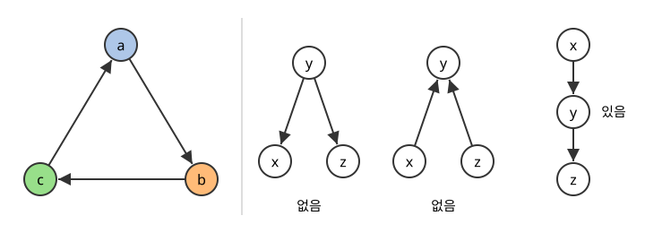

# Burr 추측

# 개요

**Burr 추측(Burr's conjecture)** 은 색을 $2n-2$ 개 이상 써야 칠할 수 있는 방향 그래프에는 정점 $n$ 개의 방향 나무가 화살표 방향에 상관없이 모두 들어 있다는 추측이다. 세 정점이 $a\to b\to c\to a$ 로 도는 그래프는 이웃한 정점끼리 색이 달라야 하므로 색이 셋 필요하지만, 한 정점에서 화살표 두 개가 나가는 꼴은 들어 있지 않다.

색이 많이 필요한 그래프에 어떤 부분구조가 반드시 생기는지 물을 때, 이 추측은 화살표 방향까지 정한 나무에 필요한 색의 수가 $2n-2$ 라고 예상한다.

# 직관

화살표를 무시한 그래프에서는 색이 $n$ 개 필요하면 정점 $n$ 개의 모든 나무가 들어 있다. 이웃이 $n-2$ 개 이하인 정점을 하나씩 지워 나가면 남는 부분이 비지 않는다. 다 지워진다면, 지운 순서의 역순으로 정점을 칠할 때마다 이미 칠한 이웃이 $n-2$ 개 이하라서 색 $n-1$ 개로 충분하고, 색이 $n$ 개 필요하다는 가정에 어긋난다.

남은 부분에서는 모든 정점의 이웃이 $n-1$ 개 이상이다. 나무를 정점 하나씩 붙여 가며 넣는다. 새 정점이 붙을 나무의 정점이 이미 $w$ 에 놓여 있으면, 이미 쓴 정점은 $w$ 를 빼고 $n-2$ 개 이하이고 $w$ 의 이웃은 $n-1$ 개 이상이므로 쓰지 않은 이웃이 남는다.

화살표 방향을 정하면 이 논법이 막힌다. 나무에서 $y$ 가 $x$ 를 가리켜야 하는데 $y$ 를 맡은 정점의 이웃이 전부 그 정점을 가리키면 붙일 자리가 없다. 아래 그림의 왼쪽 그래프는 색이 셋 필요하고 정점마다 이웃이 둘이지만 나가는 화살표는 하나뿐이다. 그래서 오른쪽의 정점 세 개짜리 방향 나무 가운데 $y$ 에서 두 화살표가 나가는 꼴과 $y$ 로 두 화살표가 들어오는 꼴이 들어 있지 않다.

이웃 가운데 절반 정도만 나가는 화살표라고 보면 이웃이 $2n-3$ 개 이상 있어야 하고, 색이 $2n-2$ 개 필요한 그래프에는 그런 부분이 있다. Burr 추측은 이 수의 색으로 모든 방향 나무가 들어 있다고 예상한다.

# 정의

방향 그래프 $D$ 의 **채색수(chromatic number)** $\chi(D)$ 는 화살표 방향을 무시한 그래프의 [그래프 색칠](graph-coloring.md) 채색수다. 직관 절의 세 정점 그래프는 $\chi=3$ 이다.

방향 나무는 [Sumner 보편 토너먼트 추측](sumner-universal-tournament-conjecture.md) 문서의 정의를 쓴다. 나무의 간선마다 방향을 하나 정한 것이다. 방향 나무 $A$ 의 정점에서 $D$ 의 정점으로 가는 단사함수 $f$ 가 $A$ 의 간선 $x\to y$ 마다 $D$ 에서 $f(x)\to f(y)$ 이면 $D$ 가 $A$ 를 **포함한다** 고 한다. 직관 절의 세 정점 그래프는 경로 $x\to y\to z$ 를 포함하고 나머지 두 방향 나무는 포함하지 않는다.

**Burr 추측** 은 $n\ge 2$ 이고 $\chi(D)\ge 2n-2$ 인 모든 방향 그래프 $D$ 가 정점 $n$ 개의 모든 방향 나무를 포함한다는 진술이다[^1]. $n=3$ 이면 색이 $4$ 개 이상 필요한 방향 그래프가 그림의 세 방향 나무를 모두 포함한다는 것이다.

# 성질

## 2n-2 의 최적성

정점이 $2n-3$ 개이고 모든 정점에서 화살표가 $n-2$ 개씩 나가는 토너먼트가 있다. 토너먼트는 모든 정점 쌍이 이웃이므로 채색수가 정점 수 $2n-3$ 이다. 이 토너먼트는 한 정점에서 화살표 $n-1$ 개가 나가는 방향 나무를 포함하지 않으므로 추측의 $2n-2$ 는 줄일 수 없다. $n=3$ 이면 이 토너먼트가 직관 절의 세 정점 그래프다.

## 별

한 정점에서 나머지 $n-1$ 개로 화살표가 나가는 방향 나무를 나가는 별이라 한다. $\chi(D)\ge 2n-2$ 이면 $D$ 는 나가는 별을 포함한다.

직관 절의 지우기로 모든 정점의 이웃이 $2n-3$ 개 이상인 부분 $H$ 를 얻는다. $H$ 의 간선 수는 $(2n-3)\lvert H\rvert/2$ 이상이고, 나가는 화살표 수의 합이 간선 수이므로 어떤 정점에서 화살표가 $n-\tfrac32$ 개 이상, 곧 $n-1$ 개 이상 나간다. 들어오는 별도 같다.

## 방향 경로

Gallai–Hasse–Roy–Vitaver 정리(Gallai–Hasse–Roy–Vitaver theorem)는 $\chi(D)\ge n$ 이면 $D$ 가 같은 방향으로 이어지는 정점 $n$ 개의 경로를 포함한다는 정리다[^2]. 방향 경로에는 추측의 $2n-2$ 보다 작은 $n$ 이 충분하다.

증명은 $D$ 에서 순환이 생기지 않는 한 화살표를 최대한 많이 고른 부분 $A$ 를 잡는 것이다. 정점 $v$ 에 $A$ 안에서 $v$ 로 끝나는 가장 긴 경로의 정점 수를 색으로 준다. 화살표 $u\to v$ 가 $A$ 에 있으면 $v$ 의 색이 $u$ 의 색보다 크다. $A$ 에 없으면 그 화살표를 더할 때 순환이 생기므로 $A$ 안에 $v$ 에서 $u$ 로 가는 경로가 있고, $u$ 의 색이 더 크다.

그러므로 이 색칠은 이웃한 정점에 다른 색을 주고, 가장 긴 경로의 정점 수가 $n-1$ 이하이면 색이 $n-1$ 개 이하다.

같은 방향으로 이어지는 가장 긴 부분 경로를 블록(block)이라 한다. $x\to y\leftarrow z$ 는 블록이 둘이다. Addario-Berry, Havet, Thomassé 는 $\chi(D)\ge n$ 이면 $D$ 가 블록이 둘인 정점 $n$ 개의 모든 방향 경로를 포함함을 증명했다[^3].

## 알려진 상한

Burr 는 $\chi(D)\ge(n-1)^2$ 이면 $D$ 가 정점 $n$ 개의 모든 방향 나무를 포함함을 증명했다[^1]. Addario-Berry, Havet, Linhares Sales, Reed, Thomassé 는 이 수를 $\frac12n^2-\frac12n+1$ 로 줄였다[^4].

## Sumner 추측과의 관계

토너먼트의 채색수는 정점 수와 같다. 그래서 Burr 추측을 토너먼트로 좁히면 Sumner 보편 토너먼트 추측이 된다. Kühn, Mycroft, Osthus 가 큰 $n$ 에서 증명한 것은 이 좁힌 진술이다.

# 활용

- 토너먼트의 부분구조. Sumner 추측의 일차 상한과 큰 $n$ 의 증명은 모두 이 추측의 토너먼트 경우를 다룬다.
- 채색수와 부분 그래프. 채색수가 크면 반드시 생기는 부분구조를 찾는 문제에서, 방향 경로는 Gallai–Hasse–Roy–Vitaver 정리로 $n$ 이 충분하고 나가는 별은 $2n-2$ 가 필요하다. Burr 추측은 방향 나무 전체가 이 두 경우 가운데 큰 쪽의 수로 충분하다고 예상한다.

[^1]: S. A. Burr, "Subtrees of directed graphs and hypergraphs", *Congressus Numerantium* 28 (1980), 227–239.
[^2]: T. Gallai, "On directed paths and circuits", in *Theory of Graphs (Proceedings of the Colloquium, Tihany, 1966)*, Academic Press, 1968, 115–118. B. Roy, "Nombre chromatique et plus longs chemins d'un graphe", *Revue Française d'Informatique et de Recherche Opérationnelle* 1 (1967), 129–132.
[^3]: L. Addario-Berry, F. Havet, S. Thomassé, "Paths with two blocks in n-chromatic digraphs", *Journal of Combinatorial Theory, Series B* 97 (2007), 620–626.
[^4]: L. Addario-Berry, F. Havet, C. Linhares Sales, B. Reed, S. Thomassé, "Oriented trees in digraphs", *Discrete Mathematics* 313 (2013), 967–974.

# 연관 문서

## 선수지식

- [Sumner 보편 토너먼트 추측](sumner-universal-tournament-conjecture.md)
- [그래프 색칠](graph-coloring.md)

## 더 알아보기

아직 연결한 문서가 없다.

#graph_theory #combinatorics
