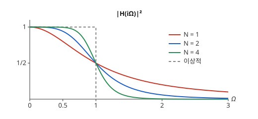

# Butterworth 필터

# 개요

**Butterworth 필터(Butterworth filter)** 는 통과시키는 주파수 범위에서 크기 응답이 가장 평탄한 저역통과 필터다. 소리를 디지털로 녹음하기 전에 들을 수 없는 높은 주파수를 지워야 하는데, 지우는 필터가 들리는 주파수에서 크기를 오르내리게 하면 음색이 바뀐다. Butterworth 필터는 크기 응답의 제곱을 $1/(1+(\Omega/\Omega_c)^{2N})$ 으로 정하고, 이 꼴이 나오도록 극을 반원 위에 같은 간격으로 놓는다.

# 직관

이상적인 저역통과 필터는 주파수 $\Omega\lt 1$ 에서 크기 $1$, $\Omega\gt 1$ 에서 크기 $0$ 이다. 저항과 축전기 하나로 된 회로의 전달함수는 $H(s)=1/(1+s)$ 이고, 허수축 $s=i\Omega$ 에서 $\lvert H(i\Omega)\rvert^2=1/(1+\Omega^2)$ 이다. $\Omega=2$ 에서 $\frac15$ 이므로 높은 주파수가 많이 남는다. 또 $\Omega=0.5$ 에서 이미 $0.8$ 로 떨어져 통과시킬 주파수의 크기도 줄어든다.

분모의 $\Omega^2$ 을 $\Omega^4$ 으로 바꾼 $1/(1+\Omega^4)$ 은 $\Omega=0.5$ 에서 약 $0.94$, $\Omega=2$ 에서 $\frac1{17}$ 이다. 이 크기를 내는 전달함수가 $H(s)=1/(s^2+\sqrt2\thinspace s+1)$ 이다.

$$
\lvert H(i\Omega)\rvert^2=\frac{1}{(1-\Omega^2)^2+2\Omega^2}=\frac{1}{1+\Omega^4}
$$

분모의 $s^2+\sqrt2 s+1$ 은 근이 $(-1\pm i)/\sqrt2$ 이고, 두 근은 단위원 위에서 왼쪽 반평면에 놓인다. 지수를 $\Omega^{2N}$ 으로 올리면 $\Omega\lt 1$ 에서 더 평평하고 $\Omega\gt 1$ 에서 더 빨리 떨어진다.

아래 그림은 $N=1,2,4$ 의 $\lvert H(i\Omega)\rvert^2$ 과 이상적인 저역통과 필터를 함께 그린 것이다. 세 곡선 모두 $\Omega=1$ 에서 $\frac12$ 를 지나고, $N$ 이 클수록 점선의 계단에 가까워진다.

# 정의

## Butterworth 필터

차수(order) $N$, 차단 주파수(cutoff frequency) $\Omega_c\gt 0$ 의 Butterworth 필터는 실수 계수의 안정한 연속시간 전달함수 $H_a(s)$ 로서 다음을 만족하는 것이다.

$$
\lvert H_a(i\Omega)\rvert^2=\frac{1}{1+(\Omega/\Omega_c)^{2N}}
$$

$H_a$ 는 $s$ 의 유리함수이고 [Laplace 변환](laplace-transform.md)으로 미분방정식의 입력과 출력을 잇는다. 직관 절의 두 회로는 $\Omega_c=1$ 에서 $N=1$ 과 $N=2$ 인 Butterworth 필터다.

## 극의 위치

다음 함수의 극은 반지름 $\Omega_c$ 인 원 위에 같은 간격으로 놓인 $2N$ 개의 점이다.

$$
H_a(s)H_a(-s)=\frac{1}{1+\bigl(s/(i\Omega_c)\bigr)^{2N}}
$$

그 가운데 왼쪽 반평면의 $N$ 개

$$
s_k=\Omega_c\thinspace e^{i\pi(2k+N-1)/(2N)}\qquad(k=1,\dots,N)
$$

를 $H_a$ 의 극으로 고르면 다음 전달함수가 나온다.

$$
H_a(s)=\frac{\Omega_c^N}{\prod_{k=1}^{N}(s-s_k)}
$$

$N=2$, $\Omega_c=1$ 이면 $s_1=e^{3\pi i/4}$, $s_2=e^{5\pi i/4}$ 이고 분모가 $s^2+\sqrt2 s+1$ 이다.

# 성질

## 최대 평탄성

$\lvert H_a(i\Omega)\rvert^2$ 를 $\Omega=0$ 에서 전개하면

$$
\frac{1}{1+x^{2N}}=1-x^{2N}+x^{4N}-\cdots\qquad(x=\Omega/\Omega_c)
$$

이므로 $1$ 차부터 $2N-1$ 차까지의 도함수가 $\Omega=0$ 에서 모두 $0$ 이다. 분모가 $1+P(\Omega^2)$ 꼴이고 $P$ 가 $N$ 차 다항식이며 $\Omega\_c$ 에서 값이 $\frac12$ 인 크기 응답 가운데 이 성질을 갖는 것은 Butterworth 필터뿐이다. 이 성질을 **최대 평탄(maximally flat)** 이라 한다[^1].

## 차단 주파수와 감쇠

모든 $N$ 에서 $\lvert H_a(i\Omega_c)\rvert^2=\frac12$ 이고, 이것은 $10\log_{10}\frac12\approx -3$ 데시벨(decibel)이다. $\Omega\gg\Omega_c$ 이면 $\lvert H_a(i\Omega)\rvert\approx(\Omega_c/\Omega)^N$ 이므로 주파수가 $10$ 배가 될 때마다 크기가 $20N$ 데시벨씩 줄어든다.

## 차수의 결정

통과대역 끝 $\Omega_p$ 에서 감쇠가 $A_p$ 데시벨 이하이고 저지대역 시작 $\Omega_s$ 에서 감쇠가 $A_s$ 데시벨 이상이려면 다음이 필요충분이다.

$$
N\ge\frac{\log\bigl((10^{A_s/10}-1)/(10^{A_p/10}-1)\bigr)}{2\log(\Omega_s/\Omega_p)}
$$

두 조건 $1+(\Omega_p/\Omega_c)^{2N}\le 10^{A_p/10}$ 과 $1+(\Omega_s/\Omega_c)^{2N}\ge 10^{A_s/10}$ 을 나누어 $\Omega_c$ 를 없애면 이 식이 나온다.

## 디지털 Butterworth 필터

[IIR 필터](iir-filters.md)(infinite impulse response) 문서의 쌍일차 변환 $s=\frac2T\cdot\frac{1-z^{-1}}{1+z^{-1}}$ 은 연속 주파수 $\Omega$ 를 디지털 주파수 $\omega$ 로 $\Omega=\frac2T\tan(\omega/2)$ 에 따라 휘어 보낸다. 디지털 차단 주파수를 $\omega_c$ 로 하려면 먼저 $\Omega_c=\frac2T\tan(\omega_c/2)$ 로 잡고 설계한 뒤 변환한다. 이 단계를 **사전 왜곡(prewarping)** 이라 한다.

$T=2$, $N=1$, $\omega_c=\pi/2$ 이면 $\Omega_c=1$ 이고

$$
H(z)=\frac{1}{1+\dfrac{1-z^{-1}}{1+z^{-1}}}=\frac{1+z^{-1}}{2}
$$

이다. 이것은 [FIR 필터](fir-filters.md)(finite impulse response) 문서의 두 값 평균이다. 쌍일차 변환은 $s=\infty$ 를 $z=-1$ 로 보내므로, 차수 $N$ 인 디지털 Butterworth 필터는 영점 $N$ 개가 모두 $z=-1$ 에 있다. 차수가 크면 극을 켤레쌍으로 묶어 2차 구간의 직렬 연결로 구현한다.

## 다른 원형과의 비교

통과대역에서 크기의 출렁임을 허용하면 같은 차수로 더 빨리 떨어지는 필터를 얻는다. Chebyshev 1형 필터(Chebyshev type I filter)는 $\lvert H_a(i\Omega)\rvert^2=1/\bigl(1+\varepsilon^2T_N(\Omega/\Omega_c)^2\bigr)$ 이고, $T_N$ 은 [Chebyshev 다항식](chebyshev-polynomials.md)이다. $\lvert\Omega\rvert\le\Omega_c$ 에서 $\lvert T_N\rvert\le 1$ 이 같은 높이로 출렁이므로 통과대역의 크기가 $1$ 과 $1/(1+\varepsilon^2)$ 사이를 오간다. 통과대역과 저지대역 모두에서 출렁이는 타원 필터(elliptic filter)는 주어진 차수에서 경계가 가장 가파르다.

# 활용

- 되접힘 방지. 연속 신호를 표본화하기 전에 표본화 주파수의 절반 이상을 아날로그 Butterworth 필터로 줄인다. 줄이지 않으면 [표본화 정리](sampling-theorem.md)의 되접힘이 생긴다.
- 디지털 저역통과와 고역통과. 사전 왜곡과 쌍일차 변환으로 Butterworth 원형을 IIR 필터로 옮기는 것이 신호처리 소프트웨어의 기본 설계 절차다.
- 음향 분할기. 스피커의 저음부와 고음부로 신호를 나누는 분할기(crossover)가 Butterworth 저역통과와 고역통과의 쌍이다.
- 측정 신호의 평활. 통과대역에서 크기가 출렁이지 않으므로, 진폭을 그대로 읽어야 하는 계측 신호의 고주파 잡음을 줄이는 데 쓴다.

[^1]: S. Butterworth, "On the theory of filter amplifiers", *Wireless Engineer* 7 (1930), 536–541.

# 연관 문서

## 선수지식

- [Laplace 변환](laplace-transform.md)
- [IIR 필터](iir-filters.md)

## 더 알아보기

아직 연결한 문서가 없다.

#signal_processing #analysis #complex_analysis
