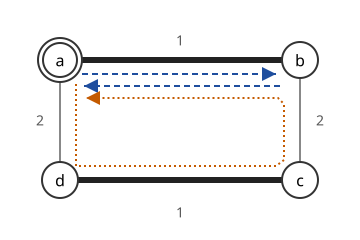

# 용량 제한 호 경로 문제

# 개요

**용량 제한 호 경로 문제(capacitated arc routing problem, CARP)** 는 창고를 떠난 차량들이 정해진 길들을 나누어 작업하고 돌아오는 경로들 가운데, 이동 거리의 합이 가장 짧은 것을 찾는 문제다. 쓰레기 수거차는 집이 늘어선 길을 빠짐없이 지나며 쓰레기를 실어야 하는데, 차가 차면 창고로 돌아가 비워야 한다. 길을 모두 한 번에 도는 가장 짧은 걸음이 있어도 차가 중간에 차면 그 걸음은 쓸 수 없다.

작업할 길들을 한 줄로 늘어놓은 순회 하나를 먼저 정하고, 그 줄을 차에 실을 수 있는 만큼씩 끊어 조각마다 창고를 오가게 한다. 끊는 자리는 가장 짧은 경로 문제 하나로 최적으로 정해진다.

# 직관

[시골 우편배달부 문제](rural-postman-problem.md)의 마을을 다시 쓴다. 교차로 $a,b,c,d$ 가 네모로 놓이고, 굵은 길 $ab$ 와 $cd$ 는 길이 $1$ 이고 쓰레기가 $1$ 톤씩 있다. 가는 길 $bc$ 와 $da$ 는 길이 $2$ 이고 쓰레기가 없다. 창고는 $a$ 에 있다.

차에 쓰레기가 얼마든지 실리면 시골 우편배달부 문제이고, $a,b,c,d,a$ 로 길이 $6$ 을 걸으면 된다. 차에 $1$ 톤만 실리면 $ab$ 를 치운 뒤 창고로 돌아가 비워야 하므로 이 걸음은 쓸 수 없다.

그래서 두 번 나간다. 첫 번째는 $a,b,a$ 로 $ab$ 를 치우고 돌아오는 길이 $2$ 의 걸음이다. 두 번째는 $a,d,c,b,a$ 로 $cd$ 를 치우고 돌아오는 길이 $6$ 의 걸음이고, $ab$ 는 이미 치웠으므로 지나가기만 한다.

아래 그림에서 파란 선이 첫 번째, 주황 선이 두 번째 걸음이고, 이중 원이 창고다. 길이의 합은 $8$ 이다.



# 정의

연결 그래프 $G=(V,E)$, 변의 길이 $w\colon E\to\lbrack 0,\infty)$, 창고 정점 $v_0$, 작업할 변의 집합 $R\subseteq E$, 변마다의 수요 $q\colon R\to(0,\infty)$, 차량의 용량 $Q\ge\max_{e\in R}q(e)$ 가 주어진다.

**경로(trip)** 는 $v_0$ 에서 출발해 $v_0$ 로 돌아오는 닫힌 걸음과, 그 걸음이 지나는 $R$ 의 변 가운데 그 경로가 **작업하는** 변들의 집합의 쌍이다. 작업하는 변의 수요 합은 $Q$ 이하여야 한다. 경로가 지나기만 하고 작업하지 않는 변은 **빈 이동(deadheading)** 이다.

$R$ 의 변마다 그 변을 작업하는 경로가 정확히 하나인 경로들의 모임이 해이고, 해의 비용은 걸음 길이의 합이다. 비용이 가장 작은 해를 찾는 문제가 용량 제한 호 경로 문제다. B. L. Golden 과 R. T. Wong 이 이 문제를 세웠다[^1].

직관 절의 마을에서는 $v_0=a$, $R=\lbrace ab,cd\rbrace$, $q\equiv 1$, $Q=1$ 이다. 해는 경로 $(a,b,a;\ \lbrace ab\rbrace)$ 와 $(a,d,c,b,a;\ \lbrace cd\rbrace)$ 이고, 두 번째 경로에서 $ab$ 는 빈 이동이다. 비용은 $8$ 이다.

# 성질

## 특수 사례와 NP-어려움

$Q$ 가 수요의 합 이상이면 경로 하나로 모든 변을 작업할 수 있으므로 시골 우편배달부 문제가 되고, $R=E$ 이면 [중국인 우편배달부 문제](chinese-postman-problem.md)다. 반대로 [차량 경로 문제](vehicle-routing-problem.md)의 고객 $v$ 마다 $v$ 에 길이 $0$ 인 변 하나를 매달아 그 변을 작업할 변으로 두면, 차량 경로 문제가 용량 제한 호 경로 문제의 특수 사례가 된다. 그래서 이 문제는 NP-어렵다(NP-hard, NP 는 nondeterministic polynomial time). $R=E$ 라서 용량이 없으면 다항 시간에 풀리는 중국인 우편배달부 문제도, 용량이 붙으면 NP-어렵다[^1].

## 순회의 최적 분할

작업할 변을 순서 $e_1,\dots,e_m$ 과 지나는 방향까지 정해 두면, 그 순서를 연속한 조각으로 끊어 조각마다 경로 하나로 작업하는 방법 가운데 가장 좋은 것은 다항 시간에 구해진다. 조각 $e_{i+1},\dots,e_j$ 의 비용은 창고에서 $e_{i+1}$ 의 시작점까지, 조각 안의 변과 그 사이의 빈 이동, $e_j$ 의 끝점에서 창고까지의 [최단경로](shortest-paths.md) 길이를 더한 것이다. 수요 합이 $Q$ 이하인 조각마다 정점 $i$ 에서 $j$ 로 그 비용의 간선을 둔 그래프는 순환이 없으므로, $0$ 에서 $m$ 까지의 가장 짧은 경로가 최적 분할이다. G. Ulusoy 가 이 분할을 제시했다[^2].

```javascript
// order[k] = { from, to, len, demand }: k 번째로 작업할 변과 지나는 방향
// dist: 정점 사이 최단경로 길이, depot: 창고, Q: 용량. 가장 좋은 끊기의 비용을 돌려준다
function split(order, dist, depot, Q) {
  const m = order.length;
  const best = new Array(m + 1).fill(Infinity);
  best[0] = 0;
  for (let i = 0; i < m; i++) {
    let load = 0;
    let inside = 0; // 조각 안의 작업 길이와 빈 이동의 합
    for (let j = i; j < m; j++) {
      const e = order[j];
      load += e.demand;
      if (load > Q) break;
      inside += e.len + (j > i ? dist[order[j - 1].to][e.from] : 0);
      const cost = dist[depot][order[i].from] + inside + dist[e.to][depot];
      best[j + 1] = Math.min(best[j + 1], best[i] + cost);
    }
  }
  return best[m];
}
```

직관 절의 마을에서 순서를 $a\to b$, $d\to c$ 로 두면 조각 $\lbrace ab\rbrace$ 의 비용은 $0+1+1=2$, 조각 $\lbrace cd\rbrace$ 의 비용은 $2+1+3=6$ 이고, 둘을 한 조각으로 두는 것은 용량을 넘는다. 분할의 비용은 $8$ 이다.

## 정점 경로 문제로의 변환

작업할 변 $e=uv$ 마다 $u$ 와 $v$ 자리에 고객을 하나씩, 수요를 $q(e)/2$ 씩 두고, 두 고객이 한 경로에서 바로 이어 방문되도록 둘 사이의 거리를 아주 작게 둔다. 그러면 용량 제한 호 경로 문제가 고객 $2\vert R\vert$ 명의 용량 제한 차량 경로 문제로 바뀐다. R. Longo, M. Poggi de Aragão, E. Uchoa 가 이 변환으로 차량 경로 문제의 정확한 해법을 호 경로 문제에 그대로 썼다[^3].

# 활용

- 쓰레기 수거, 제설과 염화칼슘 살포, 거리 청소, 수도와 전기 검침. 작업이 길 위에서 일어나고 차량이 싣거나 뿌릴 수 있는 양이 정해진 계획이 이 문제로 세워진다.
- 경로 우선, 묶음 나중(route first, cluster second) 방법. 시골 우편배달부 문제의 근사 걸음이나 무작위로 바꾼 순서에 순회의 최적 분할을 붙여 해를 만들고, 순서를 국소적으로 바꿔 가며 분할의 비용을 줄이는 진화 알고리즘과 국소 탐색이 큰 실례에 쓰인다.
- 차량 경로 문제와의 연결. 정점 경로 문제로의 변환으로 차량 경로 문제의 분기·절단·가격 결정(branch-cut-and-price) 해법이 호 경로 문제의 정확한 해를 준다.

[^1]: B. L. Golden, R. T. Wong, "Capacitated arc routing problems", *Networks* 11 (1981), 305–315.
[^2]: G. Ulusoy, "The fleet size and mix problem for capacitated arc routing", *European Journal of Operational Research* 22 (1985), 329–337.
[^3]: R. Longo, M. Poggi de Aragão, E. Uchoa, "Solving capacitated arc routing problems using a transformation to the CVRP", *Computers & Operations Research* 33 (2006), 1823–1837.

# 연관 문서

## 선수지식

- [시골 우편배달부 문제](rural-postman-problem.md)
- [차량 경로 문제](vehicle-routing-problem.md)

## 더 알아보기

아직 연결한 문서가 없다.

#graph_theory #optimization #algorithms #complexity
