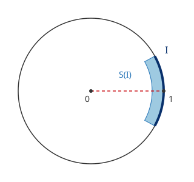

# Carleson 측도

# 개요

**Carleson 측도(Carleson measure)** 는 단위원판 안에 놓인 무게 가운데, 경계 가까이의 무게가 그 아래 경계의 길이에 비례하는 만큼만 있는 것이다. [Hardy 공간](hardy-spaces.md)의 함수는 원 위에서 제곱을 평균 내면 유한하다. 이 함수의 제곱을 원판 안의 반지름 선분 $[0,1)$ 위에서 적분해도 유한한지, 선분 위에 점 $1$ 로 갈수록 커지는 무게를 주면 어떻게 되는지가 물음이다.

이 물음은 경계의 호마다 그 위에 세운 상자 모양 영역의 무게를 호의 길이와 비교하는 조건 하나로 판정된다.

# 직관

$f(z)=\sum\_{n\ge 0}a\_nz^n$ 이 $H^2$ 에 속하면 $\sum\vert a\_n\vert^2$ 이 유한하다. 선분 $[0,1)$ 위에서 $\vert f\vert^2$ 를 적분하고 $x^mx^n$ 을 적분하면 다음이 나온다.

$$
\int_0^1\vert f(x)\vert^2\thinspace dx=\sum_{m,n\ge 0}\frac{a\_m\bar a\_n}{m+n+1}
$$

우변은 성분이 $1/(m+n+1)$ 인 행렬의 이차형식이다. 이 행렬의 노름은 $\pi$ 이므로([Hilbert 부등식](hilbert-inequality.md)) 적분은 $\pi\sum\vert a\_n\vert^2$ 이하로 유한하다.

선분에 무게 $(1-x)^{-1/2}$ 를 주면 결과가 달라진다. $f(z)=(1-z)^{-1/4}$ 의 계수는 $n^{-3/4}$ 정도로 줄어 제곱합이 유한하므로 $f$ 는 $H^2$ 에 속한다. 그런데 $\vert f(x)\vert^2=(1-x)^{-1/2}$ 이므로 적분은 다음과 같고 발산한다.

$$
\int_0^1\frac{\vert f(x)\vert^2}{(1-x)^{1/2}}\thinspace dx=\int_0^1\frac{dx}{1-x}
$$

두 무게의 차이는 점 $1$ 근처 짧은 구간 $[1-h,1)$ 에 놓인 양이다. 첫째 무게는 $h$ 이고 둘째 무게는 $2\sqrt h$ 다. $H^2$ 노름이 $1$ 인 함수는 점 $1-h$ 근처에서 $\vert f\vert^2$ 가 $1/h$ 정도까지 커질 수 있으므로, 그 근처의 무게가 $h$ 의 상수배 이하가 아니면 적분이 유계로 남지 않는다.

# 정의

단위원의 호 $I$ 의 길이를 $\vert I\vert$ 라 하자. $I$ 위의 **Carleson 상자(Carleson box)** 는 다음 집합이다.

$$
S(I)=\left\lbrace re^{i\theta}:e^{i\theta}\in I,\thickspace 1-\frac{\vert I\vert}{2\pi}\le r\lt 1\right\rbrace
$$

호 $I$ 에서 원판 안으로 호의 길이에 비례하는 깊이만큼 들어간 영역이다. 아래 그림에서 굵은 호가 $I$, 칠한 영역이 $S(I)$, 가로 점선이 직관 절의 선분 $[0,1)$ 이다.

단위원판 $\mathbb D$ 위의 유한한 양의 [측도](measure.md) $\mu$ 가 어떤 상수 $C$ 에 대해 모든 호 $I$ 에서 다음을 만족하면 **Carleson 측도** 라 한다.

$$
\mu(S(I))\le C\vert I\vert
$$

이런 $C$ 가운데 가장 작은 것을 $\mu$ 의 **Carleson 상수(Carleson constant)** 라 한다.

직관 절의 두 무게로 확인한다. 선분 $[0,1)$ 위의 길이 측도는 점 $1$ 을 포함하는 호 $I$ 에서 $\mu(S(I))=\vert I\vert/(2\pi)$ 이고, 점 $1$ 을 포함하지 않는 호에서 $0$ 이다. 그래서 Carleson 상수가 $1/(2\pi)$ 인 Carleson 측도다.

무게 $(1-x)^{-1/2}dx$ 는 점 $1$ 을 포함하는 호에서 $h=\vert I\vert/(2\pi)$ 로 두면 $\mu(S(I))=2\sqrt h$ 다. $2\sqrt h/(2\pi h)$ 는 $h\to 0$ 에서 무한대로 가므로 Carleson 측도가 아니다.

원판의 넓이 측도 $dA$ 는 $S(I)$ 의 넓이가 $\vert I\vert\thinspace h$ 이하이므로 Carleson 측도다.

# 성질

## Carleson 매립 정리

$0\lt p\lt\infty$ 일 때 다음 둘은 동치다[^1][^2].

1. $\mu$ 가 Carleson 측도다.
2. 어떤 상수 $C'$ 에 대해 모든 $f\in H^p$ 가 다음을 만족한다.

$$
\int_{\mathbb D}\vert f\vert^p\thinspace d\mu\le C'\Vert f\Vert\_{H^p}^p
$$

이것이 **Carleson 매립 정리(Carleson embedding theorem)** 다. $C'$ 는 Carleson 상수에 $p$ 만으로 정해지는 수를 곱한 것으로 고를 수 있다. 조건 1 에 $p$ 가 없으므로, 어느 한 $p$ 에서 2 가 성립하면 모든 $p$ 에서 성립한다.

## 필요 방향의 증명

$p=2$ 에서 보인다. 점 $a\in\mathbb D$ 마다 다음 함수를 둔다.

$$
k\_a(z)=\frac{(1-\vert a\vert^2)^{1/2}}{1-\bar az}
$$

계수가 $(1-\vert a\vert^2)^{1/2}\bar a^n$ 이므로 $\Vert k\_a\Vert\_{H^2}=1$ 이다. 호 $I$ 의 가운데 점이 $e^{i\theta_0}$ 이고 $h=\vert I\vert/(2\pi)$ 일 때 $a=(1-h)e^{i\theta_0}$ 로 둔다. $z\in S(I)$ 이면 $\vert 1-\bar az\vert\le 6h$ 이고 $1-\vert a\vert^2\ge h$ 이므로 $\vert k\_a(z)\vert^2\ge 1/(36h)$ 다. 2 에 $k\_a$ 를 넣으면 $\mu(S(I))/(36h)\le C'$ 이고, $\mu(S(I))\le 36C'h$ 가 나온다.

직관 절의 $(1-z)^{-1/4}$ 는 이 논증의 $k\_a$ 와 같은 일을 한다. 점 $1$ 근처에서 $H^2$ 노름이 허락하는 만큼 커지는 함수로 상자의 무게를 잰다.

## 충분 방향의 증명

$f$ 의 **비접근 극대함수(nontangential maximal function)** $f^\ast$ 는 경계점 $e^{i\theta}$ 를 꼭짓점으로 원판 안으로 벌어진 뿔 안에서 $\vert f\vert$ 의 상한이다. [Hardy–Littlewood 극대함수](hardy-littlewood-maximal-function.md)의 유계성에서 $\Vert f^\ast\Vert\_{L^p}\le C_p\Vert f\Vert\_{H^p}$ 가 나온다.

$\lambda\gt 0$ 에서 $f^\ast\gt\lambda$ 인 경계점의 집합은 열린 집합이고 서로 겹치지 않는 호 $I_j$ 들의 합집합이다. $\vert f(z)\vert\gt\lambda$ 인 점 $z$ 는 어떤 $I_j$ 를 상수배로 늘린 호의 상자 안에 있다. 그래서 $\mu(\lbrace\vert f\vert\gt\lambda\rbrace)$ 는 Carleson 상수의 상수배에 $f^\ast\gt\lambda$ 인 집합의 길이를 곱한 것 이하다. 이 부등식을 $\lambda$ 에 대해 적분하면 2 가 나온다[^2].

## 쌍곡 불변 꼴

$\mu$ 가 Carleson 측도인 것은 다음과 동치다.

$$
\sup_{a\in\mathbb D}\int_{\mathbb D}\frac{1-\vert a\vert^2}{\vert 1-\bar az\vert^2}\thinspace d\mu(z)\lt\infty
$$

피적분함수는 $\vert k\_a\vert^2$ 이다. 필요 방향의 증명은 이 적분이 유계이면 상자 조건이 성립함을 보이고, 매립 정리에 $f=k\_a$ 를 넣으면 반대 방향이 나온다. $z\mapsto(z-a)/(1-\bar az)$ 꼴의 원판 자기동형으로 측도를 옮겨도 이 조건은 같은 꼴로 남는다[^2].

## Bergman 공간의 상자 조건

[Bergman 공간](bergman-spaces.md) $A^2$ 는 원판의 정칙함수 가운데 $\int_{\mathbb D}\vert f\vert^2\thinspace dA$ 가 유한한 것의 공간이다. $\int\vert f\vert^2\thinspace d\mu\le C'\int\vert f\vert^2\thinspace dA$ 가 모든 $f\in A^2$ 에서 성립하는 것은 모든 호에서 $\mu(S(I))\le C\vert I\vert^2$ 인 것과 동치다[^3]. 넓이 측도가 상자에 주는 양이 $\vert I\vert^2$ 정도이므로 지수가 $2$ 로 바뀐다.

# 활용

- [보간 수열](interpolating-sequences.md). 원판의 수열 $(z_k)$ 가 고르게 떨어져 있는 것은 서로 다른 두 점의 의사쌍곡 거리가 양의 하한을 갖고 $\sum_k(1-\vert z_k\vert^2)\delta_{z_k}$ 가 Carleson 측도인 것과 동치다. Carleson 보간 정리의 충분 방향은 이 측도에 매립 정리를 쓴다.
- [Corona 정리](corona-theorem.md). Wolff 의 증명은 $\bar\partial b=G$ 의 해를 경계에서 유계로 고른다. $\vert G\vert^2(1-\vert z\vert)\thinspace dA$ 와 $\vert\partial G\vert(1-\vert z\vert)\thinspace dA$ 가 Carleson 측도이면 그런 해가 있고, corona 자료로 만든 $G$ 가 이 조건을 만족한다[^2].
- [유계 평균 진동 공간](bounded-mean-oscillation.md)(bounded mean oscillation, BMO). 원 위의 적분가능 함수 $\varphi$ 의 Poisson 적분(Poisson integral)을 $u$ 라 하면, $\varphi$ 가 BMO 에 속하는 것은 $\vert\nabla u(z)\vert^2(1-\vert z\vert)\thinspace dA(z)$ 가 Carleson 측도인 것과 동치다. C. Fefferman 과 E. M. Stein 은 이 판정으로 $H^1$ 의 쌍대공간이 BMO 임을 증명했다[^2].
- 연산자의 유계성. $H^2$ 위에서 정칙함수를 곱하거나 합성하는 연산자가 유계인지, 또는 그 노름이 얼마인지를 묻는 문제는 그 연산자로 정해지는 원판 위의 측도가 Carleson 측도인지로 바뀐다.

[^1]: L. Carleson, "An interpolation problem for bounded analytic functions", American Journal of Mathematics 80 (1958); L. Carleson, "Interpolations by bounded analytic functions and the corona problem", Annals of Mathematics 76 (1962).
[^2]: J. B. Garnett, *Bounded Analytic Functions*, Academic Press, 1981, 1 장 5 절(Carleson 측도), 6 장(BMO), 8 장(corona 정리).
[^3]: W. W. Hastings, "A Carleson measure theorem for Bergman spaces", Proceedings of the American Mathematical Society 52 (1975).

# 연관 문서

## 선수지식

- [Hardy 공간](hardy-spaces.md)

## 더 알아보기

- [보간 수열](interpolating-sequences.md)
- [Corona 정리](corona-theorem.md)
- [유계 평균 진동 공간](bounded-mean-oscillation.md)

#complex_analysis #functional_analysis #measure_theory #analysis
