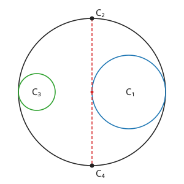

# Casey 정리

# 개요

**Casey 정리(Casey's theorem)** 는 한 원에 안쪽에서 접하는 원 네 개에 대해, 두 원씩 짝지은 공통접선의 길이 사이에 성립하는 등식이다. 원 위의 네 점에서는 마주 보는 변의 곱의 합이 대각선의 곱과 같은데, 점을 원 안쪽에 접하는 동전으로 바꾸면 두 동전 사이의 거리를 무엇으로 재야 같은 등식이 남는지가 물음이 된다. 두 동전에 함께 닿는 공통접선의 길이로 재면 등식이 그대로 성립하고, 접선의 길이가 접점 사이의 거리에 일정한 수를 곱한 것이라는 계산으로 원 위의 네 점의 등식에 옮겨진다.

# 직관

단위원 $\Gamma$ 위의 네 점 $(1,0)$, $(0,1)$, $(-1,0)$, $(0,-1)$ 은 정사각형을 이룬다. 변은 $\sqrt2$, 대각선은 $2$ 이므로 [Ptolemy 부등식](ptolemy-inequality.md)이 등호로 성립한다.

$$
\sqrt2\cdot\sqrt2+\sqrt2\cdot\sqrt2=4=2\cdot 2
$$

이제 $(1,0)$ 에 $\Gamma$ 와 안쪽에서 접하는 반지름 $1/2$ 인 원 $C\_1$ 을, $(-1,0)$ 에 반지름 $1/4$ 인 원 $C\_3$ 을 놓는다. $C\_1$ 의 중심은 $(1/2,0)$, $C\_3$ 의 중심은 $(-3/4,0)$ 이다. 나머지 두 점 $C\_2=(0,1)$, $C\_4=(0,-1)$ 은 반지름 $0$ 인 원으로 본다.

그림의 빨간 점선은 $C\_2$ 와 $C\_4$ 에서 $C\_1$ 에 그은 접선이고, 둘 다 원점에서 $C\_1$ 에 닿아 길이가 $1$ 이다.

두 원 사이의 거리로 공통접선의 길이를 쓴다. 중심 사이의 거리가 $d$ 이고 반지름이 $r$, $r'$ 인 두 원의 공통접선은 길이가 $\sqrt{d^2-(r-r')^2}$ 이다. $C\_1$ 과 $C\_3$ 은 $d=5/4$ 이므로 다음 길이가 나온다.

$$
\sqrt{\frac{25}{16}-\frac{1}{16}}=\frac{\sqrt6}{2}
$$

같은 계산으로 $C\_2$ 와 $C\_3$, $C\_3$ 과 $C\_4$ 사이는 $\sqrt6/2$ 이고 $C\_2$ 와 $C\_4$ 사이는 $2$ 다. 마주 보는 짝의 곱의 합은 $1\cdot\sqrt6/2+1\cdot\sqrt6/2=\sqrt6$ 이고, 대각선 짝의 곱은 $(\sqrt6/2)\cdot 2=\sqrt6$ 이다. 점을 원으로 바꾸어도 등식이 남는다.

# 정의

## 공통외접선의 길이

두 원 $C\_i$, $C\_j$ 의 중심 사이의 거리를 $d\_{ij}$, 반지름을 $r\_i$, $r\_j$ 라 한다. 두 원이 서로를 감싸지 않으면 두 원에 같은 쪽으로 접하는 직선이 있고, 두 접점 사이의 거리를 **공통외접선의 길이(length of the common external tangent)** $t\_{ij}$ 라 한다.

$$
t_{ij}=\sqrt{d_{ij}^2-(r_i-r_j)^2}
$$

반지름이 $0$ 인 원은 점이고, 이때 $t\_{ij}$ 는 점에서 원에 그은 접선의 길이다. 직관 절에서 $t\_{12}=t\_{14}=1$, $t\_{13}=t\_{23}=t\_{34}=\sqrt6/2$, $t\_{24}=2$ 다.

# 성질

## Casey 정리

원 $C\_1,C\_2,C\_3,C\_4$ 가 원 $\Gamma$ 에 이 순서로 놓인 점에서 안쪽으로 접하면 다음이 성립한다.

$$
t_{12}t_{34}+t_{14}t_{23}=t_{13}t_{24}
$$

네 원의 반지름이 모두 $0$ 이면 원 위의 네 점에 대한 Ptolemy 등식이다.

## 접선의 길이와 접점 사이의 거리

$\Gamma$ 의 반지름을 $R$, $C\_i$ 가 $\Gamma$ 에 접하는 점을 $P\_i$ 라 하면 다음이 성립한다.

$$
t_{ij}=\frac{P_iP_j}{R}\sqrt{(R-r_i)(R-r_j)}
$$

증명의 요지. $\Gamma$ 의 중심 $O$ 에서 $C\_i$ 의 중심까지의 거리는 $a=R-r\_i$, $C\_j$ 의 중심까지는 $b=R-r\_j$ 이고, $r\_i-r\_j=b-a$ 다. $\angle P\_iOP\_j=\theta$ 에 코사인 법칙을 쓰면 $d\_{ij}^2=a^2+b^2-2ab\cos\theta$ 이므로 $t\_{ij}^2=2ab(1-\cos\theta)$ 다. 같은 각으로 $P\_iP\_j^2=2R^2(1-\cos\theta)$ 이므로 $t\_{ij}^2=ab\thinspace P\_iP\_j^2/R^2$ 이다.

직관 절에서 $t\_{13}=2\cdot\sqrt{(1/2)(3/4)}=\sqrt6/2$ 다.

## Casey 정리의 증명

위 공식을 Casey 정리의 세 곱에 넣으면 세 곱이 모두 같은 수를 곱한 꼴이 된다.

$$
t_{12}t_{34}=\frac{P_1P_2\cdot P_3P_4}{R^2}\sqrt{\prod_{i=1}^4(R-r_i)}
$$

$t\_{14}t\_{23}$ 과 $t\_{13}t\_{24}$ 도 같은 꼴이다. 공통 인수를 나누면 원 위의 네 점 $P\_1,P\_2,P\_3,P\_4$ 에 대한 Ptolemy 등식이 남는다.

## 바깥쪽으로 접하는 원

$C\_i$ 가운데 일부가 $\Gamma$ 에 바깥쪽으로 접하면, 접하는 쪽이 다른 두 원 사이에는 공통외접선 대신 두 원을 가로지르는 공통내접선의 길이 $\sqrt{d\_{ij}^2-(r\_i+r\_j)^2}$ 를 쓴다. 그러면 같은 등식이 성립한다.

## 역

역도 성립한다. 서로를 감싸지 않는 원 네 개의 공통접선의 길이가 Casey 정리의 등식을 만족하면 네 원 모두에 접하는 원이나 직선이 있다.

# 활용

- 접하는 원의 판정. 원 네 개가 한 원에 함께 접하는지를 접선의 길이만으로 판정한다. 삼각형의 구점원이 내접원과 세 방접원에 접한다는 Feuerbach 정리가 이 판정의 역으로 증명된다. 세 변의 중점을 반지름 $0$ 인 원으로 보고 내접원과 함께 넣어 접선의 길이를 변의 길이로 적는다. 이 정리는 [Euler 직선](euler-line.md) 문서에 있다.
- 한 직선에 접하는 원 네 개. 네 원이 한 직선에 같은 쪽에서 접하면 $t\_{ij}$ 는 직선 위의 두 접점 사이의 거리다. 이 경우의 등식은 직선 위에 차례로 놓인 네 점 $A,B,C,D$ 에 대한 Euler 의 항등식 $AB\cdot CD+AD\cdot BC=AC\cdot BD$ 다.

# 연관 문서

## 선수지식

- [Ptolemy 부등식](ptolemy-inequality.md)

## 더 알아보기

아직 연결한 문서가 없다.

#complex_analysis #algebra
