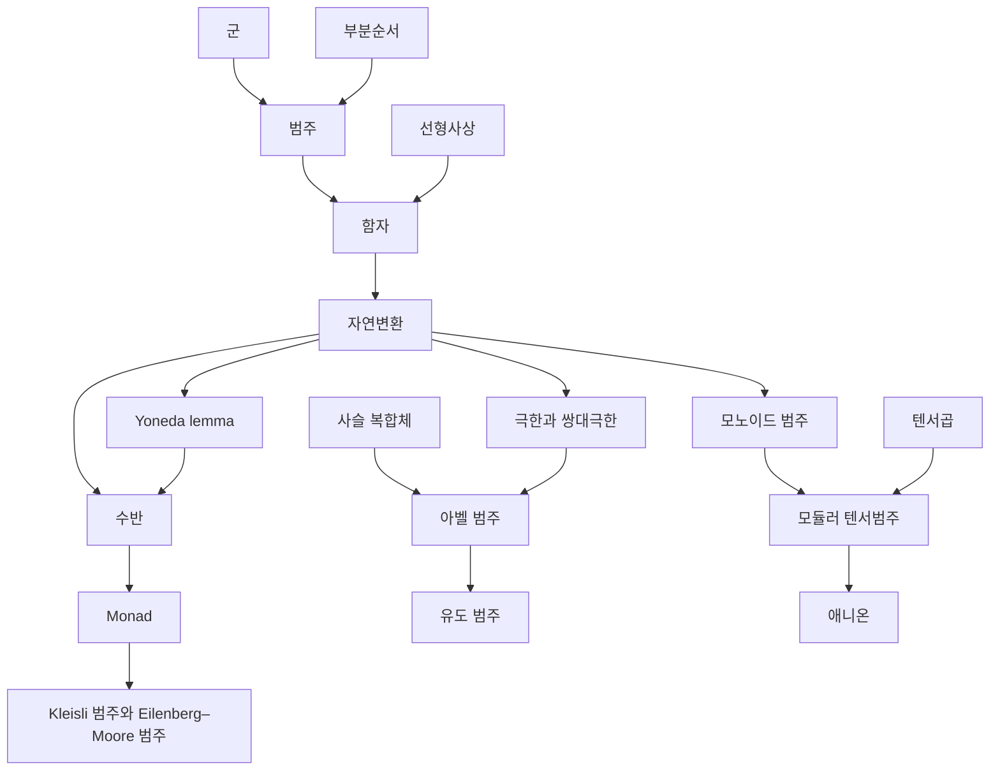

# 범주론 개관

# 개요

범주론(category theory)은 대상의 내부가 아니라 대상 사이의 사상으로 구조를 기술한다. 물음은 "이 구성이 어떤 보편성질로 결정되는가" 이고, 답은 대개 표현 가능 함자나 수반으로 온다. 같은 구성을 여러 분야에서 따로 발견하는 일이 보편성질 하나로 설명된다.

범주론의 갈래는 네 줄기다. 범주와 함자의 기본 언어, Yoneda lemma 에서 수반으로 가는 보편성질, monad 와 그 대수, 그리고 텐서범주에서 위상적 양자계산으로 이어지는 응용이다. 호몰로지 대수 쪽 응용은 [de Rham 코호몰로지](de-rham-cohomology.md)와 [대수적 K 이론](algebraic-k-theory.md)에, 프로그래밍 언어와의 대응은 [Curry–Howard 대응](curry-howard.md)에 있다.

시작은 [범주](category.md)다. 거기서 [함자](functors.md)와 [자연변환](natural-transformations.md)이 언어를 세우고, [Yoneda lemma](yoneda-lemma.md)가 대상을 사상으로 바꿔 읽는 원리를 준다.

# 지도

# 갈래

처음 읽는 사람은 기본 언어, 보편성질의 순서로 읽는다. 그 뒤는 세 방향으로 갈린다. Monad 와 대수는 수반에서 바로 이어지고, 텐서범주와 응용은 자연변환만 읽고도 들어갈 수 있고, 고차 범주는 위상수학의 호모토피를 함께 읽는다.

## 기본 언어

먼저 읽을 것: [부분순서](partial-orders.md)(순서론 개관), [군](groups.md)(대수 개관), [선형사상](linear-maps.md)(선형대수 개관). 시작 문서: [범주](category.md).

- [범주](category.md): 대상과 사상, 합성과 항등
- [함자](functors.md): 범주 사이의 구조 보존 사상
- [자연변환](natural-transformations.md): 함자 사이의 사상, 함자 범주

## 보편성질

먼저 읽을 갈래: 기본 언어. 먼저 읽을 것: [위상 공간](topology.md)(위상 개관), [사슬 복합체](chain-complexes.md)(대수 개관). 시작 문서: [Yoneda lemma](yoneda-lemma.md).

- [Yoneda lemma](yoneda-lemma.md): 대상이 그것이 받는 사상 전체로 결정된다
  - [표현 가능 함자](representable-functors.md): 보편 성질로 정의한 대상을 함자의 표현으로 읽는다
- [극한과 쌍대극한](limits-colimits.md): 곱, 당김, 쌍대곱을 하나의 보편성질로 적는다
  - [아벨 범주](abelian-categories.md): 핵과 여핵으로 상을 지목해 완전열을 원소 없이 쓰는 범주, Freyd–Mitchell 매장정리
  - [유도 범주](derived-categories.md): 준동형을 뒤집어 분해와 가군을 같은 대상으로 만든 범주, 삼각 구조와 유도 함자의 올림
- [수반](adjunctions.md): 자유 구성과 망각 함자의 쌍, 단위와 쌍대단위
  - [층](sheaves.md): 국소 데이터를 붙이는 조건을 만족하는 전층, 줄기와 층화
  - [토포스](topos-theory.md): 집합의 범주를 공리로 뽑아낸 범주, 부분대상 분류자와 내부 논리

## Monad 와 대수

먼저 읽을 갈래: 보편성질. 시작 문서: [Monad](monads.md).

- [Monad](monads.md): 수반이 남기는 자기함자와 두 자연변환
- [Kleisli 범주와 Eilenberg–Moore 범주](kleisli-eilenberg-moore.md): monad 를 다시 수반으로 분해하는 두 방법

## 텐서범주와 응용

먼저 읽을 갈래: 기본 언어. 먼저 읽을 것: [군의 표현](group-representations.md)(대수 개관), [텐서곱](tensor-products.md)(선형대수 개관). 시작 문서: [모노이드 범주](monoidal-categories.md).

- [모노이드 범주](monoidal-categories.md): 텐서곱과 단위 대상, 오각형 등식과 연접 정리
  - [Tannaka 쌍대성](tannaka-duality.md): 섬유함자를 가진 대칭 모노이드 범주에서 아핀 군 스킴을 복원하는 정리
- [모듈러 텐서범주](modular-tensor-categories.md): 짜임과 모듈러 $S$ 행렬을 가진 범주
- [애니온](anyons.md): 준입자의 교환 통계가 범주의 짜임으로 기술된다

## 고차 범주

먼저 읽을 갈래: 기본 언어. 먼저 읽을 것: [호모토피군](homotopy-groups.md)과 [단순 집합](simplicial-sets.md)(위상 개관). 시작 문서: [무한 범주](infinity-categories.md).

- [무한 범주](infinity-categories.md): 사상 사이의 사상을 모든 차수에서 갖는 범주, 안쪽 Kan 조건

# 연관 문서

## 선수지식

- [집합](sets.md)

## 더 알아보기

- [범주](category.md)

#category_theory #algebra #overview
