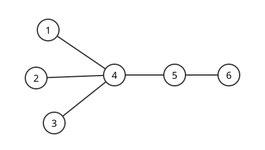

# Cayley 공식

# 개요

**Cayley 공식(Cayley's formula)** 은 $1$ 부터 $n$ 까지 이름이 붙은 정점 $n$ 개로 만들 수 있는 나무가 $n^{n-2}$ 개라는 정리다. 정점이 $4$ 개이면 한 정점에 나머지 셋을 모두 잇는 별 모양이 $4$ 개, 네 정점을 한 줄로 잇는 경로가 $4!/2=12$ 개로 모두 $16=4^2$ 개다. 나무마다 길이 $n-2$ 의 수열 하나를 대응시키는 Prüfer 부호(Prüfer code)가 일대일 대응이므로, 나무를 세는 문제가 수열을 세는 문제 $n^{n-2}$ 로 바뀐다.

# 직관

정점 $n$ 개의 나무를 직접 세려면 모양마다 이름 붙이는 방법을 세야 하고, 모양의 종류는 $n$ 이 커지면 빨리 늘어난다. 대신 나무를 한 번에 잎 하나씩 지우면서 기록을 남긴다. 번호가 가장 작은 잎을 지우고 그 잎에 붙어 있던 정점의 번호를 적는 일을 정점이 둘 남을 때까지 되풀이한다.



위 나무에서 가장 작은 잎은 $1$ 이고 이웃은 $4$ 다. $1$ 을 지우고 $4$ 를 적는다. 다음 잎 $2$ 와 $3$ 을 지울 때도 $4$ 를 적는다. 그러면 $4$ 가 잎이 되어 $4$ 를 지우고 이웃 $5$ 를 적는다. 정점 $5,6$ 이 남으므로 멈추고, 기록은 $(4,4,4,5)$ 다. 그림에서 $4$ 는 이웃이 넷이고 기록에 세 번, $5$ 는 이웃이 둘이고 한 번 나온다. 기록에 나온 횟수가 이웃의 수보다 하나 적다.

# 정의

정점 집합이 $\lbrace 1,\dots,n\rbrace$ 인 나무를 **이름 붙은 나무(labeled tree)** 라 한다. 두 나무는 간선 집합이 같을 때 같은 것으로 센다. [그래프](graphs.md)에서 나무는 순환이 없는 연결 그래프이고, 정점이 $n$ 개이면 간선이 $n-1$ 개다.

$n\ge 2$ 인 이름 붙은 나무 $T$ 의 **Prüfer 부호** 는 다음 절차로 얻는 길이 $n-2$ 의 수열 $(a_1,\dots,a_{n-2})$ 다. $i=1,\dots,n-2$ 마다 남은 나무에서 번호가 가장 작은 잎 $\ell_i$ 를 고르고, $\ell_i$ 의 유일한 이웃을 $a_i$ 로 적은 뒤 $\ell_i$ 를 지운다.

```javascript
// adj: 정점 1..n 의 이웃 집합. 나무의 Prüfer 부호를 낸다
function pruferCode(n, adj) {
  const deg = adj.map((s) => s.size);
  const removed = new Array(n + 1).fill(false);
  const code = [];
  for (let i = 0; i < n - 2; i++) {
    let leaf = 1;
    while (removed[leaf] || deg[leaf] !== 1) leaf++;
    const nb = [...adj[leaf]].find((v) => !removed[v]);
    code.push(nb);
    removed[leaf] = true;
    deg[nb]--;
  }
  return code;
}
```

# 성질

## Cayley 공식

$n\ge 2$ 이면 정점 $\lbrace 1,\dots,n\rbrace$ 위의 이름 붙은 나무는 $n^{n-2}$ 개다. Cayley 가 1889 년에 발표했고, Prüfer 가 1918 년에 아래 일대일 대응으로 증명했다.[^1]

증명의 요지. Prüfer 부호는 나무에서 $\lbrace 1,\dots,n\rbrace^{n-2}$ 로 가는 일대일 대응이다. 역사상은 다음과 같다. 수열 $(a_1,\dots,a_{n-2})$ 이 주어지면 $i=1,\dots,n-2$ 마다 아직 쓰지 않았고 $a_i,\dots,a_{n-2}$ 에도 나오지 않는 가장 작은 번호 $\ell_i$ 를 골라 간선 $\ell_i a_i$ 를 긋는다. 마지막으로 쓰지 않은 두 번호를 잇는다. 부호를 만들 때 $\ell_i$ 가 잎이었다는 것과 이 선택이 같은 번호를 고른다는 것을 $i$ 에 대한 귀납법으로 보인다.

## 차수의 분포

나무에서 정점 $v$ 의 차수는 Prüfer 부호에 $v$ 가 나오는 횟수에 $1$ 을 더한 값이다. 따라서 차수가 $d_1,\dots,d_n$ 인 이름 붙은 나무의 개수는 다음 다항계수다.

$$
\binom{n-2}{d_1-1,\ \dots,\ d_n-1}=\frac{(n-2)!}{(d_1-1)!\cdots(d_n-1)!}\qquad\Big(\sum_i d_i=2n-2\Big)
$$

이 식을 모든 차수에 대해 더하면 다항정리로 $(1+\cdots+1)^{n-2}=n^{n-2}$ 이 다시 나온다. 잎이 정확히 $k$ 개인 나무의 수, 정점 $1$ 의 차수가 $d$ 인 나무의 수가 같은 방법으로 나온다.

## 다른 증명

- 행렬-트리 정리(matrix-tree theorem). [그래프 Laplacian](graph-laplacian.md)의 여인수 하나가 신장트리의 개수와 같다. 완전그래프 $K_n$ 의 Laplacian 은 $nI-J$ 이고 고윳값이 $0$ 하나와 $n$ 이 $n-1$ 개이므로, 신장트리는 $\frac1n n^{n-1}=n^{n-2}$ 개다. $K_n$ 의 신장트리가 곧 이름 붙은 나무다.
- [Lagrange 반전 공식](lagrange-inversion.md). 이름 붙은 뿌리나무의 지수생성함수 $T(x)$ 는 $T=xe^{T}$ 를 만족하고, 반전 공식으로 계수를 읽으면 뿌리나무가 $n^{n-1}$ 개다. 뿌리를 고르는 $n$ 가지로 나누면 $n^{n-2}$ 다.
- Joyal 의 전단사(Joyal's bijection). 두 정점을 표시한 나무와 $\lbrace 1,\dots,n\rbrace$ 에서 자기 자신으로 가는 함수를 일대일로 대응시킨다. 함수는 $n^n$ 개이고 표시하는 방법이 $n^2$ 가지이므로 나무는 $n^{n-2}$ 개다.

## 숲의 개수

정점 $\lbrace 1,\dots,n\rbrace$ 위에서 정해진 $k$ 개의 정점이 서로 다른 성분에 들고 성분이 $k$ 개인 뿌리 숲(rooted forest)의 개수는 $kn^{n-k-1}$ 이다. $k=1$ 이면 Cayley 공식이다.

# 활용

- 길이 $n-2$ 의 수열을 고르게 뽑아 Prüfer 부호를 거꾸로 풀면 $K_n$ 의 신장트리를 고르게 뽑는다. [최소 신장트리](minimum-spanning-tree.md) 알고리즘의 시험 입력이나 무작위 나무 모형에 쓴다.
- 차수 분포 공식으로 고르게 뽑은 이름 붙은 나무의 잎의 개수가 평균 $n(1-1/n)^{n-2}\approx n/e$ 임을 계산한다.
- 일반 그래프의 신장트리 개수는 행렬-트리 정리로 세고, 완전그래프에 적용한 경우가 Cayley 공식이다.

[^1]: M. Aigner, G. M. Ziegler, *Proofs from THE BOOK*, 6th ed., Springer (2018), "Cayley's formula for the number of trees" 장. 이름 붙은 나무의 네 가지 증명(Prüfer 부호, 행렬-트리 정리, 이중 셈, Joyal 의 전단사)과 역사.

# 연관 문서

## 선수지식

- [그래프](graphs.md)

## 더 알아보기

아직 연결한 문서가 없다.

#graph_theory #combinatorics
