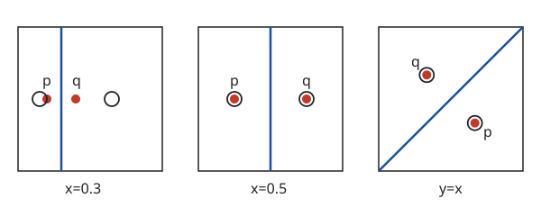

# 중심 Voronoi 분할

# 개요

**중심 Voronoi 분할(centroidal Voronoi tessellation)** 은 점마다 가장 가까운 곳을 모은 구역으로 영역을 나누었을 때, 각 점이 자기 구역의 무게중심에 놓인 배치다. 정사각형 공원에 매점 두 곳을 열고 손님은 가장 가까운 매점으로 걸어간다고 하자. 매점을 어디에 두어야 손님들이 걷는 거리의 제곱을 합한 값이 작아지는가가 물음이다.

매점을 자기 손님들의 평균 위치로 옮기고, 옮긴 자리로 손님을 다시 나누는 일을 되풀이하면 걷는 거리가 줄어든다. 되풀이가 멈춘 배치가 중심 Voronoi 분할이고, 가장 좋은 배치는 반드시 이 꼴이다.

# 직관

공원은 단위 정사각형 $\lbrack 0,1\rbrack^2$ 이고 손님은 공원에 고르게 퍼져 있다. 매점 $p$ 를 $(0.2,0.5)$ 에, $q$ 를 $(0.4,0.5)$ 에 둔다. 두 매점에서 같은 거리인 점은 수직이등분선 $x=0.3$ 위에 있으므로, $x\lt 0.3$ 인 손님은 $p$ 로, 나머지는 $q$ 로 간다. 이 나눔이 두 매점의 [Voronoi 도형](voronoi-diagrams.md)이다.

$p$ 의 손님은 띠 $\lbrack 0,0.3\rbrack\times\lbrack 0,1\rbrack$ 에 있고 그 평균 위치는 $(0.15,0.5)$ 다. $q$ 의 손님의 평균 위치는 $(0.65,0.5)$ 다. 두 매점 모두 자기 손님의 한가운데에 있지 않다.

한 무리의 점들에서 제곱거리의 합이 가장 작은 위치는 그 점들의 평균이다. 그래서 손님의 나눔을 그대로 두고 $p$ 를 $(0.15,0.5)$ 로, $q$ 를 $(0.65,0.5)$ 로 옮기면 합이 준다. 옮기고 나면 이등분선이 $x=0.4$ 로 바뀌고, 손님을 새 이등분선으로 다시 나누면 합이 또 준다.

손님 전체의 제곱거리 합은 처음 $0.1587$ 에서 한 번 옮긴 뒤 $0.1092$ 가 된다. 되풀이하면 이등분선은 $0.3, 0.4, 0.45, 0.475,\dots$ 로 $0.5$ 에 다가가고, 매점은 $(0.25,0.5)$ 와 $(0.75,0.5)$ 로 간다. 그때 합은 $5/48\approx 0.1042$ 다.

왼쪽 그림은 처음 배치다. 채운 점이 매점이고 빈 점이 구역의 무게중심이다. 가운데 그림은 되풀이가 멈춘 배치로, 매점과 무게중심이 겹친다.

# 정의

## 생성점과 구역

영역 $\Omega\subset\mathbb R^d$ 위에 음이 아닌 밀도 $\rho$ 를 둔다. 서로 다른 점 $z_1,\dots,z_k\in\Omega$ 를 **생성점(generator)** 이라 하고, $z_i$ 의 구역 $V_i$ 는 $\Omega$ 의 점 가운데 $z_i$ 가 가장 가까운 것들의 집합이다.

$$
V_i=\lbrace y\in\Omega:\ \lvert y-z_i\rvert\le\lvert y-z_j\rvert\quad\forall j\rbrace
$$

직관 절에서 $\Omega$ 는 단위 정사각형, $\rho=1$, $k=2$ 이고 처음 구역은 $V_1=\lbrack 0,0.3\rbrack\times\lbrack 0,1\rbrack$ 이다.

## 무게중심

구역 $V_i$ 의 **질량(mass)** $m_i$ 와 **무게중심(mass centroid)** $z_i^\ast$ 는 다음이다.

$$
m_i=\int_{V_i}\rho(y)\thinspace dy,\qquad z_i^\ast=\frac{1}{m_i}\int_{V_i}y\thinspace\rho(y)\thinspace dy
$$

직관 절의 처음 배치에서 $m_1=0.3$, $z_1^\ast=(0.15,0.5)$ 다. 무게중심은 구역 안 손님들의 평균 위치다.

## 중심 Voronoi 분할

모든 $i$ 에서 $z_i=z_i^\ast$ 인 생성점과 구역의 짝을 **중심 Voronoi 분할(centroidal Voronoi tessellation)** 이라 한다. 직관 절의 가운데 그림, 곧 생성점 $(0.25,0.5)$, $(0.75,0.5)$ 와 경계 $x=0.5$ 가 그 예다.

## 에너지

생성점 $z=(z_1,\dots,z_k)$ 의 **에너지(energy)** 는 손님마다 가장 가까운 생성점까지의 제곱거리를 밀도로 더한 값이다.

$$
E(z)=\sum_{i=1}^k\int_{V_i}\rho(y)\thinspace\lvert y-z_i\rvert^2\thinspace dy
$$

직관 절의 수 $0.1587$, $0.1092$, $5/48$ 이 각 배치의 $E$ 다. [양자화](quantization.md)의 왜곡과 같은 양이고, $\rho$ 가 확률밀도이면 정확히 그 왜곡이다.

# 성질

## 에너지의 임계점

$E$ 를 생성점으로 미분하면 다음이 나온다.[^1]

$$
\frac{\partial E}{\partial z_i}=2m_i\thinspace(z_i-z_i^\ast)
$$

구역의 경계가 움직이는 효과는 더해지지 않는다. 경계 위의 점은 두 생성점까지의 거리가 같아서, 경계가 조금 움직여도 그 점의 제곱거리가 바뀌지 않는다. 그러므로 모든 $m_i\gt 0$ 일 때 $z$ 가 $E$ 의 임계점인 것과 중심 Voronoi 분할인 것은 동치다. $E$ 의 최솟값을 주는 배치는 중심 Voronoi 분할이다.

## 최소가 아닌 중심 Voronoi 분할

중심 Voronoi 분할이라고 $E$ 가 최소인 것은 아니다. 직관 절의 오른쪽 그림은 생성점 $(2/3,1/3)$, $(1/3,2/3)$ 이다. 두 점의 이등분선은 대각선 $y=x$ 이고, 구역은 두 직각삼각형이며, 삼각형 $(0,0),(1,0),(1,1)$ 의 무게중심이 $(2/3,1/3)$ 이다. 그러므로 중심 Voronoi 분할이다.

이 배치의 에너지는 $1/9\approx 0.1111$ 로 가운데 그림의 $5/48$ 보다 크다. 정사각형 경계 $x=0.5$ 와 $y=0.5$ 의 두 배치는 에너지가 같아서, 최솟값을 주는 배치도 하나가 아니다.

## Lloyd 반복

[양자화](quantization.md) 문서의 Lloyd 반복(Lloyd's algorithm)은 생성점을 구역의 무게중심으로 옮기는 단계와 새 생성점으로 구역을 다시 나누는 단계를 번갈아 한다. 첫 단계는 구역을 고정한 채 각 구역의 제곱거리 합을 최소로 만들고, 둘째 단계는 생성점을 고정한 채 손님마다 가장 가까운 생성점을 고른다. 두 단계 모두 $E$ 를 늘리지 않으므로 $E$ 는 단조 감소한다.

직관 절의 반복에서 두 생성점의 $x$ 좌표를 $a\lt b$ 라 하면 반복은 경계 $m=(a+b)/2$ 만으로 정해진다. 새 생성점의 $x$ 좌표가 $m/2$ 와 $(1+m)/2$ 이므로 새 경계는 $m/2+1/4$ 이고, 경계와 $1/2$ 의 차이가 단계마다 절반이 된다.

1 차원 구간에서 밀도의 로그가 오목하면 중심 Voronoi 분할은 하나뿐이고(Fleischer 1964) Lloyd 반복은 그것으로 지수적 속도로 수렴한다(Kieffer 1982).[^2] 2 차원 이상에서 반복은 직관 절 오른쪽 그림 같은 최소가 아닌 분할에 머물 수 있다.

## 생성점이 많을 때의 구역

생성점이 많으면 밀도가 구역 하나 안에서 거의 상수다. 이때 에너지를 최소로 하는 배치의 생성점 밀도는 $\rho^{d/(d+2)}$ 에 비례한다.[^3] $d=1$ 이면 양자화 문서의 고해상도 근사가 주는 $\rho^{1/3}$ 이다.

**Gersho 추측(Gersho's conjecture)** 은 $k\to\infty$ 일 때 에너지를 최소로 하는 배치의 구역이 거의 모두 한 볼록다면체와 합동이 된다는 추측이다.[^3] 2 차원에서는 그 다면체가 정육각형이고, 균등 밀도 $\rho=1$ 인 넓이 $A$ 의 영역에서 다음이 성립한다(Fejes Tóth, Newman).[^4]

$$
\lim_{k\to\infty}\frac{k\thinspace E_k}{A^2}=\frac{5}{18\sqrt3}\approx 0.1604
$$

$E_k$ 는 생성점 $k$ 개의 최소 에너지다. 같은 넓이의 정사각형 구역으로 덮으면 이 값이 $1/6\approx 0.1667$ 이다. 3 차원 이상에서 Gersho 추측은 증명되지 않았다.[^1]

# 활용

- 격자 생성. 생성점을 마디로 두고 [Delaunay 삼각분할](delaunay-triangulation.md)을 그리면 각이 고른 삼각형을 얻는다. [유한요소법](finite-element-method.md)의 격자를 만들 때 밀도 $\rho$ 를 격자를 촘촘히 할 곳에서 크게 둔다.[^1]
- 점묘. 사진의 어두운 정도를 밀도로 두고 중심 Voronoi 분할을 구해 생성점에 점을 찍으면, 점이 뭉치거나 줄지어 서지 않고 고르게 퍼진 점묘가 된다.[^5]
- 센서 배치. 로봇마다 자기 구역의 무게중심을 향해 움직이게 하면 이웃 로봇의 위치만으로 Lloyd 반복이 돌아가고, 무리 전체가 중심 Voronoi 분할로 모인다.[^6]
- [k 평균 군집화](k-means.md). 밀도 $\rho$ 를 유한 개의 표본점으로 바꾼 것이 $k$ 평균 문제이고, 그 국소 최적해가 표본점 위의 중심 Voronoi 분할이다.

[^1]: Q. Du, V. Faber, M. Gunzburger, "Centroidal Voronoi tessellations: applications and algorithms", *SIAM Review* **41** (1999), 637–676.
[^2]: P. E. Fleischer, "Sufficient conditions for achieving minimum distortion in a quantizer", *IEEE International Convention Record* (1964), 104–111. J. C. Kieffer, "Exponential rate of convergence for Lloyd's method I", *IEEE Transactions on Information Theory* **28** (1982), 205–210.
[^3]: A. Gersho, "Asymptotically optimal block quantization", *IEEE Transactions on Information Theory* **25** (1979), 373–380.
[^4]: L. Fejes Tóth, *Lagerungen in der Ebene, auf der Kugel und im Raum*, Springer (1953). D. J. Newman, "The hexagon theorem", *IEEE Transactions on Information Theory* **28** (1982), 137–139.
[^5]: A. Secord, "Weighted Voronoi stippling", *Proceedings of the 2nd International Symposium on Non-Photorealistic Animation and Rendering* (2002), 37–43.
[^6]: J. Cortés, S. Martínez, T. Karataş, F. Bullo, "Coverage control for mobile sensing networks", *IEEE Transactions on Robotics and Automation* **20** (2004), 243–255.

# 연관 문서

## 선수지식

- [Voronoi 도형](voronoi-diagrams.md)
- [양자화](quantization.md)

## 더 알아보기

아직 연결한 문서가 없다.

#information_theory #algorithms #computation #optimization
