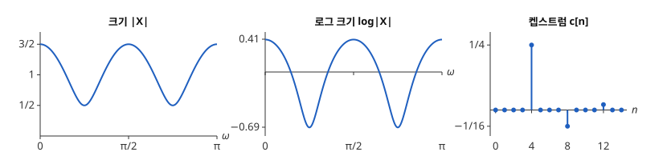

# 켑스트럼

# 개요

**켑스트럼(cepstrum)** 은 신호의 주파수 응답 크기에 로그를 취한 것을 다시 Fourier 역변환한 수열이다. 방에서 녹음한 소리에 벽에서 되돌아온 메아리가 몇 칸 늦게 섞이면, 원래 소리와 메아리가 합성곱으로 엉켜 수열만 보아서는 늦은 칸 수를 읽기 어렵다. 로그를 취하면 [합성곱](convolution.md)이 덧셈으로 바뀌고, 켑스트럼에서 메아리는 늦은 칸 수 자리의 봉우리로 따로 나타난다.

# 직관

수열 $x\lbrack n\rbrack=\delta\lbrack n\rbrack+\frac12\delta\lbrack n-4\rbrack$ 은 $n=0$ 의 값 $1$ 과 그 메아리 $\frac12$ 가 4 칸 늦게 온 것이다. [z 변환](z-transform.md) 문서의 이산시간 Fourier 변환(discrete-time Fourier transform, DTFT)은 $X(e^{i\omega})=1+\frac12e^{-4i\omega}$ 이고, 크기는 $\omega$ 가 $\pi/2$ 늘 때마다 같은 모양이 되풀이되며 $\frac12$ 과 $\frac32$ 사이를 오간다. 되풀이 간격 $2\pi/4$ 의 분모 $4$ 가 메아리가 늦은 칸 수다.

$\lvert u\rvert\lt 1$ 에서 $\log(1+u)=u-\frac{u^2}2+\frac{u^3}3-\dots$ 를 $u=\frac12e^{-4i\omega}$ 에 쓰고 실수부를 취하면 다음이 나온다.

$$
\log\lvert X(e^{i\omega})\rvert=\tfrac12\cos 4\omega-\tfrac18\cos 8\omega+\tfrac1{24}\cos 12\omega-\cdots
$$

로그 크기는 주파수가 $4,8,12,\dots$ 인 코사인의 합이다. 이 코사인 계수의 절반을 번호 $4,8,12$ 자리에 늘어놓으면 $n=4$ 에서 $\frac14$, $n=8$ 에서 $-\frac1{16}$, $n=12$ 에서 $\frac1{48}$ 이고 나머지는 $0$ 이다. 아래 그림의 세 칸이 차례로 크기, 로그 크기, 그 계수의 수열이다.

# 정의

$X(e^{i\omega})$ 가 단위원 위에서 $0$ 이 아닌 수열 $x$ 의 **켑스트럼** 은 다음 수열이다[^1].

$$
c\lbrack n\rbrack=\frac1{2\pi}\int_{-\pi}^{\pi}\log\lvert X(e^{i\omega})\rvert\thinspace e^{i\omega n}\thinspace d\omega
$$

$\log\lvert X\rvert$ 는 짝함수이므로 $c\lbrack -n\rbrack=c\lbrack n\rbrack$ 이고, $\log\lvert X(e^{i\omega})\rvert=c\lbrack 0\rbrack+2\sum_{n\ge 1}c\lbrack n\rbrack\cos n\omega$ 다. 직관 절에서 $\frac12\cos 4\omega$ 의 계수는 $2c\lbrack 4\rbrack$ 이므로 $c\lbrack 4\rbrack=\frac14$ 다. 켑스트럼의 번호 $n$ 을 **큐프런시(quefrency)** 라 한다.

길이 $N$ 의 수열에서는 적분 대신 [이산 Fourier 변환](fourier.md)을 쓴다. 이산 Fourier 변환을 하고, 각 계수의 크기에 로그를 취하고, 역변환한다.

# 성질

## 합성곱이 덧셈으로

$y=h\ast x$ 이면 $\lvert Y\rvert=\lvert H\rvert\thinspace\lvert X\rvert$ 이고 로그를 취하면 $\log\lvert Y\rvert=\log\lvert H\rvert+\log\lvert X\rvert$ 이다. 역변환은 선형이므로 켑스트럼도 $c\_y=c\_h+c\_x$ 다. 메아리가 섞인 소리 $y=s\ast(\delta+a\thinspace\delta\lbrack\cdot-D\rbrack)$ 의 켑스트럼은 $s$ 의 켑스트럼에 직관 절의 수열을 $D$ 칸 간격으로 늘인 것을 더한 것이다.

## 메아리의 켑스트럼

$\lvert a\rvert\lt 1$ 이면 $\delta+a\thinspace\delta\lbrack\cdot-D\rbrack$ 의 켑스트럼은 다음과 같다.

$$
c\lbrack\pm mD\rbrack=\frac{(-1)^{m+1}a^m}{2m}\qquad(m\ge 1)
$$

그 밖의 $n$ 에서는 $c\lbrack n\rbrack=0$ 이다. 증명은 직관 절의 계산에서 $\frac12$ 을 $a$ 로, $4$ 를 $D$ 로 바꾼 것이다. 봉우리 크기는 $\lvert a\rvert/2$ 로 시작해 기하급수로 줄어든다.

## 원래 소리와 메아리의 분리

$\log\lvert S\rvert$ 가 $\omega$ 에 따라 천천히 바뀌면 $c\_s$ 는 작은 $\lvert n\rvert$ 에 몰리고, 메아리의 봉우리는 $n=D$ 에 있다. 두 부분이 겹치지 않으면 $\lvert n\rvert\lt D$ 의 켑스트럼만 남기고 나머지를 $0$ 으로 바꾼 뒤 지수와 [Fourier 변환](fourier-transform.md)으로 되돌려 $\lvert S\rvert$ 를 얻는다. 켑스트럼에서 일부 번호만 남기는 이 연산을 **리프터링(liftering)** 이라 한다.

# 활용

- 음높이 검출. 유성음은 성대가 일정한 주기 $P$ 로 내는 펄스열에 성도의 짧은 임펄스 응답을 합성곱한 것이다. 켑스트럼에서 성도는 작은 번호에, 펄스열은 $n=P$ 근처의 봉우리로 나타나고, 봉우리 위치에서 음높이를 읽는다.
- 음성 인식의 특징. 주파수 축을 귀의 감도에 맞춘 mel 척도로 묶은 뒤 로그와 [이산 코사인 변환](discrete-cosine-transform.md)을 적용한 계수를 MFCC(mel-frequency cepstral coefficients)라 하고, 앞쪽 계수 십여 개를 특징으로 쓴다.
- 메아리 지연의 추정. 지진파와 수중 음향에서 반사파의 지연을 켑스트럼 봉우리의 위치로 읽는다. 켑스트럼은 이 목적으로 처음 제안되었다[^2].

[^1]: A. V. Oppenheim, R. W. Schafer, *Discrete-Time Signal Processing*, 3rd ed., Pearson (2010), 13장.

[^2]: B. P. Bogert, M. J. R. Healy, J. W. Tukey, "The quefrency alanysis of time series for echoes: cepstrum, pseudo-autocovariance, cross-cepstrum and saphe cracking", in M. Rosenblatt (ed.), *Proceedings of the Symposium on Time Series Analysis*, Wiley (1963), 209–243.

# 연관 문서

## 선수지식

- [z 변환](z-transform.md)

## 더 알아보기

아직 연결한 문서가 없다.

#signal_processing #analysis
