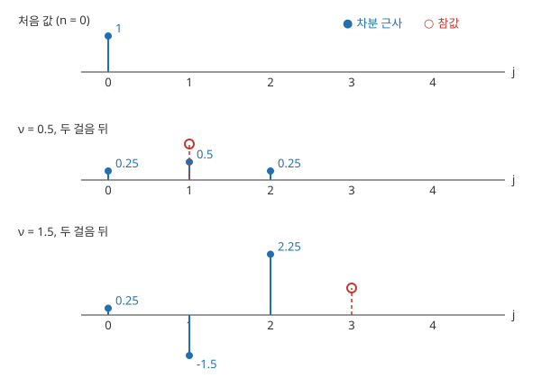

# CFL 조건

# 개요

**CFL 조건(Courant–Friedrichs–Lewy condition)** 은 움직이는 파동을 격자 위에서 한 걸음씩 계산할 때, 한 걸음 동안 파동이 격자 한 칸보다 멀리 가면 안 된다는 조건이다. 강물에 실린 오염 물질의 농도를 $0.1$ km 간격의 지점에서 계산하는데 시간 간격을 크게 잡으면, 몇 걸음 만에 농도가 음수가 되고 크기가 걸음마다 불어난다. CFL 조건은 물살의 속도, 시간 간격, 격자 간격 사이의 부등식 하나로 이런 일이 생기는 시간 간격을 가려낸다.

# 직관

물살의 속도가 $1$ 인 강에서 농도 $u(x,t)$ 는 모양을 유지한 채 아래쪽으로 실려 간다. 이것을 수송 방정식 $u\_t+u\_x=0$ 이 적고, 해는 $u(x,t)=u(x-t,0)$ 이다.

격자 간격을 $h$, 시간 간격을 $k$ 로 두고 $\nu=k/h$ 라 한다. 지점 $j$ 의 다음 값은 지금 값과 위쪽 이웃 $j-1$ 의 값으로 만든다.

$$
u^{n+1}\_j=(1-\nu)u^n\_j+\nu\thinspace u^n\_{j-1}
$$

처음에 지점 $0$ 에만 농도 $1$ 이 있다고 하자. 아래 그림의 위쪽이 이 처음 값이고, 가운데와 아래쪽이 두 걸음 뒤의 계산값과 참값이다.

$\nu=0.5$ 이면 두 걸음 뒤 값이 $0.25,0.5,0.25$ 다. 참값은 한 칸 아래의 지점 $1$ 에 있고, 계산값은 그 둘레로 퍼졌지만 $0$ 과 $1$ 사이에 머문다. $\nu=1.5$ 이면 계수 $1-\nu=-0.5$ 가 음수라 두 걸음 뒤 값이 $0.25,-1.5,2.25$ 다. 농도가 음수가 되고 크기가 걸음마다 $1.5$ 배씩 커진다.

$\nu=1.5$ 에서 참값은 두 걸음 동안 세 칸을 가서 지점 $3$ 에 있다. 계산값 $u^2\_j$ 는 지점 $j-2,j-1,j$ 의 처음 값만 쓰므로, 지점 $3$ 의 계산값은 지점 $0$ 의 농도를 보지 못한다. 한 걸음에 물살이 가는 거리 $k$ 가 격자 간격 $h$ 이하, 곧 $\nu\le 1$ 이어야 계산이 참값이 의존하는 처음 값을 볼 수 있다.

# 정의

## 의존 영역

선형 쌍곡형 방정식의 해 $u(x,t)$ 가 처음 값 $u(\cdot,0)$ 의 어느 점들의 값에 의존하는지 모은 집합을 점 $(x,t)$ 의 **의존 영역(domain of dependence)** 이라 한다. 수송 방정식 $u\_t+au\_x=0$ 에서 그것은 한 점 $x-at$ 이고, [파동방정식](wave-equation.md) $u\_{tt}=c^2u\_{xx}$ 에서는 구간 $\lbrack x-ct,x+ct\rbrack$ 이다.

명시적 차분 방법에서 $u^n\_j$ 의 계산에 쓰이는 처음 격자점들을 **수치 의존 영역(numerical domain of dependence)** 이라 한다. 직관 절의 방법에서 $u^n\_j$ 의 수치 의존 영역은 지점 $j-n,\dots,j$ 이고, 구간으로는 $\lbrack x\_j-nh,x\_j\rbrack$ 다.

## CFL 조건

격자를 $h,k\to 0$ 으로 줄일 때 각 점의 의존 영역이 수치 의존 영역의 극한에 포함된다는 조건을 **CFL 조건** 이라 한다.[^1] 직관 절에서 $t=nk$ 이면 의존 영역 $x\_j-at$ 가 $\lbrack x\_j-nh,x\_j\rbrack$ 에 들어가야 하므로, 조건은 다음과 같다.

$$
0\le\nu=\frac{ak}{h}\le 1
$$

$\nu$ 를 **Courant 수(Courant number)** 라 한다.

# 성질

## 수렴의 필요조건

CFL 조건을 어기는 명시적 차분 방법은 수렴하지 않는다.[^1] 의존 영역의 한 점이 수치 의존 영역 밖에 있으면, 그 점 둘레에서만 처음 값을 바꾸어도 참값은 바뀌고 계산값은 바뀌지 않는다. [Lax 동치 정리](lax-equivalence-theorem.md)에 따라 일관된 방법이 수렴하지 않으면 안정하지도 않다.

직관 절의 방법은 처음 값의 절댓값 합을 걸음마다 $\vert 1-\nu\vert+\nu$ 배 한다. $0\le\nu\le 1$ 이면 이 값이 $1$ 이라 안정하고, $\nu\gt 1$ 이면 $2\nu-1\gt 1$ 이라 $\nu=1.5$ 에서 두 걸음 뒤 합이 $0.25+1.5+2.25=4=2^2$ 다.

## 충분조건이 아님

CFL 조건이 성립해도 불안정할 수 있다. 수송 방정식의 $u\_x$ 를 가운데 차분 $(u^n\_{j+1}-u^n\_{j-1})/(2h)$ 로 바꾼 방법은 수치 의존 영역이 $\lbrack x\_j-nh,x\_j+nh\rbrack$ 라 $\nu\le 1$ 이면 CFL 조건을 만족한다. 그러나 증폭 인자가 $g(\theta)=1-i\nu\sin\theta$ 이고 $\vert g(\theta)\vert^2=1+\nu^2\sin^2\theta\gt 1$ 이라, von Neumann 조건(von Neumann condition)을 어겨 모든 $\nu\gt 0$ 에서 불안정하다.

반대로 아래쪽 이웃 $j+1$ 을 쓰는 방법은 수치 의존 영역이 $\lbrack x\_j,x\_j+nh\rbrack$ 라 $a\gt 0$ 이면 어느 $\nu$ 에서도 CFL 조건을 어긴다.

## 바람 위쪽 차분의 안정성

직관 절의 방법을 **바람 위쪽 차분(upwind scheme)** 이라 한다. 증폭 인자는 $g(\theta)=1-\nu+\nu e^{-i\theta}$ 이고, $\vert g(\theta)\vert\le 1$ 이 모든 $\theta$ 에서 성립하는 것은 $0\le\nu\le 1$ 일 때다. 이 방법에서는 CFL 조건과 안정성이 같은 부등식이다. 2 차 정확도의 [Lax–Wendroff 방법](lax-wendroff-method.md)도 $\vert\nu\vert\le 1$ 일 때만 안정하다.[^2]

Lax–Wendroff 방법은 계단 모양의 값에 봉우리를 만드는데, [Godunov 정리](godunov-theorem.md)에 따르면 봉우리를 만들지 않는 선형 방법은 1 차 정확도를 넘지 못한다.

## 수치 확산

바람 위쪽 차분의 계산값은 원래 방정식보다 다음 방정식의 해에 더 가깝다.[^2]

$$
u\_t+au\_x=\frac{ah}{2}(1-\nu)\thinspace u\_{xx}
$$

오른쪽 항이 확산이라 계산값이 퍼진다. 직관 절에서 $\nu=0.5$ 이면 $n$ 걸음 뒤 계산값이 이항분포 $\mathrm{B}(n,\frac12)$ 의 확률이고, 칸 단위의 분산 $n/4$ 가 이 확산 계수로 계산한 분산 $2\cdot\frac{h}{2}\cdot\frac12\cdot nk=\frac{n}{4}h^2$ 과 같다. $\nu=1$ 이면 확산이 사라지고 계산값이 참값과 같다.

## 여러 차원과 파동방정식

2 차원 수송 방정식 $u\_t+au\_x+bu\_y=0$($a,b\gt 0$)을 각 방향의 바람 위쪽 차분으로 풀면 조건이 $ak/h\_x+bk/h\_y\le 1$ 이다. 파동방정식을 시간과 공간 모두 가운데 차분으로 풀면 $ck/h\le 1$ 일 때 안정하다.[^1]

# 활용

- 시간 간격의 선택. 기상, 해양, 유체 계산에서 가장 빠른 파동의 속도 $a\_{\max}$ 로 $k\le h/a\_{\max}$ 를 정하고, 안전을 위해 $0.5$ 에서 $0.9$ 사이의 Courant 수를 쓴다.
- 음함수 방법의 선택. [Crank–Nicolson 방법](crank-nicolson-method.md) 같은 음함수 방법은 한 걸음에 모든 격자점을 함께 풀어 수치 의존 영역이 격자 전체이므로 CFL 조건에 묶이지 않는다. 격자가 잘게 나뉜 곳이 있으면 명시적 방법의 시간 간격이 그곳에서 정해지므로 음함수 방법을 쓴다.
- [선의 방법](method-of-lines.md). 공간만 이산화한 연립 [상미분방정식](ordinary-differential-equations.md)을 명시적 방법으로 풀 때, 시간 간격의 한계가 CFL 조건과 같은 꼴로 나온다.
- 보존 법칙의 계산. [Godunov 방법](godunov-method.md)과 유한 부피 방법은 격자 경계의 파동 속도로 Courant 수를 계산해 걸음마다 시간 간격을 다시 정한다.

[^1]: R. Courant, K. Friedrichs, H. Lewy, "Über die partiellen Differenzengleichungen der mathematischen Physik", *Mathematische Annalen* 100 (1928), 32–74.

[^2]: R. J. LeVeque, *Finite Volume Methods for Hyperbolic Problems*, Cambridge University Press (2002), 4 장과 8 장.

# 연관 문서

## 선수지식

- [Lax 동치 정리](lax-equivalence-theorem.md)

## 더 알아보기

- [Lax–Wendroff 방법](lax-wendroff-method.md)
- [Godunov 방법](godunov-method.md)

#functional_analysis #analysis #computation
