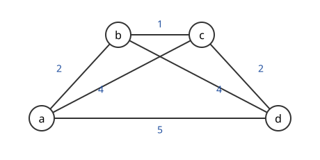
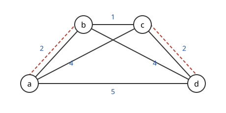

# 중국인 우편배달부 문제

# 개요

**중국인 우편배달부 문제(Chinese postman problem)** 는 그래프의 모든 변을 한 번 이상 지나 출발점으로 돌아오는 걸음 가운데 가장 짧은 것을 찾는 문제다. 우편배달부가 동네의 모든 길을 걸어 우체국으로 돌아와야 하는데 어느 길은 두 번 걸을 수밖에 없을 때, 어느 길을 두 번 걸어야 전체 거리가 가장 짧은지가 이 꼴이다. 교차로 가운데 붙은 길 수가 홀수인 것들을 둘씩 짝짓고 쌍마다 가장 짧은 길을 한 번 더 걸으면 되고, 짝짓는 방법은 가중치 합이 최소인 [매칭](matchings.md)으로 정한다.

# 직관

아래 그림은 교차로 $a,b,c,d$ 와 길 여섯 개로 된 동네이고, 길 위의 수가 길이(km)다.

길이를 모두 더하면 다음과 같다.

$$
2+1+2+5+4+4=18
$$

모든 길을 정확히 한 번씩 걷고 돌아오는 길이 있으면 걷는 거리는 $18$ km 다. 그런 길은 [Euler 회로](eulerian-circuits.md)이고, 모든 교차로에 붙은 길 수가 짝수여야 있다. 그림의 네 교차로에는 모두 길이 셋씩 붙어 있으므로 어느 길은 두 번 걸어야 한다.

두 번 걷는 길을 그래프에 한 벌 더 그린 변으로 놓으면, 배달부가 걷는 길은 변을 더한 그래프의 Euler 회로다. 그러려면 더한 변을 붙인 뒤 모든 교차로의 길 수가 짝수여야 한다. 더한 변만 따라가면 길 수가 홀수인 교차로에서 출발해 다른 홀수 교차로에서 끝나므로, 네 교차로를 두 쌍으로 짝짓고 쌍마다 가장 짧은 길을 한 번 더 걸으면 된다.

가장 가까운 $b$ 와 $c$ 를 먼저 짝지으면 남은 $a$ 와 $d$ 사이의 가장 짧은 길이 $5$ km 라 더 걷는 거리가 $1+5=6$ 이다. $a$ 와 $b$, $c$ 와 $d$ 로 짝지으면 $2+2=4$ 이고, $a$ 와 $c$, $b$ 와 $d$ 로 짝지으면 $3+3=6$ 이다. 가장 짧은 것은 아래 그림처럼 길 $ab$ 와 $cd$ 를 두 번 걷는 것이고 전체 거리는 $18+4=22$ km 다.

점선을 더한 그래프에서는 네 교차로에 길이 넷씩 붙는다. $a$ 에서 출발해 $a,b,a,c,b,d,c,d,a$ 로 걸으면 여덟 변을 한 번씩 지나고 길이는 다음과 같다.

$$
2+2+4+1+4+2+2+5=22
$$

# 정의

## 중국인 우편배달부 문제

$G=(V,E)$ 를 연결 그래프, $w:E\to\lbrack 0,\infty)$ 를 변의 길이라 하자. 닫힌 걸음 $W$ 의 길이 $w(W)$ 는 $W$ 가 지나는 변의 길이를 지난 횟수만큼 더한 값이다. **중국인 우편배달부 문제** 는 $G$ 의 모든 변을 적어도 한 번 지나는 닫힌 걸음 가운데 길이가 최소인 것을 찾는 문제다. 직관 절의 동네에서 최솟값은 $22$ 다.

두 정점 $s,t$ 사이 [최단경로](shortest-paths.md)의 길이를 $d(s,t)$ 로 쓴다. 직관 절에서 $d(a,d)=5$ 이고, $d(a,c)=3$ 은 길 $ac$ 가 아니라 $a,b,c$ 로 간다.

## T-join

$T\subseteq V$ 라 하자. 변의 다중집합 $F$ 가 **T-join** 이라는 것은 $F$ 의 변만 남긴 그래프에서 차수가 홀수인 정점의 집합이 정확히 $T$ 라는 것이다. $G$ 에서 차수가 홀수인 정점의 집합을 $T\_G$ 로 쓴다.

직관 절에서 $T\_G=\lbrace a,b,c,d\rbrace$ 이고, $\lbrace ab,cd\rbrace$ 는 네 정점에 변이 하나씩 붙으므로 $T\_G$-join 이다. $\lbrace bc,ad\rbrace$ 도 $T\_G$-join 이고 길이는 $6$ 이다.

# 성질

## 홀수 차수 정점의 수

모든 정점의 차수를 더하면 변마다 $2$ 씩 세므로 $2\lvert E\rvert$ 이다. 여기서 짝수 차수들을 빼도 짝수이므로 홀수 차수의 개수 $\lvert T\_G\rvert$ 는 짝수다. 그래서 $T\_G$ 의 정점은 빠짐없이 둘씩 짝지을 수 있다.

## 최솟값 공식

$T\_G$ 를 정점으로 하고 두 정점 $s,t$ 사이 변의 가중치를 $d(s,t)$ 로 둔 완전그래프를 생각한다. 이 그래프의 완전 매칭 $M$ 에 대해 다음이 성립한다.

$$
\min_W w(W)=w(E)+\min_M\sum_{\lbrace s,t\rbrace\in M}d(s,t)
$$

J. Edmonds 와 E. L. Johnson 이 1973 년에 이 환원을 증명했다[^1]. 직관 절에서 오른쪽은 $18+\min(6,4,6)=22$ 다.

증명의 요지. 최적 걸음 $W$ 가 두 번째 이후로 지나는 변들을 다중집합 $F$ 로 모으면 $E$ 에 $F$ 를 더한 그래프에 Euler 회로가 있으므로 모든 차수가 짝수이고, $F$ 는 $T\_G$-join 이다. $T\_G$-join 은 $T\_G$ 의 정점을 둘씩 잇는 경로 $\lvert T\_G\rvert/2$ 개와 순환 몇 개로 나뉘므로 $w(F)$ 는 어떤 완전 매칭의 $d$ 합 이상이다.

거꾸로, 최소 매칭의 쌍마다 최단경로의 변을 한 벌씩 더하면 모든 차수가 짝수이고 그래프는 연결이므로 Euler 정리에 따라 Euler 회로가 있다. 그 길이가 오른쪽 값이다.

## 두 번을 넘지 않는 반복

어떤 최적 걸음은 모든 변을 많아야 두 번 지난다. $F$ 에 같은 변이 두 벌 이상 있으면 두 벌을 빼도 모든 차수의 홀짝이 그대로이고 원래 변이 남아 연결도 그대로이며, 길이는 늘지 않는다. 따라서 최소 $T\_G$-join 은 변의 다중집합이 아니라 변의 집합으로 찾아도 된다.

## 다항 시간 알고리즘

최솟값 공식이 다음 세 단계를 준다.

1. $T\_G$ 의 정점 쌍마다 최단경로를 구한다. Dijkstra 알고리즘을 $\lvert T\_G\rvert$ 번 돌린다.
2. 가중치 $d$ 로 최소 가중치 완전 매칭을 구한다. Edmonds 의 꽃 알고리즘(blossom algorithm)의 가중치 판본이 $O(\lvert V\rvert^3)$ 시간에 푼다.
3. 매칭의 쌍마다 최단경로의 변을 한 벌씩 더하고 Euler 정리의 Hierholzer 알고리즘으로 회로를 만든다.

직관 절에서 1 단계는 $d(b,c)=1$, $d(a,b)=d(c,d)=2$, $d(a,c)=d(b,d)=3$, $d(a,d)=5$ 를 주고, 2 단계는 $\lbrace ab,cd\rbrace$ 를, 3 단계는 길이 $22$ 인 회로를 준다. 가장 가까운 쌍부터 짝짓는 탐욕 규칙은 $\lbrace bc,ad\rbrace$ 를 골라 $24$ 를 내므로 2 단계를 대신하지 못한다.

## 유향 판본

일방통행 길만 있는 강하게 연결된 유향 그래프에서는 Euler 회로의 조건이 정점마다 들어오는 변과 나가는 변의 수가 같은 것이다. 들어오는 변이 $k$ 개 많은 정점은 더한 변으로 $k$ 번 더 나가야 하고, 나가는 변이 $k$ 개 많은 정점은 $k$ 번 더 들어와야 한다.

그래서 들어오는 변이 많은 정점을 공급지, 나가는 변이 많은 정점을 수요지, 그 차를 공급량과 수요량, 유향 최단경로의 길이를 운송비로 둔 [수송 문제](transportation-problem.md)가 더할 변을 정한다. 이것은 [최소 비용 흐름](min-cost-flow.md) 문제이므로 다항 시간에 풀린다[^1].

## 어려운 변형

- 무향 변과 유향 변이 섞인 그래프에서는 판정 문제가 [NP(nondeterministic polynomial time)-완전](np-completeness.md)이다[^2].
- 모든 변이 아니라 정해진 변들만 지나면 되는 시골 우편배달부 문제(rural postman problem)는 NP-어렵다(NP-hard)[^3].

# 활용

- 거리를 따라 하는 작업의 경로 계획. 우편 배달, 제설, 거리 청소, 쓰레기 수거처럼 모든 길을 지나야 하는 일의 경로가 이 문제와 유향 판본, 시골 우편배달부 문제로 세워진다. 관메이구(Mei-Ko Kwan, 管梅谷)가 1962 년에 우편 배달 경로로 이 문제를 처음 제기했다[^4].
- 유한 상태 기계의 시험. [유한 오토마타](finite-automata.md)의 상태를 정점, 전이를 유향 변으로 두면 모든 전이를 한 번 이상 실행하는 가장 짧은 입력열이 유향 판본의 해다.
- 평면 그래프의 최대 절단. 평면 그래프의 최대 절단(maximum cut)은 쌍대 그래프의 최소 T-join 으로 바뀌고, 최솟값 공식의 매칭 계산으로 다항 시간에 풀린다[^5].

[^1]: J. Edmonds, E. L. Johnson, "Matching, Euler tours and the Chinese postman", Mathematical Programming 5 (1973), 88–124.
[^2]: C. H. Papadimitriou, "On the complexity of edge traversing", Journal of the ACM 23 (1976), 544–554.
[^3]: J. K. Lenstra, A. H. G. Rinnooy Kan, "On general routing problems", Networks 6 (1976), 273–280.
[^4]: Mei-Ko Kwan, "Graphic programming using odd or even points", Chinese Mathematics 1 (1962), 273–277.
[^5]: F. Hadlock, "Finding a maximum cut of a planar graph in polynomial time", SIAM Journal on Computing 4 (1975), 221–225.

# 연관 문서

## 선수지식

- [Euler 회로](eulerian-circuits.md)
- [매칭](matchings.md)
- [최단경로](shortest-paths.md)

## 더 알아보기

아직 연결한 문서가 없다.

#graph_theory #combinatorics #algorithms #optimization
