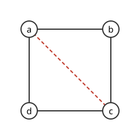

# 현 그래프

# 개요

**현 그래프(chordal graph)** 는 길이가 $4$ 이상인 모든 순환에 그 순환의 이웃하지 않은 두 정점을 잇는 간선이 있는 그래프다. 희소한 대칭 연립방정식을 [Gauss 소거법](gaussian-elimination.md)으로 풀 때, 0 이던 계수가 하나도 0 아닌 값으로 바뀌지 않는 소거 순서가 있는지가 문제가 된다. 그런 순서가 있는 것이 정확히 그 연립방정식의 그래프가 현 그래프인 경우이고, 그 순서는 선형 시간에 찾아진다.

# 직관

미지수 $a,b,c,d$ 가 $a\text{–}b$, $b\text{–}c$, $c\text{–}d$, $d\text{–}a$ 의 짝으로만 한 식에 함께 들어간 연립방정식을 푼다. 그래프로는 아래 그림의 검은 실선인 길이 $4$ 의 순환이다.

[중첩 분할](nested-dissection.md)의 소거 그래프로 보면, 어느 정점을 먼저 소거해도 그 정점의 두 이웃이 이어져 채움 간선이 하나 생긴다. $b$ 를 먼저 소거하면 $a$ 와 $c$ 가 이어진다(빨간 점선). 순환의 마주 보는 정점을 잇는 간선이 없으면 채움을 피할 수 없다.

빨간 점선 $a\text{–}c$ 가 처음부터 있는 그래프에서는 $b,d,a,c$ 순서로 소거하면 채움이 생기지 않는다. $b$ 의 이웃 $a,c$ 는 이미 이어져 있고, $b$ 를 지운 뒤 $d$ 의 이웃 $a,c$ 도 이어져 있다. 남은 $a,c$ 는 간선 하나다.

# 정의

그래프의 순환에서 순환 위의 이웃하지 않은 두 정점을 잇는 간선을 그 순환의 **현(chord)** 이라 한다. 길이 $4$ 이상의 모든 순환이 현을 가지는 그래프를 **현 그래프** 라 한다. 직관 절의 사각형은 현 그래프가 아니고, 점선 $a\text{–}c$ 를 더한 그래프는 현 그래프다.

정점 $v$ 의 이웃들이 서로 모두 이어져 있으면 $v$ 를 **단체 정점(simplicial vertex)** 이라 한다. 정점의 순서 $v\_1,\dots,v\_n$ 에서 각 $v\_i$ 가 $v\_i,\dots,v\_n$ 이 유도하는 부분그래프의 단체 정점이면 이 순서를 **완벽 소거 순서(perfect elimination ordering)** 라 한다. 점선을 더한 그래프에서 $b,d,a,c$ 가 완벽 소거 순서다.

# 성질

## 완벽 소거 순서와 채움

완벽 소거 순서는 채움이 생기지 않는 소거 순서와 같다. 단체 정점을 소거할 때 이을 이웃끼리는 이미 이어져 있어 새 간선이 생기지 않는다. 대각 성분이 양수인 대칭 행렬 $A$ 에서 Gauss 소거가 채움 없이 되는 순서가 있는 것은 $A$ 의 그래프가 현 그래프인 것과 동치다[^1].

## Dirac 정리와 특징

정리(Dirac). 현 그래프에서 두 정점을 가르는 극소 분리자는 클릭(clique), 곧 서로 모두 이어진 정점 집합이다. 완전그래프가 아닌 현 그래프는 서로 이웃하지 않은 단체 정점을 둘 이상 가진다[^2].

정리(Fulkerson–Gross). 그래프가 현 그래프인 것은 완벽 소거 순서를 가지는 것과 동치다[^3].

증명의 요지. 현 그래프의 유도 부분그래프도 현 그래프이므로 Dirac 정리로 단체 정점을 하나씩 떼어 내면 완벽 소거 순서가 된다. 거꾸로 완벽 소거 순서가 있을 때 길이 $4$ 이상의 순환에서 순서가 가장 앞인 정점을 보면, 그 정점의 순환 위 두 이웃은 뒤에 오므로 서로 이어져 있고 그 간선이 현이다.

## 선형 시간 인식

[그래프 탐색](graph-search.md)의 너비 우선 탐색에서 같은 층 안의 순서를 이미 방문한 이웃의 목록으로 사전식으로 정하는 사전식 너비 우선 탐색(lexicographic breadth-first search)이나, 이미 방문한 이웃이 가장 많은 정점을 다음으로 고르는 최대 기수 탐색(maximum cardinality search)은 방문 순서의 역순으로 완벽 소거 순서를 준다. 그래프가 현 그래프이면 그렇고, 그 역순이 완벽 소거 순서인지 확인하는 것까지 $O(\lvert V\rvert+\lvert E\rvert)$ 시간이다[^4].

## 클릭과 채색

완벽 소거 순서에서 각 $v\_i$ 와 그 뒤의 이웃들은 클릭이고, 모든 극대 클릭이 이런 꼴이므로 극대 클릭은 $n$ 개 이하다. 역순으로 탐욕적으로 [그래프 색칠](graph-coloring.md)을 하면 가장 큰 클릭의 크기만큼의 색으로 칠해진다. 유도 부분그래프도 현 그래프이므로 현 그래프는 [완벽그래프](perfect-graphs.md)다.

## 채움과 나무폭

어떤 소거 순서로 생긴 채움 간선을 원래 그래프에 더하면 현 그래프가 되고, 그 순서는 이 그래프의 완벽 소거 순서다. 그래서 채움을 가장 적게 하는 순서를 찾는 것은 간선을 가장 적게 더해 현 그래프로 만드는 것과 같다. 그래프 $G$ 의 [나무폭](treewidth.md)은 $G$ 를 포함하는 현 그래프들의 가장 큰 클릭 크기에서 $1$ 을 뺀 값의 최솟값이다.

## 나무의 부분나무 표현

그래프가 현 그래프인 것은 어떤 나무의 부분나무들을 정점으로 하고 공통 정점이 있는 두 부분나무를 간선으로 잇는 교차 그래프(intersection graph)인 것과 동치다[^5]. 나무를 경로로 바꾸면 수직선의 구간들의 교차 그래프인 [구간 그래프](interval-graphs.md)가 되고, 구간 그래프는 현 그래프다.

# 활용

- 희소 Cholesky 분해. 소거 순서로 생기는 채움을 더한 현 그래프의 클릭 구조로 계산을 조직하는 다전선(multifrontal) 방법이 이 구조를 쓴다.
- 그래프 모형의 추론. 확률 그래프 모형을 현 그래프로 바꾸면 극대 클릭들이 나무를 이루는 [접합 나무](junction-trees.md)가 생기고, 그 위에서 주변 확률을 정확히 계산한다.
- 반정부호 행렬 완성. 일부 성분만 주어진 대칭 행렬을 양의 반정부호로 채울 수 있는지가, 주어진 성분의 그래프가 현 그래프이면 클릭마다의 조건으로 정해진다.
- 레지스터 할당. 정적 단일 배정 꼴 프로그램의 간섭 그래프가 현 그래프여서 최소 색 수의 채색이 다항 시간에 구해진다.

[^1]: D. J. Rose, "Triangulated graphs and the elimination process", *Journal of Mathematical Analysis and Applications* **32** (1970), 597–609.
[^2]: G. A. Dirac, "On rigid circuit graphs", *Abhandlungen aus dem Mathematischen Seminar der Universität Hamburg* **25** (1961), 71–76.
[^3]: D. R. Fulkerson, O. A. Gross, "Incidence matrices and interval graphs", *Pacific Journal of Mathematics* **15** (1965), 835–855.
[^4]: R. E. Tarjan, M. Yannakakis, "Simple linear-time algorithms to test chordality of graphs, test acyclicity of hypergraphs, and selectively reduce acyclic hypergraphs", *SIAM Journal on Computing* **13** (1984), 566–579.
[^5]: F. Gavril, "The intersection graphs of subtrees in trees are exactly the chordal graphs", *Journal of Combinatorial Theory, Series B* **16** (1974), 47–56.

# 연관 문서

## 선수지식

- [중첩 분할](nested-dissection.md)

## 더 알아보기

- [구간 그래프](interval-graphs.md)
- [접합 나무](junction-trees.md)
- [소거 나무](elimination-trees.md)

#graph_theory #linear_algebra #algorithms #combinatorics
