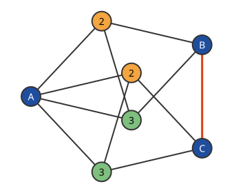

# 평면의 채색수

# 개요

**평면의 채색수(chromatic number of the plane)** 는 평면의 점에 색을 칠할 때 거리가 정확히 $1$ 인 두 점이 늘 다른 색을 받게 하는 데 필요한 색의 최소 개수 $\chi(\mathbb R^2)$ 다. 한 변이 $1$ 인 정삼각형의 세 꼭짓점은 서로 거리가 $1$ 이어서 두 색으로는 모자라지만, 색이 몇 개면 충분한지는 점 몇 개만 그려서는 정해지지 않는다. 거리가 $1$ 인 점끼리 이은 유한한 그림 하나가 적은 색으로 칠해지지 않음을 보이면 하한이 나오고, 평면을 같은 색 조각들로 덮는 무늬를 만들면 상한이 나온다.

# 직관

한 변이 $1$ 인 정삼각형의 세 꼭짓점은 서로 거리가 $1$ 이므로 세 색이 필요하다. 그래서 $\chi(\mathbb R^2)\ge 3$ 이다. 세 색으로 되는지 보려고, 변을 공유하는 정삼각형 두 개로 된 마름모를 놓는다. 공유한 변의 두 끝점이 두 색을 쓰면 나머지 두 꼭짓점은 둘 다 셋째 색이어야 하므로, 마름모의 양 끝 꼭짓점은 같은 색이다.

꼭짓점 $A$ 를 공유하는 마름모 두 개를 $A$ 를 중심으로 돌려, 다른 쪽 끝 $B$ 와 $C$ 의 거리가 $1$ 이 되게 놓는다. 세 색으로 칠하면 $B$ 와 $C$ 가 둘 다 $A$ 의 색이어야 하는데 둘의 거리가 $1$ 이라 모순이다. 따라서 $\chi(\mathbb R^2)\ge 4$ 이다. 이 정점 $7$ 개, 간선 $11$ 개의 그래프를 **Moser 방추(Moser spindle)** 라 한다.

그림은 세 색 $1,2,3$ 으로 칠하려 한 결과다. 두 마름모의 가운데 꼭짓점이 색 $2$ 와 $3$ 을 쓰면 $B$ 와 $C$ 가 둘 다 $A$ 와 같은 색을 받고, 빨간 간선 $BC$ 의 두 끝이 같은 색이 된다.

# 정의

$\mathbb R^n$ 의 **단위 거리 그래프(unit distance graph)** 는 점 전체를 정점으로 하고 거리가 $1$ 인 두 점을 잇는 그래프다. [그래프 색칠](graph-coloring.md)에서 정한 그 채색수를 $\chi(\mathbb R^n)$ 으로 쓰고, $\chi(\mathbb R^2)$ 를 정하는 문제를 Hadwiger–Nelson 문제(Hadwiger–Nelson problem)라 한다. [de Bruijn–Erdős 정리](de-bruijn-erdos-theorem.md)와 [선택 공리](axiom-of-choice.md)로 $\chi(\mathbb R^n)$ 은 유한 부분그래프의 채색수의 최댓값과 같다. 각 색의 점 집합이 Lebesgue 가측이어야 한다는 조건을 붙인 채색수를 가측 채색수 $\chi\_m(\mathbb R^n)$ 이라 한다.

# 성질

## 상한 7

정리. $\chi(\mathbb R^2)\le 7$ 이다.

증명의 요지. 평면을 한 변의 길이가 $0.4$ 인 정육각형으로 덮고, 한 육각형과 그 이웃 여섯에 서로 다른 색을 주는 무늬를 평행이동으로 되풀이한다. 한 육각형의 지름은 $0.8\lt 1$ 이다. 같은 색 육각형의 중심 사이 거리는 $\sqrt{21}\cdot 0.4\approx 1.83$ 이므로, 같은 색의 두 육각형에 속한 점 사이 거리는 $1.83-0.8\gt 1$ 이다. 경계의 점은 맞닿은 육각형 하나의 색을 받는다.

## 하한 5

정리(de Grey). 정점 $1581$ 개의 단위 거리 그래프 가운데 네 색으로 칠할 수 없는 것이 존재한다. 따라서 $\chi(\mathbb R^2)\ge 5$ 다[^1].

증명의 요지. Moser 방추를 여러 겹 회전하고 평행이동해 붙인 그래프를 만들고, 그 그래프에 네 색 칠하기가 없다는 것을 컴퓨터로 충족 가능성을 판정해 확인한다.

## 가측 채색수

K. J. Falconer 는 색마다의 점 집합이 가측이면 $5$ 색이 필요함을 보였다. 곧 $\chi\_m(\mathbb R^2)\ge 5$ 다[^2]. 이 결과는 de Grey 의 하한보다 먼저 나왔고, 증명은 측도의 밀도 논법이다.

## 높은 차원

$n$ 이 커질 때 $\chi(\mathbb R^n)$ 은 지수적으로 자란다.

$$
(1.2+o(1))^n\le\chi(\mathbb R^n)\le(3+o(1))^n
$$

하한은 [Frankl–Wilson 정리](frankl-wilson-theorem.md)로 얻고, 상한은 D. G. Larman 과 C. A. Rogers 가 격자 덮기로 얻었다[^3].

# 활용

- 유한 그래프의 채색수 하한. 평면의 채색수는 평면에 그린 유한 단위 거리 그래프의 채색수로 결정되므로, de Grey 의 하한은 특정한 유한 그래프 하나의 채색수 계산이다. 이후 정점 수를 줄인 그래프들이 컴퓨터 탐색으로 찾아졌다.
- 이산기하의 거리 문제. 평면의 점 $n$ 개가 이루는 유한 단위 거리 그래프의 간선 수는 $O(n^{4/3})$ 이하이고, 이 상한은 [Szemerédi–Trotter 정리](szemeredi-trotter.md)의 곡선 판본에서 나온다.

[^1]: A. D. N. J. de Grey, "The chromatic number of the plane is at least 5", Geombinatorics 28 (2018), 18–31.
[^2]: K. J. Falconer, "The realization of distances in measurable subsets covering Rⁿ", Journal of Combinatorial Theory, Series A 31 (1981), 184–189.
[^3]: D. G. Larman, C. A. Rogers, "The realization of distances within sets in Euclidean space", Mathematika 19 (1972), 1–24.

# 연관 문서

## 선수지식

- [그래프 색칠](graph-coloring.md)
- [de Bruijn–Erdős 정리](de-bruijn-erdos-theorem.md)

## 더 알아보기

아직 연결한 문서가 없다.

#graph_theory #combinatorics
