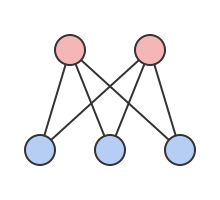

# Chvátal–Erdős 정리

# 개요

**Chvátal–Erdős 정리(Chvátal–Erdős theorem)** 는 정점이 $3$ 개 이상인 그래프에서 연결도가 독립수 이상이면 [Hamilton 순환](hamiltonian-cycles.md)이 있다는 정리다. 모든 정점을 한 번씩 도는 순환을 직접 찾기 어려울 때, 정점을 몇 개 지워야 그래프가 끊기는지와 서로 이웃하지 않는 정점을 몇 개까지 고를 수 있는지 두 수만 견주어 순환이 있음을 보장한다. 앞의 수가 뒤의 수 이상이면 순환이 있고, 증명은 가장 긴 순환을 잡아 그보다 긴 순환을 만든다.

# 직관

크기가 $k$ 와 $k+1$ 인 두 쪽을 갖는 완전이분그래프 $K_{k,k+1}$ 에는 Hamilton 순환이 없다. 순환은 두 쪽을 번갈아 지나므로 두 쪽의 정점 수가 같아야 한다. 이 그래프에서 작은 쪽의 정점 $k$ 개를 지우면 큰 쪽의 정점 $k+1$ 개가 서로 떨어진 조각으로 남는다. 그런데 Hamilton 순환에서 정점 $k$ 개를 지우면 순환이 많아야 $k$ 조각으로 끊긴다. 적은 정점을 지워 많은 조각이 생기는 것이 Hamilton 순환을 막았다.

그림은 $k=2$ 인 경우다. 빨간 두 정점을 지우면 파란 세 정점이 서로 떨어진 조각으로 남는다.

조각으로 남은 정점들은 서로 인접하지 않는다. 그래서 "지워야 끊기는 정점의 수" 와 "서로 인접하지 않게 고를 수 있는 정점의 수" 를 견준다. $K_{k,k+1}$ 에서는 앞의 수가 $k$, 뒤의 수가 $k+1$ 이라 뒤가 크다. 앞의 수가 뒤의 수 이상이면 Hamilton 순환이 있다는 것이 이 정리다.

증명은 가장 긴 순환 $C$ 를 잡고 $C$ 밖에 정점 $v$ 가 있다고 하는 데서 시작한다. $v$ 에서 $C$ 로 가는, $v$ 말고는 겹치지 않는 경로를 지워야 끊기는 정점 수만큼 고르고, 각 경로가 $C$ 에 닿는 점의 다음 점들을 모은다. 그 점들끼리나 $v$ 와 인접하면 순환을 늘릴 수 있으므로 $v$ 와 그 점들은 서로 인접하지 않고, 그 개수가 독립수보다 하나 많아 모순이 된다.

# 정의

그래프 $G$ 에서 서로 인접하지 않은 정점들의 집합을 독립집합이라 하고, 가장 큰 독립집합의 크기를 **독립수(independence number)** $\alpha(G)$ 라 한다.

정점이 $k+1$ 개 이상이고, 정점을 $k$ 개 미만으로 지우면 언제나 연결 그래프가 남는 $G$ 를 **$k$ 연결(k-connected)** 이라 한다. $G$ 가 $k$ 연결인 가장 큰 $k$ 를 **연결도(connectivity)** $\kappa(G)$ 라 한다. 완전그래프 $K_n$ 은 $\kappa=n-1$ 이다.

**Chvátal–Erdős 정리.** $n\ge 3$ 이고 $\kappa(G)\ge\alpha(G)$ 이면 $G$ 는 Hamilton 그래프다.[^1]

# 성질

## 부채 보조정리

[Menger 정리](menger-theorem.md)의 정점 판본에 따르면 $G$ 가 $k$ 연결인 것과 서로 다른 두 정점이 언제나 끝점 말고는 겹치지 않는 경로 $k$ 개로 이어지는 것이 동치다. 여기서 다음이 나온다.

**보조정리(부채 보조정리, fan lemma).** $G$ 가 $k$ 연결이고 $v\notin U$, $\lvert U\rvert\ge k$ 이면 $v$ 에서 $U$ 로 가는 경로 $k$ 개가 존재해, 경로끼리 $v$ 에서만 만나고 끝점이 $U$ 의 서로 다른 정점이며 끝점 말고는 $U$ 를 지나지 않는다.

증명의 요지. $U$ 의 모든 정점과 인접한 새 정점 $w$ 를 더한 그래프도 $k$ 연결이고, 거기서 $v$ 와 $w$ 를 잇는 경로 $k$ 개를 잡아 $w$ 를 지운다.[^2]

## 정리의 증명

$\alpha(G)=1$ 이면 $G$ 가 완전그래프이고 $n\ge 3$ 이므로 Hamilton 순환이 있다. $\alpha(G)\ge 2$ 이면 $\kappa(G)\ge 2$ 이므로 $G$ 에 순환이 있다. $k=\kappa(G)$ 로 두고 가장 긴 순환 $C$ 에 방향을 하나 정한다. 모든 정점의 차수가 $k$ 이상이므로 $C$ 의 길이는 $k+1$ 이상이다.

$C$ 밖에 정점 $v$ 가 있다고 하자. 부채 보조정리로 $v$ 에서 $C$ 의 서로 다른 정점 $u_1,\dots,u_k$ 로 가는 경로 $P_1,\dots,P_k$ 를 잡고, $C$ 위에서 $u_i$ 바로 다음 정점을 $u_i^+$ 로 쓴다.

- $u_i^+$ 가 $v$ 와 인접하면 $C$ 의 간선 $u_iu_i^+$ 대신 $P_i$ 와 간선 $vu_i^+$ 를 지나 더 긴 순환이 생긴다.
- $u_i^+$ 와 $u_j^+$ 가 인접하면 $v$ 에서 $P_i$ 로 $u_i$ 에 가서 $C$ 를 거꾸로 $u_j^+$ 까지 가고, 간선 $u_j^+u_i^+$ 를 지나 $C$ 를 바로 $u_j$ 까지 간 뒤 $P_j$ 로 $v$ 에 돌아오는 더 긴 순환이 생긴다.

그래서 $\lbrace v,u_1^+,\dots,u_k^+\rbrace$ 는 크기 $k+1$ 인 독립집합이고 $\alpha(G)\ge k+1\gt\kappa(G)$ 가 되어 가정에 모순이다. $C$ 가 모든 정점을 지난다.[^1]

## 경계의 예

조건 $\kappa\ge\alpha$ 는 $\kappa\ge\alpha-1$ 로 약하게 할 수 없다. 직관 절의 $K_{k,k+1}$ 은 $\kappa=k$, $\alpha=k+1$ 이고 Hamilton 순환이 없다. Petersen 그래프는 $\kappa=3$, $\alpha=4$ 이고 Hamilton 순환이 없다.

## Hamilton 경로

$\kappa(G)\ge\alpha(G)-1$ 이면 $G$ 에 Hamilton 경로가 있다. 모든 정점과 인접한 새 정점을 더하면 연결도와 독립수가 각각 $1$ 과 $0$ 만큼 늘어 정리의 조건이 성립하고, 얻은 Hamilton 순환에서 새 정점을 지운다.[^1]

# 활용

- **강인성과 Hamilton 순환.** 정점 $S$ 를 지웠을 때 남는 조각 수가 언제나 $\lvert S\rvert/t$ 이하인 그래프를 $t$ 강인(t-tough)이라 한다([그래프 강인성](graph-toughness.md)). Hamilton 그래프는 $1$ 강인이고, 직관 절의 논법이 그 증명이다. $\kappa\ge\alpha$ 인 그래프는 $1$ 강인이다. 충분히 큰 상수 $t$ 에 대해 $t$ 강인이면 Hamilton 그래프인지는 Chvátal 의 강인성 추측(Chvátal's toughness conjecture)이다.[^3]
- **무작위 그래프와 조밀 그래프.** 간선 확률이 충분히 큰 무작위 그래프에서 연결도와 독립수를 각각 추정해 $\kappa\ge\alpha$ 를 확인하면 Hamilton 순환의 존재가 나온다. 차수 조건이 성립하지 않는 그래프에도 적용된다.

[^1]: V. Chvátal, P. Erdős, "A note on Hamiltonian circuits", Discrete Mathematics 2 (1972), 111–113.
[^2]: R. Diestel, *Graph Theory*, 5th ed., Springer, 2017, 3 장 3 절.
[^3]: V. Chvátal, "Tough graphs and Hamiltonian circuits", Discrete Mathematics 5 (1973), 215–228.

# 연관 문서

## 선수지식

- [Hamilton 순환](hamiltonian-cycles.md)
- [Menger 정리](menger-theorem.md)

## 더 알아보기

아직 연결한 문서가 없다.

#graph_theory #combinatorics
