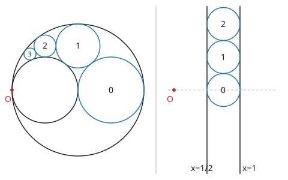

# 원 반전

# 개요

**원 반전(circle inversion)** 은 평면의 점을 한 원의 중심에서 본 같은 방향으로, 중심까지의 거리가 역수가 되는 자리로 옮기는 변환이다. 한 점에서 서로 접하는 두 원 사이의 초승달 모양 틈에 두 원과 접하는 작은 원을 차례로 채워 넣으면, 원들의 크기와 위치를 접선 조건만으로 구하기는 번거롭다. 접점을 중심으로 반전하면 두 원이 평행한 두 직선이 되고 작은 원들은 같은 크기로 쌓인 원이 되므로, 계산을 직선 사이에서 하고 다시 반전해 답을 얻는다.

# 직관

지름이 $\lbrack 0,2\rbrack$ 인 원 $C$ 와 지름이 $\lbrack 0,1\rbrack$ 인 원 $C'$ 은 원점에서 접한다. 둘 사이의 틈에 지름이 $\lbrack 1,2\rbrack$ 인 원 $K_0$ 을 넣고, $C$, $C'$, $K_0$ 에 모두 접하는 원 $K_1$, 다시 $C$, $C'$, $K_1$ 에 접하는 원 $K_2$ 를 위쪽으로 이어 넣는다. $K_1$ 의 중심과 반지름을 구하려면 세 접선 조건에서 나오는 연립 이차방정식을 풀어야 한다.

점 $z$ 를 $1/\bar z$ 로 옮긴다. 방향은 그대로이고 원점까지의 거리만 역수가 된다.

$C$ 위의 점은 $\vert z-1\vert=1$, 곧 $z\bar z=z+\bar z$ 를 만족하고, 양변을 $z\bar z$ 로 나누면 $1/z+1/\bar z=1$ 이다. 그래서 $C$ 는 직선 $x=1/2$ 로 옮겨지고, 같은 계산으로 $C'$ 은 직선 $x=1$ 로 옮겨진다. $K_0$ 은 실수축 위의 $1$ 과 $2$ 를 지나므로 $1$ 과 $1/2$ 을 지름의 양 끝으로 하는 원, 곧 중심 $3/4$, 반지름 $1/4$ 인 원으로 옮겨진다.

옮긴 그림에서는 두 평행선 사이에 반지름 $1/4$ 인 원이 위로 쌓이고, $k$ 번째 원의 중심이 $(3/4,k/2)$ 다. 접하는 두 도형은 옮긴 뒤에도 접하므로 $K_k$ 는 이 원을 다시 옮긴 것이다. $k=1$ 이면 중심 $(3/4,1/2)$ 와 반지름 $1/4$ 에서 $K_1$ 의 중심 $(1,2/3)$ 와 반지름 $1/3$ 이 나오고, $k=2$ 이면 $K_2$ 의 중심 $(1/2,2/3)$ 와 반지름 $1/6$ 이 나온다.

왼쪽 그림의 원 $K_0$, $K_1$, $K_2$ 가 오른쪽 그림에서 같은 번호의 원으로 옮겨진다. 원점 $O$ 는 두 그림에서 같은 자리에 있다.

# 정의

## 원 반전

중심이 $O$ 이고 반지름이 $R$ 인 원 $\Gamma$ 가 있다. $O$ 가 아닌 점 $P$ 에 대해 반직선 $OP$ 위에서 $OP\cdot OP'=R^2$ 을 만족하는 점 $P'$ 을 $P$ 의 $\Gamma$ 에 대한 반전이라 한다. $\Gamma$ 를 **반전원(circle of inversion)**, $O$ 를 **반전 중심(center of inversion)** 이라 한다. 직관 절의 변환은 $O=0$, $R=1$ 인 반전이다.

평면을 복소수로 보면 반전은 다음 사상이다.

$$
z\mapsto c+\frac{R^2}{\overline{z-c}}
$$

여기서 $c$ 는 $O$ 를 나타내는 복소수다. $O$ 는 $\infty$ 로, $\infty$ 는 $O$ 로 보내기로 하면 반전은 [Möbius 변환](mobius-transformations.md) 문서의 Riemann 구면에서 자기 자신으로 가는 전단사다.

## 일반화된 원

원, 또는 직선에 $\infty$ 를 더한 집합을 일반화된 원(generalized circle)이라 한다. 직관 절에서 원 $C$ 는 일반화된 원인 직선 $x=1/2$ 와 $\infty$ 로 옮겨졌다.

# 성질

## 대합

반전을 두 번 하면 제자리다. $\Gamma$ 위의 점은 움직이지 않고, $\Gamma$ 의 안쪽과 바깥쪽이 서로 바뀐다. 직관 절의 반전에서 단위원 바깥의 점 $3/2$ 는 안쪽의 점 $2/3$ 으로 옮겨지고, $2/3$ 은 다시 $3/2$ 로 옮겨진다.

## 일반화된 원의 보존

반전은 일반화된 원을 일반화된 원으로 옮긴다. $O=0$, $R=1$ 이면 반전은 $1/z$ 에 켤레를 합성한 것이고, 둘 다 일반화된 원을 일반화된 원으로 옮긴다. 원점과의 관계로 나누면 다음과 같다.

- 원점을 지나는 직선은 그 자신으로 옮겨진다.
- 원점을 지나지 않는 직선은 원점을 지나는 원으로, 원점을 지나는 원은 원점을 지나지 않는 직선으로 옮겨진다.
- 원점을 지나지 않는 원은 원점을 지나지 않는 원으로 옮겨진다.

마지막 경우에 중심 $c$, 반지름 $r$ 인 원의 상은 중심 $c'$, 반지름 $r'$ 인 원이고, 두 값은 다음과 같다.

$$
c'=\frac{c}{\vert c\vert^2-r^2},\qquad r'=\frac{r}{\bigl\vert\vert c\vert^2-r^2\bigr\vert}
$$

직관 절의 $K_0$ 은 $c=3/2$, $r=1/2$ 이고 $\vert c\vert^2-r^2=2$ 이므로 상은 중심 $3/4$, 반지름 $1/4$ 인 원이다. 상의 중심은 원래 원의 중심의 반전이 아니다.

## 거리

$O$ 가 아닌 두 점 $P$, $Q$ 의 반전 $P'$, $Q'$ 사이의 거리는 다음과 같다.

$$
P'Q'=\frac{R^2\cdot PQ}{OP\cdot OQ}
$$

$O=0$, $R=1$ 이면 $\vert 1/\bar z-1/\bar w\vert=\vert w-z\vert/(\vert z\vert\thinspace\vert w\vert)$ 에서 나온다.

## 각

반전은 두 곡선이 만나는 각의 크기를 보존하고 방향을 뒤집는다. $1/z$ 는 $0$ 이 아닌 점에서 정칙이고 도함수가 $0$ 이 아니므로 각을 방향까지 보존하고, 켤레는 크기를 두고 방향만 뒤집는다. 접하는 두 곡선은 각이 $0$ 이므로 반전한 뒤에도 접한다.

## 반전원과 직교하는 원

반전원 $\Gamma$ 와 직각으로 만나는 원은 반전으로 그 자신에게 옮겨진다. 중심이 $c$ 이고 반지름이 $r$ 인 원이 단위원과 직교하는 것은 $\vert c\vert^2=1+r^2$ 인 것과 동치이고, 이때 위의 공식에서 상의 중심은 $c$, 반지름은 $r$ 이다.

## 반전의 합성

같은 중심 $O$ 와 반지름 $R\_1$, $R\_2$ 인 두 반전을 차례로 하면 $O$ 를 중심으로 하는 $R\_2^2/R\_1^2$ 배 확대다. 두 반전의 합성은 켤레가 두 번 들어가므로 Möbius 변환이고, 모든 Möbius 변환은 반전과 직선에 대한 대칭을 짝수 번 합성한 것이다.

# 활용

- [Ptolemy 부등식](ptolemy-inequality.md)의 증명. 네 점 가운데 하나를 반전 중심으로 두고 나머지 세 점의 상에 삼각부등식을 쓰면, 거리 공식으로 Ptolemy 부등식이 된다. 등호는 세 상이 한 직선 위에 있을 때, 곧 네 점이 한 원 위에 있을 때다.
- Pappus 사슬(Pappus chain). 직관 절의 원 $K_k$ 의 중심에서 실수축까지의 높이는 $K_k$ 의 지름의 $k$ 배다. $K_1$ 은 높이 $2/3$, 지름 $2/3$ 이고 $K_2$ 는 높이 $2/3$, 지름 $1/3$ 이다. 원점을 중심으로 하고 $K_k$ 와 직교하는 원으로 반전하면 $K_k$ 는 그대로 있고 $C$, $C'$ 은 간격이 $K_k$ 의 지름인 두 평행선이 되므로, $K_k$ 는 실수축 위의 원부터 쌓인 $k+1$ 번째 원이 된다.
- [Steiner 폐형 정리](steiner-porism.md). 한 원이 다른 원 안에 있으면 반전으로 두 원을 중심이 같은 두 원으로 옮길 수 있다. 그러면 두 원 사이에 서로 접하며 이어 넣은 원들의 사슬이 닫히는지가 첫 원의 위치에 달려 있지 않다.
- [Euler 직선](euler-line.md) 문서의 Feuerbach 정리. 변 $BC$ 의 중점을 중심으로 하고 내접원과 방접원이 $BC$ 에 닿는 두 점을 지나는 원에 대한 반전은 두 원을 각자 그 자신으로 보내고 구점원을 두 원에 접하는 직선으로 보낸다. 반전으로 접하는 관계가 보존되므로 구점원이 두 원에 접한다.
- [쌍곡평면](hyperbolic-plane.md)의 대칭. 원판 모형에서 측지선은 경계원과 직교하는 원호이고, 그 측지선에 대한 대칭이 그 원에 대한 반전이다.
- [Peaucellier–Lipkin 연결 장치](peaucellier-lipkin-linkage.md). 막대를 이어 한 점의 반전을 기계적으로 만들고, 원점을 지나는 원 위를 도는 점의 반전이 직선 위를 움직이는 것을 써서 회전을 직선 운동으로 바꾼다.

# 연관 문서

## 선수지식

- [Möbius 변환](mobius-transformations.md)

## 더 알아보기

- [Steiner 폐형 정리](steiner-porism.md)
- [Descartes 원 정리](descartes-circle-theorem.md)
- [Apollonius 문제](apollonius-problem.md)
- [Peaucellier–Lipkin 연결 장치](peaucellier-lipkin-linkage.md)

#complex_analysis #algebra #differential_geometry
