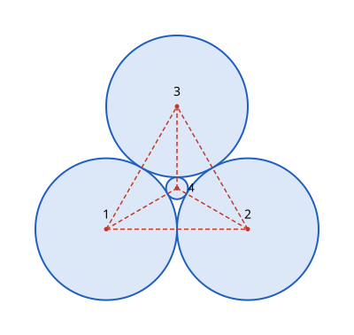

# 원 채움 정리

# 개요

**원 채움 정리(circle packing theorem)** 는 어떤 평면 그래프든, 정점마다 원판 하나를 평면에 놓아 이웃한 정점의 원판끼리만 맞닿게 할 수 있다는 정리다. 동전 네 개를 탁자에 놓아 어느 두 개도 서로 닿게 할 수 있지만, 동전 다섯 개는 그렇게 놓을 수 없다. 원 채움 정리는 동전을 원하는 대로 맞닿게 놓을 수 있는 것이 정확히 맞닿음의 관계가 평면 그래프일 때임을 보이고, 그래프를 원판 배치로 바꾸어 기하 문제로 다룬다.

# 직관

반지름이 $1$ 인 동전 셋을 서로 닿게 놓으면 중심은 한 변이 $2$ 인 정삼각형을 이룬다. 세 동전 사이의 틈에 셋 모두에 닿는 넷째 동전을 넣는다. 대칭이므로 넷째 동전의 중심은 정삼각형의 무게중심이고, 무게중심에서 꼭짓점까지의 거리는 $2/\sqrt3$ 이다. 넷째 동전의 반지름은 그 거리에서 $1$ 을 뺀 값이다.

$$
r=\frac{2}{\sqrt3}-1\approx 0.155
$$

아래 그림에서 맞닿은 두 동전의 중심을 점선으로 이으면 정점 넷의 완전그래프 $K\_4$ 가 된다. 점선은 두 동전의 맞닿은 점을 지나고 두 동전 안에만 있으므로, 서로 다른 점선은 끝점 밖에서 만나지 않는다.

동전 다섯 개를 어느 두 개도 서로 닿게 놓으면 같은 방법으로 $K\_5$ 를 엇갈림 없이 그린 그림이 나온다. $K\_5$ 는 [평면 그래프](planar-graphs.md)가 아니므로 그런 배치는 없다.

# 정의

평면의 닫힌 원판들의 유한 모임에서 어느 두 원판의 내부도 겹치지 않으면 이 모임을 **원 채움(circle packing)** 이라 한다. 원판을 정점으로, 서로 맞닿은 두 원판을 간선으로 둔 그래프를 그 원 채움의 **접촉 그래프(contact graph)** 라 한다. 직관 절의 동전 넷이 원 채움이고 그 접촉 그래프가 $K\_4$ 다.

# 성질

## 접촉 그래프의 평면성

원 채움의 접촉 그래프는 평면 그래프다. 직관 절처럼 맞닿은 두 원판의 중심을 선분으로 이으면, 각 선분은 두 원판의 합집합 안에 있고 원판들의 내부가 겹치지 않으므로 두 선분은 끝점 밖에서 만나지 않는다.

## Koebe–Andreev–Thurston 정리

정리. 모든 유한 단순 평면 그래프는 어떤 원 채움의 접촉 그래프다[^1]. 그래프가 극대 평면 그래프, 곧 모든 면이 삼각형인 평면 그래프이면 그 원 채움은 [Möbius 변환](mobius-transformations.md)과 반사를 빼면 하나뿐이다.

Koebe 가 처음 증명했고 Andreev 와 Thurston 이 다시 발견했다. 이름을 따 **Koebe–Andreev–Thurston 정리(Koebe–Andreev–Thurston theorem)** 라고도 한다.

증명의 요지. 평면 그래프는 면마다 새 정점을 넣고 그 면의 정점들과 이어 극대 평면 그래프로 만들 수 있다. 이때 원래 정점 사이에는 새 간선이 생기지 않으므로, 극대 평면 그래프의 원 채움에서 새 정점의 원판을 지우면 원래 그래프의 원 채움이 된다.

극대 평면 그래프에서는 바깥 삼각형의 세 원판을 고정하고 안쪽 정점의 반지름 $r\_v$ 를 미지수로 둔다. 서로 맞닿은 원판 셋의 중심이 이루는 삼각형에서 $v$ 의 각은 세 반지름으로 정해진다. 안쪽 정점마다 둘레 삼각형들의 각의 합이 $2\pi$ 이면 삼각형들이 평면에 맞게 붙어 원 채움이 된다. 각의 합은 $r\_v$ 가 커질수록 줄고 이웃의 반지름이 커질수록 늘어나므로, 합이 $2\pi$ 보다 큰 정점의 반지름을 키우고 작은 정점의 반지름을 줄이는 반복이 수렴한다[^2].

## 다면체 실현

3-연결 평면 그래프 $G$ 와 그 쌍대 그래프에 함께 원 채움을 주면, 각 간선에서 $G$ 쪽 두 원이 맞닿는 점에서 쌍대 쪽 두 원도 맞닿고, 두 쌍의 원은 그 점에서 직교한다. 이 배치를 입체 사영으로 구면에 옮기면 모든 모서리가 한 구에 접하는 볼록 다면체가 나오고, 그 다면체의 그래프가 $G$ 다. 이로써 [Steinitz 정리](steinitz-theorem.md)가 증명된다.

# 활용

- 이산 등각 사상. 단순연결 영역을 크기 $\varepsilon$ 인 정육각형 원 채움으로 덮고, 같은 접촉 그래프를 원판 안에 채운 원 채움과 대응시키면 원판 중심끼리의 대응이 생긴다. $\varepsilon\to 0$ 에서 이 대응이 [Riemann 사상정리](riemann-mapping-theorem.md)의 등각 사상으로 수렴한다는 것이 [Rodin–Sullivan 정리](rodin-sullivan-theorem.md)다[^3].
- 평면 그래프의 분리자. 원 채움을 구면으로 옮기고 원판 중심들의 중심점(centerpoint)이 구의 중심에 오도록 Möbius 변환으로 맞춘 뒤 무작위 대원으로 자르면, 정점 $n$ 개의 평면 그래프를 $O(\sqrt n)$ 개 정점으로 고르게 둘로 나누는 분리자가 나온다[^4].
- Steinitz 정리의 증명. 성질 절의 다면체 실현이 3-연결 평면 그래프를 다면체로 실현한다.

[^1]: P. Koebe, "Kontaktprobleme der konformen Abbildung", *Berichte über die Verhandlungen der Sächsischen Akademie der Wissenschaften zu Leipzig, Mathematisch-Physische Klasse* **88** (1936), 141–164.
[^2]: K. Stephenson, *Introduction to Circle Packing: The Theory of Discrete Analytic Functions*, Cambridge University Press, 2005.
[^3]: B. Rodin, D. Sullivan, "The convergence of circle packings to the Riemann mapping", *Journal of Differential Geometry* **26** (1987), 349–360.
[^4]: G. L. Miller, S.-H. Teng, W. Thurston, S. A. Vavasis, "Separators for sphere-packings and nearest neighbor graphs", *Journal of the ACM* **44** (1997), 1–29.

# 연관 문서

## 선수지식

- [평면 그래프](planar-graphs.md)

## 더 알아보기

- [Rodin–Sullivan 정리](rodin-sullivan-theorem.md)
- [He–Schramm 정리](he-schramm-theorem.md)

#graph_theory #complex_analysis #combinatorics
