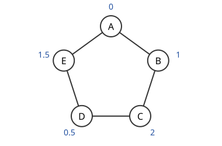

# 원형 채색수

# 개요

**원형 채색수(circular chromatic number)** 는 그래프의 정점에 색 대신 둘레가 $r$ 인 원 위의 점을 주되 이웃한 두 정점의 점이 원을 따라 $1$ 이상 떨어지게 할 때, 가능한 $r$ 의 최솟값이다. 위원회 다섯 개가 고리 모양으로 위원을 하나씩 나눠 가져 이웃한 두 위원회의 회의가 겹치면 안 되고, 회의는 한 시간씩이며 일정이 $r$ 시간마다 되풀이된다고 하자. 시간대를 한 시간 단위의 색으로 나누면 $3$ 시간마다 되풀이해야 하지만, 반 시간 단위로 시작 시각을 주면 $2.5$ 시간마다 되풀이할 수 있다.

원형 채색수는 이 $2.5$ 처럼 정수인 채색수 사이의 값을 재서, 채색수가 같은 그래프들을 유리수로 더 잘게 가른다.

# 직관

아래 그림은 위원회 $A, B, C, D, E$ 를 정점으로, 위원을 나눠 가진 두 위원회를 간선으로 둔 다섯 각형이다. 이웃한 두 위원회의 회의는 겹치면 안 된다. [그래프 색칠](graph-coloring.md)로 한 시간짜리 시간대를 색으로 쓰면, 홀수 순환은 세 색이 들어 시간대 $0$, $1$, $2$ 를 쓰고 일정은 $3$ 시간마다 되풀이된다.

시작 시각을 반 시간 단위로 주면 그림의 수처럼 $A$ 는 $0$, $B$ 는 $1$, $C$ 는 $2$, $D$ 는 $0.5$, $E$ 는 $1.5$ 시에 회의를 시작하고 일정을 $2.5$ 시간마다 되풀이할 수 있다. $C$ 의 회의는 $2$ 시부터 $2.5$ 시까지 하고 다음 주기의 $0$ 시부터 $0.5$ 시까지 이어지며, $D$ 는 $0.5$ 시에 시작하므로 겹치지 않는다. 이웃한 두 위원회의 시작 시각은 $2.5$ 시간짜리 시계를 따라 재면 모두 $1$ 시간 이상 떨어져 있다.

$2.5$ 시간보다 짧게는 되풀이할 수 없다. 서로 이웃하지 않는 위원회는 많아야 둘이므로 어느 순간에도 회의는 둘 이하로 열린다. 한 주기 $r$ 시간 동안 다섯 회의가 한 시간씩, 모두 $5$ 시간 열리므로 $5\le 2r$ 이고 $r\ge 2.5$ 다.

# 정의

## 원형 색칠

실수 $r\ge 2$ 에 대해 $x,y\in\lbrack 0,r)$ 의 원 위 거리를 다음으로 정한다.

$$
\vert x-y\vert_r=\min\left(\vert x-y\vert,\thinspace r-\vert x-y\vert\right)
$$

그래프 $G$ 의 함수 $c:V\to\lbrack 0,r)$ 가 모든 간선 $uv$ 에서 $\vert c(u)-c(v)\vert\_r\ge 1$ 을 만족하면 $c$ 를 **원형 $r$ 색칠(circular r-colouring)** 이라 한다. $G$ 가 원형 $r$ 색칠을 가지는 $r$ 의 하한이 **원형 채색수** $\chi\_c(G)$ 다. 직관 절의 시작 시각은 다섯 각형 $C\_5$ 의 원형 $5/2$ 색칠이다.

## (p, q) 색칠

정수 $p\ge 2q\ge 2$ 에 대해 $c:V\to\lbrace 0,1,\dots,p-1\rbrace$ 가 모든 간선 $uv$ 에서 $q\le\vert c(u)-c(v)\vert\le p-q$ 를 만족하면 $c$ 를 **$(p,q)$ 색칠((p,q)-colouring)** 이라 한다. 원형 $p/q$ 색칠에 $q$ 를 곱하면 원 위 거리가 $q$ 이상인 점 배치가 되고, 각 점을 정수로 내린 것이 $(p,q)$ 색칠이다. 직관 절의 시작 시각에 $2$ 를 곱한 $0, 2, 4, 1, 3$ 이 $C\_5$ 의 $(5,2)$ 색칠이다. $(k,1)$ 색칠은 보통의 $k$ 색칠이다.

## 원형 클릭

정점이 $0,1,\dots,p-1$ 이고 $q\le\vert i-j\vert\le p-q$ 일 때 $i$ 와 $j$ 를 이은 그래프를 **원형 클릭(circular clique)** $K\_{p/q}$ 라 한다. $(p,q)$ 색칠은 $G$ 에서 $K\_{p/q}$ 로 가는 [그래프 준동형](graph-homomorphisms.md)과 같다. $K\_{5/2}$ 는 $C\_5$ 이고 $K\_{k/1}$ 은 완전 그래프 $K\_k$ 다.

# 성질

## 채색수와의 관계

유한 그래프 $G$ 에서 $\chi\_c(G)$ 는 하한이 아니라 최솟값으로 달성되고, 정점 수 이하의 $p$ 를 가진 유리수 $p/q$ 이며, 다음을 만족한다(Vince)[^1].

$$
\chi(G)-1\lt\chi_c(G)\le\chi(G)
$$

오른쪽 부등식은 $k$ 색칠이 $(k,1)$ 색칠이라는 것에서 나온다. 그래서 $\lceil\chi\_c(G)\rceil=\chi(G)$ 이고, 원형 채색수는 채색수의 정보를 모두 가진다.

## 분수 채색수와의 관계

분수 채색수(fractional chromatic number) $\chi\_f$ 에 대해 $\chi\_f(G)\le\chi\_c(G)$ 다.

증명의 요지. $(p,q)$ 색칠 $c$ 에서 $i=0,\dots,p-1$ 마다 색이 $i,i+1,\dots,i+q-1$ (법 $p$) 가운데 하나인 정점들의 집합 $I\_i$ 를 잡는다. 같은 $I\_i$ 의 두 색은 법 $p$ 로 차이가 $q$ 보다 작으므로 $I\_i$ 는 독립집합이다. 각 정점은 $I\_i$ 가운데 정확히 $q$ 개에 들어가므로, 모든 $I\_i$ 에 가중치 $1/q$ 를 주면 가중치 합이 $p/q$ 인 분수 색칠이다. ∎

직관 절의 마지막 문단이 이 부등식의 $C\_5$ 경우다.

## 홀수 순환

$k\ge 1$ 에 대해 $\chi\_c(C\_{2k+1})=2+1/k$ 다.

증명의 요지. 정점 $0,1,\dots,2k$ 를 순서대로 이은 순환에 $c(i)=ik$ (법 $2k+1$) 를 주면, 이웃한 두 색의 차이는 $k$ 또는 $k+1$ 이므로 $(2k+1,k)$ 색칠이다. 독립집합의 크기가 $k$ 이하이므로 직관 절과 같은 셈으로 $\chi\_f(C\_{2k+1})\ge(2k+1)/k$ 이고, 앞 절에서 $\chi\_c\ge\chi\_f$ 다. ∎

## 원형 클릭 사이의 준동형

$K\_{p/q}$ 에서 $K\_{p'/q'}$ 로 가는 준동형이 있는 것은 $p/q\le p'/q'$ 인 것과 동치다(Bondy–Hell)[^2]. 그래서 $G$ 가 $(p,q)$ 색칠을 가지면 $p/q$ 이상인 모든 $p'/q'$ 에 대해 $(p',q')$ 색칠도 가지고, 원형 클릭들은 준동형에 대해 유리수의 순서와 같은 사슬을 이룬다.

## 평면 그래프의 쌍대

다리가 없는 평면 그래프 $G$ 와 그 쌍대 그래프 $G^\ast$ 에서 $\chi\_c(G^\ast)$ 는 $G$ 의 [원형 흐름](circular-flows.md)수 $\phi\_c(G)$ 와 같다. 두 면의 점의 차를 그 사이 간선의 흐름 값으로 주는 대응이 원형 색칠과 원형 흐름을 잇는다.

# 활용

- 주기 일정. 겹치면 안 되는 작업 쌍을 간선으로 둔 그래프에서 작업마다 한 단위 시간이 들고 일정이 주기 $r$ 로 되풀이될 때, 가능한 가장 짧은 주기가 원형 채색수다. 교차로 신호에서 함께 켜질 수 없는 방향들의 초록 신호를 주기로 배치하는 문제가 이 꼴이다.
- 원형 흐름. 평면 그래프의 쌍대성으로 원형 흐름수에 관한 정리와 추측이 원형 채색수에 관한 진술로 옮겨진다.

[^1]: A. Vince, "Star chromatic number", *Journal of Graph Theory* 12 (1988), 551–559.
[^2]: J. A. Bondy, P. Hell, "A note on the star chromatic number", *Journal of Graph Theory* 14 (1990), 479–482.

# 연관 문서

## 선수지식

- [그래프 준동형](graph-homomorphisms.md)

## 더 알아보기

아직 연결한 문서가 없다.

#graph_theory #combinatorics
