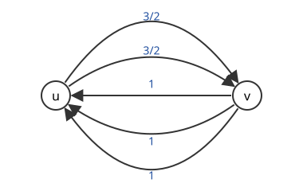

# 원형 흐름

# 개요

**원형 흐름(circular flow)** 은 [nowhere-zero 흐름](nowhere-zero-flows.md)의 값을 정수 대신 실수로 허용하고, 값의 절댓값이 $1$ 이상 $r-1$ 이하가 되게 한 흐름이다. 두 정점 사이에 간선이 다섯 개 있는 그래프에서 간선마다 $0$ 이 아닌 정수를 주어 흐름 보존을 맞추려면 $2$ 를 한 번 써야 한다. 실수를 허용하면 두 간선에 $3/2$, 세 간선에 $1$ 을 주어 가장 큰 값을 $3/2$ 로 낮출 수 있다.

이런 $r$ 의 최솟값이 원형 흐름수이고, 정수 흐름수가 같은 그래프들을 유리수로 더 잘게 가른다. 이 그래프의 원형 흐름수는 $5/2$ 이고 정수 흐름수는 $3$ 이다.

# 직관

아래 그림은 정점 $u$ 와 $v$ 를 간선 다섯 개로 이은 그래프다. 간선마다 방향과 $0$ 이 아닌 값을 주어, $u$ 에서 나가는 값의 합과 들어오는 값의 합을 같게 하려고 한다. 정점이 둘뿐이므로 $v$ 에서도 같은 등식이 따라 나온다.

값이 $\pm 1$ 뿐이면 다섯 값의 합은 홀수라서 $0$ 이 될 수 없다. 정수로는 $2+1-1-1-1=0$ 처럼 $2$ 를 한 번 써야 하고, 값의 절댓값의 최댓값이 $2$ 다.

실수를 허용해 그림처럼 $u\to v$ 두 간선에 $3/2$, $v\to u$ 세 간선에 $1$ 을 주면 양쪽 합이 둘 다 $3$ 이다. 모든 값이 $1$ 이상이라는 조건을 두면 최댓값을 이보다 낮출 수 없다. 두 간선과 세 간선으로 나누면 두 간선 쪽 값의 합이 $3$ 이상이어야 하므로 그 가운데 하나는 $3/2$ 이상이고, 한 간선과 네 간선으로 나누면 한 간선의 값이 $4$ 이상이다.

# 정의

## 원형 흐름

$r\ge 2$ 인 실수 $r$ 에 대해, 그래프 $G$ 의 간선마다 방향과 실수 값 $f(e)$ 를 주어 모든 정점에서 흐름 보존이 성립하고 모든 간선에서 다음이 성립하면 $f$ 를 **원형 nowhere-zero $r$ 흐름(circular nowhere-zero r-flow)** 이라 한다.

$$
1\le\vert f(e)\vert\le r-1
$$

$r=k$ 가 정수이고 $f$ 가 정수 값이면 nowhere-zero $k$ 흐름이다. 직관 절의 흐름은 원형 nowhere-zero $5/2$ 흐름이다.

## 원형 흐름수

$G$ 가 원형 nowhere-zero $r$ 흐름을 가지는 $r$ 의 하한을 **원형 흐름수(circular flow number)** 라 하고 $\phi\_c(G)$ 로 쓴다. 정수 흐름수는 $\phi(G)$ 로 쓴다. 직관 절의 그래프는 $\phi\_c=5/2$, $\phi=3$ 이다.

# 성질

## 정수 흐름수와의 관계

다리가 없는 그래프 $G$ 에서 $\phi\_c(G)$ 는 하한이 아니라 최솟값으로 달성되는 유리수이고, 다음이 성립한다(Goddyn–Tarsi–Zhang)[^1].

$$
\lceil\phi_c(G)\rceil=\phi(G)
$$

증명의 요지. 정수 흐름은 원형 흐름이므로 $\phi\_c\le\phi$ 다. 거꾸로 원형 nowhere-zero $r$ 흐름 $f$ 가 있으면 값이 양수가 되게 방향을 바꾼 뒤 간선마다 하한 $\lfloor f(e)\rfloor$, 상한 $\lceil f(e)\rceil$ 을 준다. $f$ 가 이 범위 안의 실수 순환이므로 [Hoffman 순환 정리](hoffman-circulation-theorem.md)의 정수성에서 같은 범위 안의 정수 순환 $g$ 가 있다. $1\le g(e)\le\lceil r-1\rceil=\lceil r\rceil-1$ 이므로 $g$ 는 nowhere-zero $\lceil r\rceil$ 흐름이다. ∎

그래서 원형 흐름수는 정수 흐름수 $\phi$ 를 $(\phi-1,\phi\rbrack$ 안의 유리수로 세분한다.

## 분수 꼴의 판정

정수 $p\ge 2q\ge 2$ 에 대해 $\phi\_c(G)\le p/q$ 인 것은 $G$ 가 모든 간선에서 $q\le\vert g(e)\vert\le p-q$ 인 정수 흐름 $g$ 를 가지는 것과 동치다.

증명의 요지. 그런 $g$ 가 있으면 $g/q$ 가 원형 nowhere-zero $p/q$ 흐름이다. 거꾸로 원형 nowhere-zero $p/q$ 흐름 $f$ 가 있으면 $qf$ 는 절댓값이 $q$ 이상 $p-q$ 이하인 실수 흐름이고, 앞 절과 같이 Hoffman 순환 정리로 반올림하면 끝값이 정수이므로 같은 범위의 정수 흐름이 나온다. ∎

직관 절에서 $p/q=5/2$ 이고 $2\cdot f$ 는 값 $3, 3, 2, 2, 2$ 의 정수 흐름이다.

## 3 정칙 그래프

모든 정점의 차수가 $3$ 인 그래프는 $\phi\_c\ge 3$ 이다. 값이 양수가 되게 방향을 정하면 한 정점에서 간선이 모두 들어오거나 모두 나갈 수 없으므로, 둘이 들어오고 하나가 나가거나 그 반대다. 그 정점에서 $a+b=c$ 이고 $a,b\ge 1$ 이므로 $c\ge 2$ 이고 $r-1\ge 2$ 다. [Tutte 3 흐름 추측](tutte-3-flow-conjecture.md)의 3 정칙 그래프 판정과 합치면, 3 정칙 그래프의 $\phi\_c$ 가 $3$ 인 것은 이분 그래프인 것과 동치다.

## 모듈러 방향과의 관계

$k\ge 1$ 에 대해 $\phi\_c(G)\le 2+1/k$ 인 것은 $G$ 가 모든 정점에서 $d^+(v)\equiv d^-(v)\pmod{2k+1}$ 인 방향을 가지는 것과 동치다[^2].

증명의 요지. 앞 절의 판정에서 $\phi\_c\le(2k+1)/k$ 는 값이 $k$ 또는 $k+1$ 인 양의 정수 흐름 $g$ 가 있는 것이다. $k+1\equiv -k\pmod{2k+1}$ 이므로, 값이 $k+1$ 인 간선의 방향을 뒤집으면 법 $2k+1$ 로 모든 값이 $k$ 다. $k$ 와 $2k+1$ 은 서로소이므로 흐름 보존 $k(d^+(v)-d^-(v))\equiv 0$ 은 $d^+(v)\equiv d^-(v)$ 와 같다. 거꾸로 가는 방향은 법 $2k+1$ 의 흐름을 같은 나머지의 정수 흐름으로 올리는 Tutte 의 논법을 쓴다. ∎

$k=1$ 이면 $\phi\_c\le 3$ 이 모듈러 3 방향과 같다.

## 평면 그래프의 쌍대

다리가 없는 [평면 그래프](planar-graphs.md) $G$ 에서 $\phi\_c(G)$ 는 쌍대 그래프 $G^\ast$ 의 [원형 채색수](circular-chromatic-number.md) $\chi\_c(G^\ast)$ 와 같다. 직관 절의 그래프는 다섯 각형 $C\_5$ 의 쌍대이고, $\chi\_c(C\_5)=5/2$ 다.

# 활용

- 간선 연결도와 흐름. Lovász, Thomassen, Wu, Zhang 은 $6k$ 간선 연결인 그래프가 모듈러 $(2k+1)$ 방향을 가진다는 것을 증명했다[^2]. 모듈러 방향과의 관계에 따라 이런 그래프는 $\phi\_c\le 2+1/k$ 이고, 간선 연결도가 커지면 원형 흐름수가 $2$ 로 다가간다.
- Jaeger 의 원형 흐름 추측(circular flow conjecture). Jaeger 는 $4k$ 간선 연결이면 $\phi\_c\le 2+1/k$ 라고 추측했다. $k=1$ 이 Tutte 3 흐름 추측이고, $k\ge 3$ 에서는 반례가 나왔다[^3].
- 평면 그래프의 원형 색칠. 쌍대성으로 평면 그래프의 원형 채색수에 관한 정리가 쌍대 그래프의 원형 흐름수에 관한 정리로 옮겨진다.

[^1]: L. A. Goddyn, M. Tarsi, C.-Q. Zhang, "On (k,d)-colorings and fractional nowhere-zero flows", *Journal of Graph Theory* 28 (1998), 155–161.
[^2]: L. M. Lovász, C. Thomassen, Y. Wu, C.-Q. Zhang, "Nowhere-zero 3-flows and modulo k-orientations", *Journal of Combinatorial Theory, Series B* 103 (2013), 587–598.
[^3]: M. Han, J. Li, Y. Wu, C.-Q. Zhang, "Counterexamples to Jaeger's circular flow conjecture", *Journal of Combinatorial Theory, Series B* 131 (2018), 1–11.

# 연관 문서

## 선수지식

- [Tutte 3 흐름 추측](tutte-3-flow-conjecture.md)

## 더 알아보기

아직 연결한 문서가 없다.

#graph_theory #combinatorics
