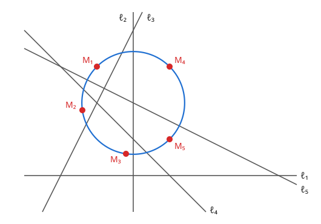

# Clifford 원 정리

# 개요

**Clifford 원 정리(Clifford's circle theorems)** 는 평면에 직선을 하나씩 더해 갈 때마다 한 점에서 만나는 원들과 한 원 위에 놓이는 점들이 번갈아 생긴다는 정리다. 직선 네 개를 그리면 그 가운데 셋씩 만드는 삼각형 네 개의 외접원이 한 점에서 만난다. 직선을 다섯 개 그리고 한 개씩 지워 가며 이런 점을 다섯 개 얻으면, 다섯 점이 한 원 위에 있는지가 물음이 된다. 다섯 점이 언제나 한 원 위에 있다는 것은 직선 넷에서 쓴 원주각 계산을 한 번 더 써서 증명된다.

# 직관

네 직선 $\ell_1: y=0$, $\ell_2: x=0$, $\ell_3: y=2x+4$, $\ell_4: x+y=1$ 을 그린다. 이 가운데 셋을 고르면 삼각형이 하나 생기고, 고르는 방법이 넷이므로 삼각형이 넷이다. 네 삼각형의 외접원은 다음과 같다.

$$
\begin{aligned}
\ell_1\ell_2\ell_3:&\quad x^2+y^2+2x-4y=0\cr
\ell_1\ell_2\ell_4:&\quad x^2+y^2-x-y=0\cr
\ell_1\ell_3\ell_4:&\quad x^2+y^2+x-y-2=0\cr
\ell_2\ell_3\ell_4:&\quad x^2+y^2-x-5y+4=0
\end{aligned}
$$

네 원이 모두 점 $(1,1)$ 을 지난다. [Miquel 정리](miquel-theorem.md)의 완전사변형의 Miquel 점이다.

다섯째 직선 $\ell_5: x+2y=4$ 를 더한다. 다섯 직선에서 $\ell_i$ 하나를 지우면 직선 넷이 남고, 남은 넷에도 Miquel 점이 하나씩 있다. 이 점을 $M_i$ 라 하고 같은 계산을 다섯 번 하면 다음이 나온다.

$$
M_1=(-1,3),\quad M_2=\left(-\tfrac75,\tfrac95\right),\quad M_3=\left(-\tfrac15,\tfrac35\right),\quad M_4=(1,3),\quad M_5=(1,1)
$$

$M_5$ 는 앞에서 구한 $(1,1)$ 이다. 다섯 점을 $x^2+(y-2)^2$ 에 넣으면 차례로 $1+1$, $49/25+1/25$, $1/25+49/25$, $1+1$, $1+1$ 이고 모두 $2$ 다.

그림의 빨간 점 다섯이 중심 $(0,2)$, 반지름 $\sqrt2$ 인 파란 원 위에 있다. 직선 하나를 움직이면 다섯 점이 모두 움직이지만 다섯 점은 계속 한 원 위에 있다.

# 정의

## 일반 위치

평면의 직선 $n$ 개 가운데 어느 두 직선도 평행하지 않고 어느 세 직선도 한 점에서 만나지 않으면, 이 직선들이 **일반 위치(general position)** 에 있다고 한다. 직관 절의 다섯 직선은 일반 위치에 있다. Miquel 정리 문서의 완전사변형은 일반 위치에 있는 직선 네 개다.

## Clifford 점과 Clifford 원

일반 위치에 있는 직선 $n$ 개에 점이나 원 하나를 다음과 같이 차례로 대응시킨다.

- 직선 둘에는 두 직선의 교점을 대응시킨다.
- 직선 셋에는 그 가운데 둘씩 고른 교점 세 개를 지나는 원, 곧 세 직선이 만드는 삼각형의 외접원을 대응시킨다.
- $n$ 이 짝수이면, 직선 하나씩을 지운 $n$ 개의 부분집합에 대응한 원 $n$ 개가 한 점에서 만나고, 그 점을 직선 $n$ 개에 대응시킨다.
- $n$ 이 홀수이면, 직선 하나씩을 지운 $n$ 개의 부분집합에 대응한 점 $n$ 개가 한 원 위에 있고, 그 원을 직선 $n$ 개에 대응시킨다.

짝수 단계의 점을 **Clifford 점(Clifford point)**, 홀수 단계의 원을 **Clifford 원(Clifford circle)** 이라 한다. 직선 넷의 Clifford 점은 완전사변형의 Miquel 점이고, 직관 절의 다섯 직선의 Clifford 원은 $x^2+(y-2)^2=2$ 다. 셋째와 넷째 항목의 "만난다" 와 "있다" 가 언제나 성립한다는 것이 아래의 Clifford 원 정리이고, 이 정리가 있어야 대응이 정의된다.

# 성질

## 직선 다섯 개의 원

일반 위치에 있는 직선 다섯 개에서 한 직선 $\ell_i$ 를 지운 완전사변형의 Miquel 점을 $M_i$ 라 하면, $M_1,\dots,M_5$ 는 한 원 위에 있다.

증명의 요지. 직선 $\ell_a$ 와 $\ell_b$ 의 교점을 $Q_{ab}$ 라 하고, $\ell_i$ 와 $\ell_j$ 를 지운 나머지 세 직선이 만드는 삼각형의 외접원을 $C_{ij}$ 라 한다. $M_i$ 는 $\ell_i$ 를 지운 네 직선의 Miquel 점이므로 $j\ne i$ 인 네 원 $C_{ij}$ 위에 있다. 그래서 $C_{ij}$ 는 $M_i$ 와 $M_j$ 를 지난다.

네 원 $C_{12}$, $C_{23}$, $C_{34}$, $C_{41}$ 을 차례로 본다. $C_{12}$ 는 직선 $\ell_3,\ell_4,\ell_5$ 의 원이고 $C_{23}$ 은 직선 $\ell_1,\ell_4,\ell_5$ 의 원이므로 둘은 $M_2$ 와 $Q_{45}$ 에서 만난다. 같은 이유로 이웃한 두 원은 다음 점에서 만난다.

$$
\begin{aligned}
C_{41}\cap C_{12}&=\lbrace M_1,Q_{35}\rbrace\cr
C_{12}\cap C_{23}&=\lbrace M_2,Q_{45}\rbrace\cr
C_{23}\cap C_{34}&=\lbrace M_3,Q_{15}\rbrace\cr
C_{34}\cap C_{41}&=\lbrace M_4,Q_{25}\rbrace
\end{aligned}
$$

네 점 $Q_{15},Q_{25},Q_{35},Q_{45}$ 는 모두 $\ell_5$ 위에 있다. Miquel 정리 문서의 유향각(directed angle)으로 원주각 정리를 $C_{12}$ 와 $C_{23}$ 에 쓰면 다음이 나온다.

$$
\begin{aligned}
\angle(M_2M_1,M_2M_3)&=\angle(M_2M_1,M_2Q_{45})+\angle(M_2Q_{45},M_2M_3)\cr
&=\angle(Q_{35}M_1,\ell_5)+\angle(\ell_5,Q_{15}M_3)
\end{aligned}
$$

$C_{41}$ 과 $C_{34}$ 에 쓰면 $\angle(M_4M_1,M_4M_3)$ 도 같은 값이 된다. 두 유향각이 같으므로 $M_1,M_2,M_3,M_4$ 는 한 원 위에 있다. 넷째 점으로 $M_4$ 대신 $M_5$ 를 쓰면 $M_1,M_2,M_3,M_5$ 도 한 원 위에 있고, 세 점 $M_1,M_2,M_3$ 을 지나는 원은 하나뿐이므로 다섯 점이 한 원 위에 있다.

## Clifford 사슬

일반 위치에 있는 직선 $n$ 개에 대해 다음이 성립한다. $n$ 이 짝수이면 직선 하나씩을 지운 $n-1$ 개의 직선의 Clifford 원 $n$ 개가 한 점에서 만난다. $n$ 이 홀수이면 직선 하나씩을 지운 $n-1$ 개의 직선의 Clifford 점 $n$ 개가 한 원 위에 있다. 이 정리를 **Clifford 사슬(Clifford's chain)** 이라 한다.

Clifford 사슬은 직선의 수에 대한 귀납법으로 증명된다[^1]. $n=4$ 가 완전사변형의 Miquel 점이고 $n=5$ 가 앞 절이다.

직관 절의 다섯 직선에 여섯째 직선 $\ell_6: y=x+8$ 을 더하면, 직선 하나씩을 지운 다섯 직선의 Clifford 원 $K_1,\dots,K_6$ 은 다음과 같다. $K_i$ 는 $\ell_i$ 를 지운 다섯 직선의 원이다.

$$
\begin{aligned}
K_1:&\quad (x+1)^2+y^2=9\cr
K_2:&\quad x^2+(y-11/3)^2=49/9\cr
K_3:&\quad (x+3/5)^2+(y-14/5)^2=5\cr
K_4:&\quad (x-3/2)^2+(y-5/2)^2=1/2\cr
K_5:&\quad (x-6/5)^2+(y-7/5)^2=1/5\cr
K_6:&\quad x^2+(y-2)^2=2
\end{aligned}
$$

여섯 원이 모두 점 $(7/5,9/5)$ 를 지난다. $K_1$ 에서는 $(12/5)^2+(9/5)^2=9$ 이고 $K_4$ 에서는 $(1/10)^2+(7/10)^2=1/2$ 이다. 이 점이 여섯 직선의 Clifford 점이다.

## 한 점을 지나는 원들의 꼴

[원 반전](circle-inversion.md)은 반전 중심을 지나지 않는 직선을 반전 중심을 지나는 원으로 보내고, 원과 원 사이의 만남과 원 위에 있음을 지킨다. 그래서 Clifford 사슬은 한 점 $O$ 를 지나는 원 $n$ 개에 대해서도 성립한다. 이때 두 원의 교점은 $O$ 가 아닌 교점이고, 일반 위치는 어느 두 원도 $O$ 에서 접하지 않고 어느 세 원도 $O$ 말고 공통점을 갖지 않는다는 조건이다.

## 포물선의 접선

포물선의 세 접선이 만드는 삼각형의 외접원은 포물선의 초점을 지난다. 그래서 한 포물선에 접하는 직선 네 개의 Miquel 점은 초점이다. 한 포물선에 접하는 직선 다섯 개에서는 $M_1,\dots,M_5$ 가 모두 초점과 같아, 다섯 점을 지나는 원이 하나로 정해지지 않는다. 직관 절의 다섯 직선은 한 포물선에 접하지 않으므로 다섯 점이 서로 다르다.

# 활용

- 완전사변형의 Miquel 점. Miquel 정리 문서의 완전사변형의 Miquel 점은 Clifford 사슬의 $n=4$ 단계이고, 그 증명이 Miquel 정리를 두 번 쓰는 논증이다. 직선 다섯 개의 원은 그 다음 단계다.
- 원 위에 있음과 한 점에서 만남의 증명. 기하 문제에 직선 다섯 개와 Miquel 점들이 나오면 네 점이 한 원 위에 있음을 직선 다섯 개의 원으로 보인다.
- 한 점을 지나는 원들의 배치. 공통점을 중심으로 반전하면 원 $n$ 개가 직선 $n$ 개가 되므로, 교점과 원의 계산을 직선의 식으로 한다.

[^1]: W. K. Clifford, "Synthetic proof of Miquel's theorem", Oxford, Cambridge and Dublin Messenger of Mathematics 5 (1871), 124–141.

# 연관 문서

## 선수지식

- [Miquel 정리](miquel-theorem.md)

## 더 알아보기

아직 연결한 문서가 없다.

#algebra #linear_algebra #complex_analysis
