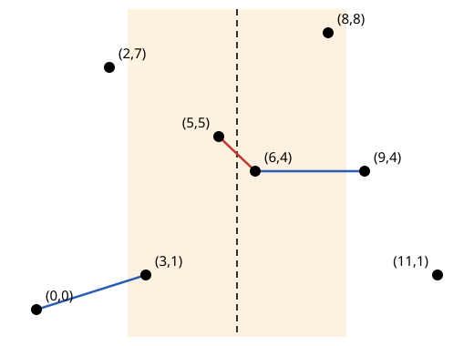

# 가장 가까운 점 쌍

# 개요

**가장 가까운 점 쌍 문제(closest pair of points problem)** 는 평면의 점 $n$ 개 가운데 거리가 가장 짧은 두 점을 찾는 문제다. 관제 화면의 비행기 위치들 가운데 가장 가까이 붙은 두 대를 찾으려면 모든 쌍 $n(n-1)/2$ 개의 거리를 재면 되지만, 비행기가 많아지면 쌍의 수가 제곱으로 늘어난다. 점들을 세로선으로 반씩 나누어 양쪽에서 따로 답을 구하고, 세로선 근처의 좁은 띠만 다시 보면 $O(n\log n)$ 시간에 답이 나온다.

# 직관

점 여덟 개 $(0,0)$, $(2,7)$, $(3,1)$, $(5,5)$, $(6,4)$, $(8,8)$, $(9,4)$, $(11,1)$ 이 있다. $x$ 좌표 순으로 넷씩 나누면 세로선 $x=5.5$ 의 왼쪽에 $(0,0)$, $(2,7)$, $(3,1)$, $(5,5)$, 오른쪽에 나머지 넷이 있다.

왼쪽 넷에서 가장 가까운 쌍은 $(0,0)$ 과 $(3,1)$ 로 거리가 $\sqrt{10}\approx 3.16$ 이다. 오른쪽 넷에서는 $(6,4)$ 와 $(9,4)$ 로 거리가 $3$ 이다. 그래서 지금까지의 답은 $\delta=3$ 이다.

남은 것은 한 점이 왼쪽, 다른 점이 오른쪽에 있는 쌍이다. 그런 쌍의 거리가 $3$ 보다 짧으려면 두 점 모두 세로선에서 $3$ 보다 가까워야 하므로, $2.5\lt x\lt 8.5$ 인 띠 안의 점 $(3,1)$, $(5,5)$, $(6,4)$, $(8,8)$ 만 보면 된다.



띠의 점을 $y$ 좌표 순으로 놓으면 $(3,1)$, $(6,4)$, $(5,5)$, $(8,8)$ 이고, 이웃한 점끼리 재면 $(6,4)$ 와 $(5,5)$ 의 거리가 $\sqrt 2\approx 1.41$ 이다. 이것이 $3$ 보다 짧으므로 답은 세로선을 가로지르는 쌍 $(5,5)$, $(6,4)$ 다. 그림의 파란 선분이 양쪽의 답, 빨간 선분이 띠에서 찾은 답이다.

# 정의

## 문제

평면의 유한 점 집합 $S$, $\lvert S\rvert=n\ge 2$ 에 대해 다음 값을 주는 두 점을 찾는 문제가 가장 가까운 점 쌍 문제다.

$$
\delta(S)=\min\lbrace\lvert p-q\rvert: p,q\in S,\ p\ne q\rbrace
$$

직관 절의 여덟 점에서 $\delta(S)=\sqrt 2$ 이고 두 점은 $(5,5)$ 와 $(6,4)$ 다.

## 분할 정복 알고리즘

**분할 정복 알고리즘** 은 Shamos 와 Hoey 가 1975 년에 제안한 다음 절차다[^1].

1. 점을 $x$ 좌표의 중앙값에서 세로선으로 나누어 왼쪽 $L$ 과 오른쪽 $R$ 을 만든다.
2. $L$ 과 $R$ 에서 재귀로 $\delta\_L$ 과 $\delta\_R$ 을 구하고 $\delta=\min(\delta\_L,\delta\_R)$ 로 둔다.
3. 세로선에서 거리가 $\delta$ 보다 작은 점을 모아 $y$ 좌표 순으로 놓고, 각 점을 뒤의 점 $7$ 개와만 비교해 $\delta$ 보다 짧은 쌍이 있으면 답을 바꾼다.

직관 절의 계산이 이 절차의 맨 위 단계다.

```typescript
type Pt = [number, number];
const dist = (a: Pt, b: Pt): number => Math.hypot(a[0] - b[0], a[1] - b[1]);

// px 는 x 순, 결과는 [가장 짧은 거리, y 순으로 정렬한 점들]
function closest(px: Pt[]): [number, Pt[]] {
  const n = px.length;
  if (n <= 3) {
    let best = Infinity;
    for (let i = 0; i < n; i++)
      for (let j = i + 1; j < n; j++) best = Math.min(best, dist(px[i], px[j]));
    return [best, [...px].sort((a, b) => a[1] - b[1])];
  }
  const mid = n >> 1;
  const xm = px[mid][0];
  const [dl, yl] = closest(px.slice(0, mid));
  const [dr, yr] = closest(px.slice(mid));
  let d = Math.min(dl, dr);
  const py: Pt[] = [];
  for (let i = 0, j = 0; i < yl.length || j < yr.length; ) {
    if (j >= yr.length || (i < yl.length && yl[i][1] <= yr[j][1])) py.push(yl[i++]);
    else py.push(yr[j++]);
  }
  const strip = py.filter((p) => Math.abs(p[0] - xm) < d);
  for (let i = 0; i < strip.length; i++)
    for (let j = i + 1; j < strip.length && j <= i + 7; j++)
      d = Math.min(d, dist(strip[i], strip[j]));
  return [d, py];
}
```

재귀가 $y$ 순으로 정렬한 점들을 함께 돌려주므로, 띠를 $y$ 순으로 놓는 일이 병합 한 번으로 끝난다.

# 성질

## 띠의 비교 횟수

정리. 띠 안에서 $y$ 좌표 순으로 놓은 점 $p$ 와의 거리가 $\delta$ 보다 짧은 점은 $p$ 의 뒤 $7$ 개 안에 있다.

증명의 요지. $p$ 보다 위에 있으면서 거리가 $\delta$ 보다 짧은 점은 세로선을 가운데 둔 가로 $2\delta$, 세로 $\delta$ 의 직사각형 안에 있다. 이 직사각형을 한 변이 $\delta/2$ 인 정사각형 여덟 개로 나누면, 한 정사각형의 두 점은 거리가 $\delta/\sqrt 2\lt\delta$ 여서 같은 쪽의 $\delta$ 정의와 어긋난다. 그래서 정사각형마다 점이 많아야 하나이고 직사각형 안에는 $p$ 를 빼고 많아야 $7$ 개다.

## 시간

정리. 분할 정복 알고리즘은 $O(n\log n)$ 시간에 답을 낸다[^1].

증명의 요지. 처음에 $x$ 순으로 한 번 정렬한다. 각 단계는 두 재귀 호출과, 병합과 띠 검사의 $O(n)$ 일로 이루어진다. 시간은 $T(n)=2T(n/2)+O(n)$ 을 만족하고, [마스터 정리](master-theorem.md)의 둘째 경우로 $T(n)=O(n\log n)$ 이다.

## 하한

점이 모두 한 직선 위에 있을 때 $\delta(S)=0$ 인 것은 같은 수가 두 번 나오는 것과 같다. 그래서 가장 가까운 점 쌍 문제를 풀면 수 $n$ 개가 모두 다른지 판정하는 원소 유일성 문제(element uniqueness problem)가 풀린다. 원소 유일성 문제는 대수적 계산 나무(algebraic computation tree) 모형에서 $\Omega(n\log n)$ 시간이 필요하므로, 같은 모형에서 이 알고리즘의 시간은 최적이다.

## 무작위 알고리즘

바닥 함수를 쓸 수 있는 모형에서는 기대 $O(n)$ 시간 알고리즘이 있다. Rabin 은 점 몇 개를 무작위로 뽑아 거리의 대략적인 크기 $d$ 를 정하고, 평면을 한 변 $d$ 의 칸으로 나눠 [해시 테이블](hash-tables.md)에 넣은 뒤 이웃한 칸끼리만 비교하는 방법을 1976 년에 제안했다[^2]. 하한의 $\Omega(n\log n)$ 은 바닥 함수가 없는 모형의 것이어서 이 결과와 어긋나지 않는다.

## Delaunay 삼각분할과의 관계

가장 가까운 두 점을 잇는 선분은 [Delaunay 삼각분할](delaunay-triangulation.md)의 변이다. 그래서 Delaunay 삼각분할을 구하면 변 $O(n)$ 개의 길이만 재어 답이 나오고, 모든 점에 대해 가장 가까운 점을 찾는 문제도 같은 시간에 풀린다.

# 활용

- 충돌 경보. 항공 관제와 로봇 경로 계획에서 가장 가까운 두 물체의 거리가 기준보다 작은지 매 순간 확인한다.
- 군집 분석. 계층적 군집에서 가장 가까운 두 점을 먼저 합치는 단일 연결 방법의 첫 단계다.
- 다른 기하 문제의 부분 절차. 띠 검사의 "칸마다 점이 몇 개 이하" 라는 논증은 점 집합의 다른 근접 문제에도 쓰인다.

[^1]: M. I. Shamos, D. Hoey, "Closest-point problems", IEEE Symposium on Foundations of Computer Science (FOCS) 1975, 151–162.
[^2]: M. O. Rabin, "Probabilistic algorithms", in J. F. Traub (ed.), Algorithms and Complexity: New Directions and Recent Results, Academic Press, 1976, 21–39.

# 연관 문서

## 선수지식

- [마스터 정리](master-theorem.md)

## 더 알아보기

아직 연결한 문서가 없다.

#algorithms #computation
