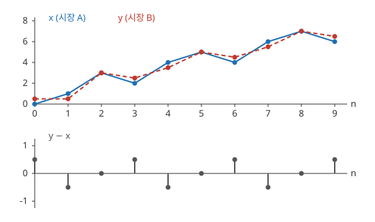

# 공적분

# 개요

**공적분(cointegration)** 은 각각 떠도는 두 시계열이 일정한 비율로 묶여 함께 떠도는 관계다. 같은 금을 파는 두 시장의 값은 날마다 오르내리며 어디로 갈지 모르지만, 두 값의 차이는 0 근처를 벗어나지 않는다. 공적분은 그 차이를 따로 떼어 모형에 넣고, 두 값이 벌어지면 다시 좁혀지는 움직임을 계산한다.

# 직관

시장 A 의 금값 $x\_n$ 은 [무작위 걷기](random-walks.md)이고, 시장 B 의 금값 $y\_n$ 은 $x\_n$ 에 작은 잡음 $u\_n$ 을 더한 것이라 한다.

$$
x\_n=x\_{n-1}+\varepsilon\_n,\qquad y\_n=x\_n+u\_n
$$

열흘 동안의 값은 다음과 같다.

| n | 0 | 1 | 2 | 3 | 4 | 5 | 6 | 7 | 8 | 9 |
| --- | --- | --- | --- | --- | --- | --- | --- | --- | --- | --- |
| $x\_n$ | 0 | 1 | 3 | 2 | 4 | 5 | 4 | 6 | 7 | 6 |
| $u\_n$ | 0.5 | −0.5 | 0 | 0.5 | −0.5 | 0 | 0.5 | −0.5 | 0 | 0.5 |
| $y\_n$ | 0.5 | 0.5 | 3 | 2.5 | 3.5 | 5 | 4.5 | 5.5 | 7 | 6.5 |

아래 그림의 위쪽은 두 값이고, 아래쪽은 차이 $y\_n-x\_n$ 이다. 두 값은 함께 오르내리며 6 근처까지 올라가지만, 차이는 $-0.5$ 와 $0.5$ 사이에 머문다.

[ARIMA 모형](arima-models.md)(autoregressive integrated moving average)은 떠도는 계열을 하루 차이로 바꾸어 다룬다. 두 계열을 따로 차분하면 $x\_n-x\_{n-1}=\varepsilon\_n$ 이고 $y\_n-y\_{n-1}=\varepsilon\_n+u\_n-u\_{n-1}$ 이다. 이 두 식에는 "$y$ 가 $x$ 보다 높으면 내일 내려온다" 는 정보가 없다. 열흘 뒤의 $y$ 를 예측하면 두 계열 모두 예측오차 분산이 날 수에 비례해 커지는데, 실제로는 $y-x$ 의 예측오차 분산이 $u\_n$ 의 분산을 넘지 않는다.

차분으로 잃은 것은 두 값의 수준 사이의 관계다. 그래서 차분한 계열에 어제의 차이 $y\_{n-1}-x\_{n-1}$ 을 설명 변수로 더한다. 직관의 식을 고쳐 쓰면 다음이 나온다.

$$
y\_n-y\_{n-1}=-(y\_{n-1}-x\_{n-1})+\varepsilon\_n+u\_n
$$

어제 $y$ 가 $x$ 보다 $0.5$ 높았으면 오늘 $y$ 의 변화에서 $0.5$ 가 빠진다. 첫날($n=1$)에는 $-0.5+1-0.5=0$ 이고, 실제로 $y$ 는 $0.5$ 에서 $0.5$ 로 그대로다. 두 값을 묶는 비율 $(-1,1)$ 을 공적분 벡터라 하고, 차이를 좁히는 계수 $-1$ 을 조정 계수라 한다.

# 정의

## 적분 차수

시계열 $x\_n$ 이 약정상이 아니고 차분 $x\_n-x\_{n-1}$ 이 약정상이면 $x\_n$ 을 **1 차 적분(integrated of order one)** 이라 하고 $I(1)$ 로 쓴다. 약정상인 계열은 $I(0)$ 이다. 직관 절의 $x\_n$ 과 $y\_n$ 은 둘 다 $I(1)$ 이고, $u\_n$ 은 $I(0)$ 이다.

## 공적분 벡터와 공적분 계수

성분이 모두 $I(1)$ 인 $k$ 차원 벡터 시계열 $z\_n$ 에 대해, 영벡터가 아닌 $\beta\in\mathbb R^k$ 가 있어 $\beta^{\mathsf T}z\_n$ 이 $I(0)$ 이면 $z\_n$ 이 **공적분되었다(cointegrated)** 고 하고, $\beta$ 를 **공적분 벡터(cointegrating vector)** 라 한다.[^1] 일차독립인 공적분 벡터의 최대 개수 $r$ 을 **공적분 계수(cointegrating rank)** 라 하며 $0\le r\lt k$ 다.

직관 절에서 $z\_n=(x\_n,y\_n)^{\mathsf T}$ 이고 $\beta=(-1,1)^{\mathsf T}$ 이면 $\beta^{\mathsf T}z\_n=u\_n$ 이다. 공적분 벡터는 상수배를 빼면 이것 하나라서 $r=1$ 이다.

## 오차 수정 모형

$k$ 차원 계열에 대해 다음 꼴의 모형을 **벡터 오차 수정 모형(vector error correction model, VECM)** 이라 한다.

$$
\Delta z\_n=\alpha\beta^{\mathsf T}z\_{n-1}+\sum\_{i=1}^{p-1}\Gamma\_i\Delta z\_{n-i}+\varepsilon\_n
$$

$\Delta z\_n=z\_n-z\_{n-1}$ 이고, $\beta$ 는 공적분 벡터를 열로 모은 $k\times r$ 행렬, $\alpha$ 는 $k\times r$ 조정 계수 행렬이다. $\beta^{\mathsf T}z\_{n-1}$ 은 어제의 균형에서 벗어난 정도이고, $\alpha$ 가 그 벗어남을 오늘 각 계열의 변화로 옮긴다.

직관 절에서 $p=1$ 이고 $\alpha=(0,-1)^{\mathsf T}$, $\beta=(-1,1)^{\mathsf T}$ 다. $x$ 의 식에는 조정 항이 없고, $y$ 의 식에 $-(y\_{n-1}-x\_{n-1})$ 이 들어간다.

# 성질

## Granger 표현 정리

$z\_n$ 이 다음 [벡터 자기회귀 모형](vector-autoregression.md)(vector autoregression, VAR)을 따르고 성분이 $I(1)$ 이라 한다.

$$
z\_n=\Phi\_1z\_{n-1}+\cdots+\Phi\_pz\_{n-p}+\varepsilon\_n
$$

$\Pi=\Phi\_1+\cdots+\Phi\_p-I$ 로 두면, $z\_n$ 의 공적분 계수가 $r$ 인 것은 $\Pi$ 의 계수가 $r$ 인 것과 동치이고, 이때 $\Pi=\alpha\beta^{\mathsf T}$ 로 쓰여 VAR 모형이 오차 수정 모형으로 다시 쓰인다.[^1] 이것을 **Granger 표현 정리(Granger representation theorem)** 라 한다.

직관 절의 두 식을 합치면 $z\_n=\Phi z\_{n-1}+(\varepsilon\_n,\varepsilon\_n+u\_n)^{\mathsf T}$ 이고 $\Phi$ 와 $\Pi$ 는 다음과 같다.

$$
\Phi=\begin{pmatrix}1&0\cr 1&0\end{pmatrix},\qquad \Pi=\Phi-I=\begin{pmatrix}0&0\cr 1&-1\end{pmatrix}=\begin{pmatrix}0\cr -1\end{pmatrix}\begin{pmatrix}-1&1\end{pmatrix}
$$

$\Pi$ 의 계수는 $1$ 이고, 분해의 두 인수가 정의 절의 $\alpha$ 와 $\beta$ 다.

## 공통 추세의 수

자기회귀 다항식의 근 가운데 $z=1$ 인 것이 $k-r$ 개이고, 나머지 근은 단위원 밖에 있다. $z\_n$ 은 $k-r$ 개의 무작위 걷기와 정상 계열의 일차결합으로 쓰인다.[^2] 직관 절의 $\Phi$ 는 고윳값이 $1$ 과 $0$ 이라 단위근이 하나이고, 두 계열이 무작위 걷기 $x\_n$ 하나를 함께 따른다.

## 허위 회귀

서로 독립인 두 무작위 걷기 $x\_n$, $y\_n$ 으로 $y\_n$ 을 $x\_n$ 에 [선형회귀](linear-regression.md)하면, 기울기의 $t$ 통계량이 $\sqrt n$ 의 속도로 커져 표본이 길수록 관계가 있다는 결론이 더 자주 나온다.[^3] 이것을 **허위 회귀(spurious regression)** 라 한다. 공적분 관계가 없는 $I(1)$ 계열을 수준으로 회귀하면 이 일이 생기므로, 수준 회귀를 해석하기 전에 공적분 여부를 먼저 검정한다.

## 초일치성

$z\_n=(x\_n,y\_n)^{\mathsf T}$ 이 공적분되어 있을 때 $y\_n$ 을 $x\_n$ 에 최소제곱 회귀한 기울기 $\hat b$ 는 참값과의 차이가 $1/n$ 의 속도로 줄어든다.[^4] 정상 계열의 회귀에서 오차가 $1/\sqrt n$ 의 속도로 주는 것보다 빠르다. $x\_n$ 의 분산이 $n$ 에 비례해 커지므로, 기울기가 조금만 틀려도 잔차의 분산이 $n$ 에 비례해 커진다.

## Engle–Granger 방법

**Engle–Granger 방법(Engle–Granger method)** 은 두 단계로 공적분을 검정한다.[^1] 먼저 $y\_n$ 을 $x\_n$ 에 최소제곱 회귀해 잔차 $\hat u\_n=y\_n-\hat a-\hat b x\_n$ 을 얻는다. 다음으로 잔차에 Dickey–Fuller 검정을 해 단위근이 기각되면 공적분이 있다고 본다.

잔차는 추정한 $\hat b$ 로 만들었으므로 ARIMA 모형 문서의 기각값을 그대로 쓸 수 없다. 상수항이 있는 두 변수 회귀에서 5% 기각값은 약 $-3.34$ 로, 단일 계열의 $-2.86$ 보다 왼쪽에 있다.[^5]

## Johansen 검정

계열이 셋 이상이면 공적분 벡터가 여럿일 수 있다. **Johansen 검정(Johansen test)** 은 오차 수정 모형을 Gauss 잡음 아래 [최대가능도 추정](maximum-likelihood.md)으로 맞추며, 이 추정은 $\Delta z\_n$ 과 $z\_{n-1}$ 사이의 정준상관(canonical correlation) 제곱 $\hat\lambda\_1\ge\cdots\ge\hat\lambda\_k$ 로 계산된다.[^6] 공적분 계수가 $r$ 이하라는 가설의 [가능도비 검정](likelihood-ratio-test.md) 통계량은 다음과 같다.

$$
-n\sum\_{i=r+1}^{k}\log(1-\hat\lambda\_i)
$$

이 통계량의 극한분포도 [Brown 운동](brownian-motion.md)의 범함수라서 기각값은 표로 정해진다. $r=0,1,\dots$ 의 순서로 검정해 처음 기각되지 않는 $r$ 을 공적분 계수로 고른다.

# 활용

- 경제 변수의 장기 관계. 소비와 소득, 장기 금리와 단기 금리, 두 나라의 물가와 환율(구매력 평가, purchasing power parity)이 Engle–Granger 와 Johansen 의 첫 예였다.[^1][^6]
- 짝 거래(pairs trading). 공적분된 두 종목의 차이 $\beta^{\mathsf T}z\_n$ 이 평균에서 멀어지면 비싼 쪽을 팔고 싼 쪽을 사서, 차이가 좁혀질 때 이익을 본다.
- 예측. 오차 수정 모형은 각 계열을 따로 차분한 [ARMA 모형](arma-models.md)(autoregressive moving average)과 달리 균형에서 벗어난 정도를 예측에 넣어, 먼 시점의 예측오차 분산이 작다.
- 회귀의 해석. 떠도는 계열끼리의 회귀를 보고하기 전에 잔차의 단위근을 검정해 허위 회귀를 걸러낸다.

[^1]: R. F. Engle, C. W. J. Granger, "Co-integration and error correction: representation, estimation, and testing", *Econometrica* 55 (1987), 251–276.

[^2]: J. H. Stock, M. W. Watson, "Testing for common trends", *Journal of the American Statistical Association* 83 (1988), 1097–1107.

[^3]: C. W. J. Granger, P. Newbold, "Spurious regressions in econometrics", *Journal of Econometrics* 2 (1974), 111–120. 극한 이론은 P. C. B. Phillips, "Understanding spurious regressions in econometrics", *Journal of Econometrics* 33 (1986), 311–340.

[^4]: J. H. Stock, "Asymptotic properties of least squares estimators of cointegrating vectors", *Econometrica* 55 (1987), 1035–1056.

[^5]: J. G. MacKinnon, "Critical values for cointegration tests", in R. F. Engle, C. W. J. Granger (eds.), *Long-Run Economic Relationships*, Oxford University Press (1991), 267–276.

[^6]: S. Johansen, "Statistical analysis of cointegration vectors", *Journal of Economic Dynamics and Control* 12 (1988), 231–254.

# 연관 문서

## 선수지식

- [ARIMA 모형](arima-models.md)
- [벡터 자기회귀 모형](vector-autoregression.md)

## 더 알아보기

- [Johansen 검정](johansen-test.md)

#statistics #probability #linear_algebra
